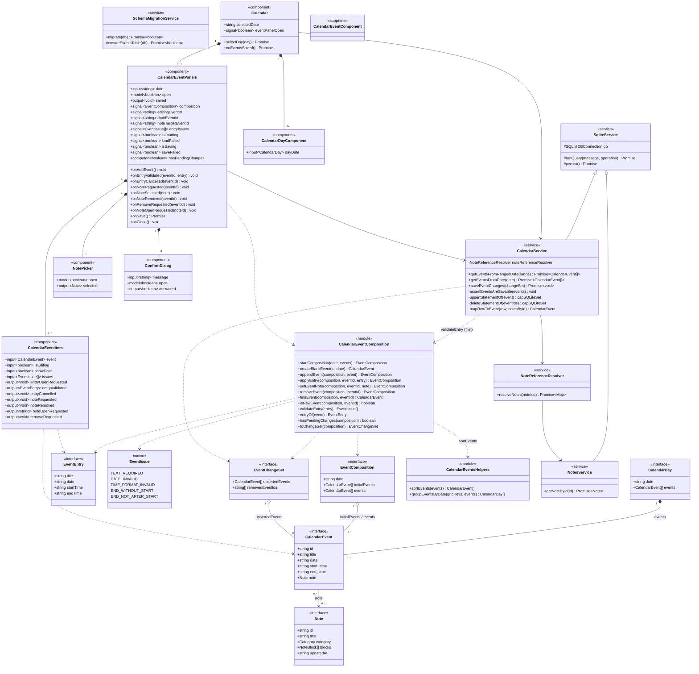

# Approche de développement — Calendrier : gestion des événements d'une date

> **Date :** 2026-11-19 · **Statut :** validé
> **SPEC :** `.agent/CALENDAR/EVENT/FEATURE_CALENDAR_EVENT.md` (US1 → US10, décisions `D-EV1` →
> `D-EV7`)
> **Docs de référence :** `.agent/CALENDAR/CALENDAR_FEATURE/APPROCHE_CALENDRIER.md` (grille, tri,
> chargement), `.agent/KANBAN/EDITION_CARTES/APPROCHE_KANBAN_EDITION_CARTES.md` (référence vers une
> note `D-C3`, `NotePicker`, composition pure `D-C18`, modifications en attente `D-C39`),
> `.agent/KANBAN/EDITION_LISTES/APPROCHE_KANBAN_EDITION_LISTES.md` (`D-L13`, `D-L14`, `D-L23`)
> **Code de référence :** `core/models/{calendar-event,calendar-day,note,kanban-card}.model.ts`,
> `core/services/{calendar-service,calendar-events,calendar-grid,kanban-card-service,kanban-composition,notes-service,sqlite-service,schema-migration.service}.ts`,
> `calendar/`, `calendar-day/`, `calendar-event/`, `kanban-card/`, `kanban-editor/`,
> `core/components/{note-picker,confirm-dialog}/`, seed `public/assets/databases/family_notesSQLite.db`

Ce lot rend le calendrier éditable. Il reprend presque tout du lot des cartes kanban : une référence
vers une note **entière**, le `NotePicker` existant, une **composition pure** tenue par l'écran, un
enregistrement **groupé** et l'avertissement de sortie. Deux choses changent par rapport au kanban.
D'abord, l'enregistrement est **atomique** : la SPEC exige qu'un échec ne laisse pas la base à
moitié écrite (`US9`). Ensuite, la composition ne porte que **les événements d'une date**, pas tout
un écran.

---

## 0. Vérification de l'existant

### 0.1 La base — table `events` du seed

Vérifié le 2026-11-19 en ouvrant le seed avec `sql.js` (cf. mémoire `validate-sql-with-sqljs`) :

| Colonne | Type et contraintes | Constat |
|---|---|---|
| `id` | `TEXT PRIMARY KEY`, `CHECK (length(id) > 0)` | ✅ convient, l'identifiant vient de l'écran (`crypto.randomUUID()`, comme `D-C20`) |
| `title` | `TEXT NOT NULL`, `CHECK (length(trim(title)) > 0)` | ✅ c'est le « texte » de la SPEC ; le `CHECK` est le filet du refus d'un texte vide (`US7`) |
| `date` | `TEXT NOT NULL`, `CHECK (date GLOB '[0-9]{4}-[0-9]{2}-[0-9]{2}')` | ⚠️ ne contrôle que la **forme** : `2026-13-45` passe. La validité réelle de la date reste à l'application |
| `start_time`, `end_time` | `TEXT`, `NULL` ou `GLOB '[0-2][0-9]:[0-5][0-9]'` avec heure `< 24` | ✅ « pas d'heure » est stocké `NULL`, jamais `''` (une chaîne vide violerait le `CHECK`) |
| `chk_end_requires_start` | `NOT (end_time IS NOT NULL AND start_time IS NULL)` | ✅ règle « fin ⇒ début » de `US7` |
| `chk_start_before_end` | `start_time < end_time` quand les deux sont posés | ✅ règle « fin strictement après le début » de `US7` |
| `created_at`, `updated_at` | `TEXT NOT NULL DEFAULT CURRENT_TIMESTAMP` | ✅ non exposés dans le modèle ; `updated_at` sera mis à jour par l'upsert |
| index | `idx_events_date (date)`, `idx_events_date_start (date, start_time, title)` | ✅ servent les deux lectures existantes |
| **`note_id`** | — | ❌ **absente** : aucun lien vers une note n'est possible aujourd'hui |

Quatre lignes de démonstration sont livrées (`evt-1` → `evt-4`, septembre 2026). Elles n'ont pas de
note et restent modifiables (`D-EV7`).

**Deux trous côté schéma :**
- **aucune migration ne crée `events`**. La table n'existe que parce que le seed la contient (constat
  déjà fait dans `ETAT_CALENDRIER.md` §3.1). Le schéma n'est donc écrit nulle part dans le dépôt ;
- **aucune colonne de référence vers une note**.

### 0.2 Le modèle — `CalendarEvent`

```ts
export interface CalendarEvent {
    readonly id: string;
    readonly title: string;
    readonly date: string;          // 'YYYY-MM-DD'
    readonly start_time: string;    // 'HH:mm'
    readonly end_time: string;      // 'HH:mm'
    readonly noteIds: readonly string[];
}
```

- `noteIds` **ne correspond à rien en base** : `mapRowToEvent` lit `row.note_ids ?? row.noteIds ?? []`,
  donc ce champ vaut toujours `[]`. Il contredit aussi `D-EV5` (au plus une note). → **remplacé par
  `note: Note | null`**, à la demande de l'utilisateur, ce qui suit `KanbanCard.note` (`D-C3`).
- `start_time` / `end_time` valent `''` quand la base dit `NULL`. Cette convention est déjà utilisée
  par `sortEvents` et par les specs du lot précédent. Elle est **conservée**, et l'écriture
  retraduit `''` en `NULL` (`D-EV11`).
- Les noms en snake_case détonnent dans un modèle TypeScript, mais ils sont utilisés par tout le lot
  précédent (helpers et quatre specs). Les renommer est **hors de ce lot** et sera noté pour la revue.

### 0.3 Le service — `CalendarService`

Il ne fait que **lire** (`getEventsFromRangedDate`, `getEventsFromDate`) et n'hydrate aucune note.
Il n'a aucune écriture. Il **doit être étendu** (lots B et C).

### 0.4 Les composants

- `calendar-event/` (`CalendarEventComponent`, `app-calendar-event`) est un **squelette vide**
  (`<p>calendar-event works!</p>`) qui n'est utilisé nulle part. → **remplacé** par
  `calendar-event-panels/` (la popup) ; le dossier `calendar-event/` est supprimé.
- `Calendar.selectDay(day)` sélectionne la date et change de mois si la case est adjacente. C'est
  le point d'accroche de l'ouverture de la popup.
- `NotePicker` et `ConfirmDialog` sont réutilisés **sans modification**.

---

## 1. Décisions de cadrage

| # | Sujet | Choix retenu |
|---|-------|--------------|
| D-EV8 | Lien vers une note en base | Colonne **`note_id TEXT REFERENCES notes(id) ON DELETE SET NULL`**, nullable, ajoutée à `events`. Le `SET NULL` porte `US10` : la note part, l'événement reste. Il n'est effectif qu'avec `PRAGMA foreign_keys = ON`, déjà posé hors transaction par `DatabaseService` (`D-L14`). Vérifié sur `sql.js` le 2026-11-19 : `ALTER TABLE … ADD COLUMN` avec `REFERENCES` passe sur le seed, et la suppression de la note vide `note_id`. |
| D-EV9 | Migration | Deux fichiers `.sql` dans `public/assets/migrations/`, jamais de SQL de schéma en TypeScript : **`schema_events.sql`** crée la table complète (seed + `note_id`) quand `events` manque ; **`migration_events_note.sql`** ajoute `note_id` et son index quand la table existe sans cette colonne. Une étape **`ensureEventsTable`** de `SchemaMigrationService` choisit l'un des deux. Elle vient **après** les tables kanban, parce qu'elle référence `notes`. |
| D-EV10 | Modèle | `CalendarEvent { id, title, date, start_time, end_time, note: Note \| null }`. `noteIds` disparaît. La note est **entière**, comme `KanbanCard.note` : la popup affiche son titre et ouvre la note par son `id`. `note` vaut `null` dans trois cas que l'écran ne distingue pas : pas de lien, note supprimée, ou note illisible (journalisée, `D-C15`). |
| D-EV11 | Heures absentes | `''` dans le modèle, `NULL` en base. La lecture convertit `NULL → ''`, comme aujourd'hui, et l'écriture convertit `'' → NULL`. Les deux conversions vivent **dans le service**, nulle part ailleurs. |
| D-EV12 | Hydratation des notes | La logique « résoudre une fois chaque note distincte référencée » de `KanbanCardService` (`resolveNotesOf`, `readNoteOrNothing`) est **extraite** dans un service partagé **`NoteReferenceResolver`**, que `CalendarService` utilise. Faire migrer `KanbanCardService` vers ce service est un **refactoring séparé**, proposé pour la revue. Ce lot ne touche pas au kanban. |
| D-EV13 | Surface d'écriture du service | **Une seule méthode publique** : `saveEventChanges(changeSet)`. Elle porte les trois opérations demandées : création et modification par un **upsert**, suppression par **identifiant**. Il n'y a pas trois méthodes `add/update/delete` publiques : la SPEC veut que la composition entière passe **ou** échoue (`US9`), ce qu'une seule transaction garantit. Les trois opérations existent comme constructeurs privés d'instructions (`upsertStatementOf`, `deleteStatementOf`). |
| D-EV14 | Atomicité | **Transaction** via `SQLiteDBConnection.executeSet(set, true)` du plugin (présent dans `@capacitor-community/sqlite` 8.1.1). C'est la première transaction du dépôt, et elle rompt sciemment avec `D-L13` : ici la SPEC exige le « tout ou rien ». Vérifié sur `sql.js` : un `CHECK` qui échoue au 3ᵉ ordre annule l'insert et la suppression qui précédaient. `persist()` est appelé **une fois**, après la transaction. |
| D-EV15 | Suppressions explicites | Les suppressions sont **dérivées** : ce sont les identifiants **lus à l'ouverture** et absents de la composition. Le kanban, lui, supprime « tout ce qui n'est pas affiché ». Ici, une suppression « par date » serait **dangereuse** : un événement déplacé vers une autre date (`US4`) serait détruit, et une lecture ratée effacerait la journée. Le service ne supprime donc **que** les identifiants qu'on lui nomme. |
| D-EV16 | Upserts ciblés | Seuls les événements **nouveaux** ou **modifiés** par rapport à leur version lue sont écrits. Cela évite de toucher le `updated_at` des autres. L'upsert reste idempotent : `INSERT … ON CONFLICT(id) DO UPDATE SET title, date, start_time, end_time, note_id, updated_at = CURRENT_TIMESTAMP`. Le `date` dans le `SET` porte le **déplacement** (`US4`) : l'identifiant survit, comme `column_id` en `D-C10`. |
| D-EV17 | Composition pure | Module **`core/services/calendar-event-composition.ts`**, sans Angular, sans DOM, sans base, sur le modèle de `kanban-composition.ts` (`D-C18`). Ce sont des fonctions nommées, pas une classe. Chaque geste rend une **nouvelle** composition, ou la composition reçue elle-même quand il ne s'applique pas. Le module porte la **validation** (`validateEntry`), la **détection des changements en attente** et la **construction du changeSet** qu'on passe au service. |
| D-EV18 | Où vit la validation | Dans `validateEntry` du module pur, **une seule fois**. La popup l'appelle quand l'utilisateur valide une saisie (✓). Si la saisie est refusée, l'élément reste en saisie et affiche ses problèmes (`US7`). La composition ne contient donc **que des événements valides**. Le service rappelle la même fonction comme **filet** avant d'ouvrir la transaction, et les `CHECK` de la table sont le dernier rempart. |
| D-EV19 | Une saisie ouverte à la fois | La popup tient **un** `editingEventId`. Ouvrir la saisie d'un autre événement est refusé tant qu'une saisie est ouverte. **« Enregistrer » est désactivé** pendant une saisie ouverte, avec le message « Validez ou abandonnez la saisie en cours ». Une saisie ouverte **compte comme un changement en attente** pour l'avertissement de sortie : la popup ne connaît pas ce que l'élément a tapé. |
| D-EV20 | Nouvel événement | « Ajouter un événement » crée tout de suite un événement **vierge** (texte vide, date de la popup, sans heure ni note), avec un nouvel `id`. Il est ajouté **en bas** de la liste, non trié (`D-EV4`), et s'ouvre en saisie. La popup le retient comme **brouillon** (`draftEventId`). ✗ sur un brouillon qui n'a jamais été validé le **retire** : renoncer ne crée rien (`US3`). Le premier ✓ valide en fait un événement à part entière, trié à sa place. |
| D-EV21 | Qui lit les événements de la popup | **La popup elle-même**, à chaque ouverture, avec `getEventsFromDate(date)`, comme `NotePicker` lit ses notes (`D-C32`). Elle ne réutilise pas `CalendarDay.events` de la grille, pour trois raisons : la lecture est toujours fraîche, les notes y sont hydratées, et un échec de chargement de la grille n'ouvre pas une popup faussement vide. En cas d'échec de lecture, la popup affiche « Impossible de charger les événements de cette date. » et ne propose **que** la fermeture : on ne compose rien sur un état inconnu. |
| D-EV22 | Noms des composants | Popup : **`CalendarEventPanels`**, sélecteur `app-calendar-event-panels`, dossier `calendar-event-panels/`, comme proposé par l'utilisateur. Un événement : **`CalendarEventItem`**, sélecteur `app-calendar-event-item`, dossier `calendar-event-item/`. Le suffixe évite la collision avec le modèle `CalendarEvent` (même raison que `D-L22`). `Item` plutôt que `Panel` évite deux noms à une lettre près. |
| D-EV23 | Répartition des commandes | Comme `D-L23` : **`CalendarEventItem` est présentationnel**. Il n'injecte rien et ne décide rien. Il affiche un événement, tient la saisie de ses champs, et **émet des demandes** : saisie ouverte, saisie validée (`EventEntry`), saisie abandonnée, lier une note, retirer la note, ouvrir la note, supprimer. La popup **`CalendarEventPanels`** porte tout le reste : la composition, la validation, `NotePicker`, les deux `ConfirmDialog`, le routeur et le service. |
| D-EV24 | Commandes de note | Sur chaque événement, en dehors de la saisie : **sans note**, un bouton **« Lier une note »** qui ouvre `NotePicker` ; **avec une note**, un bouton **« Retirer la note »** qui délie sans passer par le picker, et **aucun** bouton pour choisir une autre note. Pour changer, on retire puis on lie (décision de l'utilisateur du 2026-11-19, SPEC `D-EV27`). Le titre de la note est un bouton à part qui **ouvre** la note (`US6`), dans le style d'un lien, comme `D-C37`. La règle vit dans l'**item** : `setEventNote` reste générique et accepte tout remplacement. |
| D-EV25 | Retour vers le calendrier | La popup émet **`saved`** après un enregistrement réussi. `Calendar` y répond par `refreshDays()`, qui relit la grille : l'événement déplacé ou supprimé est à jour **sans recharger la page** (`US9`). |
| D-EV26 | Modale | La popup est un **overlay plein écran** (`position: fixed`, au-dessus de la barre de navigation), comme `ConfirmDialog` et `NotePicker` (`D-EV1`). Un clic sur le fond se comporte comme le bouton de fermeture, avertissement compris. |

---

## 2. Diagramme de classes

> **Légende :** « EXISTANT » = réutilisé sans modification ; « ETENDU » = code existant modifié ou
> complété ; « A CREER » = nouveau code ; « SUPPRIME » = retiré. `?` = optionnel.



**Ce qui existe, ce qui change :**

| Élément | État |
|---|---|
| `Note`, `CalendarDay`, `NotesService`, `SqliteService`, `NotePicker`, `ConfirmDialog`, `CalendarDayComponent`, `calendar-events.ts` | EXISTANT |
| `CalendarEvent` | ETENDU — `noteIds` → `note: Note \| null` |
| `CalendarService` | ETENDU — lectures hydratées + `saveEventChanges` |
| `SchemaMigrationService` | ETENDU — étape `ensureEventsTable` |
| `Calendar` | ETENDU — héberge la popup, l'ouvre depuis `selectDay`, relit la grille sur `saved` |
| `EventEntry`, `EventIssue`, `EventComposition`, `EventChangeSet` | A CREER — `core/models/calendar-event-composition.model.ts` |
| `calendar-event-composition.ts`, `NoteReferenceResolver` | A CREER — `core/services/` |
| `CalendarEventPanels`, `CalendarEventItem` | A CREER — `calendar-event-panels/`, `calendar-event-item/` |
| `schema_events.sql`, `migration_events_note.sql` | A CREER — `public/assets/migrations/` |
| `CalendarEventComponent` (`calendar-event/`) | SUPPRIME |

---

## 3. Approche de développement

### Lot A — Migration : `note_id` sur `events` (US5, US10)

**Au démarrage, quand `SchemaMigrationService.migrate(db)` arrive à l'étape des événements…**
- — je regarde si la table `events` existe (`isTable`) ;
- — **si elle n'existe pas**, je joue `schema_events.sql`. Ce script crée la table avec les
  colonnes du seed **plus `note_id`**, et ses trois index (`date`, `date, start_time, title`,
  `note_id`). Je réponds « créée » ;
- — **si elle existe**, je lis ses colonnes (`tableColumns`) :
  - — si `note_id` en fait partie, il n'y a rien à faire : je réponds « rien » ;
  - — sinon je joue `migration_events_note.sql`, qui contient
    `ALTER TABLE events ADD COLUMN note_id TEXT REFERENCES notes(id) ON DELETE SET NULL` et
    `CREATE INDEX IF NOT EXISTS idx_events_note_id ON events(note_id)`. Je réponds « migrée ».
- — l'étape vient **après** `ensureKanbanCardsTable`, et le résultat de `migrate()` en tient compte.

**Points d'attention.**
- Pas de `;` en fin de ligne de commentaire SQL : le plugin Android découpe sur `;\n` (mémoire
  `no-semicolon-in-sql-comments`).
- `ALTER TABLE … ADD COLUMN` n'accepte un `REFERENCES` que si la valeur par défaut est `NULL` :
  c'est le cas.
- Rejouer la migration est sans effet, puisqu'elle est gardée par la présence de la colonne.
- Après le changement de schéma : `npm run build` puis `npx cap sync`.

### Lot B — Modèle et lectures hydratées (US2, US5, US10)

**Le modèle.** `CalendarEvent.noteIds` devient `note: Note | null`. Les fabriques d'événements des
specs existantes (`calendar.spec.ts`, `calendar-day.spec.ts`, `calendar-events.spec.ts`,
`calendar-service.spec.ts`) passent de `noteIds: []` à `note: null`. Ce sont des retouches de
specs : elles relèvent des skills de test, pas de `dev_par_cas`.

**`NoteReferenceResolver.resolveNotes(noteIds)` — extrait de `KanbanCardService`…**
- — je dédoublonne les identifiants reçus et j'ignore les `null` ;
- — pour chaque identifiant distinct, je demande la note à `NotesService.getNoteById` **une seule
  fois** ;
- — une note introuvable (`null`) ou une lecture qui échoue (journalisée) est **absente** de la
  `Map` rendue. Elle ne fait jamais échouer la lecture des événements (`D-C15`) ;
- — je rends une `Map<string, Note>`.

**Quand le calendrier ou la popup demande des événements (`getEventsFromRangedDate`,
`getEventsFromDate`)…**
- — je lis les lignes avec leurs colonnes **nommées**, `note_id` compris (fini le `SELECT *`) ;
- — je collecte les `note_id` et je les fais résoudre par `NoteReferenceResolver` ;
- — je convertis chaque ligne : `start_time`/`end_time` `NULL → ''` (`D-EV11`), et
  `note = notesById.get(note_id) ?? null` ;
- — une date sans événement rend `[]`, pas une erreur ;
- — un échec SQL est relancé après journalisation (`runQuery`), et l'appelant affiche son état
  d'erreur. Le tri reste le travail de `sortEvents`, appelé par l'appelant, comme aujourd'hui.

### Lot C — Écriture groupée et atomique : `saveEventChanges` (US3, US4, US5, US8, US9)

**Quand la popup demande l'enregistrement d'un `EventChangeSet { upsertedEvents, removedEventIds }`…**
- — **si les deux listes sont vides**, je ne fais rien : pas de transaction, pas de `persist()` ;
- — je contrôle chaque événement à écrire avec `validateEntry(entryOf(event))` du module pur
  (`D-EV18`). Au premier problème, je **jette** une erreur **avant** toute écriture ;
- — je construis la liste des ordres :
  - — pour chaque événement à écrire, `upsertStatementOf(event)` :
    `INSERT INTO events (id, title, date, start_time, end_time, note_id) VALUES (…)`
    `ON CONFLICT(id) DO UPDATE SET title, date, start_time, end_time, note_id, updated_at = CURRENT_TIMESTAMP`.
    Une heure `''` devient `NULL`, et la note s'écrit `event.note?.id ?? null` : l'écriture ne
    touche **jamais** la note elle-même ;
  - — si des identifiants sont à supprimer, **un** `deleteStatementOf(ids)` :
    `DELETE FROM events WHERE id IN (?, …)`. La suppression vise ces identifiants et **eux
    seuls** (`D-EV15`) ;
- — je passe le tout à `db.executeSet(statements, true)`, **une transaction** (`D-EV14`) :
  - — si un ordre échoue (`CHECK`, clé étrangère vers une note disparue entre-temps, erreur du
    plugin), **tout est annulé**. Je relance l'erreur après journalisation (`runQuery`), et la base
    contient l'état précédent, entier ;
  - — sinon je fais **un** `persist()`, puis je rends la main.
- — supprimer un événement ne touche pas la note qu'il référence (`US8`). Aucune cascade ne va
  d'`events` vers `notes`.

### Lot D — Composition pure : `calendar-event-composition.ts` (US3 → US9)

*Pas d'état, pas d'Angular. Chaque fonction rend une **nouvelle** composition, ou celle reçue quand
le geste ne s'applique pas (identifiant inconnu). C'est ce qui permet de tester « rien n'a bougé »
par identité.*

**`startComposition(date, events)`** — à l'ouverture de la popup :
- — je trie les événements avec `sortEvents` (heure croissante, sans heure en bas, puis `id`) ;
- — je rends `{ date, initialEvents: triés, events: triés }`. `initialEvents` est la photographie
  de ce qui a été lu. C'est la référence des changements en attente et des suppressions.

**`createBlankEvent(id, date)`** — un événement vierge : texte vide, la date reçue, heures `''`,
`note: null`. Il est valide comme brouillon, jamais comme saisie validée.

**`appendEvent(composition, event)`** — ajoute l'événement **en bas**, sans trier (`D-EV4`,
`D-EV20`).

**`validateEntry(entry)`** — rend la liste des problèmes, vide si la saisie est valide :
- — `title` vide une fois débarrassé des espaces de début et de fin → `TEXT_REQUIRED` ;
- — `date` absente, hors forme `YYYY-MM-DD`, ou date civile inexistante (`2026-02-30`), → `DATE_INVALID`.
  La vérification est **civile**, sans `Date` UTC : on recompose l'année, le mois et le jour et on
  compare (§4.8 du lot précédent) ;
- — une heure non vide hors `HH:mm` dans `00:00`–`23:59` → `TIME_FORMAT_INVALID` ;
- — `endTime` posée et `startTime` vide → `END_WITHOUT_START` ;
- — les deux heures posées et `endTime <= startTime` (comparaison lexicale, valable sur des
  `HH:mm` complétés par des zéros) → `END_NOT_AFTER_START` ;
- — plusieurs problèmes peuvent sortir ensemble. Ils sont rendus dans l'ordre ci-dessus.

**`applyEntry(composition, eventId, entry)`** — une saisie validée remplace les champs de **cet**
événement :
- — `title` est retenu **sans espaces de début ni de fin**, les espaces intérieurs sont gardés ;
- — `date`, `start_time`, `end_time` sont repris tels quels, et la note n'est **pas** touchée ;
- — la liste est **re-triée** avec `sortEvents` (`US4` : l'événement prend sa place) ;
- — un événement dont la date change **reste** dans `events` jusqu'à l'enregistrement (`D-EV3`).
  C'est la popup qui affiche sa nouvelle date.

**`setEventNote(composition, eventId, note | null)`** — remplace la note de cet événement, ou la
retire avec `null`. Rien d'autre ne bouge.

**`removeEvent(composition, eventId)`** — retire l'événement de `events`. Rien d'autre ne bouge.
S'il venait de `initialEvents`, il devient une suppression **dérivée** (`toChangeSet`).

**`isNewEvent(composition, eventId)`** — vrai si l'identifiant n'est pas dans `initialEvents`.

**`entryOf(event)`** — la saisie qui correspond à un événement (`start_time` → `startTime`…). Elle
sert à pré-remplir un formulaire, et au filet du service.

**`hasPendingChanges(composition)`** — compare la **signature** de `events` à celle de
`initialEvents`. La signature contient `id`, `title`, `date`, `start_time`, `end_time` et l'**`id`
de la note**, jamais son contenu (même parti que `D-C39`). Elle ne dépend **pas de l'ordre** : les
deux listes sont signées après tri par `id`. Un tri différent n'est donc pas un changement.

**`toChangeSet(composition)`** — ce qu'il faut écrire :
- — `upsertedEvents` : les événements de `events` **absents** d'`initialEvents` (nouveaux) ou dont la
  signature **diffère** de leur version initiale (modifiés, déplacés, liés ou déliés) ;
- — `removedEventIds` : les identifiants d'`initialEvents` **absents** de `events` (`D-EV15`).

### Lot E — Le composant événement : `CalendarEventItem` (US2 → US8)

*Présentationnel (`D-EV23`) : il reçoit `event`, `isEditing`, `issues`, et il émet. Il ne trie rien,
ne valide rien, n'ouvre aucune popup. Entrées en `input()` / `input.required()` (mémoire
`prefer-signal-inputs`).*

**Au repos (`isEditing` faux), je montre…**
- — l'**heure** : `HH:mm` si seul le début est posé, `HH:mm – HH:mm` si les deux le sont, rien du
  tout sinon (`US2`) ;
- — le **texte** de l'événement, en entier (pas de troncature, `D-EV6`) ;
- — la **date** quand elle diffère de celle de la popup. C'est le cas d'un événement déplacé pas
  encore enregistré (`D-EV3`). La popup passe cette différence par une entrée `showDate` ;
- — si une note est liée : son **titre**, sous forme de bouton qui émet `noteOpenRequested(note.id)`
  (`US6`), et un bouton **« Retirer la note »** qui émet `noteRemoved` (`D-EV24`) ;
- — **sans** note seulement : un bouton **« Lier une note »** qui émet `noteRequested`. Avec une
  note, aucun bouton ne permet d'en choisir une autre (`D-EV24`) ;
- — une **corbeille** (icône, `aria-label` « Supprimer l'événement « … » ») qui émet
  `removeRequested` (`US8`) ;
- — toucher le **corps** de l'événement émet `entryOpenRequested` (`US4`).

**En saisie (`isEditing` vrai), je montre…**
- — un formulaire pré-rempli depuis l'événement **reçu au moment de l'ouverture** : texte
  (`input type="text"`), date (`input type="date"`), début et fin (`input type="time"`, vides
  autorisés). Les valeurs tapées vivent dans des signaux locaux, comme `typedText` de
  `KanbanCardPanel` ;
- — ✓ émet `entryValidated` avec l'`EventEntry` **telle que tapée**, sans nettoyage : nettoyer
  appartient à la composition (`applyEntry`), en un seul endroit ;
- — ✗ émet `entryCancelled` ;
- — les **problèmes** reçus (`issues`), chacun traduit en message lisible sous le champ concerné,
  avec `role="alert"` (`US7`). Par exemple, `END_WITHOUT_START` donne « Une heure de fin demande
  une heure de début. » ;
- — les commandes de note restent disponibles (`D-EV24`). Ainsi, on peut choisir la note d'un
  nouvel événement **dans le même geste** (`US3`).

**Quand `issues` change alors que je suis en saisie**, je garde les valeurs tapées. Un refus ne
doit pas effacer ce que l'utilisateur a écrit.

### Lot F — La popup : `CalendarEventPanels` (US1 → US9)

*Composant d'état (`D-EV23`) : entrées `date` (`input.required<string>()`) et `open` (`model()`),
sortie `saved`. Il injecte `CalendarService` et `Router`, et héberge `NotePicker` ainsi que deux
`ConfirmDialog` (suppression, abandon).*

**Quand la popup s'ouvre (`open` passe à vrai)…**
- — je remets tout l'état à zéro : pas de saisie ouverte, pas de brouillon, pas de problème, pas
  d'échec ;
- — `isLoading` vrai, puis `getEventsFromDate(date)` :
  - — si la lecture réussit : `composition = startComposition(date, events)`, `isLoading` faux ;
  - — si elle échoue : `loadFailed` vrai, message « Impossible de charger les événements de cette
    date. », et **seule la fermeture** est offerte (`D-EV21`).
- — l'**en-tête** affiche la date en clair (« jeudi 19 novembre 2026 »). La date est formatée à
  partir de ses trois parties civiles, sans conversion UTC (`US1`) ;
- — je montre `composition.events` dans l'ordre de la composition, ou l'**état vide** « Aucun
  événement ce jour. » quand il n'y en a pas ;
- — le bouton **« Ajouter un événement »** est toujours visible, liste vide ou non (`US3`).

**Quand je touche « Ajouter un événement »…**
- — si une saisie est déjà ouverte, je ne fais rien (`D-EV19`) ;
- — sinon `id = crypto.randomUUID()`, puis `appendEvent(composition, createBlankEvent(id, date))`,
  et `editingEventId = draftEventId = id` (`D-EV20`).

**Quand un événement demande l'ouverture de sa saisie (`entryOpenRequested`)…**
- — si une autre saisie est ouverte, je ne fais rien ; sinon `editingEventId = id`.

**Quand une saisie est validée (`entryValidated(entry)`)…**
- — `issues = validateEntry(entry)` ;
- — **si la liste n'est pas vide**, je la mets dans `entryIssues`. La saisie **reste ouverte** et
  la composition ne change pas (`US7`) ;
- — **sinon** `composition = applyEntry(composition, id, entry)`, `entryIssues = []`,
  `editingEventId = null`, et `draftEventId = null` s'il s'agissait du brouillon.

**Quand une saisie est abandonnée (`entryCancelled`)…**
- — si c'est le **brouillon** jamais validé : `removeEvent(composition, id)`. Renoncer ne crée
  rien ;
- — dans tous les cas : `editingEventId = null`, `draftEventId = null`, `entryIssues = []`.
  L'événement garde ses valeurs d'avant.

**Quand un événement demande une note (`noteRequested`)…**
- — je retiens `noteTargetEventId = id` et j'ouvre `NotePicker` ;
- — `selected(note)` → `setEventNote(composition, noteTargetEventId, note)`. « Aucune note » émet
  `null`, et l'événement, qui n'avait pas de note, reste sans note ;
- — l'abandon du picker n'émet rien, donc la référence reste **inchangée** (`US5`).

**Quand un événement demande à retirer sa note (`noteRemoved`)** →
`setEventNote(composition, id, null)`.

**Quand un événement demande sa suppression (`removeRequested`)…**
- — j'ouvre la `ConfirmDialog` « Supprimer l'événement « <texte> » ? ». Le texte d'un brouillon
  vide est remplacé par « Nouvel événement » ;
- — Oui → `removeEvent(composition, id)`. Si c'était l'événement en saisie, ou le brouillon, je
  ferme la saisie ;
- — Non → rien.

**`hasPendingChanges`** (`computed`) = `hasPendingChanges(composition)` **ou** saisie ouverte
(`D-EV19`).

**Quand je touche « Enregistrer »…**
- — désactivé si une saisie est ouverte (message « Validez ou abandonnez la saisie en cours »), si
  `isSaving` est vrai, ou si la lecture a échoué ;
- — **sans** changement en attente : je ferme la popup, rien n'est écrit ;
- — sinon : `isSaving` vrai, `saveFailed` faux, puis
  `calendarService.saveEventChanges(toChangeSet(composition))` :
  - — **succès** : `open = false`, j'émets `saved` (`D-EV25`) ;
  - — **échec** : `saveFailed` vrai, message « L'enregistrement a échoué. Vos modifications sont
    conservées, vous pouvez réessayer. ». La popup reste ouverte, **la composition est intacte**,
    et rien n'est présenté comme enregistré (`US9`) ;
  - — `isSaving` repasse à faux dans les deux cas. Un second appui rejoue le même changeSet, ce qui
    est idempotent (`D-EV16`).

**Quand je touche « Fermer », ou le fond de la popup…**
- — **sans** changement en attente : `open = false`, immédiatement (`US1`) ;
- — **avec** : `ConfirmDialog` « Des modifications ne sont pas enregistrées. Les abandonner ? » ;
  - — Oui → `open = false`. La composition est jetée, et la prochaine ouverture relit la base
    (`US9`) ;
  - — Non → rien. La composition et la saisie ouverte restent intactes.

**Quand un événement demande l'ouverture de sa note (`noteOpenRequested(noteId)`)…**
- — **sans** changement en attente : `router.navigate(['/notes/edit', noteId])` ;
- — **avec** : la même `ConfirmDialog` d'abandon, en retenant la sortie demandée (`pendingExit`).
  Oui → navigation vers la note, Non → rien (`US6`).

### Lot G — Intégration dans `Calendar` (US1, US9)

**Quand je touche une case…**
- — `selectDay(day)` fait ce qu'il fait déjà : `selectedDate = day.date`, et navigation vers le mois
  de la case si elle est adjacente ;
- — **puis** `eventPanelOpen.set(true)`. Le composant `Calendar` est réutilisé par le routeur lors
  du changement de mois, donc la popup reste ouverte sur la date touchée (`US1`).

**Le gabarit** ajoute, hors de la grille,
`<app-calendar-event-panels [date]="selectedDate" [(open)]="eventPanelOpen" (saved)="onEventsSaved()" />`.
La date reste sélectionnée (`.selected`) pendant que la popup est ouverte.

**Quand la popup émet `saved`** → `onEventsSaved()` appelle `refreshDays()`. La grille est relue,
avec la numérotation des chargements déjà en place (`latestGridLoad`) : un événement déplacé quitte
son ancienne case et apparaît dans la nouvelle si elle est visible, et une case vidée redevient
normale (`US4`, `US8`, `US9`).

**Le nettoyage** : le dossier `calendar-event/` (`CalendarEventComponent`, inutilisé) est
supprimé.

---

## 4. Impacts et points d'attention

- **Première transaction du dépôt (`D-EV14`).** `executeSet(set, true)` est documenté pour le web
  (`jeep-sqlite`) et pour Android. Le comportement sur `sql.js` est vérifié, mais **pas sur
  appareil** : le rollback d'un enregistrement raté reste à vérifier sur le téléphone. Le pragma
  `foreign_keys` est posé à l'ouverture de la connexion, hors transaction (`D-L14`). Il reste donc
  actif pendant la transaction : c'est au **pragma** qu'une transaction ne doit pas toucher, pas
  aux contraintes.
- **Specs du lot précédent à retoucher** : quatre fabriques `noteIds: []` → `note: null`, et dans
  `calendar-service.spec.ts` le cas qui affirme `noteIds` égal à `[]` (ligne ~110) devient « `note`
  vaut `null` sans `note_id` ». `CalendarService` dépendra de `NoteReferenceResolver` : ses specs
  devront fournir un double par DI, sinon le vrai `NotesService` ouvre une connexion (mémoire
  `run-frontend-tests`, `TestBed` reconstruits).
- **Tests de service** : asserter les **données relues ou rendues**, jamais le SQL émis (mémoire
  `no-sql-assertions-in-service-tests`). Pour `saveEventChanges`, le double de `db` doit exposer
  `executeSet` ; la vraie atomicité se prouve sur `sql.js`, hors spec.
- **`date` du seed contrôlée par forme seulement** : la validité civile est garantie par
  `validateEntry` (lot D), et le filet du service la rejoue.
- **Navigation vers une note avec la popup ouverte** : `Calendar` est détruit par la navigation, et
  la popup avec lui. Aucun état ne fuit.
- **Retour matériel Android** non intercepté : la composition peut être perdue par ce geste. C'est
  un trou connu, hors périmètre (SPEC).
- **Refactorings proposés pour la revue, hors de ce lot** : faire passer `KanbanCardService` par
  `NoteReferenceResolver` (`D-EV12`) ; renommer `start_time` / `end_time` en camelCase ; retirer le
  `ALTER TABLE notes ADD COLUMN category_id` écrit en TypeScript dans `SchemaMigrationService`
  (contraire à la règle des migrations en `.sql`) ; supprimer `calendar.model.ts`, qui n'est pas
  utilisé.

---

## 5. Découpage suggéré

Dans l'ordre, chaque lot ne dépendant que des précédents :

| Ordre | Lot | Cible | US |
|---|---|---|---|
| 1 | **A** — migration `note_id` | `schema_events.sql`, `migration_events_note.sql`, `SchemaMigrationService.ensureEventsTable` | US5, US10 |
| 2 | **B** — modèle + lectures hydratées | `CalendarEvent.note`, `NoteReferenceResolver`, `CalendarService` (lectures) | US2, US5, US10 |
| 3 | **D** — composition pure | `calendar-event-composition.ts` + modèles associés | US3 → US9 |
| 4 | **C** — écriture atomique | `CalendarService.saveEventChanges` (utilise `validateEntry` de D) | US3, US4, US5, US8, US9 |
| 5 | **E** — composant événement | `CalendarEventItem` | US2 → US8 |
| 6 | **F** — popup | `CalendarEventPanels` | US1 → US9 |
| 7 | **G** — intégration | `Calendar` (ouverture, `saved` → `refreshDays`), suppression de `calendar-event/` | US1, US9 |

`plan_test` peut prendre les lots un par un. D est le plus riche en cas (validation, signature,
changeSet), et F en scénarios (avertissement, échecs, brouillon).

**Hors périmètre de ce lot** : tout ce que la SPEC exclut (multi-jours, récurrence, plusieurs notes,
création de note, rappels, annuler/rétablir, glisser-déposer, retour Android, synchronisation), et
les refactorings listés au §4.
