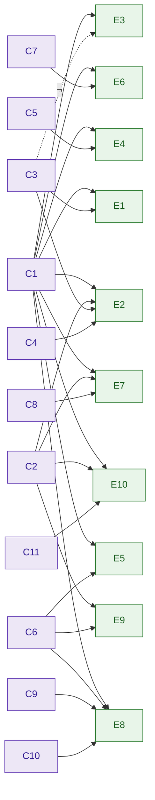
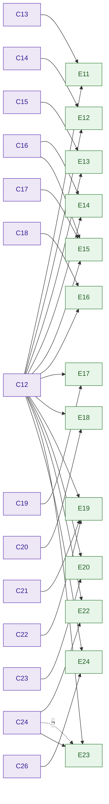
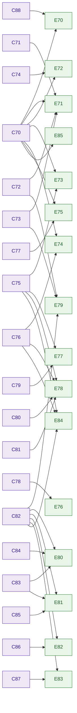

# Plan de test — Calendrier : gestion des événements d'une date

> **Date :** 2026-11-19 · **Statut :** validé
> **Approche :** TDD **boîte noire** : chaque cas décrit un comportement observable (donnée relue,
> élément affiché, émission, navigation, erreur relancée), jamais la façon dont le code l'obtient.
> **SPEC :** `.agent/CALENDAR/EVENT/FEATURE_CALENDAR_EVENT.md` (US1 → US10, `D-EV1` → `D-EV7`,
> `D-EV27`)
> **Approche de dev :** `.agent/CALENDAR/EVENT/APPROCHE_CALENDAR_EVENT.md` (`D-EV8` → `D-EV26`)
> **Précédents suivis :** `.agent/KANBAN/EDITION_CARTES/PLAN_TESTS_KANBAN_CARTES.md` (effets →
> causes → correspondance → cas, table simulée derrière le double de la base),
> `.agent/CALENDAR/CALENDAR_FEATURE/PLAN_TESTS_CALENDRIER.md` (banc du calendrier)

Le plan se lit dans l'ordre où il a été construit avec l'utilisateur, le 2026-11-19 : les **effets**
d'abord (§2), puis les **causes** (§3), puis leur **correspondance** (§4), dont les diagrammes (§5)
et les **cas de test** (§7) sont déduits. Chaque cas renvoie aux effets qu'il prouve, et chaque
effet aux cas qui le prouvent.

---

## 1. Objet testé

Quatre cibles, une spec chacune :

| Cible | Fichier de spec | Nature |
|---|---|---|
| `CalendarService` (lectures hydratées + `saveEventChanges`) | `core/services/calendar-service.spec.ts` — **étendu** | service |
| Fonctions d'aide `calendar-event-composition.ts` | `core/services/calendar-event-composition.spec.ts` — **nouveau** | module pur |
| `CalendarEventItem` — un événement | `calendar-event-item/calendar-event-item.spec.ts` — **nouveau** | composant présentationnel |
| `CalendarEventPanels` — la popup | `calendar-event-panels/calendar-event-panels.spec.ts` — **nouveau** | composant d'état |

**Retouches de non-régression** (même lot, avant le premier cas) : les fabriques d'événements de
`calendar.spec.ts`, `calendar-day.spec.ts`, `calendar-events.spec.ts` et `calendar-service.spec.ts`
passent de `noteIds: []` à `note: null`. Le cas de `calendar-service.spec.ts` qui affirme `noteIds`
égal à `[]` est remplacé par T1.7. Les cas existants `T001…` de `calendar-service.spec.ts` sont
gardés tant qu'ils n'assertent pas le SQL émis (mémoire `no-sql-assertions-in-service-tests`) ; ceux
qui le font sont réécrits sur la table simulée (`D2`).

### Hors périmètre de ce plan

- **Lot A — migration** (`schema_events.sql`, `migration_events_note.sql`,
  `SchemaMigrationService.ensureEventsTable`) : un second plan, avec la vérification sur `sql.js`.
- **Lot G — intégration dans `Calendar`** (toucher une case ouvre la popup, `saved` relit la
  grille) : même second plan.
- **`NoteReferenceResolver` testé seul** : ses comportements sont observés **à travers**
  `CalendarService` (E7, E8), avec le vrai résolveur et un double de `NotesService`.
- **Le vrai rollback d'une transaction** : retiré du plan le 2026-11-19 à la demande de
  l'utilisateur (ancien effet E21, ancienne cause C25, ancien cas T2.15). Le critère d'`US9` « un
  échec n'enregistre pas à moitié » repose sur la transaction de l'approche (`D-EV14`) et sur la
  vérification faite sur `sql.js` pendant l'approche, mais **aucun test automatisé** ne le garde.
  Seuls « l'erreur est relancée » (E22) et « rien n'est persisté » (E23) sont testés.
- **La vérification sur appareil** (transaction Android, popup au-dessus de la barre de navigation,
  clavier) : manuelle.

---

## 2. Effets attendus

> Un **effet** est un résultat **observable** en boîte noire. ⚠️ marque les effets délicats à
> vérifier, ou qui protègent d'un piège relevé dans l'approche.

### 2.1 `CalendarService` — lecture

| # | Effet |
|---|---|
| **E1** | Les événements d'une date sont renvoyés avec leur texte, leur date et leurs heures |
| **E2** | Seuls les événements de la date demandée (ou de l'intervalle) sont renvoyés |
| **E3** | Une date sans événement renvoie une liste **vide** |
| **E4** | Une heure absente en base est renvoyée **vide** (`''`) ⚠️ |
| **E5** | Un événement lié est renvoyé avec sa **note entière** |
| **E6** | Un événement sans lien est renvoyé **sans note** |
| **E7** | Une note visée par plusieurs événements n'est lue **qu'une fois** ⚠️ |
| **E8** | Une note introuvable, ou dont la lecture échoue, laisse l'événement sans note, **sans faire échouer** la lecture ⚠️ |
| **E9** | La lecture sur intervalle (celle de la grille) renvoie elle aussi les notes |
| **E10** | L'erreur de lecture des événements est **relancée** |

### 2.2 `CalendarService` — écriture

| # | Effet |
|---|---|
| **E11** | Un nouvel événement est **créé** et se relit tel qu'il a été demandé |
| **E12** | Un événement modifié se relit avec ses nouvelles valeurs, sous **le même identifiant** |
| **E13** | Un événement déplacé **change de date sans perdre son identifiant** ⚠️ |
| **E14** | Les événements désignés pour la suppression sont **supprimés** |
| **E15** | Les événements **non désignés** ne sont pas touchés, qu'ils soient sur la même date ou ailleurs ⚠️ |
| **E16** | Une heure vide est écrite comme **absente**, et la base l'accepte ⚠️ |
| **E17** | La note est écrite par son **identifiant**. La note elle-même n'est ni modifiée ni supprimée |
| **E18** | Un événement dont on a retiré la note se relit **sans note** |
| **E19** | Un événement invalide est refusé **avant toute écriture** : rien du changeSet n'est écrit ⚠️ |
| **E20** | Un changeSet **vide** n'écrit rien, ne persiste rien, et ne lève pas d'erreur |
| **E22** | L'erreur d'écriture est **relancée** |
| **E23** | La base est persistée **une fois** après un succès, **jamais** après un échec |
| **E24** | Rejouer le même changeSet donne **le même résultat** (idempotence) |

### 2.3 Fonctions d'aide — `calendar-event-composition.ts`

| # | Fonction | Effet |
|---|---|---|
| **E30** | `startComposition` | Les événements sont présentés **triés** : heure croissante, ceux sans heure en bas, puis par identifiant |
| **E31** | `startComposition` | Une composition qui vient d'être ouverte n'a **aucun changement en attente** |
| **E32** | `createBlankEvent` | L'événement vierge porte l'identifiant et la date reçus, avec un texte vide, sans heure ni note |
| **E33** | `appendEvent` | L'événement ajouté est **en bas**, sans être trié |
| **E34** | `validateEntry` | Une saisie complète et cohérente ne présente **aucun problème** |
| **E35** | `validateEntry` | Sans aucune heure, ou avec une heure de début seule, la saisie est **valide** |
| **E36** | `validateEntry` | Un texte vide ou fait seulement d'espaces → `TEXT_REQUIRED` |
| **E37** | `validateEntry` | Une date absente, mal formée ou inexistante → `DATE_INVALID` ; le 29 février d'une année bissextile est valide ⚠️ |
| **E38** | `validateEntry` | Une heure hors format → `TIME_FORMAT_INVALID` |
| **E39** | `validateEntry` | Une heure de fin sans heure de début → `END_WITHOUT_START` |
| **E40** | `validateEntry` | Une fin **égale** au début, ou avant lui → `END_NOT_AFTER_START` ⚠️ |
| **E41** | `validateEntry` | Plusieurs problèmes sortent **ensemble**, dans l'ordre fixé |
| **E42** | `applyEntry` | Seuls les champs de **cet** événement sont remplacés |
| **E43** | `applyEntry` | Le texte est retenu sans les espaces de début et de fin, les espaces intérieurs sont **gardés** |
| **E44** | `applyEntry` | La saisie **ne touche pas** à la note |
| **E45** | `applyEntry` | L'événement modifié prend sa **place triée** |
| **E46** | `applyEntry` | Un événement dont la date change **reste** dans la composition |
| **E47** | `setEventNote` | La note de cet événement est remplacée, ou retirée avec `null`. **Rien d'autre** ne bouge |
| **E48** | `removeEvent` | L'événement disparaît, les autres restent dans le même ordre |
| **E49** | tous les gestes | Un identifiant **inconnu** rend la composition reçue **elle-même** |
| **E50** | tous les gestes | La composition reçue n'est **jamais modifiée** |
| **E51** | `isNewEvent` | Vrai pour un événement ajouté, faux pour un événement lu |
| **E52** | `entryOf` | Restitue la saisie d'un événement, heures vides comprises |
| **E53** | `findEvent` | Rend l'événement cherché, ou `null` |
| **E54** | `hasPendingChanges` | Vrai après un ajout, une modification, un déplacement, un lien, un retrait de lien ou une suppression |
| **E55** | `hasPendingChanges` | Faux quand on **revient** à l'état initial ⚠️ |
| **E56** | `hasPendingChanges` | Un simple **ré-ordonnancement** n'est pas un changement ⚠️ |
| **E57** | `hasPendingChanges` | Une note de même identifiant mais de contenu différent n'est **pas** un changement |
| **E58** | `toChangeSet` | Les événements nouveaux et modifiés sont à écrire, les **inchangés en sont absents** ⚠️ |
| **E59** | `toChangeSet` | Les événements lus puis retirés sont à supprimer ; un brouillon **ajouté puis retiré n'y figure pas** ⚠️ |
| **E60** | `toChangeSet` | Une composition inchangée donne un changeSet **vide** |

### 2.4 `CalendarEventItem` — le composant événement

| # | Effet |
|---|---|
| **E70** | Le **texte** est affiché en entier |
| **E71** | L'heure s'affiche `HH:mm` avec un début seul, `HH:mm – HH:mm` avec les deux, et **rien** sans heure |
| **E72** | La date de l'événement n'est affichée **que** si `showDate` est vrai |
| **E73** | Avec une note : son **titre** est affiché à part du texte, avec « **Retirer la note** ». **Aucun** bouton ne permet de choisir une autre note (`D-EV27`) |
| **E74** | Sans note : ni titre ni « Retirer la note », et un bouton « **Lier une note** » |
| **E75** | Toucher le corps **émet une demande de saisie** |
| **E76** | La corbeille **émet une demande** de suppression, sans rien supprimer |
| **E77** | Le titre de la note émet une **demande d'ouverture** avec l'identifiant de la note, **sans naviguer** ⚠️ |
| **E78** | « Lier une note » émet une demande de choix de note, « Retirer la note » une demande de retrait |
| **E79** | En saisie, le formulaire est **pré-rempli** : texte, date, heures, vide quand une heure est absente |
| **E80** | ✓ émet la saisie **telle que tapée**, sans la nettoyer |
| **E81** | ✗ émet un **abandon** et n'émet pas de saisie validée |
| **E82** | Chaque problème reçu s'affiche en **message lisible**, en alerte |
| **E83** | Recevoir des problèmes **ne vide pas** ce qui a été tapé ⚠️ |
| **E84** | Les commandes de note restent **disponibles en saisie** |
| **E85** | Les boutons ont un libellé accessible qui **nomme l'événement** |

### 2.5 `CalendarEventPanels` — la popup

| # | Effet |
|---|---|
| **E90** | L'en-tête donne la date **en clair**, sans décalage de jour ⚠️ |
| **E91** | Un **indicateur de chargement** est affiché pendant la lecture |
| **E92** | **Tous** les événements de la date sont affichés, dans l'ordre trié |
| **E93** | Une date sans événement affiche un **état vide**, avec le bouton « Ajouter un événement » |
| **E94** | Si la lecture échoue, un message s'affiche et **seule la fermeture** est offerte |
| **E95** | Une réouverture **relit la base** : on voit l'état enregistré, sans trace d'un abandon ⚠️ |
| **E96** | « Ajouter un événement » crée un événement **en bas, en saisie**, à la date de la popup |
| **E97** | « Ajouter un événement » est **sans effet** tant qu'une saisie est ouverte |
| **E98** | ✗ sur un brouillon jamais validé le fait **disparaître** |
| **E99** | Toucher un événement ouvre sa saisie, **sauf** si une autre saisie est ouverte |
| **E100** | Une saisie valide **ferme** la saisie, et l'événement apparaît à sa place triée |
| **E101** | Une saisie invalide **reste ouverte** avec ses problèmes, et la liste ne change pas |
| **E102** | ✗ sur un événement existant lui rend ses **valeurs d'avant** |
| **E103** | Un événement déplacé **reste visible**, avec sa nouvelle date |
| **E104** | « Lier une note » ouvre `NotePicker`, et la note choisie s'affiche sur **cet** événement |
| **E105** | « Retirer la note » enlève le titre ; « Aucune note » laisse sans note un événement qui n'en avait pas |
| **E106** | Abandonner le picker laisse la note **inchangée** |
| **E107** | La corbeille demande une **confirmation** qui nomme l'événement (« Nouvel événement » pour un brouillon vide) |
| **E108** | Confirmer fait disparaître l'événement, refuser ne change rien |
| **E109** | Aucun geste n'écrit en base **avant « Enregistrer »** ⚠️ |
| **E110** | « Enregistrer » est **désactivé** pendant une saisie ouverte, avec un message |
| **E111** | Sans changement, « Enregistrer » **ferme sans écrire** |
| **E112** | Avec des changements, le service reçoit **le bon changeSet**, la popup se ferme et **`saved` est émis** |
| **E113** | Si l'enregistrement échoue : la popup reste ouverte, la composition est intacte, un message s'affiche, `saved` **n'est pas** émis, et on peut réessayer |
| **E114** | Un second appui pendant l'enregistrement est **sans effet** ⚠️ |
| **E115** | Fermer **sans changement** ferme tout de suite, sans confirmation |
| **E116** | Fermer **avec des changements**, ou avec une saisie ouverte, affiche l'**avertissement** |
| **E117** | Confirmer l'avertissement ferme et abandonne ; refuser laisse la popup ouverte, composition intacte |
| **E118** | Un clic sur le **fond** se comporte comme « Fermer » |
| **E119** | Ouvrir la note **sans changement** navigue vers `/notes/edit/:id` |
| **E120** | Ouvrir la note **avec des changements** affiche l'avertissement : confirmer navigue, refuser reste |

---

## 3. Causes

> Une **cause** est une condition d'entrée : un **geste**, un **état de départ**, ou une **réponse
> d'une dépendance**. Les causes se combinent pour produire les effets (§4).

### 3.1 `CalendarService` — lecture

| # | Cause |
|---|---|
| **C1** | On demande les événements **d'une date** |
| **C2** | On demande les événements **d'un intervalle** |
| **C3** | La base contient des événements à cette date, ou dans cet intervalle |
| **C4** | La base contient d'**autres** événements, hors de cette date ou de cet intervalle |
| **C5** | Un événement a une heure **absente** en base (`NULL`) |
| **C6** | Un événement porte une **référence** de note |
| **C7** | Un événement ne porte **aucune** référence |
| **C8** | Plusieurs événements visent la **même** note |
| **C9** | La note visée **n'existe plus** : la source de notes ne renvoie rien |
| **C10** | La source de notes **échoue** |
| **C11** | La base **échoue** à la lecture |

### 3.2 `CalendarService` — écriture

| # | Cause |
|---|---|
| **C12** | On demande d'enregistrer un changeSet |
| **C13** | Il contient un événement **absent** de la base : création |
| **C14** | Il contient un événement de la base avec un **autre texte ou d'autres heures** : modification |
| **C15** | Il contient un événement de la base avec une **autre date** : déplacement |
| **C16** | Il désigne des **identifiants à supprimer** |
| **C17** | La base contient d'autres événements **non désignés**, à la même date et à d'autres dates |
| **C18** | Un événement à écrire a une heure **vide** |
| **C19** | Un événement à écrire porte une **note** |
| **C20** | Un événement lié en base est écrit **sans note** |
| **C21** | Un événement à écrire est **invalide** |
| **C22** | Cet événement invalide n'est **pas le premier** du changeSet, qui désigne aussi des suppressions |
| **C23** | Le changeSet est **vide** |
| **C24** | La base **échoue** pendant l'écriture |
| **C26** | Ce même changeSet a **déjà** été enregistré |

### 3.3 Fonctions d'aide — `calendar-event-composition.ts`

| # | Cause |
|---|---|
| **C30** | On **ouvre** une composition sur des événements lus |
| **C31** | Les événements lus sont **en désordre** : heures non triées, événements sans heure, deux événements à la même heure |
| **C32** | On crée un **événement vierge** avec un identifiant et une date |
| **C33** | On **ajoute** un événement à une composition |
| **C34** | L'événement ajouté a une heure **plus tôt** que ceux déjà présents |
| **C35** | On **valide** une saisie |
| **C36** | Son texte est vide ou fait seulement d'espaces |
| **C37** | Sa date est absente, mal formée ou inexistante (`2026-02-30`, `2027-02-29`) |
| **C38** | Sa date est le **29 février d'une année bissextile** (`2028-02-29`) |
| **C39** | Une de ses heures est **hors format** (`25:00`, `9:00`, `12:60`) |
| **C40** | Elle a une heure de **fin sans début** |
| **C41** | Sa fin est **égale** au début, ou **avant** lui |
| **C42** | Elle n'a **aucune heure**, ou seulement un **début** |
| **C43** | Elle cumule **plusieurs défauts** |
| **C44** | On **applique** une saisie à un événement de la composition |
| **C45** | Le texte saisi a des espaces en **début et fin**, et à l'**intérieur** |
| **C46** | L'événement visé **porte une note** |
| **C47** | La saisie **change l'heure** de début |
| **C48** | La saisie **change la date** |
| **C49** | On **pose** une note sur un événement, ou on la **retire** (`null`) |
| **C50** | On **retire** un événement |
| **C51** | L'événement retiré fait partie des événements **lus** |
| **C52** | L'événement retiré a été **ajouté** depuis l'ouverture |
| **C53** | Le geste vise un identifiant **inconnu** |
| **C54** | On demande si un identifiant est **nouveau** |
| **C55** | On demande la **saisie** d'un événement, qui a des heures vides |
| **C56** | On **cherche** un événement |
| **C57** | On demande s'il y a des **changements en attente** |
| **C58** | La composition a subi un **geste** : ajout, modification, déplacement, lien, retrait de lien ou retrait |
| **C59** | La composition est **revenue** aux valeurs initiales |
| **C60** | La composition ne diffère que par l'**ordre** |
| **C61** | Une note liée a changé de **contenu**, sans changer d'identifiant |
| **C62** | On demande le **changeSet** |
| **C63** | La composition contient des événements **inchangés** à côté des changés |

### 3.4 `CalendarEventItem` — le composant événement

| # | Cause |
|---|---|
| **C70** | L'item reçoit un événement **au repos** |
| **C71** | L'événement a une heure de **début seule** |
| **C72** | L'événement a un **début et une fin** |
| **C73** | L'événement n'a **aucune heure** |
| **C74** | `showDate` est **vrai**, ou **faux** |
| **C75** | L'événement **porte une note** |
| **C76** | L'événement ne porte **aucune note** |
| **C77** | Toucher le **corps** |
| **C78** | Toucher la **corbeille** |
| **C79** | Toucher le **titre de la note** |
| **C80** | Toucher « **Lier une note** » (offert seulement sans note) |
| **C81** | Toucher « **Retirer la note** » |
| **C82** | L'item est **en saisie** |
| **C83** | L'utilisateur **tape** des valeurs, avec des espaces superflus |
| **C84** | Toucher **✓** |
| **C85** | Toucher **✗** |
| **C86** | L'item reçoit des **problèmes** |
| **C87** | Ces problèmes arrivent **après** que des valeurs ont été tapées |
| **C88** | Le texte de l'événement est **long** |

### 3.5 `CalendarEventPanels` — la popup

| # | Cause |
|---|---|
| **C90** | La popup **s'ouvre** sur une date |
| **C91** | La date a des événements en base, **en désordre** |
| **C92** | La date n'a **aucun** événement |
| **C93** | La lecture n'a **pas encore répondu** |
| **C94** | La lecture **échoue** |
| **C95** | La popup est **rouverte** après un abandon |
| **C96** | La date est un **1er janvier** |
| **C97** | Toucher « **Ajouter un événement** » |
| **C98** | Une saisie est **ouverte** |
| **C99** | Cette saisie est celle d'un **brouillon** jamais validé |
| **C100** | Toucher un événement (son corps) |
| **C101** | Valider une saisie **valide** |
| **C102** | Valider une saisie **invalide** |
| **C103** | **Abandonner** la saisie (✗) |
| **C104** | La saisie validée **change l'heure**, ou la **date** |
| **C105** | **Demander une note** pour un événement |
| **C106** | **Choisir** une note dans le picker |
| **C107** | Choisir « **Aucune note** », ou toucher « **Retirer la note** » |
| **C108** | **Abandonner** le picker |
| **C109** | Toucher la **corbeille** |
| **C110** | L'événement à supprimer est un **brouillon vide** |
| **C111** | **Confirmer** la suppression |
| **C112** | **Refuser** la suppression |
| **C113** | Toucher « **Enregistrer** » |
| **C114** | La composition a des **changements** |
| **C115** | L'enregistrement **réussit** |
| **C116** | L'enregistrement **échoue** |
| **C117** | Un enregistrement est **en cours** |
| **C118** | Toucher « **Fermer** » |
| **C119** | Cliquer sur le **fond** |
| **C120** | **Confirmer** l'abandon |
| **C121** | **Refuser** l'abandon |
| **C122** | Toucher le **titre d'une note** |

---

## 4. Correspondance causes → effets

> Table de travail : les diagrammes (§5) en sont **générés**, et les cas (§7) en sont déduits.
> `¬` note une cause **absente**, qui compte autant qu'une cause présente ; `|` note une
> alternative, chaque branche donnant au moins un cas.

### 4.1 `CalendarService` — lecture

| Effet | Causes | Cas |
|---|---|---|
| **E1** | `C1` · `C3` | T1.1 |
| **E2** | (`C1` \| `C2`) · `C3` · `C4` | T1.2, T1.3 |
| **E3** | `C1` · `¬C3` | T1.4 |
| **E4** | `C1` · `C5` | T1.5 |
| **E5** | `C1` · `C6` | T1.6 |
| **E6** | `C1` · `C7` | T1.7 |
| **E7** | (`C1` \| `C2`) · `C8` | T1.8 |
| **E8** | `C1` · `C6` · (`C9` \| `C10`) | T1.9, T1.10 |
| **E9** | `C2` · `C6` | T1.11 |
| **E10** | (`C1` \| `C2`) · `C11` | T1.12, T1.13 |

### 4.2 `CalendarService` — écriture

| Effet | Causes | Cas |
|---|---|---|
| **E11** | `C12` · `C13` | T2.1 |
| **E12** | `C12` · `C14` | T2.2 |
| **E13** | `C12` · `C15` | T2.3 |
| **E14** | `C12` · `C16` | T2.4 |
| **E15** | `C12` · `C16` · `C17` | T2.5 |
| **E16** | `C12` · `C18` | T2.6 |
| **E17** | `C12` · `C19` | T2.7 |
| **E18** | `C12` · `C20` | T2.8 |
| **E19** | `C12` · `C21` · `C22` | T2.9 |
| **E20** | `C12` · `C23` | T2.10 |
| **E22** | `C12` · `C24` | T2.11 |
| **E23** | `C12` · (`¬C24` \| `C24`) | T2.12, T2.13 |
| **E24** | `C12` · `C26` | T2.14 |

### 4.3 Fonctions d'aide — `calendar-event-composition.ts`

| Effet | Causes | Cas |
|---|---|---|
| **E30** | `C30` · `C31` | T3.1 |
| **E31** | `C30` · `C57` | T3.2 |
| **E32** | `C32` | T3.3 |
| **E33** | `C33` · `C34` | T3.4 |
| **E34** | `C35` · `¬C36` · `¬C37` · `¬C39` · `¬C40` · `¬C41` | T4.1 |
| **E35** | `C35` · `C42` | T4.2, T4.3 |
| **E36** | `C35` · `C36` | T4.4, T4.5 |
| **E37** | `C35` · (`C37` \| `C38`) | T4.6, T4.7, T4.8, T4.9, T4.10 |
| **E38** | `C35` · `C39` | T4.11, T4.12, T4.13 |
| **E39** | `C35` · `C40` | T4.14 |
| **E40** | `C35` · `C41` | T4.15, T4.16 |
| **E41** | `C35` · `C43` | T4.17 |
| **E42** | `C44` | T5.1 |
| **E43** | `C44` · `C45` | T5.2 |
| **E44** | `C44` · `C46` | T5.3 |
| **E45** | `C44` · `C47` | T5.4 |
| **E46** | `C44` · `C48` | T5.5 |
| **E47** | `C49` | T5.6, T5.7 |
| **E48** | `C50` | T5.8 |
| **E49** | (`C44` \| `C49` \| `C50`) · `C53` | T5.9, T5.10, T5.11 |
| **E50** | `C33` \| `C44` \| `C49` \| `C50` | T5.12 |
| **E51** | `C54` · (`C33` \| `¬C33`) | T6.1, T6.2 |
| **E52** | `C55` | T6.3 |
| **E53** | `C56` · (`¬C53` \| `C53`) | T6.4, T6.5 |
| **E54** | `C57` · `C58` | T7.1, T7.2, T7.3, T7.4, T7.5, T7.6 |
| **E55** | `C57` · `C59` | T7.7 |
| **E56** | `C57` · `C60` | T7.8 |
| **E57** | `C57` · `C61` | T7.9 |
| **E58** | `C62` · `C58` · `C63` | T7.10 |
| **E59** | `C62` · `C50` · (`C51` \| `C52`) | T7.11, T7.12 |
| **E60** | `C62` · `¬C58` | T7.13 |

### 4.4 `CalendarEventItem` — le composant événement

| Effet | Causes | Cas |
|---|---|---|
| **E70** | `C70` · `C88` | T8.1 |
| **E71** | `C70` · (`C71` \| `C72` \| `C73`) | T8.2, T8.3, T8.4 |
| **E72** | `C70` · `C74` | T8.5, T8.6 |
| **E73** | `C70` · `C75` | T8.7 |
| **E74** | `C70` · `C76` | T8.8 |
| **E75** | `C70` · `C77` | T8.9 |
| **E76** | `C78` | T8.10 |
| **E77** | `C75` · `C79` | T8.11 |
| **E78** | (`C76` · `C80`) \| (`C75` · `C81`) | T8.12, T8.13 |
| **E79** | `C82` · (`C72` \| `C73`) | T9.1, T9.2 |
| **E80** | `C82` · `C83` · `C84` | T9.3 |
| **E81** | `C82` · `C83` · `C85` | T9.4 |
| **E82** | `C82` · `C86` | T9.5 |
| **E83** | `C82` · `C87` | T9.6 |
| **E84** | `C82` · (`C75` \| `C76`) | T9.7, T9.8 |
| **E85** | `C70` | T8.14 |

### 4.5 `CalendarEventPanels` — la popup

| Effet | Causes | Cas |
|---|---|---|
| **E90** | `C90` · (`¬C96` \| `C96`) | T10.1, T10.2 |
| **E91** | `C90` · `C93` | T10.3 |
| **E92** | `C90` · `C91` | T10.4 |
| **E93** | `C90` · `C92` | T10.5 |
| **E94** | `C90` · `C94` | T10.6 |
| **E95** | `C114` · `C118` · `C120` · `C95` | T10.7 |
| **E96** | `C97` · `¬C98` | T11.1 |
| **E97** | `C97` · `C98` | T11.2 |
| **E98** | `C99` · `C103` | T11.3 |
| **E99** | `C100` · (`¬C98` \| `C98`) | T11.4, T11.5 |
| **E100** | `C98` · `C101` · `C104` | T11.6 |
| **E101** | `C98` · `C102` | T11.7 |
| **E102** | `C98` · `¬C99` · `C103` | T11.8 |
| **E103** | `C101` · `C104` | T11.9 |
| **E104** | `C105` · `C106` | T12.1 |
| **E105** | `C107` | T12.2, T12.3 |
| **E106** | `C105` · `C108` | T12.4 |
| **E107** | `C109` · (`¬C110` \| `C110`) | T12.5, T12.6 |
| **E108** | `C109` · (`C111` \| `C112`) | T12.7, T12.8 |
| **E109** | (`C97` \| `C101` \| `C106` \| `C107` \| `C111`) · `¬C113` | T12.9 |
| **E110** | `C113` · `C98` | T13.1 |
| **E111** | `C113` · `¬C114` | T13.2 |
| **E112** | `C113` · `C114` · `C115` | T13.3 |
| **E113** | `C113` · `C114` · `C116` | T13.4, T13.5 |
| **E114** | `C113` · `C117` | T13.6 |
| **E115** | `C118` · `¬C114` · `¬C98` | T14.1 |
| **E116** | `C118` · (`C114` \| `C98`) | T14.2, T14.3 |
| **E117** | `C118` · `C114` · (`C120` \| `C121`) | T14.4, T14.5 |
| **E118** | `C119` | T14.6 |
| **E119** | `C122` · `¬C114` | T14.7 |
| **E120** | `C122` · `C114` · (`C120` \| `C121`) | T14.8, T14.9 |

---

## 5. Diagrammes Cause-Effet

> Générés depuis les tables du §4 : une flèche pleine relie une cause présente à son effet, une
> flèche pointillée marquée `¬` une cause qui doit être **absente**. Les libellés sont aux §2 et §3.

### 5.1 `CalendarService` — lecture

### 5.2 `CalendarService` — écriture

### 5.3 Fonctions d'aide — `calendar-event-composition.ts`

```mermaid
graph LR
    C30 --> E30
    C31 --> E30
    C30 --> E31
    C57 --> E31
    C32 --> E32
    C33 --> E33
    C34 --> E33
    C35 --> E34
    C36 -. ¬ .-> E34
    C37 -. ¬ .-> E34
    C39 -. ¬ .-> E34
    C40 -. ¬ .-> E34
    C41 -. ¬ .-> E34
    C35 --> E35
    C42 --> E35
    C35 --> E36
    C36 --> E36
    C35 --> E37
    C37 --> E37
    C38 --> E37
    C35 --> E38
    C39 --> E38
    C35 --> E39
    C40 --> E39
    C35 --> E40
    C41 --> E40
    C35 --> E41
    C43 --> E41
    C44 --> E42
    C44 --> E43
    C45 --> E43
    C44 --> E44
    C46 --> E44
    C44 --> E45
    C47 --> E45
    C44 --> E46
    C48 --> E46
    C49 --> E47
    C50 --> E48
    C44 --> E49
    C49 --> E49
    C50 --> E49
    C53 --> E49
    C33 --> E50
    C44 --> E50
    C49 --> E50
    C50 --> E50
    C54 --> E51
    C33 --> E51
    C33 -. ¬ .-> E51
    C55 --> E52
    C56 --> E53
    C53 -. ¬ .-> E53
    C53 --> E53
    C57 --> E54
    C58 --> E54
    C57 --> E55
    C59 --> E55
    C57 --> E56
    C60 --> E56
    C57 --> E57
    C61 --> E57
    C62 --> E58
    C58 --> E58
    C63 --> E58
    C62 --> E59
    C50 --> E59
    C51 --> E59
    C52 --> E59
    C62 --> E60
    C58 -. ¬ .-> E60
    classDef cause fill:#ede7f6,stroke:#5e35b1,color:#311b92
    classDef effect fill:#e8f5e9,stroke:#2e7d32,color:#1b5e20
    class C30,C31,C57,C32,C33,C34,C35,C36,C37,C39,C40,C41,C42,C38,C43,C44,C45,C46,C47,C48,C49,C50,C53,C54,C55,C56,C58,C59,C60,C61,C62,C63,C51,C52 cause
    class E30,E31,E32,E33,E34,E35,E36,E37,E38,E39,E40,E41,E42,E43,E44,E45,E46,E47,E48,E49,E50,E51,E52,E53,E54,E55,E56,E57,E58,E59,E60 effect
```

### 5.4 `CalendarEventItem` — le composant événement

### 5.5 `CalendarEventPanels` — la popup

```mermaid
graph LR
    C90 --> E90
    C96 -. ¬ .-> E90
    C96 --> E90
    C90 --> E91
    C93 --> E91
    C90 --> E92
    C91 --> E92
    C90 --> E93
    C92 --> E93
    C90 --> E94
    C94 --> E94
    C114 --> E95
    C118 --> E95
    C120 --> E95
    C95 --> E95
    C97 --> E96
    C98 -. ¬ .-> E96
    C97 --> E97
    C98 --> E97
    C99 --> E98
    C103 --> E98
    C100 --> E99
    C98 -. ¬ .-> E99
    C98 --> E99
    C98 --> E100
    C101 --> E100
    C104 --> E100
    C98 --> E101
    C102 --> E101
    C98 --> E102
    C99 -. ¬ .-> E102
    C103 --> E102
    C101 --> E103
    C104 --> E103
    C105 --> E104
    C106 --> E104
    C107 --> E105
    C105 --> E106
    C108 --> E106
    C109 --> E107
    C110 -. ¬ .-> E107
    C110 --> E107
    C109 --> E108
    C111 --> E108
    C112 --> E108
    C97 --> E109
    C101 --> E109
    C106 --> E109
    C107 --> E109
    C111 --> E109
    C113 -. ¬ .-> E109
    C113 --> E110
    C98 --> E110
    C113 --> E111
    C114 -. ¬ .-> E111
    C113 --> E112
    C114 --> E112
    C115 --> E112
    C113 --> E113
    C114 --> E113
    C116 --> E113
    C113 --> E114
    C117 --> E114
    C118 --> E115
    C114 -. ¬ .-> E115
    C98 -. ¬ .-> E115
    C118 --> E116
    C114 --> E116
    C98 --> E116
    C118 --> E117
    C114 --> E117
    C120 --> E117
    C121 --> E117
    C119 --> E118
    C122 --> E119
    C114 -. ¬ .-> E119
    C122 --> E120
    C114 --> E120
    C120 --> E120
    C121 --> E120
    classDef cause fill:#ede7f6,stroke:#5e35b1,color:#311b92
    classDef effect fill:#e8f5e9,stroke:#2e7d32,color:#1b5e20
    class C90,C96,C93,C91,C92,C94,C114,C118,C120,C95,C97,C98,C99,C103,C100,C101,C104,C102,C105,C106,C107,C108,C109,C110,C111,C112,C113,C115,C116,C117,C121,C119,C122 cause
    class E90,E91,E92,E93,E94,E95,E96,E97,E98,E99,E100,E101,E102,E103,E104,E105,E106,E107,E108,E109,E110,E111,E112,E113,E114,E115,E116,E117,E118,E119,E120 effect
```

---

## 6. Décisions de conception à figer

| # | Décision | Impact sur les assertions |
|---|---|---|
| **D1** | **Banc du service** : `CalendarService` est construit avec un double de `DatabaseService` (`connect`, `persist`) et un double de `NotesService` (`getNoteById`), et le **vrai** `NoteReferenceResolver`. Chaque `TestBed` reconstruit redonne **toutes** les doublures (mémoire `run-frontend-tests`). | E7 se lit au nombre d'appels de `getNoteById`. E23 se lit au nombre d'appels de `persist`. *(à confirmer)* |
| **D2** | **Table simulée** : la connexion doublée tient une table `events` en mémoire, comme `kanban-card-service.spec.ts`. `query` filtre par date ou par intervalle. `executeSet` applique l'ensemble des ordres **tout ou rien**, en appliquant les règles de la vraie table (texte non vide, heure `NULL` ou `HH:mm`, fin ⇒ début, début < fin) : un ordre refusé rejette l'appel sans rien appliquer. Les cas assertent les **lignes relues**, jamais le SQL. | E11 → E19, E24 sont observés en relisant la table. E16 échoue si une heure vide est écrite `''`, parce que la table simulée la refuse. *(à confirmer)* |
| **D3** | *Retirée le 2026-11-19, avec le cas T2.15 qu'elle encadrait (vérification du rollback sur `sql.js`).* | — |
| **D4** | **Erreur de refus** : un changeSet invalide fait **rejeter** `saveEventChanges` (promesse rejetée), avant tout `executeSet`. | T2.9 attend un rejet, puis une table inchangée. *(à confirmer)* |
| **D5** | **Données de référence** : date de la popup `2026-11-19`. Événements : `evt-matin` « Réunion parents-profs » 09:00–10:30, `evt-midi` « Déjeuner » 12:30, `evt-journee` « Congé » sans heure, `evt-autre-jour` le `2026-11-20`. Notes : `note-questions` « Questions à poser », `note-courses` « Courses ». | Toutes les specs partagent ces jeux, pour que les cas se lisent sans remonter aux fabriques. *(à confirmer)* |
| **D6** | **Messages des problèmes** (`CalendarEventItem`) : `TEXT_REQUIRED` « Le texte de l'événement est obligatoire. » ; `DATE_INVALID` « La date n'est pas valide. » ; `TIME_FORMAT_INVALID` « L'heure doit être au format HH:mm. » ; `END_WITHOUT_START` « Une heure de fin demande une heure de début. » ; `END_NOT_AFTER_START` « L'heure de fin doit être après l'heure de début. » | T9.5 compare ces textes exacts. *(à confirmer)* |
| **D7** | **Affichage de l'heure** : `09:00` pour un début seul, `09:00 – 10:30` (tiret demi-cadratin entouré d'espaces) pour une plage. **Affichage de la date** quand `showDate` est vrai : `20/11/2026`. | T8.2, T8.3, T8.5, T11.9 comparent ces textes exacts. *(à confirmer)* |
| **D8** | **En-tête de la popup** : `DatePipe` au format `EEEE d MMMM y`, locale `fr-FR` (déjà enregistrée par `app.config.ts` et par le banc du calendrier) : « jeudi 19 novembre 2026 », « vendredi 1 janvier 2027 ». La date est passée comme chaîne `YYYY-MM-DD`, que `DatePipe` lit en heure **locale** : aucun décalage. | T10.1, T10.2. Le test ne force pas de fuseau : un décalage n'apparaîtrait que dans un fuseau négatif, d'où le ⚠️ sur E90. *(à confirmer)* |
| **D9** | **Saisie ouverte = changement en attente** (`D-EV19`) : ouvrir une saisie, même sans rien taper, suffit à déclencher l'avertissement de fermeture et désactive « Enregistrer ». | T14.3 attend l'avertissement. **Point laissé ouvert avec l'utilisateur.** *(à confirmer)* |
| **D10** | **Banc de la popup** : double de `CalendarService` (`getEventsFromDate`, `saveEventChanges`) dont les promesses se **contrôlent** depuis le cas (résolues, rejetées, ou laissées en attente). Double du `Router` (`navigate`). Double de `NotesService` (`getAllNotes`) pour le vrai `NotePicker`. Les vrais `CalendarEventItem` et `ConfirmDialog` sont montés. La popup est hébergée par un composant de test qui lie `[date]` et `[(open)]` et écoute `(saved)`. | E91 et E114 demandent une lecture ou un enregistrement **en attente**. E109 se lit à l'absence d'appel de `saveEventChanges`, le seul endroit où un cas de composant observe un appel au service. *(à confirmer)* |
| **D11** | **Ouvrir la popup** dans un cas : le composant hôte passe `open` à `true`, puis on laisse la lecture répondre (`whenStable`, `detectChanges`, comme le helper `settle()` du calendrier). L'application est zoneless : on ne truque pas les timers. | Tous les cas des groupes 10 à 14. *(à confirmer)* |
| **D12** | **Banc de l'item** : un composant hôte qui lie `event`, `isEditing`, `showDate`, `issues` et enregistre chaque émission. L'item n'injecte rien : aucun double. | E77 est prouvé par l'émission seule. Aucun `Router` n'est fourni, donc une navigation ferait échouer le cas. *(à confirmer)* |
| **D13** | **Brouillon** : la popup crée l'identifiant avec `crypto.randomUUID()`, non truqué. Les cas retrouvent le brouillon par sa **position** (dernier item) et son état (en saisie). Le changeSet de T13.3 est comparé avec `expect.any(String)` sur cet identifiant. | T11.1, T11.3, T13.3. *(à confirmer)* |

---

## 7. Cas de test

> Un cas = un comportement observable. Chaque cas cite ses effets (`E#`) et les user stories qu'il
> sert (`US#`). « Table » désigne la table simulée de `D2`.

### Groupe 1 — `CalendarService` : lecture

| Cas | Étant donné | Quand | Alors | Effets | US |
|---|---|---|---|---|---|
| **T1.1** | La table contient `evt-matin` et `evt-midi` au 2026-11-19 | On lit les événements du 2026-11-19 | Les deux sont rendus avec leur texte, leur date et leurs heures | E1 | US2 |
| **T1.2** | La table contient aussi `evt-autre-jour` au 2026-11-20 | On lit le 2026-11-19 | `evt-autre-jour` n'est pas rendu | E2 | US2 |
| **T1.3** | La table contient des événements au 2026-10-31, 2026-11-19 et 2026-12-31 | On lit l'intervalle 2026-11-01 → 2026-11-30 | Seul celui du 2026-11-19 est rendu | E2 | US2 |
| **T1.4** | La table ne contient rien au 2026-11-19 | On lit le 2026-11-19 | Une liste vide est rendue, sans erreur | E3 | US1 |
| **T1.5** | `evt-journee` a début et fin `NULL`, `evt-midi` a une fin `NULL` | On lit le 2026-11-19 | Leurs heures absentes valent `''` | E4 | US2 |
| **T1.6** | `evt-matin` référence `note-questions` | On lit le 2026-11-19 | `evt-matin` porte la note entière, titre « Questions à poser » compris | E5 | US5 |
| **T1.7** | `evt-midi` ne référence aucune note | On lit le 2026-11-19 | `evt-midi` a `note: null`, et aucune note n'a été demandée | E6 | US5 |
| **T1.8** | `evt-matin` et `evt-midi` référencent tous deux `note-questions` | On lit le 2026-11-19 | Les deux portent la note, et `getNoteById` n'a été appelé qu'une fois | E7 | US5 |
| **T1.9** | `evt-matin` référence une note que la source ne connaît plus | On lit le 2026-11-19 | La lecture aboutit, `evt-matin` a `note: null` | E8 | US10 |
| **T1.10** | La lecture de `note-questions` échoue | On lit le 2026-11-19 | La lecture aboutit, `evt-matin` a `note: null` | E8 | US5 |
| **T1.11** | `evt-matin` référence `note-questions` | On lit l'intervalle de novembre 2026 | `evt-matin` porte la note entière | E9 | US5 |
| **T1.12** | La base échoue à la lecture | On lit le 2026-11-19 | La promesse est rejetée avec l'erreur de la base | E10 | US1 |
| **T1.13** | La base échoue à la lecture | On lit l'intervalle de novembre 2026 | La promesse est rejetée avec l'erreur de la base | E10 | US1 |

### Groupe 2 — `CalendarService` : écriture

| Cas | Étant donné | Quand | Alors | Effets | US |
|---|---|---|---|---|---|
| **T2.1** | La table contient `evt-matin` | On enregistre un changeSet qui crée `evt-nouveau` « Piscine » 18:00 au 2026-11-19 | La relecture du 2026-11-19 rend `evt-nouveau` tel qu'il a été demandé, et `evt-matin` | E11 | US3, US9 |
| **T2.2** | La table contient `evt-matin` | On enregistre `evt-matin` avec le texte « Réunion décalée » et 14:00–15:00 | La relecture rend `evt-matin`, même identifiant, avec ces valeurs | E12 | US4, US9 |
| **T2.3** | La table contient `evt-matin` au 2026-11-19 | On enregistre `evt-matin` daté du 2026-11-21 | Il est relu au 2026-11-21 sous le même identifiant, et n'est plus au 2026-11-19 | E13 | US4 |
| **T2.4** | La table contient `evt-matin` et `evt-midi` | On enregistre un changeSet qui désigne `evt-midi` à supprimer | `evt-midi` n'est plus relu | E14 | US8 |
| **T2.5** | La table contient `evt-matin`, `evt-midi`, `evt-journee` et `evt-autre-jour` | On supprime `evt-midi` seul | `evt-matin`, `evt-journee` et `evt-autre-jour` sont relus inchangés | E15 | US8 |
| **T2.6** | — | On crée un événement sans aucune heure | L'enregistrement aboutit, et l'événement est relu avec des heures `''` | E16 | US3 |
| **T2.7** | Les notes `note-questions` et `note-courses` existent | On enregistre `evt-matin` lié à `note-questions` | `evt-matin` est relu avec cette note, et les deux notes sont inchangées | E17 | US5 |
| **T2.8** | `evt-matin` est lié à `note-questions` en base | On enregistre `evt-matin` avec `note: null` | `evt-matin` est relu sans note, et `note-questions` existe toujours | E18 | US5 |
| **T2.9** | La table contient `evt-matin` et `evt-midi` | On enregistre un changeSet : un événement valide, puis un événement au texte vide, et la suppression de `evt-midi` | La promesse est rejetée, la table est **inchangée** (`evt-midi` toujours là, aucun ajout), et rien n'est persisté | E19 | US7, US9 |
| **T2.10** | La table contient `evt-matin` | On enregistre un changeSet vide | La promesse aboutit, la table est inchangée, et `persist` n'est pas appelé | E20 | US9 |
| **T2.11** | La base échoue à l'écriture | On enregistre un changeSet qui crée un événement | La promesse est rejetée avec l'erreur de la base | E22 | US9 |
| **T2.12** | — | On enregistre un changeSet qui crée deux événements et en supprime un | `persist` est appelé exactement une fois | E23 | US9 |
| **T2.13** | La base échoue à l'écriture | On enregistre un changeSet qui crée un événement | `persist` n'est pas appelé | E23 | US9 |
| **T2.14** | Un changeSet (une création, une modification, une suppression) vient d'être enregistré | On enregistre le même changeSet une seconde fois | La relecture est identique à celle d'après le premier enregistrement | E24 | US9 |

### Groupe 3 — Composition : ouverture, événement vierge, ajout

| Cas | Étant donné | Quand | Alors | Effets | US |
|---|---|---|---|---|---|
| **T3.1** | Des événements lus dans l'ordre : sans heure, 12:30, 09:00 (`id` b), 09:00 (`id` a) | `startComposition('2026-11-19', …)` | `events` vaut : 09:00 (a), 09:00 (b), 12:30, sans heure | E30 | US2 |
| **T3.2** | Une composition vient d'être ouverte | `hasPendingChanges` | `false` | E31 | US9 |
| **T3.3** | — | `createBlankEvent('evt-x', '2026-11-19')` | `{ id: 'evt-x', title: '', date: '2026-11-19', start_time: '', end_time: '', note: null }` | E32 | US3 |
| **T3.4** | Une composition avec 09:00 et 12:30 | `appendEvent` d'un événement à 07:00 | Il est le **dernier** de `events` | E33 | US3 |

### Groupe 4 — Composition : `validateEntry`

| Cas | Saisie | Alors | Effets | US |
|---|---|---|---|---|
| **T4.1** | « Réunion », 2026-11-19, 09:00 → 10:30 | `[]` | E34 | US7 |
| **T4.2** | « Congé », 2026-11-19, sans heure | `[]` | E35 | US7 |
| **T4.3** | « Déjeuner », 2026-11-19, début 12:30, fin vide | `[]` | E35 | US7 |
| **T4.4** | texte `''` | `['TEXT_REQUIRED']` | E36 | US7 |
| **T4.5** | texte `'   '` | `['TEXT_REQUIRED']` | E36 | US7 |
| **T4.6** | date `''` | `['DATE_INVALID']` | E37 | US7 |
| **T4.7** | date `'19/11/2026'` | `['DATE_INVALID']` | E37 | US7 |
| **T4.8** | date `'2026-02-30'` | `['DATE_INVALID']` | E37 | US7 |
| **T4.9** | date `'2027-02-29'` | `['DATE_INVALID']` | E37 | US7 |
| **T4.10** | date `'2028-02-29'` | `[]` | E37 | US7 |
| **T4.11** | début `'25:00'` | `['TIME_FORMAT_INVALID']` | E38 | US7 |
| **T4.12** | début `'9:00'` | `['TIME_FORMAT_INVALID']` | E38 | US7 |
| **T4.13** | fin `'12:60'`, début 09:00 | `['TIME_FORMAT_INVALID']` | E38 | US7 |
| **T4.14** | début vide, fin 10:00 | `['END_WITHOUT_START']` | E39 | US7 |
| **T4.15** | début 10:00, fin 10:00 | `['END_NOT_AFTER_START']` | E40 | US7 |
| **T4.16** | début 10:00, fin 09:30 | `['END_NOT_AFTER_START']` | E40 | US7 |
| **T4.17** | texte `' '`, date `'2026-02-30'`, début vide, fin 10:00 | `['TEXT_REQUIRED', 'DATE_INVALID', 'END_WITHOUT_START']` | E41 | US7 |

### Groupe 5 — Composition : gestes

| Cas | Étant donné | Quand | Alors | Effets | US |
|---|---|---|---|---|---|
| **T5.1** | Une composition avec `evt-matin` et `evt-midi` | `applyEntry` sur `evt-midi` (« Déjeuner client », 2026-11-19, 12:30 → 13:30) | `evt-midi` porte ces valeurs, `evt-matin` est identique à avant | E42 | US4 |
| **T5.2** | Idem | `applyEntry` avec le texte `'  Déjeuner   client  '` | Le texte retenu est `'Déjeuner   client'` | E43 | US3, US4 |
| **T5.3** | `evt-matin` est lié à `note-questions` | `applyEntry` sur `evt-matin` | `evt-matin` est toujours lié à `note-questions` | E44 | US4, US5 |
| **T5.4** | `evt-matin` 09:00, `evt-midi` 12:30 | `applyEntry` qui passe `evt-matin` à 14:00 | L'ordre devient `evt-midi`, `evt-matin` | E45 | US4 |
| **T5.5** | `evt-matin` au 2026-11-19 | `applyEntry` qui le date du 2026-11-21 | `evt-matin` est toujours dans `events`, daté du 2026-11-21 | E46 | US4 |
| **T5.6** | `evt-matin` et `evt-midi` sans note | `setEventNote(evt-midi, note-courses)` | `evt-midi` porte `note-courses`, `evt-matin` reste sans note | E47 | US5 |
| **T5.7** | `evt-matin` lié à `note-questions` | `setEventNote(evt-matin, null)` | `evt-matin` est sans note, ses autres valeurs sont inchangées | E47 | US5 |
| **T5.8** | `evt-matin`, `evt-midi`, `evt-journee` | `removeEvent(evt-midi)` | `events` vaut `evt-matin`, `evt-journee` | E48 | US8 |
| **T5.9** | Une composition | `applyEntry` sur `evt-inconnu` | Le résultat **est** la composition reçue (`toBe`) | E49 | US4 |
| **T5.10** | Une composition | `setEventNote` sur `evt-inconnu` | Le résultat **est** la composition reçue | E49 | US5 |
| **T5.11** | Une composition | `removeEvent` sur `evt-inconnu` | Le résultat **est** la composition reçue | E49 | US8 |
| **T5.12** | Une composition et une copie profonde de celle-ci | `appendEvent`, `applyEntry`, `setEventNote`, `removeEvent` appliqués à la composition | La composition reçue est toujours égale à sa copie | E50 | US9 |

### Groupe 6 — Composition : utilitaires

| Cas | Étant donné | Quand | Alors | Effets | US |
|---|---|---|---|---|---|
| **T6.1** | `evt-x` ajouté après l'ouverture | `isNewEvent(evt-x)` | `true` | E51 | US3 |
| **T6.2** | `evt-matin` lu à l'ouverture | `isNewEvent(evt-matin)` | `false` | E51 | US3 |
| **T6.3** | `evt-journee`, sans heure | `entryOf(evt-journee)` | `{ title: 'Congé', date: '2026-11-19', startTime: '', endTime: '' }` | E52 | US4 |
| **T6.4** | Une composition avec `evt-midi` | `findEvent(evt-midi)` | L'événement `evt-midi` | E53 | US4 |
| **T6.5** | Idem | `findEvent(evt-inconnu)` | `null` | E53 | US4 |

### Groupe 7 — Composition : changements en attente et changeSet

| Cas | Étant donné, depuis une composition ouverte sur `evt-matin`, `evt-midi` | Alors | Effets | US |
|---|---|---|---|---|
| **T7.1** | On ajoute un événement | `hasPendingChanges` vaut `true` | E54 | US9 |
| **T7.2** | On change le texte de `evt-midi` | `true` | E54 | US9 |
| **T7.3** | On change la date de `evt-midi` | `true` | E54 | US9 |
| **T7.4** | On lie `evt-midi` à `note-courses` | `true` | E54 | US9 |
| **T7.5** | `evt-matin` lu avec `note-questions`, on retire sa note | `true` | E54 | US9 |
| **T7.6** | On retire `evt-midi` | `true` | E54 | US9 |
| **T7.7** | On change le texte de `evt-midi`, puis on lui remet son texte d'origine | `false` | E55 | US9 |
| **T7.8** | Une composition dont `events` contient les mêmes événements qu'`initialEvents`, dans un autre ordre | `false` | E56 | US9 |
| **T7.9** | `evt-matin` lu avec `note-questions` ; on lui pose une note de même `id` au titre différent | `false` | E57 | US9 |
| **T7.10** | On ajoute `evt-x` et on modifie `evt-midi` ; `evt-matin` est intact | `toChangeSet` : `upsertedEvents` contient `evt-x` et `evt-midi`, pas `evt-matin` ; `removedEventIds` est vide | E58 | US9 |
| **T7.11** | On retire `evt-midi` | `toChangeSet` : `removedEventIds` vaut `['evt-midi']`, `upsertedEvents` est vide | E59 | US8 |
| **T7.12** | On ajoute `evt-x`, puis on le retire | `toChangeSet` : `upsertedEvents` et `removedEventIds` sont vides | E59 | US3 |
| **T7.13** | Aucun geste | `toChangeSet` : les deux listes sont vides | E60 | US9 |

### Groupe 8 — `CalendarEventItem` : au repos

| Cas | Étant donné | Quand | Alors | Effets | US |
|---|---|---|---|---|---|
| **T8.1** | Un événement au texte de 120 caractères | L'item s'affiche | Le texte complet est dans `.event-title` | E70 | US2 |
| **T8.2** | `evt-midi`, début 12:30 seul | L'item s'affiche | `.event-time` vaut `12:30` | E71 | US2 |
| **T8.3** | `evt-matin`, 09:00–10:30 | L'item s'affiche | `.event-time` vaut `09:00 – 10:30` | E71 | US2 |
| **T8.4** | `evt-journee`, sans heure | L'item s'affiche | Aucun `.event-time` | E71 | US2 |
| **T8.5** | `evt-matin` daté du 2026-11-20, `showDate` vrai | L'item s'affiche | `.event-date` vaut `20/11/2026` | E72 | US4 |
| **T8.6** | `evt-matin`, `showDate` faux | L'item s'affiche | Aucun `.event-date` | E72 | US4 |
| **T8.7** | `evt-matin` lié à `note-questions` | L'item s'affiche | `.event-note-title` vaut « Questions à poser », `.btn-remove-note` est présent, `.btn-link-note` est **absent** | E73 | US5 |
| **T8.8** | `evt-midi` sans note | L'item s'affiche | `.btn-link-note` est présent, ni `.event-note-title` ni `.btn-remove-note` | E74 | US5 |
| **T8.9** | `evt-midi` | On touche `.event-body` | `entryOpenRequested` est émis une fois | E75 | US4 |
| **T8.10** | `evt-midi` | On touche `.btn-remove-event` | `removeRequested` est émis une fois, et l'item est toujours affiché | E76 | US8 |
| **T8.11** | `evt-matin` lié à `note-questions` | On touche `.event-note-title` | `noteOpenRequested` est émis avec `'note-questions'` | E77 | US6 |
| **T8.12** | `evt-midi` sans note | On touche `.btn-link-note` | `noteRequested` est émis une fois | E78 | US5 |
| **T8.13** | `evt-matin` lié à `note-questions` | On touche `.btn-remove-note` | `noteRemoved` est émis une fois | E78 | US5 |
| **T8.14** | `evt-matin` lié à une note | L'item s'affiche | `.btn-remove-event`, `.btn-remove-note` et `.event-body` ont un `aria-label` qui contient « Réunion parents-profs » | E85 | US2 |

### Groupe 9 — `CalendarEventItem` : en saisie

| Cas | Étant donné | Quand | Alors | Effets | US |
|---|---|---|---|---|---|
| **T9.1** | `evt-matin`, `isEditing` vrai | L'item s'affiche | Les champs valent « Réunion parents-profs », `2026-11-19`, `09:00`, `10:30` | E79 | US4 |
| **T9.2** | `evt-journee`, `isEditing` vrai | L'item s'affiche | Les champs de début et de fin sont vides | E79 | US4 |
| **T9.3** | `evt-matin` en saisie | On tape `'  Réunion  '` et 11:00, puis ✓ | `entryValidated` est émis avec `{ title: '  Réunion  ', date: '2026-11-19', startTime: '11:00', endTime: '10:30' }` | E80 | US4 |
| **T9.4** | `evt-matin` en saisie, un texte tapé | On touche ✗ | `entryCancelled` est émis, `entryValidated` ne l'est pas | E81 | US4 |
| **T9.5** | En saisie | L'item reçoit `['TEXT_REQUIRED', 'END_WITHOUT_START']` | Deux `.event-issue[role="alert"]` affichent les messages de `D6` correspondants | E82 | US7 |
| **T9.6** | En saisie, on a tapé « Piscine » et 18:00 | L'item reçoit `['END_NOT_AFTER_START']` | Les champs valent toujours « Piscine » et `18:00` | E83 | US7 |
| **T9.7** | `evt-midi` sans note, en saisie | L'item s'affiche | `.btn-link-note` est présent | E84 | US3, US5 |
| **T9.8** | `evt-matin` lié à une note, en saisie | L'item s'affiche | `.btn-remove-note` est présent, `.btn-link-note` est absent | E84 | US5 |

### Groupe 10 — `CalendarEventPanels` : ouverture et lecture

| Cas | Étant donné | Quand | Alors | Effets | US |
|---|---|---|---|---|---|
| **T10.1** | Date `2026-11-19` | La popup s'ouvre | `.event-panels-title` vaut « jeudi 19 novembre 2026 » | E90 | US1 |
| **T10.2** | Date `2027-01-01` | La popup s'ouvre | `.event-panels-title` vaut « vendredi 1 janvier 2027 » | E90 | US1 |
| **T10.3** | La lecture est laissée en attente | La popup s'ouvre | `.event-panels-loading` est affiché, aucun item | E91 | US1 |
| **T10.4** | La lecture rend 5 événements dans le désordre | La popup s'ouvre | 5 items sont affichés, dans l'ordre trié (heure croissante, sans heure en bas) | E92 | US1, US2 |
| **T10.5** | La lecture rend `[]` | La popup s'ouvre | `.event-panels-empty` dit « Aucun événement ce jour. », et `.btn-add-event` est présent | E93 | US1, US3 |
| **T10.6** | La lecture échoue | La popup s'ouvre | `.event-panels-load-error` est affiché ; `.btn-close-events` est présent ; ni `.btn-add-event` ni `.btn-save-events` | E94 | US1 |
| **T10.7** | La popup a été ouverte, `evt-midi` modifié, puis fermée en confirmant l'abandon | On la rouvre, et la lecture rend l'état de la base | `evt-midi` affiche ses valeurs enregistrées, et `getEventsFromDate` a été appelé deux fois | E95 | US9 |

### Groupe 11 — `CalendarEventPanels` : ajout et saisie

| Cas | Étant donné | Quand | Alors | Effets | US |
|---|---|---|---|---|---|
| **T11.1** | La popup ouverte sur `evt-matin`, `evt-midi` | On touche `.btn-add-event` | Un troisième item apparaît **en dernier**, en saisie, sa date valant `2026-11-19` | E96 | US3 |
| **T11.2** | Une saisie est ouverte sur `evt-midi` | On touche `.btn-add-event` | Le nombre d'items est inchangé | E97 | US3 |
| **T11.3** | Un brouillon vient d'être ajouté | On touche ✗ sur le brouillon | L'item du brouillon a disparu | E98 | US3 |
| **T11.4** | Aucune saisie ouverte | On touche le corps de `evt-midi` | `evt-midi` est en saisie | E99 | US4 |
| **T11.5** | `evt-midi` est en saisie | On touche le corps de `evt-matin` | `evt-matin` n'est pas en saisie, `evt-midi` l'est toujours | E99 | US4 |
| **T11.6** | `evt-matin` (09:00) en saisie, avant `evt-midi` (12:30) | On valide une saisie qui passe `evt-matin` à 14:00 | La saisie est fermée et l'ordre affiché devient `evt-midi`, `evt-matin` | E100 | US4 |
| **T11.7** | `evt-midi` en saisie | On valide une saisie au texte vide | La saisie reste ouverte, le message `TEXT_REQUIRED` est affiché, `evt-midi` affiche toujours « Déjeuner » une fois la saisie abandonnée | E101 | US7 |
| **T11.8** | `evt-midi` en saisie, on tape « Autre chose » | On touche ✗ | `evt-midi` affiche « Déjeuner » | E102 | US4 |
| **T11.9** | `evt-midi` en saisie | On valide une saisie datée du 2026-11-21 | `evt-midi` est toujours affiché, avec `.event-date` « 21/11/2026 » | E103 | US4 |

### Groupe 12 — `CalendarEventPanels` : notes et suppression

| Cas | Étant donné | Quand | Alors | Effets | US |
|---|---|---|---|---|---|
| **T12.1** | `evt-midi` sans note ; `NotesService` rend `note-courses` | On touche `.btn-link-note` de `evt-midi`, puis la note « Courses » dans le picker | `evt-midi` affiche « Courses », `evt-matin` n'affiche pas de note | E104 | US5 |
| **T12.2** | `evt-matin` lié à `note-questions` | On touche `.btn-remove-note` de `evt-matin` | `evt-matin` n'a plus de `.event-note-title`, et affiche `.btn-link-note` | E105 | US5 |
| **T12.3** | `evt-midi` sans note | On ouvre le picker depuis `evt-midi` et on choisit « Aucune note » | `evt-midi` n'a pas de `.event-note-title` | E105 | US5 |
| **T12.4** | `evt-midi` sans note | On ouvre le picker puis on le ferme sans choisir | `evt-midi` n'a pas de note, et « Enregistrer » ne trouve aucun changement (la popup se ferme sans appel au service) | E106 | US5 |
| **T12.5** | `evt-midi` | On touche sa corbeille | Une confirmation affiche « Supprimer l'événement « Déjeuner » ? » | E107 | US8 |
| **T12.6** | Un brouillon vide vient d'être ajouté | On touche sa corbeille | La confirmation affiche « Supprimer l'événement « Nouvel événement » ? » | E107 | US8 |
| **T12.7** | La confirmation de suppression de `evt-midi` est affichée | On confirme | `evt-midi` n'est plus affiché | E108 | US8 |
| **T12.8** | Idem | On refuse | `evt-midi` est toujours affiché | E108 | US8 |
| **T12.9** | La popup ouverte | On ajoute et valide un événement, on lie une note, on supprime `evt-midi`, sans toucher « Enregistrer » | `saveEventChanges` n'a jamais été appelé | E109 | US3, US5, US8, US9 |

### Groupe 13 — `CalendarEventPanels` : enregistrer

| Cas | Étant donné | Quand | Alors | Effets | US |
|---|---|---|---|---|---|
| **T13.1** | Une saisie ouverte | On regarde le bouton | `.btn-save-events` est désactivé, `.event-panels-entry-hint` dit « Validez ou abandonnez la saisie en cours » | E110 | US9 |
| **T13.2** | Aucun changement | On touche `.btn-save-events` | La popup est fermée, `saveEventChanges` n'est pas appelé, `saved` n'est pas émis | E111 | US9 |
| **T13.3** | On a ajouté « Piscine » 18:00, modifié `evt-midi` en « Déjeuner client », et supprimé `evt-journee` | On touche `.btn-save-events`, l'enregistrement réussit | `saveEventChanges` a reçu `upsertedEvents` = [« Piscine » (`id` quelconque), `evt-midi` modifié] et `removedEventIds` = `['evt-journee']` ; la popup est fermée ; `saved` est émis une fois | E112 | US9 |
| **T13.4** | Des changements ; l'enregistrement échoue | On touche `.btn-save-events` | La popup est ouverte, les items montrent toujours les changements, `.event-panels-save-error` est affiché, `saved` n'est pas émis | E113 | US9 |
| **T13.5** | Après l'échec de T13.4, l'enregistrement réussit désormais | On touche de nouveau `.btn-save-events` | `saveEventChanges` est appelé une seconde fois avec le même changeSet, la popup se ferme, `saved` est émis | E113 | US9 |
| **T13.6** | Des changements ; l'enregistrement est laissé en attente | On touche `.btn-save-events` deux fois | `saveEventChanges` n'a été appelé qu'une fois | E114 | US9 |

### Groupe 14 — `CalendarEventPanels` : fermer et ouvrir une note

| Cas | Étant donné | Quand | Alors | Effets | US |
|---|---|---|---|---|---|
| **T14.1** | Aucun changement, aucune saisie ouverte | On touche `.btn-close-events` | La popup est fermée, sans confirmation | E115 | US1 |
| **T14.2** | `evt-midi` supprimé | On touche `.btn-close-events` | La confirmation « Des modifications ne sont pas enregistrées. Les abandonner ? » est affichée, la popup est ouverte | E116 | US9 |
| **T14.3** | Une saisie ouverte, rien de tapé (`D9`) | On touche `.btn-close-events` | La même confirmation est affichée | E116 | US9 |
| **T14.4** | La confirmation d'abandon est affichée | On confirme | La popup est fermée, `saved` n'est pas émis | E117 | US9 |
| **T14.5** | Idem | On refuse | La popup est ouverte, `evt-midi` est toujours absent de la liste | E117 | US9 |
| **T14.6** | `evt-midi` supprimé | On clique sur `.event-panels-backdrop` | La confirmation d'abandon est affichée | E118 | US9 |
| **T14.7** | `evt-matin` lié à `note-questions`, aucun changement | On touche `.event-note-title` de `evt-matin` | `Router.navigate` est appelé avec `['/notes/edit', 'note-questions']` | E119 | US6 |
| **T14.8** | Idem, avec `evt-midi` supprimé | On touche `.event-note-title`, puis on confirme l'abandon | La confirmation a été affichée, puis `navigate` est appelé avec `['/notes/edit', 'note-questions']` | E120 | US6 |
| **T14.9** | Idem | On touche `.event-note-title`, puis on refuse | `navigate` n'est pas appelé, la popup est ouverte | E120 | US6 |

---

## 8. Dépendances et doublures

| Cible | Dépendance | Doublure |
|---|---|---|
| `CalendarService` | Connexion SQLite | Double de `DatabaseService` dont `connect()` rend une connexion simulée : table `events` en mémoire, `query` filtrant, `executeSet` tout ou rien (`D2`) |
| `CalendarService` | Sauvegarde du store | `persist` de ce même double, compté (E20, E23) |
| `CalendarService` | Notes référencées | Double de `NotesService` : `getNoteById` rend la note, `null`, ou rejette ; appels comptés (E7, E8). `NoteReferenceResolver` est le vrai |
| Module pur | — | Aucune : fonctions appelées directement |
| `CalendarEventItem` | — | Aucune : composant hôte de test (`D12`) |
| `CalendarEventPanels` | Événements | Double de `CalendarService` : `getEventsFromDate`, `saveEventChanges`, promesses pilotées (`D10`) |
| `CalendarEventPanels` | Navigation | Double de `Router` : `navigate` espionné (E119, E120) |
| `CalendarEventPanels` | Notes du picker | Double de `NotesService` : `getAllNotes` rend `note-questions`, `note-courses` (le vrai `NotePicker` le lit) |
| `CalendarEventPanels` | Confirmations | Vrai `ConfirmDialog`, identifié par son message |

---

## 9. Contrat DOM

### 9.1 `CalendarEventItem` (`app-calendar-event-item`)

| Sélecteur | Rôle | Présence |
|---|---|---|
| `.event-item` | Racine de l'item | toujours |
| `.event-body` | Bouton : le corps, toucher ouvre la saisie ; `aria-label` « Modifier l'événement « … » » | au repos |
| `.event-time` | Heure, au format de `D7` | au repos, si une heure de début existe |
| `.event-title` | Texte de l'événement, complet | au repos |
| `.event-date` | Date `dd/MM/yyyy` | au repos, si `showDate` |
| `.event-note-title` | Bouton : titre de la note, ouvre la note | si une note est liée |
| `.btn-link-note` | Bouton « Lier une note » | si **aucune** note n'est liée |
| `.btn-remove-note` | Bouton « Retirer la note » ; `aria-label` « Retirer la note de l'événement « … » » | si une note est liée |
| `.btn-remove-event` | Corbeille, icône seule ; `aria-label` « Supprimer l'événement « … » » | au repos |
| `.event-entry` | Formulaire de saisie | en saisie |
| `.event-entry-title` | `input type="text"` : texte | en saisie |
| `.event-entry-date` | `input type="date"` : date | en saisie |
| `.event-entry-start` | `input type="time"` : début | en saisie |
| `.event-entry-end` | `input type="time"` : fin | en saisie |
| `.btn-entry-confirm` | ✓ | en saisie |
| `.btn-entry-cancel` | ✗ | en saisie |
| `.event-issue` | Un message par problème, `role="alert"`, textes de `D6` | en saisie, si `issues` n'est pas vide |

Les commandes de note (`.event-note-title`, `.btn-link-note`, `.btn-remove-note`) restent présentes
en saisie (E84).

### 9.2 `CalendarEventPanels` (`app-calendar-event-panels`)

| Sélecteur | Rôle | Présence |
|---|---|---|
| `.event-panels-backdrop` | Fond de la popup ; un clic dessus vaut « Fermer » | si `open` |
| `.event-panels` | Panneau, `role="dialog"`, `aria-labelledby` vers le titre | si `open` |
| `.event-panels-title` | Date en clair (`D8`) | si `open` |
| `.event-panels-loading` | Indicateur, `role="status"` | pendant la lecture |
| `.event-panels-load-error` | « Impossible de charger les événements de cette date. », `role="alert"` | si la lecture a échoué |
| `.event-panels-empty` | « Aucun événement ce jour. » | si la liste est vide |
| `.event-panels-list` | Liste des `app-calendar-event-item`, dans l'ordre de la composition | si la lecture a réussi |
| `.btn-add-event` | « Ajouter un événement » | si la lecture a réussi |
| `.btn-save-events` | « Enregistrer », `disabled` pendant une saisie ou un enregistrement | si la lecture a réussi |
| `.event-panels-entry-hint` | « Validez ou abandonnez la saisie en cours » | si une saisie est ouverte |
| `.event-panels-save-error` | « L'enregistrement a échoué. Vos modifications sont conservées, vous pouvez réessayer. », `role="alert"` | après un échec d'enregistrement |
| `.btn-close-events` | « Fermer » | si `open` |
| `app-confirm-dialog` | Deux instances : suppression et abandon, distinguées par `.confirm-message` ; boutons `.btn-confirm` / `.btn-cancel` | — |
| `app-note-picker` | Le picker existant : `.note-option`, `.note-option-none`, `.btn-note-picker-close` | — |

**Messages exacts :** suppression « Supprimer l'événement « <texte> » ? » (« Nouvel événement » pour
un brouillon vide) ; abandon « Des modifications ne sont pas enregistrées. Les abandonner ? ».

---

## 10. Ordre d'implémentation TDD suggéré

`ecrire_tests` aplatit ces groupes au grain du cas, dans cet ordre :

1. **Retouches de non-régression** (§1) : `noteIds` → `note`, la suite doit rester verte une fois le
   modèle changé.
2. **Groupes 3 → 7** — le module pur. Il n'a aucune dépendance, et le service (filet) comme la
   popup s'appuient dessus.
3. **Groupes 1 → 2** — `CalendarService`, une fois le modèle et `validateEntry` en place.
4. **Groupes 8 → 9** — `CalendarEventItem`, isolé.
5. **Groupes 10 → 14** — `CalendarEventPanels`, qui monte les vrais items.

Puis le second plan (migration + intégration dans `Calendar`).
