# Approche de développement — Kanban : les cartes dans les listes

> **Date :** 2026-11-11 · **Statut :** brouillon — à valider
> **SPEC :** `.agent/KANBAN/EDITION_CARTES/FEATURE_KANBAN_EDITION_CARTES.md` (US1 → US10)
> **Docs de référence :** `.agent/KANBAN/EDITION_LISTES/APPROCHE_KANBAN_EDITION_LISTES.md`
> (décisions `D-L1` → `D-L24`), `.agent/KANBAN/EDITION/APPROCHE_KANBAN_EDITION.md` (`D-E1` →
> `D-E13`), `.agent/KANBAN/CRUD/APPROCHE_KANBAN_CRUD.md` (`D-K1`, `D-K4`, `D-K11`)
> **Code de référence :** `core/models/{note.model,kanban.model,kanban-column.model,index}.ts`,
> `core/services/{sqlite-service,notes-service,kanban-service,kanban-column-service,database.service,schema-migration.service}.ts`,
> `core/services/{document-model,edit-history}.ts` (précédent des modules purs),
> `kanban-editor/`, `kanban-column/`, `core/components/confirm-dialog/`,
> `public/assets/migrations/{schema_notes,schema_kanban,schema_kanban_columns}.sql`

Ce lot remplit la zone `.column-cards` que `EDITION_LISTES` a livrée présente et vide (`D-L21`), et
**termine la fonctionnalité kanban**. Il descend d'un niveau tout ce que le lot précédent a établi :
un modèle par table, un service par table, une composition tenue par l'écran, une persistance
groupée par upsert puis suppression des absentes. Il introduit en revanche deux choses nouvelles —
un **lien entre les deux moitiés de l'application** (une carte référence une note) et un **mode
d'interaction** (le mode déplacement) —, qui sont les deux endroits où l'approche doit être précise.

**Vocabulaire.** Contrairement aux listes, aucune divergence à prévoir : l'utilisateur lit
« carte », le code dit `card`, la table dit `kanban_cards`. Rien dans le dépôt ne porte déjà ce nom.

---

## 0. Décisions de cadrage

| # | Sujet | Choix retenu |
|---|-------|--------------|
| D-C1 | Table | `kanban_cards (id, column_id, text, note_id, position)`. `column_id` **non nul**, `REFERENCES kanban_columns(id) ON DELETE CASCADE` ; `note_id` **nullable**, `REFERENCES notes(id) ON DELETE SET NULL`. Index `(column_id, position)`. **Pas de dates** : rien ne les affiche, et `kanbans.updated_at` bouge déjà quand les cartes changent (`D-K1`, `D-L6`). **Aucune contrainte d'unicité** — ni sur `text`, ni sur `(column_id, position)` (collision temporaire admise, cf. `D-C8`), ni sur `note_id` (deux cartes peuvent viser la même note, `US2`). |
| D-C2 | Modèle | `KanbanCard { id, text, note, position }`, mappé sur la table **sauf `column_id`** : une carte est toujours lue et écrite **dans le contexte de sa colonne**, la porter deux fois inviterait la contradiction — c'est `D-L7` descendu d'un niveau. |
| D-C3 | Forme de la référence | **`note: Note ou null`** — la **note entière**, pas un couple identifiant/titre. Suit le précédent `Note.category`, qui porte la `Category` entière et non un `category_id`. *Tranché le 2026-11-11, en connaissance du coût :* la lecture doit hydrater chaque référence, et l'écran n'utilise que le titre et l'identifiant. |
| D-C4 | Cartes dans la colonne | `KanbanColumn.cards?: KanbanCard[]` — **optionnel**, et la distinction est porteuse de sens comme pour `Kanban.columns` (`D-L7`) : `undefined` = *cartes non chargées*, `[]` = *chargées, la colonne n'en a aucune*. Cette distinction n'est pas décorative : elle **protège l'écriture** (`D-C9`). |
| D-C5 | Partage des lectures | **`getAllKanbans` ne charge ni colonnes ni cartes**, et reste une requête sur `kanbans` : c'est `D-L8` prolongé d'une ligne, la liste des tableaux n'affichant toujours ni l'une ni l'autre. **`getKanbanById` ramène le tableau, ses colonnes et leurs cartes**, parce que c'est la méthode qui sert l'éditeur. |
| D-C6 | Où vit la logique | **`KanbanCardService`** porte les requêtes de `kanban_cards` — un service par table (`D-L9`). Il est injecté par **`KanbanColumnService`**, qui complète ses colonnes à la lecture et pilote l'écriture des cartes. `KanbanService` est **inchangé dans sa signature** : `saveKanbanWithColumns(id, name, columns)` reçoit désormais des colonnes qui portent leurs cartes. La chaîne est donc `KanbanService → KanbanColumnService → KanbanCardService`, chaque étage ignorant celui du dessus. |
| D-C7 | Surface du service des cartes | **Deux requêtes publiques seulement** : `getCardsByColumnId(columnId)` et `saveCardsForColumns(columns)`, plus un **contrôle** public `assertCardsAreSavable(columns)` qui n'interroge rien. **Pas** d'`addCard` / `updateCard` / `deleteCard` : ces formes-là sont celles d'une persistance immédiate, que `H-C2` écarte — rien n'est écrit avant le bouton « Enregistrer », et `D-L10` exige un upsert d'ensemble pour que les identifiants survivent. |
| D-C8 | Stratégie et **ordre** d'écriture | **Quatre phases à l'échelle du tableau**, et non colonne par colonne : (1) upsert de toutes les **colonnes** ; (2) upsert de toutes les **cartes de toutes les colonnes**, `column_id` compris ; (3) suppression, pour chaque colonne affichée, de ses **cartes absentes** ; (4) suppression des **colonnes absentes** (la cascade emporte leurs cartes). *Pourquoi cet ordre :* traiter les colonnes une par une — upsert puis clôture de A, puis de B — **détruirait et recréerait** une carte déplacée de A vers B, exactement ce que `D-L10` cherchait à éviter. Ici, la phase 2 met sa ligne à jour avec `column_id = B` ; en phase 3, la clôture sur A ne la voit plus, celle sur B la garde. Les suppressions viennent en dernier : rien n'est détruit avant que le nouvel état soit en place, au prix d'une collision temporaire de positions qu'aucune contrainte n'interdit (`D-C1`). |
| D-C9 | Protection de l'écriture par `undefined` | `saveCardsForColumns` **saute la phase de clôture** d'une colonne dont `cards` vaut `undefined` : « je ne sais rien de ses cartes » ne doit jamais se traduire par « elle n'en garde aucune ». Un `[]` explicite, lui, **vide** la colonne. L'éditeur doit donc poser `cards: []` — jamais `undefined` — sur toute colonne qu'il ajoute. |
| D-C10 | Forme de l'upsert | `INSERT … ON CONFLICT(id) DO UPDATE SET column_id, text, note_id, position`. Le `column_id` **dans le `SET`** est ce qui porte le déplacement horizontal : la carte change de colonne par un vrai `UPDATE`, sans perdre son identifiant. `note_id` reçoit `card.note?.id ?? null` — l'écriture ne touche **jamais** la note elle-même. |
| D-C11 | Un seul `persist()` | `saveCardsForColumns` **ne flush pas** : le `persist()` unique reste celui de `saveColumnsForKanban`, après la dernière écriture (`D-L10`). |
| D-C12 | Moment du contrôle des textes | Les textes de **toutes** les cartes sont vérifiés **avant la première écriture**, aux côtés du contrôle des noms de colonnes déjà en place : un texte refusé à la troisième carte ne laisse ni colonne ni carte écrite. C'est ce qui justifie qu'`assertCardsAreSavable` soit public (`D-C7`). |
| D-C13 | Résultat de l'enregistrement | **`KanbanSaveResult` inchangé** (`D-L24`) : un échec des cartes fait `columnsSaved: false`, comme un échec des colonnes. Le message à l'écran est le même (« Impossible d'enregistrer le tableau »), donc un troisième drapeau n'apporterait rien à l'utilisateur. |
| D-C14 | Hydratation de la référence | `getCardsByColumnId` injecte `NotesService` et résout chaque `note_id` par **`getNoteById`**, **une seule fois par note distincte** dans un appel. Décoder le contenu d'une note — avec sa migration depuis l'ancien HTML et l'ancien JSON — appartient à `NotesService` ; le refaire ici dupliquerait ce que le dépôt interdit. |
| D-C15 | Note illisible | Une `note_id` que `getNoteById` ne résout pas — ligne disparue, lecture en échec — donne une carte à **`note: null`**, journalisée, et **ne fait pas tomber le tableau** : le texte est la donnée porteuse, et c'est ce qui sert le critère « note introuvable » d'`US5` sans écran blanc. |
| D-C16 | Note supprimée | **`ON DELETE SET NULL`** (`H-C6`) : supprimer une note vide la référence des cartes qui la visaient, qui gardent leur texte. Effectif sans travail d'infrastructure, le `PRAGMA foreign_keys = ON` étant déjà posé hors transaction (`D-L14`). |
| D-C17 | Migration de schéma | Une quatrième étape `ensureKanbanCardsTable`, gardée par son `isTable` comme les trois autres (`D-L15`), jouée **en dernier** : le script référence `kanban_columns` **et** `notes`, que les étapes précédentes garantissent. Le seed binaire n'est pas regénéré ; c'est ce script qui crée la table partout. |
| D-C18 | Algèbre de la composition | Un **module pur** `core/services/kanban-composition.ts` — sans Angular, sans DOM, à l'image de `document-model.ts`, `document-selection.ts` et `edit-history.ts`. Il porte les gestes sur la composition (ajout, retrait, déplacements, renumérotation) sous forme de **fonctions pures** rendant un **nouveau** tableau de colonnes. *Pourquoi :* l'éditeur reste la source unique de vérité, mais les règles délicates — rang conservé au changement de colonne, atterrissage en bas sur une colonne plus courte, renumérotation sans trou — se testent isolément, sans monter de composant. |
| D-C19 | Représentation de l'ordre | Comme pour les colonnes (`D-L12`) : lecture **triée par `position`**, puis renumérotation **depuis l'index (base 0)** après chaque ajout, retrait ou déplacement. Le modèle n'est donc jamais porteur d'une position fausse, et le service n'a pas à redériver l'ordre. |
| D-C20 | Origine des identifiants | **Générés par l'écran** à la validation d'un ajout (`crypto.randomUUID()`), comme pour les colonnes (`D-L11`) : l'écran doit pouvoir désigner la carte à modifier, retirer, sélectionner ou déplacer **avant** qu'elle existe en base. |
| D-C21 | Nom de la classe du composant | **`KanbanCardPanel`**, sélecteur `app-kanban-card`, dossier `kanban-card/`. `KanbanCard` est pris par le **modèle** (`D-C2`), et le composant **le reçoit en entrée** : c'est le raisonnement exact de `D-L22` pour `KanbanColumnPanel`. |
| D-C22 | Qui rend les cartes | **La colonne** : `KanbanColumnPanel` rend un `KanbanCardPanel` par carte dans sa zone `.column-cards`, et **relaie** leurs événements à l'éditeur en les étiquetant de l'identifiant de la carte. *Écarté :* la projection de contenu (`ng-content`), qui aurait laissé l'éditeur rendre les cartes — mais la colonne ne saurait alors plus si la carte sélectionnée est la première ou la dernière de sa pile, et ne pourrait plus décider de ses flèches ↑ ↓ elle-même. |
| D-C23 | Qui possède la **sélection** | **L'éditeur**, par un unique `selectedCardId`. `US7` exige une seule carte sélectionnée **sur tout le tableau** : un booléen par carte ne coordonnerait rien, et sélectionner une carte de B laisserait celle de A sélectionnée. La carte reçoit donc `selected` en **entrée** et émet `selectionRequested`. Même chose pour le **mode déplacement**, qui est un état du tableau. |
| D-C24 | Ce que la carte garde en local | Sa **saisie de texte** (`isEditing`, `typedText`), parce qu'elle ne concerne qu'elle — exactement le parti de `KanbanColumnPanel` pour son renommage. La ligne est donc : **état propre à la carte** dans la carte, **état global au tableau** dans l'éditeur. |
| D-C25 | Disponibilité des flèches | La colonne décide seule de **↑ ↓** : elle tient ses cartes et reçoit `selectedCardId`, donc elle sait si la carte sélectionnée est en tête ou en queue de sa pile. Elle **reçoit en entrée** `canMoveCardLeft` / `canMoveCardRight`, parce qu'elle ignore son propre rang dans le tableau — c'est le même motif que `D-L23`, où l'éditeur gardait les ← → de déplacement **de colonne** parce que seul lui connaît les voisines. |
| D-C26 | Place des flèches | **↑ ↓ en bas** de la colonne, **← →** sur ses **flancs**, à l'intérieur de `KanbanColumnPanel`, et **visibles seulement en mode déplacement avec une carte sélectionnée**. Les flèches de déplacement **de colonne**, elles, restent où `D-L23` les a mises : sous la colonne, rendues par l'éditeur. Les deux jeux ne sont donc jamais affichés en même temps qu'en mode déplacement — c'est ce qui rend les quatre contrôles distinguables. |
| D-C27 | Défilement | `.column-cards` défile **verticalement** ; les flèches ↑ ↓ et le bouton d'ajout restent **hors** de la zone défilante, en pied de colonne, sinon ils sortiraient de l'écran dès qu'une colonne est longue. Le défilement **horizontal** des colonnes, déjà en place, est conservé. |
| D-C28 | Corbeille | **Dans la carte** (`D-C21`), masquée en **mode déplacement** : sans quoi la carte porterait deux cibles tactiles voulant dire deux choses selon le mode. ⚠ **Écart avec la SPEC** : `H-C7` plaçait la corbeille dans le formulaire de saisie — la SPEC est à retoucher (cf. §4). |
| D-C29 | Brouillon d'une carte | **Hors de la composition** : l'éditeur tient `addingCardInColumnId` et `newCardText` / `newCardNote`, et la carte n'entre dans la composition qu'**à la validation**. C'est le parti de `D-L18` pour les colonnes, et il évite un piège réel : une carte à texte vide momentanément dans la composition ferait **échouer tout l'enregistrement** si l'utilisateur touchait « Enregistrer » pendant la saisie, le filet `assertCardsAreSavable` refusant le texte vide. |
| D-C30 | Repli du texte | **« Sans titre »**, même repli et même esprit que pour un tableau (`D-E2`) et une colonne (`D-L17`) : appliqué **à la validation de la saisie**, pas pendant la frappe. Le refus du texte vide par le service reste un **filet** (`D-C12`). |
| D-C31 | Popup de sélection de note | Composant **à part**, `core/components/note-picker/`, classe `NotePicker`, sélecteur `app-note-picker` — rangé à côté de `ConfirmDialog`, dont il reprend la mécanique (`open` en `model`, fermeture au clic hors de la popup). |
| D-C32 | La popup **injecte** `NotesService` | **Entorse assumée** à la règle « composants présentationnels » que `D-L23` a posée pour les composants du tableau. Elle se justifie : la popup devient une **unité cohérente et réutilisable** — « choisir une note parmi celles de l'application » — posable ailleurs sans que son hôte sache lire les notes ; les notes sont chargées **paresseusement**, à l'ouverture, et non à chaque ouverture d'un tableau ; et la liste, son chargement et son erreur restent **hors** de l'éditeur, déjà lourd. La règle devient donc : présentationnel pour les composants **du tableau**, la popup étant une **boîte de dialogue qui lit des données**, comme un écran. *Écarté :* le précédent `CategorySelector`, qui reçoit ses `categories` en entrée — mais l'éditeur de notes les charge déjà pour autre chose, ce qui n'est pas le cas ici. |
| D-C33 | Ce que la popup émet | La **`Note` sélectionnée**, ou **`null`** pour le choix explicite « Aucune note ». Elle les a en main : `getAllNotes()` rend des notes complètes, donc émettre un couple identifiant/titre obligerait à relire la note par `getNoteById` pour remplir un champ déjà tenu (`D-C3`). **Renoncer** n'émet rien : la référence reste inchangée (`US4`) sans que le parent ait à le gérer. |
| D-C34 | Recherche dans la popup | Filtre **en mémoire**, sous-chaîne **insensible à la casse**, sur le **seul titre** — jamais la catégorie, jamais le contenu. Aucun `LIKE` en SQL : la liste est déjà chargée. Deux états vides **distincts** : « aucune note dans l'application » (`US4`) et « aucune note ne correspond à la recherche ». |
| D-C35 | Délier une carte | Par le choix **« Aucune note »** en tête de la popup (`D-C33`) : un seul endroit pour tout ce qui concerne la référence, qui sert à la poser comme à la retirer, sans contrôle supplémentaire sur la carte. |
| D-C36 | Où l'on ouvre la popup | Depuis le **formulaire de saisie du texte** de la carte — celui qu'ouvre un toucher, et celui que l'ajout présente. Création (`US2`) et rattachement ultérieur (`US4`) passent par le même endroit, et la carte au repos garde **deux** cibles tactiles (son corps, sa corbeille) au lieu de trois. |
| D-C37 | La carte n'ouvre pas la note | Elle rend un contrôle **d'apparence de lien** — le titre de la note — qui **émet** `noteOpenRequested`, et c'est l'**éditeur** qui navigue. `US5` et `US10` exigent la popup de confirmation quand des modifications sont en attente : un vrai `<a routerLink>` naviguerait sans rien demander et le garde-fou sauterait. Seul l'éditeur connaît `hasPendingChanges`, possède la popup et injecte le `Router`. |
| D-C38 | Popup réutilisée pour la sortie vers une note | **La popup d'abandon déjà en place** (`confirmOpen`), dont le message reste juste. L'éditeur retient dans `pendingNoteNavigationId` la note visée, et l'issue de la popup y est routée : confirmer navigue vers la note, annuler **remet ce champ à `null`** — sans quoi un « Retour » ultérieur sauterait vers la note (cf. §4). |
| D-C39 | Modifications en attente | `hasPendingChanges` compare le nom **et** une **signature** de la composition à celle de `initialColumns` : colonnes (identifiant, nom, position) et, pour chacune, ses cartes (identifiant, texte, **identifiant de note**, position). La référence est comparée **par son identifiant** (`D-C3` rendrait la comparaison de deux documents à blocs entiers coûteuse et fragile). La **sélection** et le **mode déplacement** n'y entrent **pas** : `US7` exige qu'entrer dans le mode, sélectionner puis sortir ne compte pour rien. |
| D-C40 | Retrait d'une liste qui porte des cartes | La popup de retrait existante **le dit** (`US10`) : son message mentionne les cartes qui partiront. Retouche du gabarit de l'éditeur, pas de code neuf. |
| D-C41 | N+1 assumé | La lecture d'un tableau fait une requête par colonne pour ses cartes, plus une lecture par note distincte. À cette échelle — quelques colonnes, quelques dizaines de cartes — c'est acceptable, et ça préserve « un service par table ». Une jointure unique sur le tableau serait l'alternative, au prix de faire lire `kanban_cards` par `KanbanColumnService` ou `notes` par `KanbanCardService`. |
| D-C42 | H-C12 — sort de l'écran après enregistrement | **Retour à la liste maintenu** (`D-E1`, `D-L16` inchangés) : ce lot ne change pas deux choses à la fois. **Question toujours ouverte** dans la SPEC, et plus pressante qu'au lot précédent — composer plusieurs cartes et être éjecté du tableau à chaque enregistrement est un vrai inconfort. |
| D-C43 | H-C13 — maquette | **Pas de nouvelle maquette** : `D-L20` a acté que le code fait foi. Le contrat DOM des cartes, des flèches et de la popup sera fixé directement par `plan_test`, à partir des gabarits existants. *(À renverser si tu veux voir l'écran avant de le tester.)* |

---

## 1. Diagramme de classes

> **Légende :** « EXISTANT » = réutilisé sans modification ; « ETENDU » = code existant auquel ce
> lot ajoute quelque chose ; « A CREER » = nouveau code. `?` = optionnel.

```mermaid
classDiagram
    direction TB

    %% ---------- Modele du domaine ----------
    class Note {
        <<interface — EXISTANT>>
        +string id
        +string title
        +Category category
        +NoteBlock[] blocks
        +string updatedAt
    }

    class Kanban {
        <<interface — EXISTANT>>
        +string id
        +string name
        +string updatedAt
        +KanbanColumn[] columns?
    }

    class KanbanColumn {
        <<interface — ETENDU>>
        +string id
        +string name
        +number position
        +KanbanCard[] cards?
    }

    class KanbanCard {
        <<interface — A CREER>>
        +string id
        +string text
        +Note note
        +number position
    }

    class KanbanSaveResult {
        <<interface — EXISTANT>>
        +Kanban kanban
        +boolean columnsSaved
    }

    %% ---------- Infrastructure base de donnees ----------
    class SchemaMigrationService {
        <<Injectable root — ETENDU>>
        +migrate(db) Promise~boolean~
        #ensureRelationalNotes(db) Promise~boolean~
        #ensureKanbanTable(db) Promise~boolean~
        #ensureKanbanColumnsTable(db) Promise~boolean~
        #ensureKanbanCardsTable(db) Promise~boolean~
    }

    class SqliteService {
        <<Injectable root — EXISTANT>>
        #runQuery(errorMessage, operation) Promise~T~
        #persist() Promise~void~
    }

    %% ---------- Services de donnees ----------
    class KanbanService {
        <<Injectable root — EXISTANT>>
        +getAllKanbans() Promise~Kanban[]~
        +getKanbanById(id) Promise~Kanban ou null~
        +saveKanbanWithColumns(id, name, columns) Promise~KanbanSaveResult~
        +deleteKanban(id) Promise~void~
    }

    class KanbanColumnService {
        <<Injectable root — ETENDU>>
        -KanbanCardService cardService
        +getColumnsByKanbanId(kanbanId) Promise~KanbanColumn[]~
        +saveColumnsForKanban(kanbanId, columns) Promise~KanbanColumn[]~
        -upsertColumn(kanbanId, column) Promise~void~
        -deleteColumnsAbsentFrom(kanbanId, keptIds) Promise~void~
    }

    class KanbanCardService {
        <<Injectable root — A CREER>>
        -NotesService notesService
        +getCardsByColumnId(columnId) Promise~KanbanCard[]~
        +saveCardsForColumns(columns) Promise~void~
        +assertCardsAreSavable(columns) void
        -upsertCard(columnId, card) Promise~void~
        -deleteCardsAbsentFrom(columnId, keptIds) Promise~void~
        -deleteAllCardsOf(columnId) Promise~void~
        -resolveNotesOf(rows) Promise~Map~
        -mapRowToCard(row, notesById) KanbanCard
    }

    class NotesService {
        <<Injectable root — EXISTANT>>
        +getAllNotes() Promise~Note[]~
        +getNoteById(id) Promise~Note ou null~
    }

    %% ---------- Module pur ----------
    class KanbanComposition {
        <<module pur — A CREER>>
        +addCardTo(columns, columnId, card) KanbanColumn[]
        +replaceCardText(columns, cardId, text) KanbanColumn[]
        +setCardNote(columns, cardId, note) KanbanColumn[]
        +removeCard(columns, cardId) KanbanColumn[]
        +moveCardUp(columns, cardId) KanbanColumn[]
        +moveCardDown(columns, cardId) KanbanColumn[]
        +moveCardToPreviousColumn(columns, cardId) KanbanColumn[]
        +moveCardToNextColumn(columns, cardId) KanbanColumn[]
        +canMoveCard(columns, cardId, direction) boolean
        +locateCard(columns, cardId) CardLocation ou null
        +compositionSignature(columns) string
        -reindexCards(cards) KanbanCard[]
    }

    %% ---------- Composants (UI) ----------
    class KanbanEditor {
        <<Component app-kanban-editor — ETENDU>>
        -KanbanService kanbanService
        -Router router
        +Signal~KanbanColumn[]~ columns
        +Signal~KanbanColumn[]~ initialColumns
        +Signal~string ou null~ selectedCardId
        +Signal~boolean~ moveMode
        +Signal~string ou null~ addingCardInColumnId
        +Signal~string~ newCardText
        +Signal~Note ou null~ newCardNote
        +Signal~KanbanCard ou null~ cardToRemove
        +Signal~boolean~ removeCardConfirmOpen
        +Signal~boolean~ notePickerOpen
        +Signal~string ou null~ cardAwaitingNote
        +Signal~string ou null~ pendingNoteNavigationId
        +Signal~boolean~ hasPendingChanges
        +onStartAddCard(columnId) void
        +onConfirmAddCard() void
        +onCancelAddCard() void
        +onCardTextChanged(cardId, text) void
        +onCardRemoveRequested(card) void
        +onRemoveCardConfirmed(confirmed) void
        +onToggleMoveMode() void
        +onCardSelected(cardId) void
        +onCardMoveRequested(direction) void
        +onNoteRequested(cardId) void
        +onNoteSelected(note) void
        +onNoteOpenRequested(noteId) void
        +onLeaveConfirmed(confirmed) void
        +onSave() Promise~void~
    }

    class KanbanColumnPanel {
        <<Component app-kanban-column — ETENDU>>
        +InputSignal~KanbanColumn~ column
        +InputSignal~string ou null~ selectedCardId
        +InputSignal~boolean~ moveMode
        +InputSignal~boolean~ canMoveCardLeft
        +InputSignal~boolean~ canMoveCardRight
        +OutputEmitter~string~ renamed
        +OutputEmitter~void~ removeRequested
        +OutputEmitter~void~ addCardRequested
        +OutputEmitter~void~ moveModeToggled
        +OutputEmitter~string~ cardSelected
        +OutputEmitter~string~ cardRemoveRequested
        +OutputEmitter~string~ cardNoteRequested
        +OutputEmitter~string~ cardNoteOpenRequested
        +OutputEmitter~CardTextChange~ cardTextChanged
        +OutputEmitter~MoveDirection~ cardMoveRequested
        +Signal~boolean~ canMoveCardUp
        +Signal~boolean~ canMoveCardDown
    }

    class KanbanCardPanel {
        <<Component app-kanban-card — A CREER>>
        +InputSignal~KanbanCard~ card
        +InputSignal~boolean~ selected
        +InputSignal~boolean~ moveMode
        +OutputEmitter~string~ textChanged
        +OutputEmitter~void~ noteRequested
        +OutputEmitter~string~ noteOpenRequested
        +OutputEmitter~void~ removeRequested
        +OutputEmitter~void~ selectionRequested
        +Signal~boolean~ isEditing
        +Signal~string~ typedText
    }

    class NotePicker {
        <<Component app-note-picker — A CREER>>
        -NotesService notesService
        +ModelSignal~boolean~ open
        +OutputEmitter~Note ou null~ selected
        +Signal~Note[]~ notes
        +Signal~string~ search
        +Signal~boolean~ isLoading
        +Signal~boolean~ loadError
        +Signal~Note[]~ filteredNotes
    }

    class ConfirmDialog {
        <<Component app-confirm-dialog — EXISTANT>>
        +InputSignal~string~ message
        +ModelSignal~boolean~ open
        +OutputEmitter~boolean~ answered
    }

    %% ---------- Relations ----------
    Kanban "1" o-- "0..*" KanbanColumn : colonnes ordonnees
    KanbanColumn "1" o-- "0..*" KanbanCard : cartes ordonnees
    KanbanCard "0..*" --> "0..1" Note : reference facultative
    KanbanSaveResult "1" o-- "1" Kanban : tableau enregistre

    KanbanService --|> SqliteService : extends
    KanbanColumnService --|> SqliteService : extends
    KanbanCardService --|> SqliteService : extends
    NotesService --|> SqliteService : extends
    KanbanService --> KanbanColumnService : inject()
    KanbanColumnService --> KanbanCardService : inject()
    KanbanCardService --> NotesService : inject()
    KanbanCardService ..> KanbanCard : lit / persiste
    SchemaMigrationService ..> KanbanCard : cree la table

    KanbanEditor --> KanbanService : inject()
    KanbanEditor ..> KanbanComposition : appelle
    KanbanEditor "1" o-- "0..*" KanbanColumn : composition affichee
    KanbanEditor "1" *-- "0..*" KanbanColumnPanel : une par colonne
    KanbanEditor "1" *-- "2" ConfirmDialog : abandon + retrait de liste
    KanbanEditor "1" *-- "1" NotePicker : popup de selection
    KanbanColumnPanel "1" *-- "0..*" KanbanCardPanel : une par carte
    KanbanCardPanel ..> KanbanCard : affiche
    NotePicker --> NotesService : inject()
    NotePicker ..> Note : liste et filtre
```

**À créer :** le modèle `KanbanCard`, le service `KanbanCardService`, le module pur
`kanban-composition.ts`, les composants `KanbanCardPanel` (`kanban-card/`) et `NotePicker`
(`core/components/note-picker/`), le script `schema_kanban_cards.sql`.
**Étendu :** `KanbanColumn` (un champ optionnel), `KanbanColumnService` (hydratation + pilotage des
quatre phases), `SchemaMigrationService` (une quatrième étape gardée), `KanbanColumnPanel`
(cartes, flèches, bouton d'ajout), `KanbanEditor` (classe, gabarit, feuille de style), `models/index.ts`.
**Existant réutilisé sans modification :** `SqliteService`, `NotesService`, `ConfirmDialog`,
`Note`, `Kanban`, `KanbanSaveResult`, `KanbanService` (signatures inchangées), `DatabaseService`
(le pragma est déjà posé), `app.routes.ts`.

**Changement de schéma** : après ce lot, `npm run build` puis `npx cap sync` sont **obligatoires**
pour que `schema_kanban_cards.sql` arrive dans les assets de l'application (cf.
`scripts/README.md`).

---

## 2. Approche de développement

### Lot A — Le schéma (`US1`, `US9`, `H-C6`)

`schema_kanban_cards.sql`, sur le modèle de `schema_kanban_columns.sql` : `id` clé primaire non
vide, `column_id` non nul référençant `kanban_columns(id)` en `ON DELETE CASCADE`, `text` non nul
avec `CHECK (length(trim(text)) > 0)`, `note_id` **nullable** référençant `notes(id)` en
`ON DELETE SET NULL`, `position` entière `>= 0`. Index sur `(column_id, position)`. En-tête de
fichier expliquant, comme les autres scripts, les contraintes **absentes** et pourquoi.

`SchemaMigrationService.migrate()` gagne une quatrième étape, **après** les trois autres :

- Quand l'application démarre…
  - `migrate()` déroule ses étapes gardées : notes relationnelles, `kanbans`, `kanban_columns`,
    puis `kanban_cards`.
  - Si `kanban_cards` existe déjà, l'étape ne fait rien et rend `false`.
  - Sinon elle joue le script et rend `true`.
- La cascade à **deux étages** — `kanbans` → `kanban_columns` → `kanban_cards` — et le
  `SET NULL` depuis `notes` sont effectifs sans travail supplémentaire : `DatabaseService` pose
  déjà `PRAGMA foreign_keys = ON` **hors transaction** (`D-L14`).

### Lot B — Les modèles (`US1`)

`KanbanCard { id, text, note: Note | null, position }` dans `core/models/kanban-card.model.ts`,
exporté par le barrel. `KanbanColumn` gagne `cards?: KanbanCard[]`, dont l'en-tête JSDoc doit dire
ce que `undefined` et `[]` veulent dire, puisque l'écriture s'appuie dessus (`D-C9`).

### Lot C — `KanbanCardService` : la lecture (`US1`, `US5`)

- Quand on demande les cartes d'une colonne…
  - `getCardsByColumnId(columnId)` lit `id, text, note_id, position` de `kanban_cards` pour cette
    colonne, **triées par `position` croissante**.
  - Elle relève les `note_id` **non nuls et distincts** des lignes obtenues.
  - Pour chacun, elle demande la note à `NotesService.getNoteById` et range le résultat dans une
    table par identifiant : **une lecture par note distincte**, même si trois cartes la visent
    (`D-C14`).
  - Elle convertit chaque ligne en `KanbanCard`, en y plaçant la note trouvée ou `null`.
  - Elle rend les cartes **triées par position** dans le modèle aussi, pour que l'appelant puisse
    s'y fier quel que soit l'ordre rendu par le pilote (`D-C19`).
- Cas limites :
  - **Colonne sans carte** : ce n'est pas une anomalie mais une réponse — un tableau vide.
  - **Note introuvable** (`getNoteById` rend `null`) : la carte sort avec `note: null` (`D-C15`).
  - **Lecture d'une note en échec** : journalisée, la carte sort avec `note: null`, et le tableau
    **continue de se charger** — le texte est la donnée porteuse (`D-C15`).
  - **Échec de la lecture des cartes elle-même** : remonte par `runQuery`, et c'est l'écran qui le
    transforme en état d'erreur (`US1`).

### Lot D — `KanbanColumnService` : hydratation et pilotage (`US1`, `US9`)

**Lecture** — `getColumnsByKanbanId` est prolongée :

- Quand l'éditeur ouvre un tableau…
  - `getKanbanById` lit le tableau, puis demande ses colonnes (inchangé).
  - `getColumnsByKanbanId` lit les lignes de `kanban_columns`, puis, **pour chaque colonne**,
    demande ses cartes à `KanbanCardService` et rend une **nouvelle** colonne portant ses `cards`.
  - Une colonne sans carte reçoit `[]`, pas `undefined` : elle est chargée, et elle n'en a aucune.

**Écriture** — `saveColumnsForKanban` orchestre les **quatre phases** de `D-C8` :

- Quand l'utilisateur touche « Enregistrer »…
  - `saveKanbanWithColumns` écrit d'abord le **tableau** (création ou renommage), inchangé.
  - Puis `saveColumnsForKanban` :
    1. **contrôle** les noms de toutes les colonnes (déjà en place) **et** demande à
       `KanbanCardService.assertCardsAreSavable(columns)` de contrôler les textes de toutes les
       cartes — **avant la première écriture**, pour qu'un refus n'écrive rien du tout (`D-C12`) ;
    2. **upsert** de chaque colonne (déjà en place) ;
    3. appelle `KanbanCardService.saveCardsForColumns(columns)`, qui fait les phases 2 et 3 des
       cartes ;
    4. **supprime les colonnes absentes**, dont la cascade emporte les cartes ;
    5. un **seul** `persist()`, après la dernière écriture (`D-C11`).
  - Un échec à n'importe laquelle de ces étapes remonte à `saveColumnsOf`, qui le journalise et
    rend `columnsSaved: false` — le tableau, lui, reste enregistré (`D-L24`, `D-C13`).

### Lot C bis — `KanbanCardService` : l'écriture (`US9`)

- `assertCardsAreSavable(columns)` parcourt toutes les cartes de toutes les colonnes et refuse un
  texte vide après `trim`. Elle ne touche pas la base ; elle est publique pour pouvoir être appelée
  **avant** les upserts de colonnes (`D-C12`).
- `saveCardsForColumns(columns)` :
  1. **upsert de toutes les cartes de toutes les colonnes**, dans l'ordre reçu, chacune sous le
     `column_id` de la colonne qui la porte. L'upsert met à jour `column_id`, `text`, `note_id` et
     `position` sur conflit d'identifiant : c'est ce `column_id` dans le `SET` qui **porte le
     déplacement horizontal** (`D-C10`). `note_id` reçoit `card.note?.id ?? null`.
  2. **clôture, colonne par colonne** : pour chaque colonne dont les cartes sont **chargées**,
     suppression de ses cartes dont l'identifiant n'est plus affiché. Une colonne dont `cards`
     vaut `undefined` est **sautée** (`D-C9`). Une colonne à `[]` voit **toutes** ses cartes
     supprimées, par une requête dédiée — « cette colonne ne garde aucune carte » mérite sa propre
     ligne, comme `deleteAllColumnsOf` pour les colonnes.
  - Elle ne **flush pas** (`D-C11`).
- **Pourquoi deux boucles et non une** : une carte déplacée de A vers B voit, en phase 1, sa ligne
  passer à `column_id = B` ; en phase 2, la clôture sur A ne la compte plus parmi les cartes de A
  et ne la supprime donc pas, et celle sur B la garde. Une seule boucle (upsert de A puis clôture
  de A, puis B) l'aurait **détruite puis recréée**.
- Cas limites :
  - **Carte déplacée depuis une colonne retirée** : la colonne est supprimée en phase 4 du lot D,
    donc **après** l'upsert de la carte sous sa nouvelle colonne. La carte survit.
  - **Colonne ajoutée dans le même enregistrement** : elle est upsertée en phase 2 du lot D, donc
    sa clé étrangère est satisfaite quand ses cartes arrivent.
  - **Note supprimée entre-temps** : la clé étrangère refuserait l'insertion. Le cas est hors
    d'atteinte en pratique — on ne peut pas supprimer une note sans quitter l'écran du tableau —
    mais l'échec remonterait proprement en `columnsSaved: false`.

### Lot E — `kanban-composition.ts` : l'algèbre (`US2`, `US3`, `US4`, `US6`, `US8`)

Module **pur**, aucune dépendance Angular, **aucune mutation** : chaque fonction rend un nouveau
tableau de colonnes, et renumérote les positions concernées **depuis l'index** (`D-C19`).

- `locateCard(columns, cardId)` → la colonne, son rang dans le tableau, la carte et son rang dans
  la colonne — ou `null`. Toutes les autres fonctions passent par elle, et rendent la composition
  **inchangée** quand elle ne trouve rien.
- `addCardTo(columns, columnId, card)` → ajoute la carte **en dernière position** de la colonne
  visée, puis renumérote cette colonne (`US2`).
- `replaceCardText(columns, cardId, text)` → remplace le texte de **cette** carte, sans toucher ni
  sa position, ni sa colonne, ni sa référence (`US3`).
- `setCardNote(columns, cardId, note)` → pose la note, ou `null` pour délier (`US4`).
- `removeCard(columns, cardId)` → retire la carte et renumérote sa colonne, **sans trou** (`US6`).
- `moveCardUp` / `moveCardDown` → échangent la carte avec sa **voisine immédiate** dans sa colonne,
  puis renumérotent. Sur la première (respectivement la dernière) carte, la composition est rendue
  **inchangée** (`US8`).
- `moveCardToPreviousColumn` / `moveCardToNextColumn` :
  - Quand l'utilisateur pousse la carte sélectionnée vers la colonne voisine…
    - le module repère la colonne source et le **rang vertical** de la carte ;
    - si la colonne voisine n'existe pas (extrémité du tableau), il rend la composition
      **inchangée** ;
    - il retire la carte de la source et **renumérote** la source ;
    - il insère la carte dans la cible **au même rang**, ou **en dernière position** si la cible
      est plus courte — soit, concrètement, au plus petit du rang d'origine et de la longueur de la
      cible (`H-C4`) ;
    - il **renumérote** la cible, et rend une composition où **les deux** colonnes sont remplacées.
- `canMoveCard(columns, cardId, direction)` → sert à **désactiver** les flèches plutôt qu'à les
  cacher, dans l'esprit des ← → de colonne (`D-L23`). Une carte seule dans sa colonne n'offre aucun
  déplacement vertical ; un tableau d'une seule colonne n'offre aucun déplacement horizontal
  (`US8`).
- `compositionSignature(columns)` → la chaîne que `hasPendingChanges` compare : colonnes
  (identifiant, nom, position) et, pour chacune, ses cartes (identifiant, texte, **identifiant de
  note**, position). Ni sélection, ni mode déplacement (`D-C39`).

### Lot F — `KanbanCardPanel` (`US1`, `US3`, `US5`, `US6`, `US7`)

Composant **présentationnel** : aucun service, aucun routeur, aucune décision. Il reçoit sa carte,
son état `selected` et le `moveMode`, et il garde en local **sa seule** saisie de texte (`D-C24`).

- Au repos, il affiche le **texte** de la carte et, si elle en porte une, le **titre** de la note
  sous forme de contrôle d'apparence de lien. Une carte sans référence n'affiche **rien de plus** :
  aucun emplacement vide (`US1`).
- Quand on touche le corps de la carte…
  - **en mode déplacement** : il émet `selectionRequested` et **n'ouvre pas** la saisie (`US7`) ;
  - **hors mode** : il ouvre sa saisie de texte, préremplie du texte **actuellement reçu** — pas
    d'un texte mémorisé à la construction (`US3`).
- Dans la saisie, deux boutons valident ou abandonnent — le clavier étant hors de portée sur un
  téléphone, comme pour le renommage d'une colonne. Valider émet `textChanged` avec le texte **tel
  qu'il a été tapé** : le nettoyage des espaces et le repli sur « Sans titre » appartiennent à
  l'éditeur (`D-C30`), qui applique déjà ces règles au nom du tableau et à celui des colonnes.
- La saisie porte aussi le contrôle de **référence** (`D-C36`) : il affiche la note liée ou invite à
  en lier une, et émet `noteRequested`. C'est l'éditeur qui ouvre la popup.
- Le **titre de la note**, touché, émet `noteOpenRequested` avec l'identifiant de la note — une
  demande, pas une navigation (`D-C37`).
- La **corbeille** émet `removeRequested` : une demande, la popup et la composition restant à
  l'éditeur. Elle est **masquée en mode déplacement** (`D-C28`).
- La carte reçue n'est **jamais** modifiée ni copiée : un nouveau texte revient par l'entrée une
  fois que l'éditeur a remplacé la carte.

### Lot G — `NotePicker` (`US2`, `US4`)

- Quand la popup s'ouvre…
  - elle demande les notes à `NotesService.getAllNotes()` — **à l'ouverture**, pas au démarrage de
    l'éditeur (`D-C32`) ;
  - pendant la lecture, elle montre son propre indicateur de chargement ;
  - en cas d'échec, elle le dit et laisse fermer, sans faire tomber l'écran du tableau.
- Elle affiche, en tête, le choix explicite **« Aucune note »**, qui sert à **délier** (`D-C35`),
  puis la liste des notes **par titre**.
- Quand l'utilisateur tape dans le champ de recherche…
  - la liste se filtre **en mémoire**, par sous-chaîne **insensible à la casse**, sur le **seul
    titre** (`D-C34`).
- Deux états vides **distincts** : « aucune note dans l'application » (`US4`) et « aucune note ne
  correspond à la recherche ».
- Choisir une note émet `selected` avec la **`Note` entière** ; choisir « Aucune note » émet
  `selected` avec `null` (`D-C33`). La popup se referme.
- **Renoncer** — clic hors de la popup, ou bouton de fermeture — n'émet **rien** : la référence
  reste inchangée sans que le parent ait à le gérer (`US4`).

### Lot H — `KanbanColumnPanel` étendu (`US1`, `US2`, `US7`, `US8`)

- Il rend un `KanbanCardPanel` par carte de `column().cards ?? []`, dans l'ordre, dans
  `.column-cards`, qui **défile verticalement** (`D-C27`). Une colonne sans carte y affiche son
  **état vide** (`US1`).
- Il **relaie** vers l'éditeur chaque événement de carte en l'étiquetant de l'identifiant de
  celle-ci : sélection, texte validé, demande de note, demande d'ouverture de note, demande de
  retrait.
- Il porte un bouton d'**ajout de carte**, visible même quand la colonne est vide, qui émet
  `addCardRequested` (`US2`), et un bouton **« déplacer »** qui émet `moveModeToggled` (`US7`).
  Tous deux restent **hors** de la zone défilante, en pied de colonne (`D-C27`).
- Il porte les **flèches** (`D-C26`), affichées **seulement** si `moveMode()` est vrai **et** que
  la carte sélectionnée est l'une des siennes :
  - **↑ ↓** en pied de colonne. Leur disponibilité est **calculée par la colonne** : elle tient ses
    cartes et reçoit `selectedCardId`, donc elle sait si la carte est en tête ou en queue de sa
    pile (`D-C25`).
  - **← →** sur ses flancs, dont la disponibilité **vient de l'éditeur** par
    `canMoveCardLeft` / `canMoveCardRight` : la colonne ignore son propre rang dans le tableau
    (`D-C25`).
  - Les flèches émettent `cardMoveRequested` avec la **direction**. Elles sont **désactivées**, pas
    cachées, aux extrémités (`US8`).

### Lot I — `KanbanEditor` étendu (`US2` → `US10`)

L'éditeur reste la **source unique de vérité** : les cartes vivent **dans** `columns`, il n'y a pas
de signal séparé pour elles. Chaque geste se résume à appeler **une** fonction du module pur et à
reposer le résultat dans `columns` (`D-C18`).

**Ajout d'une carte** (`US2`)

- Quand l'utilisateur touche le bouton d'ajout d'une colonne…
  - l'éditeur retient `addingCardInColumnId`, et vide `newCardText` et `newCardNote`.
  - La saisie est rendue **hors** de la composition (`D-C29`).
- Quand il valide…
  - l'éditeur **replie** le texte sur « Sans titre » s'il est vide après `trim` (`D-C30`) ;
  - il forge la carte avec un `crypto.randomUUID()` (`D-C20`) et la note éventuellement choisie ;
  - il appelle `addCardTo`, ce qui la place **en dernière position** et renumérote ;
  - il referme la saisie. Plusieurs cartes peuvent être ajoutées **à la suite**.
- Renoncer referme la saisie et **n'ajoute rien**.

**Modification du texte** (`US3`) — l'éditeur replie le texte reçu, appelle `replaceCardText`.

**Référence** (`US4`) — quand une carte demande une note, l'éditeur retient `cardAwaitingNote` (ou
`null` pour le brouillon) et ouvre `notePickerOpen`. Au retour de la popup, il pose la note sur le
brouillon (`newCardNote`) ou appelle `setCardNote`, puis referme.

**Ouverture de la note** (`US5`, `US10`)

- Quand une carte demande l'ouverture de sa note…
  - **sans** modification en attente : l'éditeur navigue immédiatement vers `/notes/edit/:id` ;
  - **avec** : il retient `pendingNoteNavigationId` et ouvre la **popup d'abandon déjà en place**
    (`D-C38`).
- Quand la popup répond…
  - **confirmé** et `pendingNoteNavigationId` posé → navigation vers la **note**, sans
    enregistrement ;
  - **confirmé** sans note en attente → retour à la **liste des tableaux** (comportement existant) ;
  - **annulé** → l'utilisateur reste sur l'écran, et `pendingNoteNavigationId` est **remis à
    `null`**. Sans ce nettoyage, un « Retour » ultérieur sauterait vers la note au lieu de la liste.

**Suppression** (`US6`) — la demande retient `cardToRemove` et ouvre `removeCardConfirmOpen` (une
**troisième** instance de `ConfirmDialog`, avec son propre état, dont le message nomme la carte).
Confirmer appelle `removeCard` ; si la carte retirée était la sélectionnée, `selectedCardId`
retombe à `null`. Annuler conserve la carte. La note n'est **jamais** touchée.

**Mode déplacement** (`US7`, `US8`)

- Quand l'utilisateur touche « déplacer » d'une colonne…
  - l'éditeur bascule `moveMode`. Le mode vaut pour **tout le tableau**, quelle que soit la colonne
    d'où il a été déclenché.
  - En **sortant** du mode, `selectedCardId` retombe à `null`.
- Quand il touche une carte en mode déplacement…
  - l'éditeur pose `selectedCardId` : **une seule** carte sélectionnée sur tout le tableau
    (`D-C23`).
- Quand il touche une flèche…
  - l'éditeur appelle la fonction correspondante du module pur avec `selectedCardId` ;
  - la carte **reste sélectionnée** — la sélection étant tenue par **identifiant**, elle survit au
    remplacement des tableaux, y compris quand la carte a changé de colonne : les crans
    s'enchaînent sans ressélectionner (`US8`).
- Entrer dans le mode, sélectionner, puis en sortir ne compte **pas** comme une modification
  (`D-C39`).

**Enregistrement** (`US9`) — inchangé dans sa forme : `saveKanbanWithColumns(kanbanId(), name(),
columns())`. Les cartes voyagent **dans** les colonnes. Au succès, `initialColumns` est rafraîchi
avec la composition enregistrée, ce qui éteint les modifications en attente, et l'écran revient à
la liste (`D-C42`). À l'échec, l'utilisateur **reste** avec sa composition intacte et la bannière
visible, et peut réessayer (`US10`).

**Modifications en attente** (`US10`) — `hasPendingChanges` compare le nom et la **signature** de la
composition à celle de `initialColumns` (`D-C39`).

### Lot J — Retouches du gabarit existant (`US10`)

- La popup de **retrait d'une liste** mentionne désormais les cartes qui partiront avec elle
  (`D-C40`).
- L'état vide d'une colonne et celui du tableau cohabitent sans se marcher dessus : un tableau sans
  colonne garde son message existant, une colonne sans carte a le sien.

---

## 3. Impacts & points d'attention

- **Build obligatoire.** Changement de schéma ⇒ `npm run build` puis `npx cap sync`, sinon
  `schema_kanban_cards.sql` n'arrive pas dans les assets et la table ne se crée pas sur le
  téléphone (`scripts/README.md`).
- **Atomicité : la réserve s'étend d'un cran.** `D-L13` a renoncé à la transaction. Avec les
  cartes, un échec peut désormais laisser le tableau écrit, les colonnes écrites et les cartes
  à moitié. La garantie reste la **rejouabilité** — rejouer la composition affichée converge —, pas
  l'atomicité. `US9` le dit en clair, `H-L12` reste la trace de ce choix.
- **Le piège de `undefined`.** `D-C9` est la décision la plus facile à perdre en route : une
  colonne dont les cartes ne sont pas chargées ne doit **jamais** passer par la clôture, sinon
  l'enregistrement **vide** ses cartes en base. À tester explicitement.
- **Le piège de `pendingNoteNavigationId`.** Annuler la popup doit le remettre à `null`
  (`D-C38`) : c'est un état qui change le sens d'une popup partagée, donc exactement le genre de
  champ qu'on oublie de nettoyer. À tester explicitement.
- **Coût de `D-C3`.** Porter la `Note` entière fait lire des documents complets pour n'afficher que
  des titres : une carte liée = une lecture de note (dédupliquée par note distincte). Mesurable
  seulement sur un tableau très chargé ; si le besoin s'en fait sentir, le remède est une forme
  allégée de la référence, et il ne touche que le lot C.
- **`D-L23` gagne une exception.** `NotePicker` injecte un service (`D-C32`). La règle devient :
  présentationnel pour les composants **du tableau** (`KanbanColumnPanel`, `KanbanCardPanel`), la
  popup étant une boîte de dialogue qui lit ses propres données.
- **La SPEC est à retoucher.** `H-C7` plaçait la corbeille dans le formulaire de saisie ; `D-C28`
  la met **dans la carte**, masquée en mode déplacement. À corriger dans
  `FEATURE_KANBAN_EDITION_CARTES.md` avant le plan de test.
- **`H-C12` reste ouverte** (`D-C42`) : retour à la liste après enregistrement, ou rester sur le
  tableau. Plus pressant qu'au lot précédent.
- **Tests.** `DatabaseService` se double **par injection**, jamais en moquant le module sqlite ;
  les scripts de migration se valident sur `sql.js`, déjà dans `node_modules` — c'est là qu'on
  vérifiera pour de vrai la **cascade à deux étages** et le **`SET NULL`**. Le spec de
  `KanbanCardService` demande une doublure de `NotesService`, celui de `NotePicker` aussi, et celui
  de `KanbanEditor` n'en a **pas** besoin : il n'injecte toujours que `KanbanService` et le
  `Router`.
- **Le module pur est le gros du test.** `kanban-composition.ts` concentre les règles délicates et
  se teste sans monter un composant ni une base : c'est là que doivent aller les cas de
  renumérotation, de rang conservé et d'extrémités.
- **Deux jeux de flèches autour d'une colonne.** Celles de la colonne (sous elle, éditeur) et
  celles de la carte (flancs et pied, colonne). Elles ne coexistent qu'en mode déplacement
  (`D-C26`) ; à regarder à l'œil sur un téléphone, et c'est un point où le plan de test doit fixer
  un contrat DOM sans ambiguïté.
- **Largeur.** Les ← → sur les flancs mangent de la place dans une colonne déjà étroite. Si la
  gêne est réelle, le repli est de les ramener en pied de colonne à côté des ↑ ↓, sans rien changer
  au modèle.

---

## 4. Découpage suggéré

L'ordre suit les dépendances : rien ne dépend de ce qui vient après.

| Lot | Contenu | Sert |
|---|---|---|
| **A** | `schema_kanban_cards.sql` + `ensureKanbanCardsTable` | `US1`, `US9` |
| **B** | `KanbanCard`, `KanbanColumn.cards?`, barrel | `US1` |
| **C** | `KanbanCardService` — lecture, puis écriture et contrôle | `US1`, `US5`, `US9` |
| **D** | `KanbanColumnService` — hydratation + les quatre phases | `US1`, `US9` |
| **E** | `kanban-composition.ts` — l'algèbre pure | `US2` → `US8` |
| **F** | `KanbanCardPanel` | `US1`, `US3`, `US5`, `US6`, `US7` |
| **G** | `NotePicker` | `US2`, `US4` |
| **H** | `KanbanColumnPanel` étendu — cartes, flèches, ajout | `US1`, `US2`, `US7`, `US8` |
| **I** | `KanbanEditor` étendu — état, gestes, popups, navigation | `US2` → `US10` |
| **J** | Retouches du gabarit + `npm run build` et `npx cap sync` | `US10` |

Les lots **A** à **E** ne touchent aucun composant et peuvent être menés et testés d'un bloc. Les
lots **F** et **G** sont indépendants l'un de l'autre. Le lot **I** suppose tous les autres.

**Hors périmètre de ce lot**, rappelé depuis la SPEC : glisser-déposer, déplacement au-delà d'un
cran ou vers un autre tableau, sélection multiple, référence vers autre chose qu'une note,
plusieurs notes par carte, aperçu de la note dans le tableau, création d'une note depuis une carte,
texte riche sur la carte, limite WIP, annuler / rétablir, interception du bouton retour d'Android.
