# Plan de test — Kanban : les cartes dans les listes

> **Date :** 2026-11-12 · **Statut :** brouillon — à valider
> **Approche :** TDD **boîte noire** — les cas disent ce qui est **vérifié**, jamais comment le code
> s'y prend.
> **SPEC :** `.agent/KANBAN/EDITION_CARTES/FEATURE_KANBAN_EDITION_CARTES.md` (`US1` → `US10`)
> **Approche de dev :** `.agent/KANBAN/EDITION_CARTES/APPROCHE_KANBAN_EDITION_CARTES.md`
> (décisions `D-C1` → `D-C43`, lots **A** → **J**)
> **Précédent de forme :** `.agent/KANBAN/EDITION_LISTES/PLAN_TESTS_KANBAN_EDITION_LISTES.md`
> (effets `E11` → `E59`, causes `C1` → `C67`) — ce plan **poursuit** les deux numérotations.

**Document unique du lot.** Il porte **tous** les effets attendus et **toutes** les causes de la
fonctionnalité « cartes », pour ses dix cibles de test. Rien de ce lot ne vit dans un autre
fichier.

---

## 1. Objet testé

Le lot `EDITION_CARTES` **termine la fonctionnalité kanban** : il remplit la zone `.column-cards`
que `EDITION_LISTES` avait livrée présente et vide (`D-L21`). Une carte porte un **texte** et une
**référence facultative vers une note**, et l'utilisateur peut la créer, modifier son texte, la
supprimer, la lier ou la délier d'une note, et la déplacer — dans sa liste, ou vers une liste
voisine — par un **mode déplacement**.

Dix cibles de test, neuf fichiers de test :

| Cible | Nature | Fichier de test | Effets |
|---|---|---|---|
| `schema_kanban_cards.sql` | script de migration | joué sur `sql.js` | `E89` → `E93` |
| `KanbanCardService` | service — lecture | `kanban-card-service.spec.ts` | `E60` → `E68` |
| `KanbanCardService` | service — écriture | `kanban-card-service.spec.ts` | `E69` → `E79` |
| `KanbanColumnService` | service étendu | `kanban-column-service.spec.ts` | `E80` → `E85` |
| `KanbanService` | service — non-régression | `kanban-service.spec.ts` | `E86` → `E88` |
| `kanban-composition` | **module pur** | `kanban-composition.spec.ts` | `E94` → `E114` |
| `KanbanCardPanel` | composant — la carte | `kanban-card.spec.ts` | `E115` → `E126` |
| `KanbanColumnPanel` | composant étendu — la colonne | `kanban-column.spec.ts` | `E127` → `E136` |
| `NotePicker` | composant — la popup de notes | `note-picker.spec.ts` | `E169` → `E179` |
| `KanbanEditor` | l'écran | `kanban-editor.spec.ts` | `E138` → `E168` |

**119 effets** et **131 causes neuves**, plus une dizaine de causes reprises du lot précédent
(§3.11). Une seule cible n'est ni un composant, ni un service, ni une table : le **module pur**
`kanban-composition`, que l'approche crée pour sortir de l'écran l'algèbre de la composition
(`D-C18`), et qui se teste sans monter quoi que ce soit.

### Hors périmètre de ce plan

Reporté par la SPEC, donc hors test : glisser-déposer, déplacement au-delà d'un cran ou vers un
autre tableau, sélection multiple, référence vers autre chose qu'une note, plusieurs notes par
carte, aperçu de la note dans le tableau, création d'une note depuis une carte, texte riche sur la
carte, limite de cartes par liste, annuler / rétablir, interception du bouton retour d'Android.

Hors test pour d'autres raisons :

- le **défilement vertical** d'une colonne pleine et le fait que les flèches restent hors de la
  zone défilante (`D-C27`) : invariants de mise en page, vérifiés à l'œil et fixés par le contrat
  DOM, sans cause qui les déclenche — c'est pourquoi l'effet `E137` de la liste de travail a été
  **retiré** ;
- le **repli « Sans titre »** côté module pur : il est fait par l'écran avant l'appel (`D-C30`),
  donc testé en `E139` et non dans le module ;
- le sort de la **sélection** après un enregistrement : non tranché par l'approche (voir §9).

---

## 2. Effets attendus

> Un **effet** est un résultat **observable** par un test en boîte noire : une donnée renvoyée, un
> élément affiché, une émission, une navigation, une erreur relancée.
>
> ⚠️ marque les effets dont la vérification est délicate, ou qui gardent un piège identifié par
> l'approche.

### 2.1 `KanbanCardService` — lecture

| # | Effet |
|---|---|
| **E60** | Les cartes d'une colonne sont renvoyées **dans l'ordre des positions** |
| **E61** | Une colonne sans carte renvoie une liste **vide** |
| **E62** | La lecture ne renvoie que les cartes de la **colonne demandée** |
| **E63** | Une carte liée est renvoyée avec sa **note entière** |
| **E64** | Une carte sans référence est renvoyée avec une **note absente** |
| **E65** | Une note visée par **plusieurs** cartes n'est lue **qu'une fois** ⚠️ |
| **E66** | Une note **introuvable** laisse la carte sans référence, sans faire échouer la lecture ⚠️ |
| **E67** | Une **lecture de note en échec** laisse la carte sans référence, sans faire échouer la lecture ⚠️ |
| **E68** | L'erreur de lecture **des cartes** est relancée à l'appelant |

### 2.2 `KanbanCardService` — écriture

| # | Effet |
|---|---|
| **E69** | Les cartes affichées sont écrites **telles qu'elles ont été demandées** |
| **E70** | Les cartes retirées de la composition sont effectivement **supprimées** ⚠️ |
| **E71** | Une carte déplacée **change de colonne sans perdre son identifiant** ⚠️ |
| **E72** | Les cartes des **autres colonnes** ne sont pas touchées ⚠️ |
| **E73** | Une colonne dont les cartes sont **« non chargées »** garde ses cartes en base ⚠️ |
| **E74** | Une colonne à liste **vide** voit **toutes** ses cartes supprimées |
| **E75** | Un texte vide est refusé **avant la moindre écriture**, y compris celle des colonnes |
| **E76** | La référence est écrite par l'**identifiant** de la note ; la note n'est jamais touchée |
| **E77** | Ré-enregistrer la même composition donne le **même résultat** (idempotence) |
| **E78** | L'erreur d'écriture est relancée |
| **E79** | L'écriture des cartes ne déclenche **aucun flush** : un seul, celui des colonnes ⚠️ |

### 2.3 `KanbanColumnService` étendu

| # | Effet |
|---|---|
| **E80** | Les colonnes sont renvoyées **avec leurs cartes**, dans l'ordre |
| **E81** | Une colonne sans carte est renvoyée avec une liste **vide**, et non « non chargées » |
| **E82** | Les **quatre phases** s'enchaînent dans l'ordre : colonnes, cartes, cartes absentes, colonnes absentes ⚠️ |
| **E83** | Retirer une colonne **emporte ses cartes** |
| **E84** | Une carte déplacée **depuis une colonne retirée** survit dans sa nouvelle colonne ⚠️ |
| **E85** | Une carte posée dans une colonne **ajoutée au même enregistrement** est écrite sans violer la clé étrangère |

### 2.4 `KanbanService` — non-régression

| # | Effet |
|---|---|
| **E86** | `getKanbanById` renvoie le tableau, ses colonnes **et leurs cartes** |
| **E87** | `getAllKanbans` renvoie les tableaux **sans** colonnes ni cartes |
| **E88** | Un échec sur les cartes **ne jette pas** : le tableau est renvoyé avec « les colonnes n'ont pas suivi » |

### 2.5 Le schéma — joué sur `sql.js`

| # | Effet |
|---|---|
| **E89** | Supprimer un tableau supprime ses colonnes **et leurs cartes** — cascade à deux étages ⚠️ |
| **E90** | Supprimer une note **vide la référence** des cartes qui la visaient, sans les supprimer ⚠️ |
| **E91** | Une carte rattachée à une colonne **inexistante** est refusée |
| **E92** | Un texte **vide** est refusé par la contrainte |
| **E93** | Deux cartes **peuvent** porter le même texte et viser la même note |

### 2.6 `kanban-composition` — le module pur

| # | Effet |
|---|---|
| **E94** | Une carte est ajoutée **en dernière position** de la colonne visée |
| **E95** | Une carte est échangée avec sa voisine **du dessus** |
| **E96** | Une carte est échangée avec sa voisine **du dessous** |
| **E97** | Une carte passe dans la colonne de **droite**, au **même rang** |
| **E98** | Une carte passe dans la colonne de **gauche**, au **même rang** |
| **E99** | Une carte qui change de colonne atterrit **en dernier** quand la cible est plus courte |
| **E100** | Une carte est **retirée** de sa colonne |
| **E101** | Le texte d'une carte est remplacé, et **d'elle seule** |
| **E102** | Une note est posée sur une carte, et **sur elle seule** |
| **E103** | La référence d'une carte est **vidée** |
| **E104** | Les positions restent **contiguës** et repartent de 0 après chaque geste |
| **E105** | Les **deux** colonnes concernées sont renumérotées après un déplacement horizontal |
| **E106** | La composition est rendue **inchangée** quand la carte est déjà **en tête** de sa colonne |
| **E107** | La composition est rendue **inchangée** quand la carte est déjà **en queue** de sa colonne |
| **E108** | La composition est rendue **inchangée** quand la carte est dans la **première** colonne |
| **E109** | La composition est rendue **inchangée** quand la carte est dans la **dernière** colonne |
| **E110** | La composition est rendue **inchangée** quand la cible désignée **n'existe pas** |
| **E111** | La composition **reçue** n'est jamais modifiée — pureté ⚠️ |
| **E112** | Un déplacement ne change ni le texte, ni la référence, ni le **nombre total** de cartes |
| **E113** | La **disponibilité** d'un déplacement est fausse aux extrémités |
| **E114** | La **signature** de composition bouge après chaque geste de composition |

### 2.7 `KanbanCardPanel` — le composant carte

| # | Effet |
|---|---|
| **E115** | Le **texte** de la carte est affiché |
| **E116** | Le **titre** de la note est affiché quand la carte en porte une |
| **E117** | **Rien de plus** que le texte n'est affiché quand la carte n'a pas de référence |
| **E118** | La carte **sélectionnée** est distinguée des autres |
| **E119** | Toucher le corps **hors mode** ouvre la saisie, **pré-remplie** du texte actuel |
| **E120** | Toucher le corps **en mode déplacement** émet une sélection, **sans** ouvrir la saisie ⚠️ |
| **E121** | Le texte **tapé tel quel** est émis à la validation — ni nettoyé, ni replié |
| **E122** | L'abandon de la saisie n'émet rien et ne change pas le texte affiché |
| **E123** | La corbeille émet une **demande** de retrait — sans rien supprimer ni ouvrir de popup |
| **E124** | La corbeille est **absente** en mode déplacement |
| **E125** | Le titre de la note émet une **demande d'ouverture**, sans naviguer ⚠️ |
| **E126** | Le contrôle de référence émet une **demande de choix** de note |

### 2.8 `KanbanColumnPanel` étendu — le composant colonne

| # | Effet |
|---|---|
| **E127** | Une carte est rendue **par élément**, dans l'ordre |
| **E128** | L'**état vide** de la colonne est affiché quand elle n'a aucune carte |
| **E129** | Les flèches sont **absentes** hors mode déplacement |
| **E130** | Les flèches sont **absentes** en mode déplacement tant qu'aucune carte n'est sélectionnée |
| **E131** | Les flèches ne sont rendues que par la colonne **qui porte** la carte sélectionnée ⚠️ |
| **E132** | Les flèches **↑ ↓** sont indisponibles aux **extrémités de la pile** |
| **E133** | Les flèches **← →** sont indisponibles selon ce que l'**éditeur indique** |
| **E134** | Chaque événement de carte est **relayé**, étiqueté de l'identifiant de la carte |
| **E135** | Le bouton d'ajout émet une demande, **visible même** quand la colonne est vide |
| **E136** | Le bouton **« déplacer »** émet une bascule de mode |

> `E137` — « les flèches et le bouton d'ajout sont hors de la zone défilante » — a été **retiré** :
> aucune cause ne le déclenche, c'est un invariant de structure qui relève du contrat DOM.

### 2.9 `KanbanEditor` — l'écran

| # | Effet |
|---|---|
| **E138** | Une carte apparaît **en dernière position**, avec un identifiant neuf |
| **E139** | Le texte entrant est nettoyé, ou replié sur **« Sans titre »** — à l'ajout **comme** à la modification |
| **E140** | L'abandon de la saisie d'ajout **n'ajoute rien** |
| **E141** | Le brouillon **n'entre pas** dans la composition avant validation ⚠️ |
| **E142** | Seule la carte **visée** change de texte |
| **E143** | La popup de confirmation s'ouvre en **nommant** la carte |
| **E144** | La carte est **retirée** après confirmation |
| **E145** | La carte est **conservée** après refus |
| **E146** | La **note n'est pas supprimée** quand la carte l'est |
| **E147** | La sélection **retombe** quand la carte sélectionnée est retirée |
| **E148** | Une **seule** carte est sélectionnée sur tout le tableau ⚠️ |
| **E149** | **Sortir** du mode déplacement désélectionne |
| **E150** | La carte **reste sélectionnée** après un déplacement, y compris en changeant de colonne |
| **E151** | Entrer dans le mode, sélectionner et sortir ne crée **aucune** modification en attente ⚠️ |
| **E152** | La popup de sélection de note s'ouvre **sur demande d'une carte** |
| **E153** | La note choisie est posée sur la carte **visée** |
| **E154** | Le choix **« Aucune note »** vide la référence |
| **E155** | **Renoncer** à la popup laisse la référence inchangée |
| **E156** | La note choisie **avant** validation se retrouve sur la carte créée |
| **E157** | L'ouverture d'une note navigue **immédiatement** quand rien n'est en attente |
| **E158** | L'ouverture d'une note ouvre la **popup d'abandon** quand quelque chose est en attente |
| **E159** | Confirmer l'abandon navigue **vers la note**, sans enregistrer |
| **E160** | Refuser l'abandon laisse l'écran intact **et oublie la navigation en attente** ⚠️ |
| **E161** | Un « Retour » **après ce refus** ramène à la **liste**, et non à la note ⚠️ |
| **E162** | **Aucune écriture** n'est demandée à la source de données par les gestes sur les cartes |
| **E163** | Le tableau, ses colonnes et leurs cartes sont enregistrés **en un seul appel** |
| **E164** | Une modification en attente est signalée après **chacun** des gestes sur les cartes |
| **E165** | **Plus aucune** modification en attente après un enregistrement réussi |
| **E166** | L'écran est conservé, **cartes intactes**, avec un message d'erreur après un échec |
| **E167** | La popup de retrait d'une **liste** mentionne ses cartes |
| **E168** | Une colonne **ajoutée par l'écran** porte une liste de cartes **vide**, jamais « non chargées » ⚠️ |

### 2.10 `NotePicker` — la popup de sélection de note

| # | Effet |
|---|---|
| **E169** | Les notes sont demandées **à l'ouverture**, pas avant ⚠️ |
| **E170** | Les notes sont affichées par leur **titre** |
| **E171** | Le filtre retient les titres contenant la recherche, **sans tenir compte de la casse** |
| **E172** | Le filtre ne regarde **ni la catégorie ni le contenu** |
| **E173** | **« Aucune note dans l'application »** est affiché quand il n'y en a aucune |
| **E174** | **« Aucune note ne correspond »** est affiché quand le filtre ne retient rien |
| **E175** | Le choix **« Aucune note »** est proposé **en tête** |
| **E176** | La note choisie est émise **entière** |
| **E177** | Le choix « Aucune note » émet l'**absence** de note |
| **E178** | **Renoncer** n'émet rien |
| **E179** | L'échec de lecture des notes est signalé **dans la popup**, sans faire tomber l'écran |

### 2.11 Compte des effets

| Cible | Effets | Nb |
|---|---|---|
| `KanbanCardService` — lecture | `E60` → `E68` | 9 |
| `KanbanCardService` — écriture | `E69` → `E79` | 11 |
| `KanbanColumnService` | `E80` → `E85` | 6 |
| `KanbanService` | `E86` → `E88` | 3 |
| Le schéma | `E89` → `E93` | 5 |
| `kanban-composition` | `E94` → `E114` | 21 |
| `KanbanCardPanel` | `E115` → `E126` | 12 |
| `KanbanColumnPanel` | `E127` → `E136` | 10 |
| `KanbanEditor` | `E138` → `E168` | 31 |
| `NotePicker` | `E169` → `E179` | 11 |
| **Total** | | **119** |

---

## 3. Causes

> Une **cause** est une condition d'entrée : un **geste**, un **état de départ**, ou une **réponse
> d'une dépendance**. Les causes se combinent pour produire les effets (§4).

### 3.1 `KanbanCardService` — lecture

| # | Cause |
|---|---|
| **C68** | On demande les cartes d'une colonne |
| **C69** | Cette colonne a au moins une carte en base |
| **C70** | Les positions stockées ne suivent pas l'ordre naturel des lignes |
| **C71** | Une carte porte une **référence** de note |
| **C72** | Une carte ne porte **aucune** référence |
| **C73** | Plusieurs cartes du lot visent la **même** note |
| **C74** | La note visée **n'existe plus** — la source de notes ne renvoie rien |
| **C75** | La source de notes **échoue** |
| **C76** | La base échoue à la lecture |
| **C77** | D'**autres** colonnes portent des cartes |

### 3.2 `KanbanCardService` — écriture

| # | Cause |
|---|---|
| **C78** | On demande d'enregistrer les cartes d'une composition |
| **C79** | La composition contient une carte **absente** de la base — ajout |
| **C80** | La composition contient une carte de la base sous un **autre texte** — modification |
| **C81** | La composition contient une carte de la base **à un autre rang** — déplacement vertical |
| **C82** | La composition contient une carte de la base **sous une autre colonne** — déplacement horizontal |
| **C83** | La base contient une carte **absente** de la composition — retrait |
| **C84** | Une colonne de la composition a ses cartes **« non chargées »** |
| **C85** | Une colonne de la composition a une liste de cartes **vide** |
| **C86** | Un texte de la composition est **vide** une fois nettoyé |
| **C87** | Ce texte vide n'est **pas** sur la première carte de la première colonne |
| **C88** | La composition contient une carte dont la **référence a changé** |
| **C89** | La base échoue à l'écriture |
| **C90** | L'échec survient pendant la **suppression des absentes**, et non pendant les upserts |
| **C91** | La composition reçue est **identique** à celle en base |
| **C92** | La base est dans un **état intermédiaire** laissé par un échec précédent |

### 3.3 `KanbanColumnService` étendu

*Réutilise `C1`, `C5`, `C9` — voir §3.11.*

| # | Cause |
|---|---|
| **C93** | Une colonne du tableau a au moins une carte |
| **C94** | Une colonne du tableau n'a **aucune** carte |
| **C95** | La composition **retire** une colonne qui portait des cartes |
| **C96** | La composition déplace une carte **depuis une colonne retirée** vers une colonne conservée |
| **C97** | La composition **ajoute** une colonne et y pose une carte dans le **même** enregistrement |

### 3.4 `KanbanService`

*Réutilise `C15`, `C16`, `C20`, `C24` — voir §3.11.*

| # | Cause |
|---|---|
| **C98** | La lecture des **cartes** échoue |
| **C99** | L'écriture des **cartes** échoue |

### 3.5 Le schéma

| # | Cause |
|---|---|
| **C100** | On supprime un tableau |
| **C101** | Ce tableau porte des colonnes qui portent des cartes |
| **C102** | On supprime une note |
| **C103** | Cette note est référencée par au moins une carte |
| **C104** | On insère une carte rattachée à une colonne **inexistante** |
| **C105** | On insère une carte au texte **vide** |
| **C106** | On insère deux cartes de **même texte** visant la **même** note |
| **C107** | La connexion porte le **pragma des clés étrangères** ⚠️ |

### 3.6 `kanban-composition` — le module pur

**Gestes demandés**

| # | Cause |
|---|---|
| **C108** | On demande l'**ajout** d'une carte à une colonne |
| **C109** | On demande le **remplacement du texte** d'une carte |
| **C110** | On demande la **pose d'une note** sur une carte |
| **C111** | On demande le **retrait de la référence** d'une carte |
| **C112** | On demande le **retrait** d'une carte |
| **C113** | On demande le déplacement **vers le haut** |
| **C114** | On demande le déplacement **vers le bas** |
| **C115** | On demande le déplacement vers la colonne de **gauche** |
| **C116** | On demande le déplacement vers la colonne de **droite** |
| **C117** | On demande **si** un déplacement est possible |
| **C118** | On demande la **signature** de la composition |

**États de départ**

| # | Cause |
|---|---|
| **C119** | La carte visée est **en tête** de sa colonne |
| **C120** | La carte visée est **en queue** de sa colonne |
| **C121** | La colonne de la carte est la **première** du tableau |
| **C122** | La colonne de la carte est la **dernière** du tableau |
| **C123** | La colonne de la carte n'a qu'**une seule** carte |
| **C124** | Le tableau n'a qu'**une seule** colonne |
| **C125** | La colonne cible est **plus courte** que le rang de la carte |
| **C126** | La colonne cible est **au moins aussi longue** que le rang de la carte |
| **C127** | La colonne cible est **vide** |
| **C128** | L'identifiant ne désigne **aucune** carte de la composition |
| **C129** | La colonne visée porte au moins **trois** cartes |
| **C130** | La carte visée porte **déjà** une référence |
| **C131** | Une **autre** carte porte le même texte |
| **C132** | La colonne visée **n'existe pas** dans la composition |

### 3.7 `KanbanCardPanel` — le composant carte

| # | Cause |
|---|---|
| **C133** | Une carte est fournie en entrée |
| **C134** | Cette carte porte une **référence** de note |
| **C135** | La carte est fournie comme **sélectionnée** |
| **C136** | Le **mode déplacement** est actif |
| **C137** | On touche le **corps** de la carte |
| **C138** | On **valide** la saisie du texte |
| **C139** | La saisie porte des **espaces superflus** en début ou en fin |
| **C140** | La saisie est **vide**, ou faite uniquement d'espaces |
| **C141** | On **abandonne** la saisie |
| **C142** | Du texte a été tapé **avant** l'abandon |
| **C143** | On touche la **corbeille** |
| **C144** | On touche le **titre de la note** |
| **C145** | On touche le **contrôle de référence** |
| **C146** | Une **nouvelle** carte arrive sur l'entrée — l'éditeur a remplacé la précédente |

### 3.8 `KanbanColumnPanel` étendu — le composant colonne

| # | Cause |
|---|---|
| **C147** | Une colonne **portant des cartes** est fournie en entrée |
| **C148** | La colonne fournie n'a **aucune** carte |
| **C149** | La carte sélectionnée appartient à **cette** colonne |
| **C150** | La carte sélectionnée appartient à une **autre** colonne |
| **C151** | **Aucune** carte n'est sélectionnée |
| **C152** | L'éditeur indique que le déplacement **à gauche** est impossible |
| **C153** | L'éditeur indique que le déplacement **à droite** est impossible |
| **C154** | On touche une **flèche** |
| **C155** | On touche le bouton d'**ajout de carte** |
| **C156** | On touche le bouton **« déplacer »** |
| **C157** | Une carte **émet** un de ses événements |

### 3.9 `KanbanEditor` — l'écran

*Réutilise `C46`, `C47`, `C50`, `C51` — voir §3.11.*

**Ouverture et état**

| # | Cause |
|---|---|
| **C158** | L'écran s'ouvre sur un tableau dont les colonnes **portent des cartes** |
| **C159** | Une carte a été ajoutée, modifiée, déplacée, retirée ou (dé)liée **depuis l'ouverture** |
| **C160** | Une **autre** carte était déjà sélectionnée |
| **C161** | La carte sélectionnée est **celle qu'on retire** |
| **C162** | Une **colonne** vient d'être ajoutée par l'écran |

**Gestes sur les cartes**

| # | Cause |
|---|---|
| **C163** | On touche le bouton d'**ajout** d'une colonne |
| **C164** | On **valide** la saisie d'ajout de carte |
| **C165** | On **abandonne** la saisie d'ajout de carte |
| **C166** | Le texte entrant — ajout **ou** modification — est vide ou fait uniquement d'espaces |
| **C167** | Le texte entrant porte des **espaces superflus** |
| **C168** | Une **note a été choisie** avant la validation de l'ajout |
| **C169** | Une carte émet un **nouveau texte** |
| **C170** | Une carte émet une **demande de retrait** |
| **C171** | On **confirme** la popup de retrait de carte |
| **C172** | On **refuse** la popup de retrait de carte |

**Mode déplacement**

| # | Cause |
|---|---|
| **C173** | On touche le bouton « déplacer » d'une colonne |
| **C174** | On touche une carte **alors que le mode est actif** |
| **C175** | On touche une **flèche** de déplacement |
| **C176** | On **sort** du mode déplacement |

**Référence et navigation**

| # | Cause |
|---|---|
| **C177** | Une carte demande le **choix d'une note** |
| **C178** | La popup émet une **note** |
| **C179** | La popup émet **« aucune note »** |
| **C180** | On **renonce** à la popup de sélection |
| **C181** | Une carte demande l'**ouverture** de sa note |
| **C182** | On **confirme** la popup d'abandon alors qu'une note est en attente |
| **C183** | On **refuse** la popup d'abandon alors qu'une note est en attente |
| **C184** | On touche « Retour » **après** ce refus ⚠️ |
| **C185** | La popup de retrait d'une **liste** s'ouvre sur une liste qui porte des cartes |

### 3.10 `NotePicker` — la popup de sélection de note

| # | Cause |
|---|---|
| **C186** | La popup est **fermée** |
| **C187** | La popup **s'ouvre** |
| **C188** | L'application **contient** des notes |
| **C189** | L'application ne contient **aucune** note |
| **C190** | La lecture des notes **échoue** |
| **C191** | On tape une **recherche** |
| **C192** | La recherche correspond à un titre, **dans une autre casse** |
| **C193** | La recherche correspond à un **nom de catégorie**, pas à un titre |
| **C194** | La recherche correspond à du **contenu** de note, pas à un titre |
| **C195** | La recherche ne correspond à **aucun** titre |
| **C196** | On **choisit une note** dans la liste |
| **C197** | On choisit **« Aucune note »** |
| **C198** | On **ferme** la popup sans choisir |

### 3.11 Causes reprises du lot `EDITION_LISTES`

Ces conditions sont déjà nommées dans `PLAN_TESTS_KANBAN_EDITION_LISTES.md` §3. Elles sont
**réutilisées telles quelles** plutôt que redéclarées sous un nouveau numéro.

| # | Cause | Sert ici |
|---|---|---|
| **C1** | On demande les colonnes d'un tableau | §3.3 |
| **C5** | On demande d'enregistrer une composition | §3.3 |
| **C9** | La base contient une colonne absente de la composition | §3.3 |
| **C15** | On demande un tableau par son identifiant | §3.4 |
| **C16** | L'identifiant correspond à un tableau existant | §3.4 |
| **C20** | On demande d'enregistrer un tableau avec sa composition | §3.4 |
| **C24** | On demande tous les tableaux | §3.4 |
| **C46** | On touche « Enregistrer » | §3.9 |
| **C47** | On touche « Retour » | §3.9 |
| **C50** | L'enregistrement réussit | §3.9 |
| **C51** | L'enregistrement échoue | §3.9 |

### 3.12 Compte des causes

| Cible | Causes | Nb |
|---|---|---|
| `KanbanCardService` — lecture | `C68` → `C77` | 10 |
| `KanbanCardService` — écriture | `C78` → `C92` | 15 |
| `KanbanColumnService` | `C93` → `C97` | 5 |
| `KanbanService` | `C98` → `C99` | 2 |
| Le schéma | `C100` → `C107` | 8 |
| `kanban-composition` | `C108` → `C132` | 25 |
| `KanbanCardPanel` | `C133` → `C146` | 14 |
| `KanbanColumnPanel` | `C147` → `C157` | 11 |
| `KanbanEditor` | `C158` → `C185` | 28 |
| `NotePicker` | `C186` → `C198` | 13 |
| **Total neuves** | | **131** |
| Reprises du lot précédent | 11 | |

---

## 4. Correspondance causes → effets

*Table de travail : elle est reprise telle quelle par les diagrammes (§5), puis par les cas (§6).
`¬` note une cause **absente**, qui compte autant qu'une cause présente.*

### 4.1 `KanbanCardService` — lecture

| Effet | Causes |
|---|---|
| **E60** | `C68` · `C69` · `C70` |
| **E61** | `C68` · `¬C69` |
| **E62** | `C68` · `C77` |
| **E63** | `C68` · `C71` |
| **E64** | `C68` · `C72` |
| **E65** | `C68` · `C73` |
| **E66** | `C68` · `C71` · `C74` |
| **E67** | `C68` · `C71` · `C75` |
| **E68** | `C68` · `C76` |

### 4.2 `KanbanCardService` — écriture

| Effet | Causes |
|---|---|
| **E69** | `C78` · `C79` · `C80` · `C81` |
| **E70** | `C78` · `C83` |
| **E71** | `C78` · `C82` |
| **E72** | `C78` · `C83` · `C77` |
| **E73** | `C78` · `C84` |
| **E74** | `C78` · `C85` |
| **E75** | `C78` · `C86` · `C87` |
| **E76** | `C78` · `C88` |
| **E77** | `C78` · `C91` · `C92` |
| **E78** | `C78` · `C89` · `C90` |
| **E79** | `C78` · `¬C86` · `¬C89` |

### 4.3 `KanbanColumnService` étendu

| Effet | Causes |
|---|---|
| **E80** | `C1` · `C93` |
| **E81** | `C1` · `C94` |
| **E82** | `C5` · `C79` · `C83` · `C9` |
| **E83** | `C5` · `C95` |
| **E84** | `C5` · `C96` |
| **E85** | `C5` · `C97` |

### 4.4 `KanbanService` — non-régression

| Effet | Causes |
|---|---|
| **E86** | `C15` · `C16` · `C93` |
| **E87** | `C24` |
| **E88** | `C20` · `C99` |
| *`E57` du lot précédent* | `C15` · `C98` — **non-régression** : l'erreur de lecture des cartes se relance comme celle des colonnes |

### 4.5 Le schéma

| Effet | Causes |
|---|---|
| **E89** | `C100` · `C101` · `C107` |
| **E90** | `C102` · `C103` · `C107` |
| **E91** | `C104` · `C107` |
| **E92** | `C105` |
| **E93** | `C106` |

### 4.6 `kanban-composition` — le module pur

| Effet | Causes |
|---|---|
| **E94** | `C108` · `C127` · `C129` |
| **E95** | `C113` · `¬C119` · `C129` |
| **E96** | `C114` · `¬C120` · `C129` |
| **E97** | `C116` · `¬C122` · `C126` |
| **E98** | `C115` · `¬C121` · `C126` |
| **E99** | `C115` · `C116` · `C125` · `C127` |
| **E100** | `C112` · `C129` |
| **E101** | `C109` · `C131` |
| **E102** | `C110` · `C129` |
| **E103** | `C111` · `C130` |
| **E104** | `C108` · `C112` · `C113` · `C129` |
| **E105** | `C116` · `C126` · `C129` |
| **E106** | `C113` · `C119` |
| **E107** | `C114` · `C120` · `C123` |
| **E108** | `C115` · `C121` |
| **E109** | `C116` · `C122` · `C124` |
| **E110** | `C128` · `C132` |
| **E111** | `C108` → `C116` |
| **E112** | `C113` · `C116` · `C130` |
| **E113** | `C117` · `C119` · `C120` · `C121` · `C122` · `C123` · `C124` |
| **E114** | `C118` · `C108` · `C109` · `C112` · `C113` |

### 4.7 `KanbanCardPanel` — le composant carte

| Effet | Causes |
|---|---|
| **E115** | `C133` · `C146` |
| **E116** | `C133` · `C134` |
| **E117** | `C133` · `¬C134` |
| **E118** | `C133` · `C135` |
| **E119** | `C133` · `C137` · `¬C136` |
| **E120** | `C133` · `C137` · `C136` |
| **E121** | `C138` · `C139` · `C140` |
| **E122** | `C141` · `C142` |
| **E123** | `C143` · `¬C136` |
| **E124** | `C133` · `C136` |
| **E125** | `C134` · `C144` |
| **E126** | `C145` |

### 4.8 `KanbanColumnPanel` étendu — le composant colonne

| Effet | Causes |
|---|---|
| **E127** | `C147` |
| **E128** | `C148` |
| **E129** | `C147` · `¬C136` |
| **E130** | `C147` · `C136` · `C151` |
| **E131** | `C147` · `C136` · `C149` · `C150` |
| **E132** | `C147` · `C136` · `C149` · `C119` · `C120` |
| **E133** | `C147` · `C136` · `C149` · `C152` · `C153` |
| **E134** | `C157` · `C154` ⚠️ *voir §4.11* |
| **E135** | `C155` · `C148` |
| **E136** | `C156` |

### 4.9 `KanbanEditor` — l'écran

| Effet | Causes |
|---|---|
| **E138** | `C163` · `C164` |
| **E139** | `C164` · `C166` · `C167` · `C169` |
| **E140** | `C165` |
| **E141** | `C163` · `C46` |
| **E142** | `C169` |
| **E143** | `C170` |
| **E144** | `C171` |
| **E145** | `C172` |
| **E146** | `C171` · `C134` |
| **E147** | `C171` · `C161` |
| **E148** | `C174` · `C160` |
| **E149** | `C176` |
| **E150** | `C175` · `C174` |
| **E151** | `C173` · `C174` · `C176` |
| **E152** | `C177` |
| **E153** | `C178` |
| **E154** | `C179` |
| **E155** | `C180` |
| **E156** | `C168` · `C164` |
| **E157** | `C181` · `¬C159` |
| **E158** | `C181` · `C159` |
| **E159** | `C182` |
| **E160** | `C183` |
| **E161** | `C183` · `C184` |
| **E162** | `C164` · `C169` · `C171` · `C175` |
| **E163** | `C46` · `C158` |
| **E164** | `C159` |
| **E165** | `C46` · `C50` |
| **E166** | `C46` · `C51` |
| **E167** | `C185` |
| **E168** | `C162` |

### 4.10 `NotePicker` — la popup de sélection de note

| Effet | Causes |
|---|---|
| **E169** | `C186` · `C187` |
| **E170** | `C187` · `C188` |
| **E171** | `C191` · `C192` |
| **E172** | `C191` · `C193` · `C194` |
| **E173** | `C187` · `C189` |
| **E174** | `C191` · `C195` |
| **E175** | `C187` |
| **E176** | `C196` |
| **E177** | `C197` |
| **E178** | `C198` |
| **E179** | `C187` · `C190` |

### 4.11 Ce que la correspondance a révélé

La table sert d'abord à débusquer les **effets sans cause** et les **causes sans effet**. Trois
trouvailles, dont une à trancher.

**`C154` — « on touche une flèche » — n'avait aucun effet.** Les effets `E129` à `E133` disent
quand les flèches sont **présentes** et **disponibles**, mais aucun ne disait ce qui se passe quand
on en **touche** une. Je l'ai rattachée à `E134`, dont le libellé doit alors s'élargir : « chaque
événement **de carte comme de flèche** est relayé, étiqueté de l'identifiant de la carte ». **À
confirmer** — l'autre option est un effet neuf, qui casserait la numérotation validée.

**`C98` — « la lecture des cartes échoue » — ne sert aucun effet neuf.** Elle sert `E57` du lot
précédent, « une erreur de lecture est relancée à l'appelant », qui s'étend d'un cran avec les
cartes. C'est donc un cas de **non-régression**, inscrit comme tel en §4.4.

**Deux conditions sont partagées entre deux cibles, et réutilisées plutôt que dupliquées.** `C136`
— « le mode déplacement est actif » — sert la carte (§4.7) et la colonne (§4.8) ; `C119` et `C120`
— « en tête » et « en queue » de la colonne — servent le module pur (§4.6) et la colonne (§4.8).
Un test de la colonne et un test du module pur peuvent donc partir du même état de départ sans que
deux numéros décrivent la même chose.

---

## 5. Diagrammes Cause-Effet — un par effet

> Un diagramme par effet, soit **119**. Les noeuds bleus sont des **causes**, les hexagones des
> **portes** (`ET`, `OU`), le noeud vert l'**effet**. Les libellés d'arête disent **pourquoi** cette
> combinaison mérite son chemin — souvent, pourquoi elle **discrimine** d'une autre.

### 5.1 `KanbanCardService` — lecture

### E60 — Les cartes d'une colonne sont renvoyées dans l'ordre des positions

*Cible : `getCardsByColumnId` · Causes : `C68`, `C69`, `C70` · Sert `US1` · `D-C19`*

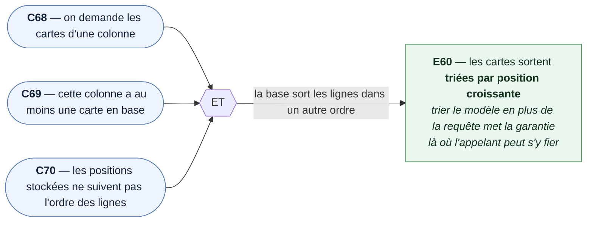

### E61 — Une colonne sans carte renvoie une liste vide

*Cible : `getCardsByColumnId` · Causes : `C68`, `¬C69` · Sert `US1` · `D-C4`*

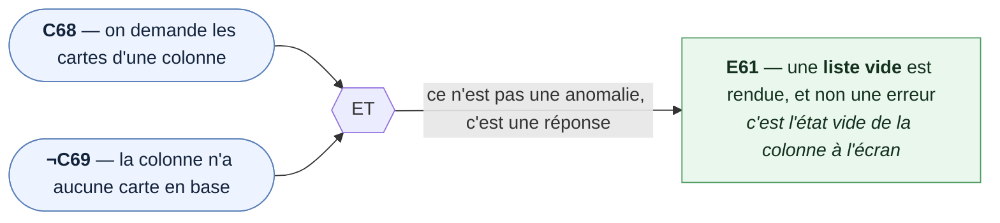

### E62 — La lecture ne renvoie que les cartes de la colonne demandée

*Cible : `getCardsByColumnId` · Causes : `C68`, `C77` · Sert `US1`*

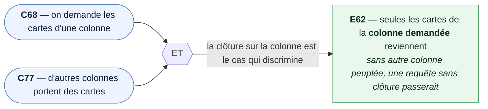

### E63 — Une carte liée est renvoyée avec sa note entière

*Cible : `getCardsByColumnId` · Causes : `C68`, `C71` · Sert `US1` · `D-C3`, `D-C14`*

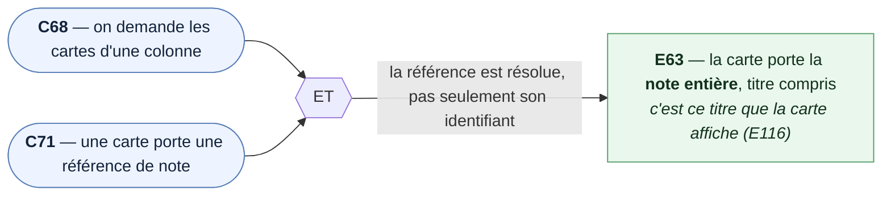

### E64 — Une carte sans référence est renvoyée avec une note absente

*Cible : `getCardsByColumnId` · Causes : `C68`, `C72` · Sert `US1`*

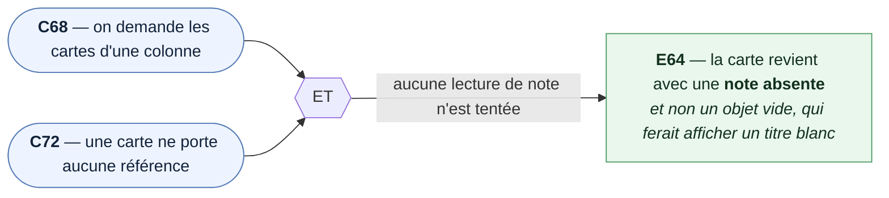

### E65 — Une note visée par plusieurs cartes n'est lue qu'une fois

*Cible : `getCardsByColumnId` · Causes : `C68`, `C73` · Sert `US1` · `D-C14`*

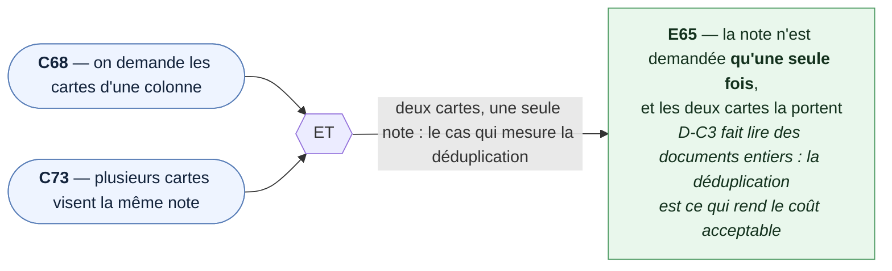

### E66 — Une note introuvable laisse la carte sans référence

*Cible : `getCardsByColumnId` · Causes : `C68`, `C71`, `C74` · Sert `US1`, `US5` · `D-C15`*

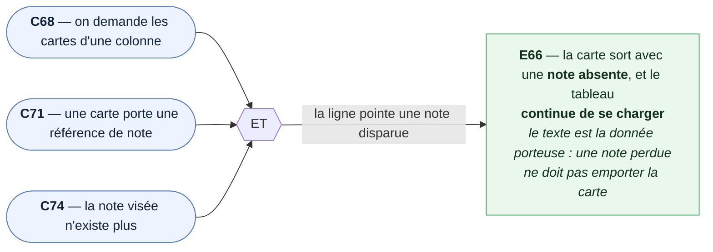

### E67 — Une lecture de note en échec laisse la carte sans référence

*Cible : `getCardsByColumnId` · Causes : `C68`, `C71`, `C75` · Sert `US1` · `D-C15`*

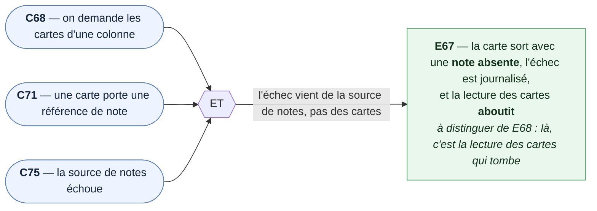

### E68 — L'erreur de lecture des cartes est relancée à l'appelant

*Cible : `getCardsByColumnId` · Causes : `C68`, `C76` · Sert `US1`*

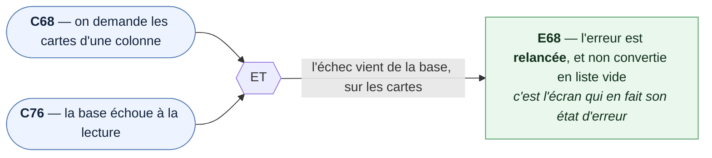

### 5.2 `KanbanCardService` — écriture

### E69 — Les cartes affichées sont écrites telles qu'elles ont été demandées

*Cible : `saveCardsForColumns` · Causes : `C78`, `C79`, `C80`, `C81` · Sert `US9` · `D-C8`*

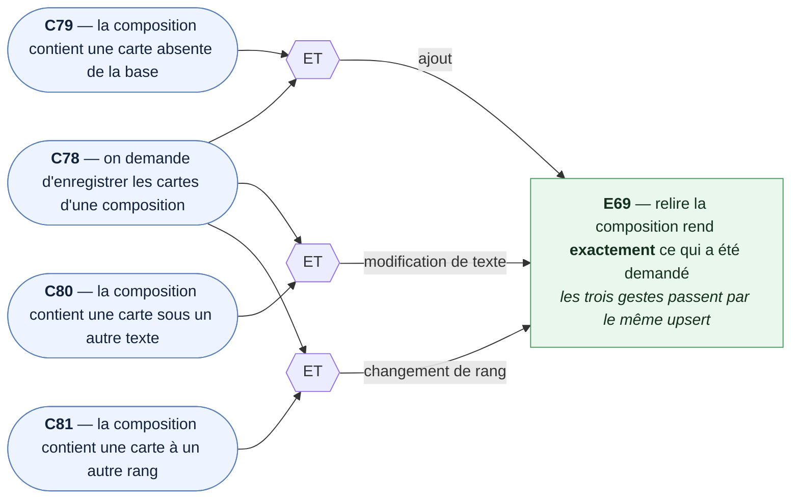

### E70 — Les cartes retirées de la composition sont effectivement supprimées

*Cible : `saveCardsForColumns` · Causes : `C78`, `C83` · Sert `US6`, `US9` · `D-C8`*

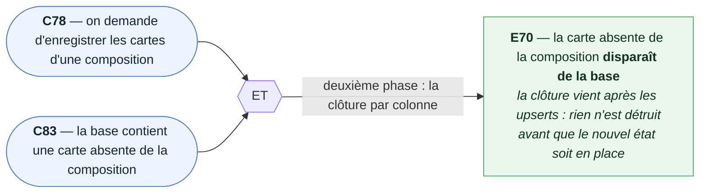

### E71 — Une carte déplacée change de colonne sans perdre son identifiant

*Cible : `saveCardsForColumns` · Causes : `C78`, `C82` · Sert `US8`, `US9` · `D-C8`, `D-C10`*

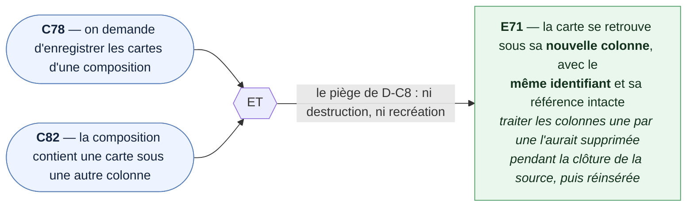

### E72 — Les cartes des autres colonnes ne sont pas touchées

*Cible : `saveCardsForColumns` · Causes : `C78`, `C83`, `C77` · Sert `US9`*

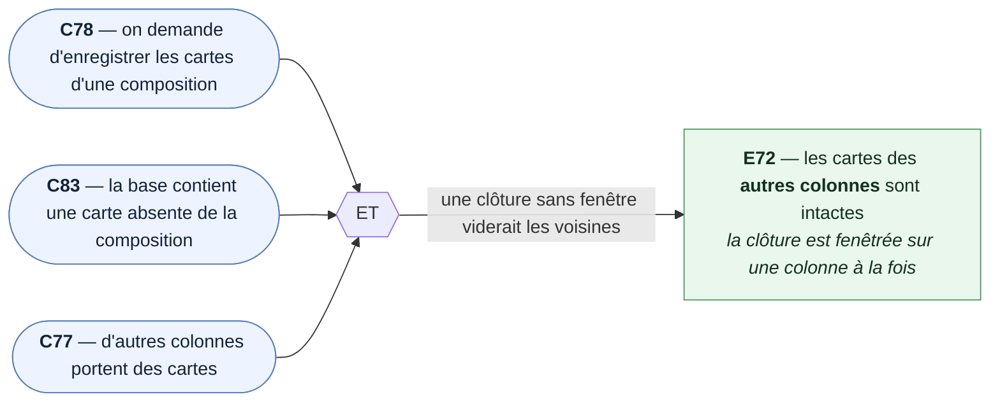

### E73 — Une colonne dont les cartes ne sont pas chargées garde ses cartes en base

*Cible : `saveCardsForColumns` · Causes : `C78`, `C84` · Sert `US9` · `D-C9`*

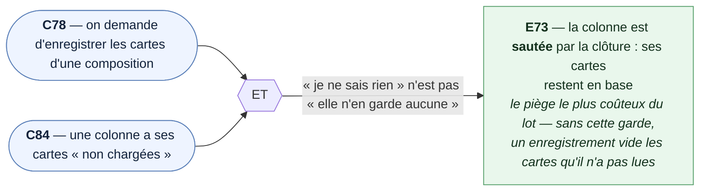

### E74 — Une colonne à liste vide voit toutes ses cartes supprimées

*Cible : `saveCardsForColumns` · Causes : `C78`, `C85` · Sert `US6`, `US9` · `D-C4`, `D-C9`*

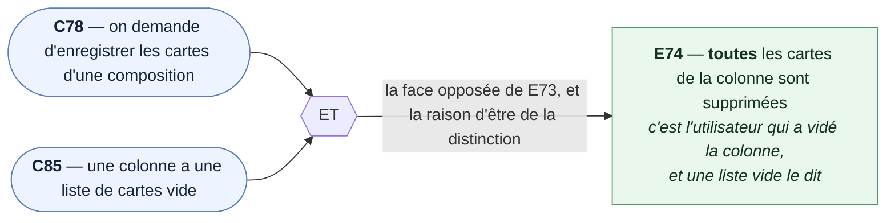

### E75 — Un texte vide est refusé avant la moindre écriture

*Cible : `assertCardsAreSavable` · Causes : `C78`, `C86`, `C87` · Sert `US2`, `US3` · `D-C12`*

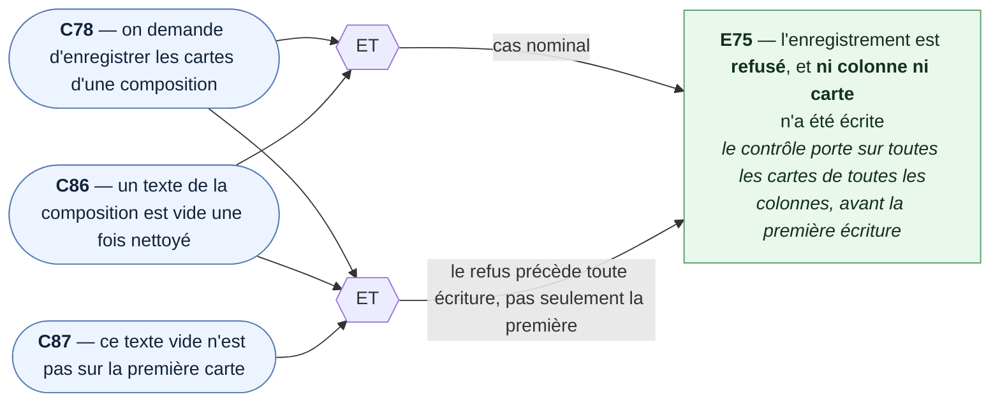

### E76 — La référence est écrite par l'identifiant de la note

*Cible : `saveCardsForColumns` · Causes : `C78`, `C88` · Sert `US4`, `US9` · `D-C10`*

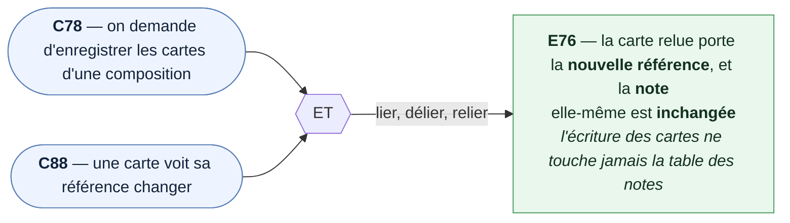

### E77 — Ré-enregistrer la même composition donne le même résultat

*Cible : `saveCardsForColumns` · Causes : `C78`, `C91`, `C92` · Sert `US9`, `US10` · `D-C8`*

```mermaid
flowchart LR
    C78(["<b>C78</b> — on demande d'enregistrer les cartes d'une composition"])
    C91(["<b>C91</b> — la composition reçue est identique à celle en base"])
    C92(["<b>C92</b> — la base est dans un état intermédiaire"])

    ET1{{ET}}
    ET2{{ET}}

    C78 --> ET1
    C91 --> ET1

    C78 --> ET2
    C92 --> ET2

    ET1 -- deux fois de suite --> E77
    ET2 -- rejeu depuis un état laissé par un échec --> E77

    E77["<b>E77</b> — le résultat est le <b>même</b> qu'un premier enregistrement réussi :<br/>ni carte en double, ni carte orpheline<br/><i>c'est la rejouabilité qui tient lieu d'atomicité (D-L13)</i>"]

    class C78,C91,C92 cause
    class E77 effet
    classDef cause fill:#eef4ff,stroke:#5a7fb8,color:#13233b
    classDef effet fill:#e9f7ec,stroke:#4e9a63,color:#13311d
```

### E78 — L'erreur d'écriture est relancée

*Cible : `saveCardsForColumns` · Causes : `C78`, `C89`, `C90` · Sert `US10`*

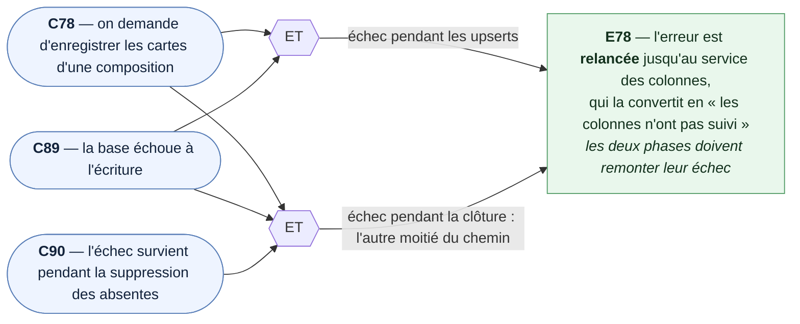

### E79 — L'écriture des cartes ne déclenche aucun flush

*Cible : `saveCardsForColumns` · Causes : `C78`, `¬C86`, `¬C89` · Sert `US9` · `D-C11`*

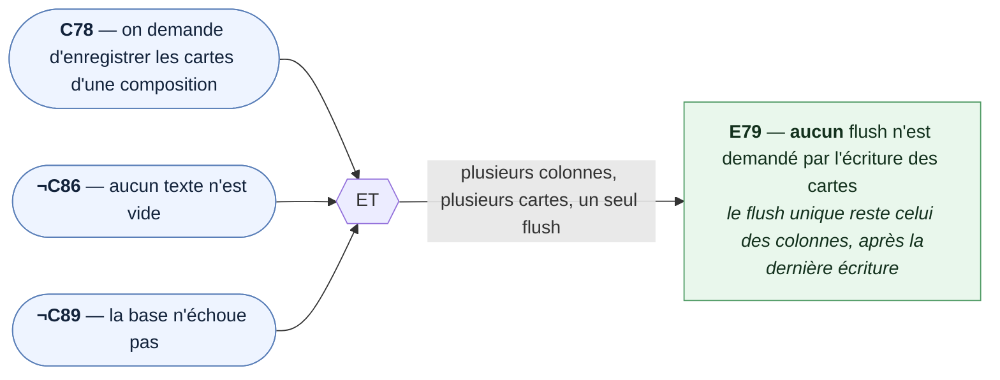

### 5.3 `KanbanColumnService` étendu

### E80 — Les colonnes sont renvoyées avec leurs cartes, dans l'ordre

*Cible : `getColumnsByKanbanId` · Causes : `C1`, `C93` · Sert `US1` · `D-C5`*

```mermaid
flowchart LR
    C1(["<b>C1</b> — on demande les colonnes d'un tableau"])
    C93(["<b>C93</b> — une colonne du tableau a au moins une carte"])

    ET1{{ET}}

    C1 --> ET1
    C93 --> ET1

    ET1 -- l'hydratation descend d'un niveau --> E80

    E80["<b>E80</b> — chaque colonne revient <b>avec ses cartes</b>, triées par position<br/><i>une requête par colonne, N+1 assumé (D-C41)</i>"]

    class C1,C93 cause
    class E80 effet
    classDef cause fill:#eef4ff,stroke:#5a7fb8,color:#13233b
    classDef effet fill:#e9f7ec,stroke:#4e9a63,color:#13311d
```

### E81 — Une colonne sans carte est renvoyée avec une liste vide

*Cible : `getColumnsByKanbanId` · Causes : `C1`, `C94` · Sert `US1` · `D-C4`, `D-C9`*

```mermaid
flowchart LR
    C1(["<b>C1</b> — on demande les colonnes d'un tableau"])
    C94(["<b>C94</b> — une colonne du tableau n'a aucune carte"])

    ET1{{ET}}

    C1 --> ET1
    C94 --> ET1

    ET1 -- « chargée, et elle n'en a aucune » --> E81

    E81["<b>E81</b> — la colonne porte une <b>liste vide</b>, et non « non chargées »<br/><i>c'est cette distinction qui protège l'écriture (E73, E74)</i>"]

    class C1,C94 cause
    class E81 effet
    classDef cause fill:#eef4ff,stroke:#5a7fb8,color:#13233b
    classDef effet fill:#e9f7ec,stroke:#4e9a63,color:#13311d
```

### E82 — Les quatre phases s'enchaînent dans l'ordre

*Cible : `saveColumnsForKanban` · Causes : `C5`, `C79`, `C83`, `C9` · Sert `US9` · `D-C8`*

```mermaid
flowchart LR
    C5(["<b>C5</b> — on demande d'enregistrer une composition"])
    C79(["<b>C79</b> — la composition contient une carte absente de la base"])
    C83(["<b>C83</b> — la base contient une carte absente de la composition"])
    C9(["<b>C9</b> — la base contient une colonne absente de la composition"])

    ET1{{ET}}

    C5 --> ET1
    C79 --> ET1
    C83 --> ET1
    C9 --> ET1

    ET1 -- une composition qui ajoute, retire une carte et retire une colonne --> E82

    E82["<b>E82</b> — colonnes upsertées, puis cartes, puis cartes absentes,<br/>puis colonnes absentes — et le résultat relu est le bon<br/><i>les suppressions en dernier : rien n'est détruit<br/>avant que le nouvel état soit en place</i>"]

    class C5,C79,C83,C9 cause
    class E82 effet
    classDef cause fill:#eef4ff,stroke:#5a7fb8,color:#13233b
    classDef effet fill:#e9f7ec,stroke:#4e9a63,color:#13311d
```

### E83 — Retirer une colonne emporte ses cartes

*Cible : `saveColumnsForKanban` · Causes : `C5`, `C95` · Sert `US6`, `US9` · `D-C1`*

```mermaid
flowchart LR
    C5(["<b>C5</b> — on demande d'enregistrer une composition"])
    C95(["<b>C95</b> — la composition retire une colonne qui portait des cartes"])

    ET1{{ET}}

    C5 --> ET1
    C95 --> ET1

    ET1 -- la cascade fait le travail, pas une suppression explicite --> E83

    E83["<b>E83</b> — la colonne retirée <b>et ses cartes</b> disparaissent,<br/>celles des colonnes conservées restent<br/><i>effectif grâce au pragma déjà posé (D-L14)</i>"]

    class C5,C95 cause
    class E83 effet
    classDef cause fill:#eef4ff,stroke:#5a7fb8,color:#13233b
    classDef effet fill:#e9f7ec,stroke:#4e9a63,color:#13311d
```

### E84 — Une carte déplacée depuis une colonne retirée survit

*Cible : `saveColumnsForKanban` · Causes : `C5`, `C96` · Sert `US8`, `US9` · `D-C8`*

```mermaid
flowchart LR
    C5(["<b>C5</b> — on demande d'enregistrer une composition"])
    C96(["<b>C96</b> — la composition déplace une carte depuis une colonne retirée"])

    ET1{{ET}}

    C5 --> ET1
    C96 --> ET1

    ET1 -- le cas qui exige que les suppressions viennent après les upserts --> E84

    E84["<b>E84</b> — la carte se retrouve dans sa <b>nouvelle colonne</b>,<br/>alors que son ancienne a disparu<br/><i>si la colonne était supprimée d'abord, la cascade<br/>emporterait la carte avant son upsert</i>"]

    class C5,C96 cause
    class E84 effet
    classDef cause fill:#eef4ff,stroke:#5a7fb8,color:#13233b
    classDef effet fill:#e9f7ec,stroke:#4e9a63,color:#13311d
```

### E85 — Une carte posée dans une colonne ajoutée au même enregistrement est écrite

*Cible : `saveColumnsForKanban` · Causes : `C5`, `C97` · Sert `US2`, `US9` · `D-C8`*

```mermaid
flowchart LR
    C5(["<b>C5</b> — on demande d'enregistrer une composition"])
    C97(["<b>C97</b> — la composition ajoute une colonne et y pose une carte"])

    ET1{{ET}}

    C5 --> ET1
    C97 --> ET1

    ET1 -- le cas qui exige que les colonnes soient upsertées avant les cartes --> E85

    E85["<b>E85</b> — la carte est écrite <b>sans violer la clé étrangère</b><br/><i>sa colonne existe déjà en base quand elle arrive</i>"]

    class C5,C97 cause
    class E85 effet
    classDef cause fill:#eef4ff,stroke:#5a7fb8,color:#13233b
    classDef effet fill:#e9f7ec,stroke:#4e9a63,color:#13311d
```

### 5.4 `KanbanService` — non-régression

### E86 — getKanbanById renvoie le tableau, ses colonnes et leurs cartes

*Cible : `getKanbanById` · Causes : `C15`, `C16`, `C93` · Sert `US1` · `D-C5`*

```mermaid
flowchart LR
    C15(["<b>C15</b> — on demande un tableau par son identifiant"])
    C16(["<b>C16</b> — l'identifiant correspond à un tableau existant"])
    C93(["<b>C93</b> — une colonne du tableau a au moins une carte"])

    ET1{{ET}}

    C15 --> ET1
    C16 --> ET1
    C93 --> ET1

    ET1 -- la méthode qui sert l'éditeur ramène tout --> E86

    E86["<b>E86</b> — le tableau revient avec ses <b>colonnes</b> et leurs <b>cartes</b>,<br/>dans l'ordre, en un seul appel<br/><i>l'écran n'orchestre aucune séquence de lectures</i>"]

    class C15,C16,C93 cause
    class E86 effet
    classDef cause fill:#eef4ff,stroke:#5a7fb8,color:#13233b
    classDef effet fill:#e9f7ec,stroke:#4e9a63,color:#13311d
```

### E87 — getAllKanbans renvoie les tableaux sans colonnes ni cartes

*Cible : `getAllKanbans` · Causes : `C24` · Sert `US1` · `D-C5`*

```mermaid
flowchart LR
    C24(["<b>C24</b> — on demande tous les tableaux"])

    C24 -- non-régression : la liste des tableaux n'affiche ni l'une ni l'autre --> E87

    E87["<b>E87</b> — les tableaux reviennent <b>sans</b> champ de colonnes,<br/>donc sans cartes<br/><i>D-L8 prolongé d'un cran : pas de lecture inutile<br/>à l'ouverture de la liste</i>"]

    class C24 cause
    class E87 effet
    classDef cause fill:#eef4ff,stroke:#5a7fb8,color:#13233b
    classDef effet fill:#e9f7ec,stroke:#4e9a63,color:#13311d
```

### E88 — Un échec sur les cartes ne jette pas

*Cible : `saveKanbanWithColumns` · Causes : `C20`, `C99` · Sert `US9`, `US10` · `D-C13`, `D-L24`*

```mermaid
flowchart LR
    C20(["<b>C20</b> — on demande d'enregistrer un tableau avec sa composition"])
    C99(["<b>C99</b> — l'écriture des cartes échoue"])

    ET1{{ET}}

    C20 --> ET1
    C99 --> ET1

    ET1 -- l'échec des cartes se comporte comme celui des colonnes --> E88

    E88["<b>E88</b> — le <b>tableau enregistré</b> est renvoyé, assorti de<br/>« les colonnes n'ont pas suivi »<br/><i>une exception emporterait l'identifiant d'un tableau<br/>neuf, et un ré-essai en créerait un second</i>"]

    class C20,C99 cause
    class E88 effet
    classDef cause fill:#eef4ff,stroke:#5a7fb8,color:#13233b
    classDef effet fill:#e9f7ec,stroke:#4e9a63,color:#13311d
```

### 5.5 Le schéma — joué sur `sql.js`

### E89 — Supprimer un tableau supprime ses colonnes et leurs cartes

*Cible : `schema_kanban_cards.sql` · Causes : `C100`, `C101`, `C107` · Sert `US6` · `D-C1`, `D-L14`*

```mermaid
flowchart LR
    C100(["<b>C100</b> — on supprime un tableau"])
    C101(["<b>C101</b> — ce tableau porte des colonnes qui portent des cartes"])
    C107(["<b>C107</b> — la connexion porte le pragma des clés étrangères"])

    ET1{{ET}}

    C100 --> ET1
    C101 --> ET1
    C107 --> ET1

    ET1 -- cascade à deux étages, pragma posé --> E89

    E89["<b>E89</b> — le tableau, ses colonnes <b>et leurs cartes</b> disparaissent<br/><i>sans le pragma, SQLite ignore la cascade en silence<br/>et le test passerait pour de mauvaises raisons</i>"]

    class C100,C101,C107 cause
    class E89 effet
    classDef cause fill:#eef4ff,stroke:#5a7fb8,color:#13233b
    classDef effet fill:#e9f7ec,stroke:#4e9a63,color:#13311d
```

### E90 — Supprimer une note vide la référence des cartes qui la visaient

*Cible : `schema_kanban_cards.sql` · Causes : `C102`, `C103`, `C107` · Sert `US4` · `D-C16`, `H-C6`*

```mermaid
flowchart LR
    C102(["<b>C102</b> — on supprime une note"])
    C103(["<b>C103</b> — cette note est référencée par au moins une carte"])
    C107(["<b>C107</b> — la connexion porte le pragma des clés étrangères"])

    ET1{{ET}}

    C102 --> ET1
    C103 --> ET1
    C107 --> ET1

    ET1 -- SET NULL, et non CASCADE --> E90

    E90["<b>E90</b> — les cartes <b>restent</b>, avec leur texte, et leur référence<br/>est <b>vidée</b><br/><i>supprimer une note ne doit jamais faire disparaître<br/>du travail dans un tableau</i>"]

    class C102,C103,C107 cause
    class E90 effet
    classDef cause fill:#eef4ff,stroke:#5a7fb8,color:#13233b
    classDef effet fill:#e9f7ec,stroke:#4e9a63,color:#13311d
```

### E91 — Une carte rattachée à une colonne inexistante est refusée

*Cible : `schema_kanban_cards.sql` · Causes : `C104`, `C107` · Sert `US9` · `D-C1`*

```mermaid
flowchart LR
    C104(["<b>C104</b> — on insère une carte rattachée à une colonne inexistante"])
    C107(["<b>C107</b> — la connexion porte le pragma des clés étrangères"])

    ET1{{ET}}

    C104 --> ET1
    C107 --> ET1

    ET1 -- la clé étrangère est effective --> E91

    E91["<b>E91</b> — l'insertion est <b>refusée</b><br/><i>aucune carte orpheline ne peut entrer en base</i>"]

    class C104,C107 cause
    class E91 effet
    classDef cause fill:#eef4ff,stroke:#5a7fb8,color:#13233b
    classDef effet fill:#e9f7ec,stroke:#4e9a63,color:#13311d
```

### E92 — Un texte vide est refusé par la contrainte

*Cible : `schema_kanban_cards.sql` · Causes : `C105` · Sert `US2` · `D-C1`*

```mermaid
flowchart LR
    C105(["<b>C105</b> — on insère une carte au texte vide"])

    C105 -- le filet du schéma, sous celui du service --> E92

    E92["<b>E92</b> — l'insertion est <b>refusée</b><br/><i>le repli « Sans titre » est fait par l'écran ;<br/>ceci est la dernière barrière</i>"]

    class C105 cause
    class E92 effet
    classDef cause fill:#eef4ff,stroke:#5a7fb8,color:#13233b
    classDef effet fill:#e9f7ec,stroke:#4e9a63,color:#13311d
```

### E93 — Deux cartes peuvent porter le même texte et viser la même note

*Cible : `schema_kanban_cards.sql` · Causes : `C106` · Sert `US2` · `D-C1`*

```mermaid
flowchart LR
    C106(["<b>C106</b> — on insère deux cartes de même texte visant la même note"])

    C106 -- l'absence de contrainte est un choix, pas un oubli --> E93

    E93["<b>E93</b> — les deux insertions <b>réussissent</b><br/><i>aucune contrainte d'unicité, ni sur le texte,<br/>ni sur la référence</i>"]

    class C106 cause
    class E93 effet
    classDef cause fill:#eef4ff,stroke:#5a7fb8,color:#13233b
    classDef effet fill:#e9f7ec,stroke:#4e9a63,color:#13311d
```

### 5.6 `kanban-composition` — le module pur

> Ces 21 diagrammes ont été construits et **validés au rendu** avant d'être repliés ici. Les
> décisions qu'ils citent sont préfixées **`DM`** — « décisions du module » — pour ne pas se
> confondre avec celles des autres cibles (§7).

### E94 — Une carte est ajoutée en dernière position de la colonne visée

*Cible : `addCardTo` · Causes : `C108`, `C127`, `C129` · Sert `US2` · `D-C19`*

```mermaid
flowchart LR
    C108(["<b>C108</b> — on demande l'ajout d'une carte à une colonne"])
    C129(["<b>C129</b> — la colonne visée porte au moins trois cartes"])
    C127(["<b>C127</b> — la colonne cible est vide"])

    ET1{{ET}}
    ET2{{ET}}

    C108 --> ET1
    C129 --> ET1

    C108 --> ET2
    C127 --> ET2

    ET1 -- cas nominal : elle se pose sous les autres --> E94
    ET2 -- cas limite : première carte de la colonne --> E94

    E94["<b>E94</b> — la carte est placée <b>en queue</b> de la colonne visée<br/><i>à une seule carte, « en queue » et « en tête » se confondent :<br/>il en faut trois pour que le cas discrimine</i>"]

    class C108,C127,C129 cause
    class E94 effet
    classDef cause fill:#eef4ff,stroke:#5a7fb8,color:#13233b
    classDef effet fill:#e9f7ec,stroke:#4e9a63,color:#13311d
```

### E95 — Une carte est échangée avec sa voisine du dessus

*Cible : `moveCardUp` · Causes : `C113`, `¬C119`, `C129` · Sert `US8` · `D-C19`*

```mermaid
flowchart LR
    C113(["<b>C113</b> — on demande le déplacement vers le haut"])
    NC119(["<b>¬C119</b> — la carte n'est pas en tête de sa colonne"])
    C129(["<b>C129</b> — la colonne porte au moins trois cartes"])

    ET1{{ET}}

    C113 --> ET1
    NC119 --> ET1
    C129 --> ET1

    ET1 -- la carte du milieu monte d'un cran --> E95

    E95["<b>E95</b> — la carte est échangée avec sa <b>voisine immédiate du dessus</b><br/><i>à deux cartes, « un cran » et « envoyée en tête »<br/>donnent le même résultat : il en faut trois</i>"]

    class C113,NC119,C129 cause
    class E95 effet
    classDef cause fill:#eef4ff,stroke:#5a7fb8,color:#13233b
    classDef effet fill:#e9f7ec,stroke:#4e9a63,color:#13311d
```

### E96 — Une carte est échangée avec sa voisine du dessous

*Cible : `moveCardDown` · Causes : `C114`, `¬C120`, `C129` · Sert `US8` · `D-C19`*

```mermaid
flowchart LR
    C114(["<b>C114</b> — on demande le déplacement vers le bas"])
    NC120(["<b>¬C120</b> — la carte n'est pas en queue de sa colonne"])
    C129(["<b>C129</b> — la colonne porte au moins trois cartes"])

    ET1{{ET}}

    C114 --> ET1
    NC120 --> ET1
    C129 --> ET1

    ET1 -- la carte du milieu descend d'un cran --> E96

    E96["<b>E96</b> — la carte est échangée avec sa <b>voisine immédiate du dessous</b><br/><i>symétrique de E95, et discriminé par les mêmes trois cartes</i>"]

    class C114,NC120,C129 cause
    class E96 effet
    classDef cause fill:#eef4ff,stroke:#5a7fb8,color:#13233b
    classDef effet fill:#e9f7ec,stroke:#4e9a63,color:#13311d
```

### E97 — Une carte passe dans la colonne de droite, au même rang

*Cible : `moveCardToNextColumn` · Causes : `C116`, `¬C122`, `C126` · Sert `US8` · `H-C4`*

```mermaid
flowchart LR
    C116(["<b>C116</b> — on demande le déplacement vers la colonne de droite"])
    NC122(["<b>¬C122</b> — la colonne de la carte n'est pas la dernière"])
    C126(["<b>C126</b> — la colonne cible est au moins aussi longue que le rang de la carte"])

    ET1{{ET}}

    C116 --> ET1
    NC122 --> ET1
    C126 --> ET1

    ET1 -- la cible peut l'accueillir à son rang --> E97

    E97["<b>E97</b> — la carte quitte sa colonne et s'insère dans la <b>voisine de droite</b><br/>au <b>même rang vertical</b> qu'elle occupait<br/><i>il faut un rang non nul pour discriminer d'un atterrissage en tête</i>"]

    class C116,NC122,C126 cause
    class E97 effet
    classDef cause fill:#eef4ff,stroke:#5a7fb8,color:#13233b
    classDef effet fill:#e9f7ec,stroke:#4e9a63,color:#13311d
```

### E98 — Une carte passe dans la colonne de gauche, au même rang

*Cible : `moveCardToPreviousColumn` · Causes : `C115`, `¬C121`, `C126` · Sert `US8` · `H-C4`*

```mermaid
flowchart LR
    C115(["<b>C115</b> — on demande le déplacement vers la colonne de gauche"])
    NC121(["<b>¬C121</b> — la colonne de la carte n'est pas la première"])
    C126(["<b>C126</b> — la colonne cible est au moins aussi longue que le rang de la carte"])

    ET1{{ET}}

    C115 --> ET1
    NC121 --> ET1
    C126 --> ET1

    ET1 -- la cible peut l'accueillir à son rang --> E98

    E98["<b>E98</b> — la carte quitte sa colonne et s'insère dans la <b>voisine de gauche</b><br/>au <b>même rang vertical</b> qu'elle occupait<br/><i>symétrique de E97</i>"]

    class C115,NC121,C126 cause
    class E98 effet
    classDef cause fill:#eef4ff,stroke:#5a7fb8,color:#13233b
    classDef effet fill:#e9f7ec,stroke:#4e9a63,color:#13311d
```

### E99 — Une carte qui change de colonne atterrit en dernier quand la cible est plus courte

*Cible : `moveCardToPreviousColumn`, `moveCardToNextColumn` · Causes : `C115`, `C116`, `C125`, `C127` · Sert `US8` · `H-C4`, `D-C18`*

```mermaid
flowchart LR
    C116(["<b>C116</b> — déplacement vers la droite"])
    C115(["<b>C115</b> — déplacement vers la gauche"])
    C125(["<b>C125</b> — la colonne cible est plus courte que le rang de la carte"])
    C127(["<b>C127</b> — la colonne cible est vide"])

    ET1{{ET}}
    ET2{{ET}}
    ET3{{ET}}

    C116 --> ET1
    C125 --> ET1

    C115 --> ET2
    C125 --> ET2

    C116 --> ET3
    C127 --> ET3

    ET1 -- cas nominal à droite --> E99
    ET2 -- la règle vaut dans les deux sens --> E99
    ET3 -- cas limite : la cible n'a aucune carte --> E99

    E99["<b>E99</b> — la carte se pose <b>en dernière position</b> de la colonne cible<br/><i>le rang retenu est le plus petit du rang d'origine<br/>et de la longueur de la cible</i>"]

    class C115,C116,C125,C127 cause
    class E99 effet
    classDef cause fill:#eef4ff,stroke:#5a7fb8,color:#13233b
    classDef effet fill:#e9f7ec,stroke:#4e9a63,color:#13311d
```

### E100 — Une carte est retirée de sa colonne

*Cible : `removeCard` · Causes : `C112`, `C129` · Sert `US6`*

```mermaid
flowchart LR
    C112(["<b>C112</b> — on demande le retrait d'une carte"])
    C129(["<b>C129</b> — la colonne porte au moins trois cartes"])

    ET1{{ET}}

    C112 --> ET1
    C129 --> ET1

    ET1 -- retrait au milieu : les deux voisines restent --> E100

    E100["<b>E100</b> — la carte disparaît de sa colonne, et <b>elle seule</b><br/><i>les autres cartes de la colonne, et celles des autres colonnes,<br/>sont intactes</i>"]

    class C112,C129 cause
    class E100 effet
    classDef cause fill:#eef4ff,stroke:#5a7fb8,color:#13233b
    classDef effet fill:#e9f7ec,stroke:#4e9a63,color:#13311d
```

### E101 — Le texte d'une carte est remplacé, et d'elle seule

*Cible : `replaceCardText` · Causes : `C109`, `C131` · Sert `US3` · `D-C30`*

```mermaid
flowchart LR
    C109(["<b>C109</b> — on demande le remplacement du texte d'une carte"])
    C131(["<b>C131</b> — une autre carte porte le même texte"])

    ET1{{ET}}

    C109 -- cas nominal --> E101
    C109 --> ET1
    C131 --> ET1

    ET1 -- cas discriminant : la cible est désignée par son identifiant, pas par son texte --> E101

    E101["<b>E101</b> — seule la carte <b>désignée</b> change de texte<br/><i>sa position, sa colonne et sa référence sont inchangées ;<br/>le texte est stocké tel quel, sans nettoyage ni repli</i>"]

    class C109,C131 cause
    class E101 effet
    classDef cause fill:#eef4ff,stroke:#5a7fb8,color:#13233b
    classDef effet fill:#e9f7ec,stroke:#4e9a63,color:#13311d
```

### E102 — Une note est posée sur une carte, et sur elle seule

*Cible : `setCardNote` · Causes : `C110`, `C129` · Sert `US4`*

```mermaid
flowchart LR
    C110(["<b>C110</b> — on demande la pose d'une note sur une carte"])
    C129(["<b>C129</b> — la colonne porte au moins trois cartes"])

    ET1{{ET}}

    C110 --> ET1
    C129 --> ET1

    ET1 -- les deux voisines gardent leur référence --> E102

    E102["<b>E102</b> — seule la carte désignée porte la <b>note entière</b> reçue<br/><i>son texte et sa position sont inchangés</i>"]

    class C110,C129 cause
    class E102 effet
    classDef cause fill:#eef4ff,stroke:#5a7fb8,color:#13233b
    classDef effet fill:#e9f7ec,stroke:#4e9a63,color:#13311d
```

### E103 — La référence d'une carte est vidée

*Cible : `setCardNote` · Causes : `C111`, `C130` · Sert `US4` · `D-C35`*

```mermaid
flowchart LR
    C111(["<b>C111</b> — on demande le retrait de la référence d'une carte"])
    C130(["<b>C130</b> — la carte visée porte déjà une référence"])

    ET1{{ET}}

    C111 --> ET1
    C130 --> ET1

    ET1 -- le lien tombe, la carte reste --> E103

    E103["<b>E103</b> — la carte désignée se retrouve <b>sans référence</b><br/><i>son texte et sa position sont inchangés ;<br/>délier est le même geste que lier, avec une note absente</i>"]

    class C111,C130 cause
    class E103 effet
    classDef cause fill:#eef4ff,stroke:#5a7fb8,color:#13233b
    classDef effet fill:#e9f7ec,stroke:#4e9a63,color:#13311d
```

### E104 — Les positions restent contiguës et repartent de 0

*Cible : toutes les fonctions de geste · Causes : `C108`, `C112`, `C113`, `C129` · Sert `US2`, `US6`, `US8` · `D-C19`*

```mermaid
flowchart LR
    C108(["<b>C108</b> — ajout d'une carte"])
    C112(["<b>C112</b> — retrait d'une carte"])
    C113(["<b>C113</b> — déplacement vers le haut"])
    C129(["<b>C129</b> — la colonne porte au moins trois cartes"])

    ET1{{ET}}

    C108 -- après un ajout --> E104
    C113 -- après un déplacement --> E104

    C112 --> ET1
    C129 --> ET1
    ET1 -- retrait au milieu : le cas qui creuse un trou --> E104

    E104["<b>E104</b> — après chaque geste, les positions de la colonne touchée sont<br/><b>renumérotées depuis l'index</b> : 0, 1, 2… sans trou<br/><i>le modèle ne porte jamais une position périmée</i>"]

    class C108,C112,C113,C129 cause
    class E104 effet
    classDef cause fill:#eef4ff,stroke:#5a7fb8,color:#13233b
    classDef effet fill:#e9f7ec,stroke:#4e9a63,color:#13311d
```

### E105 — Les deux colonnes concernées sont renumérotées

*Cible : `moveCardToNextColumn` · Causes : `C116`, `C126`, `C129` · Sert `US8` · `D-C19`*

```mermaid
flowchart LR
    C116(["<b>C116</b> — déplacement vers la colonne de droite"])
    C126(["<b>C126</b> — la cible est au moins aussi longue que le rang de la carte"])
    C129(["<b>C129</b> — la colonne de départ porte au moins trois cartes"])

    ET1{{ET}}

    C116 --> ET1
    C126 --> ET1
    C129 --> ET1

    ET1 -- la source se referme, la cible s'écarte --> E105

    E105["<b>E105</b> — la colonne <b>quittée</b> et la colonne <b>d'arrivée</b> repartent<br/>toutes deux de 0, sans trou ni doublon de position<br/><i>un déplacement horizontal est le seul geste qui touche deux colonnes</i>"]

    class C116,C126,C129 cause
    class E105 effet
    classDef cause fill:#eef4ff,stroke:#5a7fb8,color:#13233b
    classDef effet fill:#e9f7ec,stroke:#4e9a63,color:#13311d
```

### E106 — La composition est rendue inchangée quand la carte est déjà en tête

*Cible : `moveCardUp` · Causes : `C113`, `C119` · Sert `US8` · `DM3`*

```mermaid
flowchart LR
    C113(["<b>C113</b> — on demande le déplacement vers le haut"])
    C119(["<b>C119</b> — la carte visée est en tête de sa colonne"])

    ET1{{ET}}

    C113 --> ET1
    C119 --> ET1

    ET1 -- aucun voisin au-dessus --> E106

    E106["<b>E106</b> — la composition <b>reçue</b> est rendue telle quelle<br/><i>pas une copie identique : la composition elle-même (DM3),<br/>ce qui distingue « rien à faire » de « nouvelle composition »</i>"]

    class C113,C119 cause
    class E106 effet
    classDef cause fill:#eef4ff,stroke:#5a7fb8,color:#13233b
    classDef effet fill:#e9f7ec,stroke:#4e9a63,color:#13311d
```

### E107 — La composition est rendue inchangée quand la carte est déjà en queue

*Cible : `moveCardDown` · Causes : `C114`, `C120` · Sert `US8` · `DM3`*

```mermaid
flowchart LR
    C114(["<b>C114</b> — on demande le déplacement vers le bas"])
    C120(["<b>C120</b> — la carte visée est en queue de sa colonne"])
    C123(["<b>C123</b> — la colonne n'a qu'une seule carte"])

    ET1{{ET}}
    ET2{{ET}}

    C114 --> ET1
    C120 --> ET1

    C114 --> ET2
    C123 --> ET2

    ET1 -- aucun voisin en dessous --> E107
    ET2 -- cas limite : la carte est à la fois en tête et en queue --> E107

    E107["<b>E107</b> — la composition <b>reçue</b> est rendue telle quelle<br/><i>une carte seule dans sa colonne n'offre aucun<br/>déplacement vertical, dans aucun sens</i>"]

    class C114,C120,C123 cause
    class E107 effet
    classDef cause fill:#eef4ff,stroke:#5a7fb8,color:#13233b
    classDef effet fill:#e9f7ec,stroke:#4e9a63,color:#13311d
```

### E108 — La composition est rendue inchangée dans la première colonne

*Cible : `moveCardToPreviousColumn` · Causes : `C115`, `C121` · Sert `US8` · `DM3`*

```mermaid
flowchart LR
    C115(["<b>C115</b> — on demande le déplacement vers la gauche"])
    C121(["<b>C121</b> — la colonne de la carte est la première du tableau"])

    ET1{{ET}}

    C115 --> ET1
    C121 --> ET1

    ET1 -- aucune colonne à gauche --> E108

    E108["<b>E108</b> — la composition <b>reçue</b> est rendue telle quelle<br/><i>aucun déplacement hors du tableau, aucune erreur levée</i>"]

    class C115,C121 cause
    class E108 effet
    classDef cause fill:#eef4ff,stroke:#5a7fb8,color:#13233b
    classDef effet fill:#e9f7ec,stroke:#4e9a63,color:#13311d
```

### E109 — La composition est rendue inchangée dans la dernière colonne

*Cible : `moveCardToNextColumn` · Causes : `C116`, `C122` · Sert `US8` · `DM3`*

```mermaid
flowchart LR
    C116(["<b>C116</b> — on demande le déplacement vers la droite"])
    C122(["<b>C122</b> — la colonne de la carte est la dernière du tableau"])
    C124(["<b>C124</b> — le tableau n'a qu'une seule colonne"])

    ET1{{ET}}
    ET2{{ET}}

    C116 --> ET1
    C122 --> ET1

    C116 --> ET2
    C124 --> ET2

    ET1 -- aucune colonne à droite --> E109
    ET2 -- cas limite : la colonne est à la fois première et dernière --> E109

    E109["<b>E109</b> — la composition <b>reçue</b> est rendue telle quelle<br/><i>un tableau d'une seule colonne n'offre aucun<br/>déplacement horizontal, dans aucun sens</i>"]

    class C116,C122,C124 cause
    class E109 effet
    classDef cause fill:#eef4ff,stroke:#5a7fb8,color:#13233b
    classDef effet fill:#e9f7ec,stroke:#4e9a63,color:#13311d
```

### E110 — La composition est rendue inchangée quand la cible n'existe pas

*Cible : toutes les fonctions de geste · Causes : `C128`, `C132` · Sert `US2` → `US8` · `DM3`, `DM8`*

```mermaid
flowchart LR
    C128(["<b>C128</b> — l'identifiant ne désigne aucune carte"])
    C132(["<b>C132</b> — la colonne visée n'existe pas dans la composition"])

    OU1{{OU}}

    C128 -- pour les huit gestes qui désignent une carte --> OU1
    C132 -- pour l'ajout, qui désigne une colonne --> OU1

    OU1 -- rien à faire, et surtout rien à casser --> E110

    E110["<b>E110</b> — la composition <b>reçue</b> est rendue telle quelle<br/><i>aucune erreur levée, aucune carte fantôme créée :<br/>l'écran peut appeler sans vérifier d'abord</i>"]

    class C128,C132 cause
    class E110 effet
    classDef cause fill:#eef4ff,stroke:#5a7fb8,color:#13233b
    classDef effet fill:#e9f7ec,stroke:#4e9a63,color:#13311d
```

### E111 — La composition reçue n'est jamais modifiée

*Cible : les neuf fonctions de geste · Causes : `C108` → `C116` · Sert `US2` → `US8` · `DM2`, `DM9`*

```mermaid
flowchart LR
    C108(["<b>C108</b> — ajout"])
    C109(["<b>C109</b> — remplacement du texte"])
    C110(["<b>C110</b> — pose d'une note"])
    C111(["<b>C111</b> — retrait de la référence"])
    C112(["<b>C112</b> — retrait d'une carte"])
    C113(["<b>C113</b> — vers le haut"])
    C114(["<b>C114</b> — vers le bas"])
    C115(["<b>C115</b> — vers la gauche"])
    C116(["<b>C116</b> — vers la droite"])

    OU1{{OU}}

    C108 --> OU1
    C109 --> OU1
    C110 --> OU1
    C111 --> OU1
    C112 --> OU1
    C113 --> OU1
    C114 --> OU1
    C115 --> OU1
    C116 --> OU1

    OU1 -- quel que soit le geste --> E111

    E111["<b>E111</b> — la composition d'entrée, ses colonnes et ses cartes<br/>sont <b>identiques après l'appel</b> à ce qu'elles étaient avant<br/><i>effet transversal : un cas unique balaie les neuf gestes (DM9)</i>"]

    class C108,C109,C110,C111,C112,C113,C114,C115,C116 cause
    class E111 effet
    classDef cause fill:#eef4ff,stroke:#5a7fb8,color:#13233b
    classDef effet fill:#e9f7ec,stroke:#4e9a63,color:#13311d
```

### E112 — Un déplacement ne change ni le texte, ni la référence, ni le nombre de cartes

*Cible : les quatre fonctions de déplacement · Causes : `C113`, `C116`, `C130` · Sert `US8`*

```mermaid
flowchart LR
    C113(["<b>C113</b> — déplacement vertical"])
    C116(["<b>C116</b> — déplacement horizontal"])
    C130(["<b>C130</b> — la carte déplacée porte une référence"])

    ET1{{ET}}
    ET2{{ET}}

    C113 --> ET1
    C130 --> ET1

    C116 --> ET2
    C130 --> ET2

    ET1 -- dans sa colonne --> E112
    ET2 -- d'une colonne à l'autre : le cas qui compte --> E112

    E112["<b>E112</b> — la carte déplacée garde son <b>identifiant</b>, son <b>texte</b><br/>et sa <b>référence</b> ; le <b>nombre total</b> de cartes du tableau est inchangé<br/><i>c'est ce qui garantit que la carte survit à son changement de colonne</i>"]

    class C113,C116,C130 cause
    class E112 effet
    classDef cause fill:#eef4ff,stroke:#5a7fb8,color:#13233b
    classDef effet fill:#e9f7ec,stroke:#4e9a63,color:#13311d
```

### E113 — La disponibilité d'un déplacement est fausse aux extrémités

*Cible : `canMoveCard` · Causes : `C117`, `C119` → `C124` · Sert `US8` · `DM6`*

```mermaid
flowchart LR
    C117(["<b>C117</b> — on demande si un déplacement est possible"])
    C119(["<b>C119</b> — la carte est en tête de sa colonne"])
    C120(["<b>C120</b> — la carte est en queue de sa colonne"])
    C121(["<b>C121</b> — sa colonne est la première"])
    C122(["<b>C122</b> — sa colonne est la dernière"])
    C123(["<b>C123</b> — la colonne n'a qu'une carte"])
    C124(["<b>C124</b> — le tableau n'a qu'une colonne"])

    OU1{{OU}}
    ET1{{ET}}

    C119 --> OU1
    C120 --> OU1
    C121 --> OU1
    C122 --> OU1
    C123 --> OU1
    C124 --> OU1

    C117 --> ET1
    OU1 --> ET1

    ET1 -- la direction bute sur un bord --> E113

    E113["<b>E113</b> — la disponibilité rendue est <b>fausse</b> pour cette direction,<br/>et <b>vraie</b> pour les autres<br/><i>même règle que les gestes (DM6) : indisponible ⟺ composition inchangée</i>"]

    class C117,C119,C120,C121,C122,C123,C124 cause
    class E113 effet
    classDef cause fill:#eef4ff,stroke:#5a7fb8,color:#13233b
    classDef effet fill:#e9f7ec,stroke:#4e9a63,color:#13311d
```

### E114 — La signature de composition bouge après chaque geste

*Cible : `compositionSignature` · Causes : `C118`, `C108`, `C109`, `C112`, `C113` · Sert `US10` · `DM7`*

```mermaid
flowchart LR
    C118(["<b>C118</b> — on demande la signature de la composition"])
    C108(["<b>C108</b> — un ajout a eu lieu"])
    C109(["<b>C109</b> — un texte a été remplacé"])
    C112(["<b>C112</b> — une carte a été retirée"])
    C113(["<b>C113</b> — une carte a été déplacée"])

    OU1{{OU}}
    ET1{{ET}}

    C108 --> OU1
    C109 --> OU1
    C112 --> OU1
    C113 --> OU1

    C118 --> ET1
    OU1 --> ET1

    ET1 -- la composition n'est plus celle d'avant --> E114

    E114["<b>E114</b> — la signature <b>diffère</b> de celle d'avant le geste,<br/>et deux compositions de même contenu donnent la <b>même</b> signature<br/><i>elle ne porte que id/nom/position des colonnes et<br/>id/texte/identifiant de note/position des cartes (DM7)</i>"]

    class C118,C108,C109,C112,C113 cause
    class E114 effet
    classDef cause fill:#eef4ff,stroke:#5a7fb8,color:#13233b
    classDef effet fill:#e9f7ec,stroke:#4e9a63,color:#13311d
```

### 5.7 `KanbanCardPanel` — le composant carte

### E115 — Le texte de la carte est affiché

*Cible : `KanbanCardPanel` · Causes : `C133`, `C146` · Sert `US1`*

```mermaid
flowchart LR
    C133(["<b>C133</b> — une carte est fournie en entrée"])
    C146(["<b>C146</b> — une nouvelle carte arrive sur l'entrée"])

    ET1{{ET}}

    C133 --> ET1
    C146 --> ET1

    ET1 -- le composant suit son entrée, il ne mémorise rien --> E115

    E115["<b>E115</b> — le texte affiché est celui de la carte <b>actuellement reçue</b><br/><i>l'éditeur remplace la carte à chaque geste :<br/>un texte mémorisé à la construction se figerait</i>"]

    class C133,C146 cause
    class E115 effet
    classDef cause fill:#eef4ff,stroke:#5a7fb8,color:#13233b
    classDef effet fill:#e9f7ec,stroke:#4e9a63,color:#13311d
```

### E116 — Le titre de la note est affiché quand la carte en porte une

*Cible : `KanbanCardPanel` · Causes : `C133`, `C134` · Sert `US1` · `D-C3`*

```mermaid
flowchart LR
    C133(["<b>C133</b> — une carte est fournie en entrée"])
    C134(["<b>C134</b> — cette carte porte une référence de note"])

    ET1{{ET}}

    C133 --> ET1
    C134 --> ET1

    ET1 -- le titre vient de la note entière portée par la carte --> E116

    E116["<b>E116</b> — le <b>titre de la note</b> est affiché, <b>distinctement</b> du<br/>texte de la carte<br/><i>c'est ce que D-C3 achète en portant la note entière</i>"]

    class C133,C134 cause
    class E116 effet
    classDef cause fill:#eef4ff,stroke:#5a7fb8,color:#13233b
    classDef effet fill:#e9f7ec,stroke:#4e9a63,color:#13311d
```

### E117 — Rien de plus que le texte n'est affiché sans référence

*Cible : `KanbanCardPanel` · Causes : `C133`, `¬C134` · Sert `US1`*

```mermaid
flowchart LR
    C133(["<b>C133</b> — une carte est fournie en entrée"])
    NC134(["<b>¬C134</b> — la carte ne porte aucune référence"])

    ET1{{ET}}

    C133 --> ET1
    NC134 --> ET1

    ET1 -- ni emplacement vide, ni mention « aucune note » --> E117

    E117["<b>E117</b> — la carte n'affiche <b>que son texte</b><br/><i>et n'offre pas le geste d'ouverture (E125)</i>"]

    class C133,NC134 cause
    class E117 effet
    classDef cause fill:#eef4ff,stroke:#5a7fb8,color:#13233b
    classDef effet fill:#e9f7ec,stroke:#4e9a63,color:#13311d
```

### E118 — La carte sélectionnée est distinguée des autres

*Cible : `KanbanCardPanel` · Causes : `C133`, `C135` · Sert `US7` · `D-C23`*

```mermaid
flowchart LR
    C133(["<b>C133</b> — une carte est fournie en entrée"])
    C135(["<b>C135</b> — la carte est fournie comme sélectionnée"])

    ET1{{ET}}

    C133 --> ET1
    C135 --> ET1

    ET1 -- la sélection entre par l'entrée, elle n'est pas décidée ici --> E118

    E118["<b>E118</b> — la carte sélectionnée est <b>visuellement distinguée</b>,<br/>et une carte non sélectionnée ne l'est pas<br/><i>la carte ne possède pas cet état : elle le reçoit</i>"]

    class C133,C135 cause
    class E118 effet
    classDef cause fill:#eef4ff,stroke:#5a7fb8,color:#13233b
    classDef effet fill:#e9f7ec,stroke:#4e9a63,color:#13311d
```

### E119 — Toucher le corps hors mode ouvre la saisie

*Cible : `KanbanCardPanel` · Causes : `C133`, `C137`, `¬C136` · Sert `US3` · `D-C24`*

```mermaid
flowchart LR
    C133(["<b>C133</b> — une carte est fournie en entrée"])
    C137(["<b>C137</b> — on touche le corps de la carte"])
    NC136(["<b>¬C136</b> — le mode déplacement n'est pas actif"])

    ET1{{ET}}

    C133 --> ET1
    C137 --> ET1
    NC136 --> ET1

    ET1 -- le geste le plus fréquent est le geste par défaut --> E119

    E119["<b>E119</b> — la saisie du texte s'ouvre, <b>pré-remplie</b> du texte actuel<br/><i>état local au composant, comme le renommage<br/>de KanbanColumnPanel</i>"]

    class C133,C137,NC136 cause
    class E119 effet
    classDef cause fill:#eef4ff,stroke:#5a7fb8,color:#13233b
    classDef effet fill:#e9f7ec,stroke:#4e9a63,color:#13311d
```

### E120 — Toucher le corps en mode déplacement émet une sélection

*Cible : `KanbanCardPanel` · Causes : `C133`, `C137`, `C136` · Sert `US7` · `D-C23`*

```mermaid
flowchart LR
    C133(["<b>C133</b> — une carte est fournie en entrée"])
    C137(["<b>C137</b> — on touche le corps de la carte"])
    C136(["<b>C136</b> — le mode déplacement est actif"])

    ET1{{ET}}

    C133 --> ET1
    C137 --> ET1
    C136 --> ET1

    ET1 -- le mode remplace le geste, il ne s'y ajoute pas --> E120

    E120["<b>E120</b> — une <b>demande de sélection</b> est émise, et la saisie<br/><b>ne s'ouvre pas</b><br/><i>les deux moitiés comptent : émettre sans ouvrir</i>"]

    class C133,C137,C136 cause
    class E120 effet
    classDef cause fill:#eef4ff,stroke:#5a7fb8,color:#13233b
    classDef effet fill:#e9f7ec,stroke:#4e9a63,color:#13311d
```

### E121 — Le texte tapé tel quel est émis à la validation

*Cible : `KanbanCardPanel` · Causes : `C138`, `C139`, `C140` · Sert `US3` · `D-C30`*

```mermaid
flowchart LR
    C138(["<b>C138</b> — on valide la saisie du texte"])
    C139(["<b>C139</b> — la saisie porte des espaces superflus"])
    C140(["<b>C140</b> — la saisie est vide ou faite d'espaces"])

    ET1{{ET}}
    ET2{{ET}}

    C138 --> ET1
    C139 --> ET1

    C138 --> ET2
    C140 --> ET2

    ET1 -- espaces superflus conservés --> E121
    ET2 -- saisie vide émise telle quelle --> E121

    E121["<b>E121</b> — le texte est émis <b>tel qu'il a été tapé</b> : ni nettoyé,<br/>ni replié sur « Sans titre »<br/><i>ces règles vivent dans l'éditeur, en un seul endroit,<br/>sinon elles divergeraient un jour</i>"]

    class C138,C139,C140 cause
    class E121 effet
    classDef cause fill:#eef4ff,stroke:#5a7fb8,color:#13233b
    classDef effet fill:#e9f7ec,stroke:#4e9a63,color:#13311d
```

### E122 — L'abandon de la saisie n'émet rien

*Cible : `KanbanCardPanel` · Causes : `C141`, `C142` · Sert `US3`*

```mermaid
flowchart LR
    C141(["<b>C141</b> — on abandonne la saisie"])
    C142(["<b>C142</b> — du texte a été tapé avant l'abandon"])

    ET1{{ET}}

    C141 --> ET1
    C142 --> ET1

    ET1 -- du texte tapé puis abandonné : le cas qui discrimine --> E122

    E122["<b>E122</b> — <b>aucune</b> émission, et le texte affiché revient à celui<br/>de la carte reçue<br/><i>sans frappe préalable, un composant qui émettrait<br/>le texte d'origine passerait quand même</i>"]

    class C141,C142 cause
    class E122 effet
    classDef cause fill:#eef4ff,stroke:#5a7fb8,color:#13233b
    classDef effet fill:#e9f7ec,stroke:#4e9a63,color:#13311d
```

### E123 — La corbeille émet une demande de retrait

*Cible : `KanbanCardPanel` · Causes : `C143`, `¬C136` · Sert `US6` · `D-C28`*

```mermaid
flowchart LR
    C143(["<b>C143</b> — on touche la corbeille"])
    NC136(["<b>¬C136</b> — le mode déplacement n'est pas actif"])

    ET1{{ET}}

    C143 --> ET1
    NC136 --> ET1

    ET1 -- une demande, rien de plus --> E123

    E123["<b>E123</b> — une <b>demande</b> de retrait est émise — <b>sans</b> rien supprimer<br/>ni ouvrir de popup<br/><i>la popup et la composition restent à l'éditeur</i>"]

    class C143,NC136 cause
    class E123 effet
    classDef cause fill:#eef4ff,stroke:#5a7fb8,color:#13233b
    classDef effet fill:#e9f7ec,stroke:#4e9a63,color:#13311d
```

### E124 — La corbeille est absente en mode déplacement

*Cible : `KanbanCardPanel` · Causes : `C133`, `C136` · Sert `US7` · `D-C28`*

```mermaid
flowchart LR
    C133(["<b>C133</b> — une carte est fournie en entrée"])
    C136(["<b>C136</b> — le mode déplacement est actif"])

    ET1{{ET}}

    C133 --> ET1
    C136 --> ET1

    ET1 -- une cible tactile ne doit pas vouloir dire deux choses --> E124

    E124["<b>E124</b> — la corbeille <b>n'est pas rendue</b><br/><i>en mode déplacement, toute la carte sert à la sélection</i>"]

    class C133,C136 cause
    class E124 effet
    classDef cause fill:#eef4ff,stroke:#5a7fb8,color:#13233b
    classDef effet fill:#e9f7ec,stroke:#4e9a63,color:#13311d
```

### E125 — Le titre de la note émet une demande d'ouverture, sans naviguer

*Cible : `KanbanCardPanel` · Causes : `C134`, `C144` · Sert `US5` · `D-C37`*

```mermaid
flowchart LR
    C134(["<b>C134</b> — cette carte porte une référence de note"])
    C144(["<b>C144</b> — on touche le titre de la note"])

    ET1{{ET}}

    C134 --> ET1
    C144 --> ET1

    ET1 -- un lien d'apparence, une demande de fond --> E125

    E125["<b>E125</b> — une <b>demande d'ouverture</b> portant l'identifiant de la note<br/>est émise, et <b>aucune navigation</b> n'a lieu<br/><i>un vrai lien naviguerait sans passer par la popup<br/>de modifications en attente (E158)</i>"]

    class C134,C144 cause
    class E125 effet
    classDef cause fill:#eef4ff,stroke:#5a7fb8,color:#13233b
    classDef effet fill:#e9f7ec,stroke:#4e9a63,color:#13311d
```

### E126 — Le contrôle de référence émet une demande de choix de note

*Cible : `KanbanCardPanel` · Causes : `C145` · Sert `US4` · `D-C36`*

```mermaid
flowchart LR
    C145(["<b>C145</b> — on touche le contrôle de référence"])

    C145 -- le contrôle vit dans la saisie du texte --> E126

    E126["<b>E126</b> — une <b>demande de choix</b> de note est émise, et <b>aucune popup</b><br/>n'est ouverte par la carte<br/><i>c'est l'éditeur qui possède la popup</i>"]

    class C145 cause
    class E126 effet
    classDef cause fill:#eef4ff,stroke:#5a7fb8,color:#13233b
    classDef effet fill:#e9f7ec,stroke:#4e9a63,color:#13311d
```

### 5.8 `KanbanColumnPanel` étendu — le composant colonne

### E127 — Une carte est rendue par élément, dans l'ordre

*Cible : `KanbanColumnPanel` · Causes : `C147` · Sert `US1` · `D-C22`*

```mermaid
flowchart LR
    C147(["<b>C147</b> — une colonne portant des cartes est fournie en entrée"])

    C147 -- trois cartes, trois éléments, dans l'ordre des positions --> E127

    E127["<b>E127</b> — une carte est rendue <b>par élément</b>, dans la zone des cartes,<br/>dans l'ordre<br/><i>la colonne rend les cartes, et c'est ce qui lui permet<br/>de décider de ses flèches verticales</i>"]

    class C147 cause
    class E127 effet
    classDef cause fill:#eef4ff,stroke:#5a7fb8,color:#13233b
    classDef effet fill:#e9f7ec,stroke:#4e9a63,color:#13311d
```

### E128 — L'état vide de la colonne est affiché quand elle n'a aucune carte

*Cible : `KanbanColumnPanel` · Causes : `C148` · Sert `US1`*

```mermaid
flowchart LR
    C148(["<b>C148</b> — la colonne fournie n'a aucune carte"])

    C148 -- l'état vide de la colonne, distinct de celui du tableau --> E128

    E128["<b>E128</b> — un <b>état vide</b> invitant à créer une carte est affiché,<br/>et aucune carte n'est rendue<br/><i>à ne pas confondre avec l'état vide du tableau sans liste</i>"]

    class C148 cause
    class E128 effet
    classDef cause fill:#eef4ff,stroke:#5a7fb8,color:#13233b
    classDef effet fill:#e9f7ec,stroke:#4e9a63,color:#13311d
```

### E129 — Les flèches sont absentes hors mode déplacement

*Cible : `KanbanColumnPanel` · Causes : `C147`, `¬C136` · Sert `US7` · `D-C26`*

```mermaid
flowchart LR
    C147(["<b>C147</b> — une colonne portant des cartes est fournie en entrée"])
    NC136(["<b>¬C136</b> — le mode déplacement n'est pas actif"])

    ET1{{ET}}

    C147 --> ET1
    NC136 --> ET1

    ET1 -- au repos, la colonne ne montre aucune flèche de carte --> E129

    E129["<b>E129</b> — <b>aucune</b> flèche de déplacement de carte n'est rendue<br/><i>ce qui évite de les confondre avec les ← → de<br/>déplacement de colonne, rendues par l'éditeur</i>"]

    class C147,NC136 cause
    class E129 effet
    classDef cause fill:#eef4ff,stroke:#5a7fb8,color:#13233b
    classDef effet fill:#e9f7ec,stroke:#4e9a63,color:#13311d
```

### E130 — Les flèches sont absentes tant qu'aucune carte n'est sélectionnée

*Cible : `KanbanColumnPanel` · Causes : `C147`, `C136`, `C151` · Sert `US7` · `D-C26`*

```mermaid
flowchart LR
    C147(["<b>C147</b> — une colonne portant des cartes est fournie en entrée"])
    C136(["<b>C136</b> — le mode déplacement est actif"])
    C151(["<b>C151</b> — aucune carte n'est sélectionnée"])

    ET1{{ET}}

    C147 --> ET1
    C136 --> ET1
    C151 --> ET1

    ET1 -- le mode seul ne suffit pas : il faut une cible --> E130

    E130["<b>E130</b> — <b>aucune</b> flèche n'est rendue<br/><i>des flèches sans carte sélectionnée n'auraient rien<br/>sur quoi agir</i>"]

    class C147,C136,C151 cause
    class E130 effet
    classDef cause fill:#eef4ff,stroke:#5a7fb8,color:#13233b
    classDef effet fill:#e9f7ec,stroke:#4e9a63,color:#13311d
```

### E131 — Les flèches ne sont rendues que par la colonne qui porte la carte sélectionnée

*Cible : `KanbanColumnPanel` · Causes : `C147`, `C136`, `C149`, `C150` · Sert `US7` · `D-C26`*

```mermaid
flowchart LR
    C147(["<b>C147</b> — une colonne portant des cartes est fournie en entrée"])
    C136(["<b>C136</b> — le mode déplacement est actif"])
    C149(["<b>C149</b> — la carte sélectionnée appartient à cette colonne"])
    C150(["<b>C150</b> — la carte sélectionnée appartient à une autre colonne"])

    ET1{{ET}}
    ET2{{ET}}

    C147 --> ET1
    C136 --> ET1
    C149 --> ET1

    C147 --> ET2
    C136 --> ET2
    C150 --> ET2

    ET1 -- la colonne porteuse : elle rend ses flèches --> E131
    ET2 -- une autre colonne : elle n'en rend aucune --> E131

    E131["<b>E131</b> — seule la colonne <b>porteuse</b> rend les flèches ; les autres<br/>n'en rendent <b>aucune</b><br/><i>sans les deux chemins, une colonne qui les rendrait<br/>toujours passerait le premier</i>"]

    class C147,C136,C149,C150 cause
    class E131 effet
    classDef cause fill:#eef4ff,stroke:#5a7fb8,color:#13233b
    classDef effet fill:#e9f7ec,stroke:#4e9a63,color:#13311d
```

### E132 — Les flèches haut et bas sont indisponibles aux extrémités de la pile

*Cible : `KanbanColumnPanel` · Causes : `C147`, `C136`, `C149`, `C119`, `C120` · Sert `US8` · `D-C25`*

```mermaid
flowchart LR
    C147(["<b>C147</b> — une colonne portant des cartes est fournie en entrée"])
    C136(["<b>C136</b> — le mode déplacement est actif"])
    C149(["<b>C149</b> — la carte sélectionnée appartient à cette colonne"])
    C119(["<b>C119</b> — la carte visée est en tête de sa colonne"])
    C120(["<b>C120</b> — la carte visée est en queue de sa colonne"])

    ET1{{ET}}
    ET2{{ET}}

    C147 --> ET1
    C136 --> ET1
    C149 --> ET1
    C119 --> ET1

    C147 --> ET2
    C136 --> ET2
    C149 --> ET2
    C120 --> ET2

    ET1 -- carte en tête : la flèche haute est désactivée --> E132
    ET2 -- carte en queue : la flèche basse est désactivée --> E132

    E132["<b>E132</b> — la flèche concernée est <b>désactivée</b> — et non cachée —,<br/>l'autre reste disponible<br/><i>la colonne décide seule : elle tient ses cartes et<br/>reçoit la carte sélectionnée</i>"]

    class C147,C136,C149,C119,C120 cause
    class E132 effet
    classDef cause fill:#eef4ff,stroke:#5a7fb8,color:#13233b
    classDef effet fill:#e9f7ec,stroke:#4e9a63,color:#13311d
```

### E133 — Les flèches gauche et droite sont indisponibles selon ce que l'éditeur indique

*Cible : `KanbanColumnPanel` · Causes : `C147`, `C136`, `C149`, `C152`, `C153` · Sert `US8` · `D-C25`*

```mermaid
flowchart LR
    C147(["<b>C147</b> — une colonne portant des cartes est fournie en entrée"])
    C136(["<b>C136</b> — le mode déplacement est actif"])
    C149(["<b>C149</b> — la carte sélectionnée appartient à cette colonne"])
    C152(["<b>C152</b> — l'éditeur indique que la gauche est impossible"])
    C153(["<b>C153</b> — l'éditeur indique que la droite est impossible"])

    ET1{{ET}}
    ET2{{ET}}

    C147 --> ET1
    C136 --> ET1
    C149 --> ET1
    C152 --> ET1

    C147 --> ET2
    C136 --> ET2
    C149 --> ET2
    C153 --> ET2

    ET1 -- la gauche est annoncée impossible --> E133
    ET2 -- la droite est annoncée impossible --> E133

    E133["<b>E133</b> — la flèche concernée est <b>désactivée</b>, sur la seule foi de<br/>l'entrée reçue<br/><i>la colonne ignore son propre rang dans le tableau :<br/>elle ne peut pas en décider elle-même</i>"]

    class C147,C136,C149,C152,C153 cause
    class E133 effet
    classDef cause fill:#eef4ff,stroke:#5a7fb8,color:#13233b
    classDef effet fill:#e9f7ec,stroke:#4e9a63,color:#13311d
```

### E134 — Chaque événement de carte, et chaque flèche, est relayé

*Cible : `KanbanColumnPanel` · Causes : `C157`, `C154` · Sert `US3` → `US8` · `D-C22`*

```mermaid
flowchart LR
    C157(["<b>C157</b> — une carte émet un de ses événements"])
    C154(["<b>C154</b> — on touche une flèche"])

    ET1{{ET}}

    C157 --> ET1
    C154 --> ET1

    ET1 -- les deux familles d'émission remontent à l'éditeur --> E134

    E134["<b>E134</b> — chaque événement de carte est relayé <b>étiqueté de son<br/>identifiant</b>, et chaque flèche relaie sa <b>direction</b><br/><i>libellé élargi pour couvrir C154 — voir §4.11</i>"]

    class C157,C154 cause
    class E134 effet
    classDef cause fill:#eef4ff,stroke:#5a7fb8,color:#13233b
    classDef effet fill:#e9f7ec,stroke:#4e9a63,color:#13311d
```

### E135 — Le bouton d'ajout émet une demande, visible même sur une colonne vide

*Cible : `KanbanColumnPanel` · Causes : `C155`, `C148` · Sert `US2`*

```mermaid
flowchart LR
    C155(["<b>C155</b> — on touche le bouton d'ajout de carte"])
    C148(["<b>C148</b> — la colonne fournie n'a aucune carte"])

    ET1{{ET}}

    C155 --> ET1
    C148 --> ET1

    ET1 -- visible y compris quand la colonne n'a rien --> E135

    E135["<b>E135</b> — une <b>demande</b> d'ajout est émise, et le bouton est <b>rendu</b><br/>même sur une colonne vide<br/><i>sans quoi une colonne vide serait un cul-de-sac</i>"]

    class C155,C148 cause
    class E135 effet
    classDef cause fill:#eef4ff,stroke:#5a7fb8,color:#13233b
    classDef effet fill:#e9f7ec,stroke:#4e9a63,color:#13311d
```

### E136 — Le bouton déplacer émet une bascule de mode

*Cible : `KanbanColumnPanel` · Causes : `C156` · Sert `US7` · `D-C23`*

```mermaid
flowchart LR
    C156(["<b>C156</b> — on touche le bouton « déplacer »"])

    C156 -- une bascule, pas un état porté par la colonne --> E136

    E136["<b>E136</b> — une <b>bascule de mode</b> est émise, et la colonne ne change<br/>rien par elle-même<br/><i>le mode vaut pour tout le tableau : seul l'éditeur<br/>peut le tenir</i>"]

    class C156 cause
    class E136 effet
    classDef cause fill:#eef4ff,stroke:#5a7fb8,color:#13233b
    classDef effet fill:#e9f7ec,stroke:#4e9a63,color:#13311d
```

### 5.9 `KanbanEditor` — l'écran

### E138 — Une carte apparaît en dernière position, avec un identifiant neuf

*Cible : `KanbanEditor` · Causes : `C163`, `C164` · Sert `US2` · `D-C20`*

```mermaid
flowchart LR
    C163(["<b>C163</b> — on touche le bouton d'ajout d'une colonne"])
    C164(["<b>C164</b> — on valide la saisie d'ajout de carte"])

    ET1{{ET}}

    C163 --> ET1
    C164 --> ET1

    ET1 -- ajout validé dans une colonne qui porte déjà des cartes --> E138

    E138["<b>E138</b> — la carte est rendue <b>en dernier</b> dans sa colonne, et porte<br/>un identifiant <b>qui n'existait pas</b><br/><i>l'écran génère l'identifiant : il doit pouvoir désigner<br/>la carte avant qu'elle existe en base</i>"]

    class C163,C164 cause
    class E138 effet
    classDef cause fill:#eef4ff,stroke:#5a7fb8,color:#13233b
    classDef effet fill:#e9f7ec,stroke:#4e9a63,color:#13311d
```

### E139 — Le texte entrant est nettoyé, ou replié sur « Sans titre »

*Cible : `KanbanEditor` · Causes : `C164`, `C166`, `C167`, `C169` · Sert `US2`, `US3` · `D-C30`*

```mermaid
flowchart LR
    C164(["<b>C164</b> — on valide la saisie d'ajout de carte"])
    C166(["<b>C166</b> — le texte entrant est vide ou fait d'espaces"])
    C167(["<b>C167</b> — le texte entrant porte des espaces superflus"])
    C169(["<b>C169</b> — une carte émet un nouveau texte"])

    ET1{{ET}}
    ET2{{ET}}
    ET3{{ET}}

    C164 --> ET1
    C167 --> ET1

    C164 --> ET2
    C166 --> ET2

    C169 --> ET3
    C166 --> ET3

    ET1 -- à l'ajout : espaces de bord retirés --> E139
    ET2 -- à l'ajout : repli sur « Sans titre » --> E139
    ET3 -- à la modification : la même règle, l'autre chemin --> E139

    E139["<b>E139</b> — le texte retenu est <b>sans espaces de bord</b>, les espaces<br/>intérieurs conservés, et <b>« Sans titre »</b> si rien ne reste<br/><i>la règle vaut à l'ajout comme à la modification :<br/>deux chemins, un seul traitement</i>"]

    class C164,C166,C167,C169 cause
    class E139 effet
    classDef cause fill:#eef4ff,stroke:#5a7fb8,color:#13233b
    classDef effet fill:#e9f7ec,stroke:#4e9a63,color:#13311d
```

### E140 — L'abandon de la saisie d'ajout n'ajoute rien

*Cible : `KanbanEditor` · Causes : `C165` · Sert `US2`*

```mermaid
flowchart LR
    C165(["<b>C165</b> — on abandonne la saisie d'ajout de carte"])

    C165 -- renoncer ne crée aucune carte --> E140

    E140["<b>E140</b> — <b>aucune</b> carte n'est ajoutée, et la saisie se referme<br/><i>le nombre de cartes de la colonne est inchangé</i>"]

    class C165 cause
    class E140 effet
    classDef cause fill:#eef4ff,stroke:#5a7fb8,color:#13233b
    classDef effet fill:#e9f7ec,stroke:#4e9a63,color:#13311d
```

### E141 — Le brouillon n'entre pas dans la composition avant validation

*Cible : `KanbanEditor` · Causes : `C163`, `C46` · Sert `US2`, `US9` · `D-C29`*

```mermaid
flowchart LR
    C163(["<b>C163</b> — on touche le bouton d'ajout d'une colonne"])
    C46(["<b>C46</b> — on touche « Enregistrer »"])

    ET1{{ET}}

    C163 --> ET1
    C46 --> ET1

    ET1 -- « Enregistrer » touché pendant la saisie : le piège --> E141

    E141["<b>E141</b> — l'enregistrement part <b>sans</b> la carte en cours de saisie,<br/>et <b>n'échoue pas</b><br/><i>un brouillon à texte vide dans la composition ferait<br/>refuser tout l'enregistrement par le filet du service</i>"]

    class C163,C46 cause
    class E141 effet
    classDef cause fill:#eef4ff,stroke:#5a7fb8,color:#13233b
    classDef effet fill:#e9f7ec,stroke:#4e9a63,color:#13311d
```

### E142 — Seule la carte visée change de texte

*Cible : `KanbanEditor` · Causes : `C169` · Sert `US3`*

```mermaid
flowchart LR
    C169(["<b>C169</b> — une carte émet un nouveau texte"])

    C169 -- plusieurs cartes à l'écran, une seule émet --> E142

    E142["<b>E142</b> — seule la carte qui a émis change de texte ; les autres,<br/>et celles des autres colonnes, sont <b>intactes</b><br/><i>le relais de la colonne étiquette l'identifiant (E134)</i>"]

    class C169 cause
    class E142 effet
    classDef cause fill:#eef4ff,stroke:#5a7fb8,color:#13233b
    classDef effet fill:#e9f7ec,stroke:#4e9a63,color:#13311d
```

### E143 — La popup de confirmation s'ouvre en nommant la carte

*Cible : `KanbanEditor` · Causes : `C170` · Sert `US6` · `D-C4`*

```mermaid
flowchart LR
    C170(["<b>C170</b> — une carte émet une demande de retrait"])

    C170 -- une demande de retrait, pas un retrait --> E143

    E143["<b>E143</b> — la popup s'ouvre, son message <b>nomme la carte</b> concernée,<br/>et la carte est <b>toujours là</b><br/><i>c'est ici que l'écran a besoin de retrouver la carte<br/>depuis son identifiant — voir §9</i>"]

    class C170 cause
    class E143 effet
    classDef cause fill:#eef4ff,stroke:#5a7fb8,color:#13233b
    classDef effet fill:#e9f7ec,stroke:#4e9a63,color:#13311d
```

### E144 — La carte est retirée après confirmation

*Cible : `KanbanEditor` · Causes : `C171` · Sert `US6`*

```mermaid
flowchart LR
    C171(["<b>C171</b> — on confirme la popup de retrait de carte"])

    C171 -- confirmation donnée --> E144

    E144["<b>E144</b> — la carte disparaît de l'affichage, <b>et elle seule</b> ;<br/>les positions restantes se referment<br/><i>sans écriture en base : l'enregistrement reste à faire</i>"]

    class C171 cause
    class E144 effet
    classDef cause fill:#eef4ff,stroke:#5a7fb8,color:#13233b
    classDef effet fill:#e9f7ec,stroke:#4e9a63,color:#13311d
```

### E145 — La carte est conservée après refus

*Cible : `KanbanEditor` · Causes : `C172` · Sert `US6`*

```mermaid
flowchart LR
    C172(["<b>C172</b> — on refuse la popup de retrait de carte"])

    C172 -- bouton, clic hors popup, Échap --> E145

    E145["<b>E145</b> — la popup se ferme et la carte est <b>conservée</b><br/><i>les trois façons de refuser mènent au même état</i>"]

    class C172 cause
    class E145 effet
    classDef cause fill:#eef4ff,stroke:#5a7fb8,color:#13233b
    classDef effet fill:#e9f7ec,stroke:#4e9a63,color:#13311d
```

### E146 — La note n'est pas supprimée quand la carte l'est

*Cible : `KanbanEditor` · Causes : `C171`, `C134` · Sert `US6`*

```mermaid
flowchart LR
    C171(["<b>C171</b> — on confirme la popup de retrait de carte"])
    C134(["<b>C134</b> — cette carte porte une référence de note"])

    ET1{{ET}}

    C171 --> ET1
    C134 --> ET1

    ET1 -- la carte retirée portait une référence --> E146

    E146["<b>E146</b> — <b>aucune</b> suppression de note n'est demandée à la source<br/>de données<br/><i>supprimer une carte ne touche pas la note qu'elle visait</i>"]

    class C171,C134 cause
    class E146 effet
    classDef cause fill:#eef4ff,stroke:#5a7fb8,color:#13233b
    classDef effet fill:#e9f7ec,stroke:#4e9a63,color:#13311d
```

### E147 — La sélection retombe quand la carte sélectionnée est retirée

*Cible : `KanbanEditor` · Causes : `C171`, `C161` · Sert `US6`, `US7`*

```mermaid
flowchart LR
    C171(["<b>C171</b> — on confirme la popup de retrait de carte"])
    C161(["<b>C161</b> — la carte sélectionnée est celle qu'on retire"])

    ET1{{ET}}

    C171 --> ET1
    C161 --> ET1

    ET1 -- on retire précisément la carte sélectionnée --> E147

    E147["<b>E147</b> — <b>plus aucune</b> carte n'est sélectionnée, et les flèches<br/>disparaissent<br/><i>sinon la sélection désignerait une carte qui n'existe plus</i>"]

    class C171,C161 cause
    class E147 effet
    classDef cause fill:#eef4ff,stroke:#5a7fb8,color:#13233b
    classDef effet fill:#e9f7ec,stroke:#4e9a63,color:#13311d
```

### E148 — Une seule carte est sélectionnée sur tout le tableau

*Cible : `KanbanEditor` · Causes : `C174`, `C160` · Sert `US7` · `D-C23`*

```mermaid
flowchart LR
    C174(["<b>C174</b> — on touche une carte alors que le mode est actif"])
    C160(["<b>C160</b> — une autre carte était déjà sélectionnée"])

    ET1{{ET}}

    C174 --> ET1
    C160 --> ET1

    ET1 -- la seconde carte est dans une autre colonne : le cas qui discrimine --> E148

    E148["<b>E148</b> — la nouvelle carte est sélectionnée et la <b>précédente ne l'est<br/>plus</b>, même dans une autre colonne<br/><i>un booléen par carte ne coordonnerait rien :<br/>c'est pourquoi l'écran possède la sélection</i>"]

    class C174,C160 cause
    class E148 effet
    classDef cause fill:#eef4ff,stroke:#5a7fb8,color:#13233b
    classDef effet fill:#e9f7ec,stroke:#4e9a63,color:#13311d
```

### E149 — Sortir du mode déplacement désélectionne

*Cible : `KanbanEditor` · Causes : `C176` · Sert `US7`*

```mermaid
flowchart LR
    C176(["<b>C176</b> — on sort du mode déplacement"])

    C176 -- sortie explicite du mode --> E149

    E149["<b>E149</b> — plus aucune carte n'est sélectionnée, et le toucher retrouve<br/>son rôle de <b>modification</b><br/><i>le mode se quitte explicitement, pas par un geste latéral</i>"]

    class C176 cause
    class E149 effet
    classDef cause fill:#eef4ff,stroke:#5a7fb8,color:#13233b
    classDef effet fill:#e9f7ec,stroke:#4e9a63,color:#13311d
```

### E150 — La carte reste sélectionnée après un déplacement

*Cible : `KanbanEditor` · Causes : `C175`, `C174` · Sert `US8`*

```mermaid
flowchart LR
    C175(["<b>C175</b> — on touche une flèche de déplacement"])
    C174(["<b>C174</b> — on touche une carte alors que le mode est actif"])

    ET1{{ET}}

    C174 --> ET1
    C175 --> ET1

    ET1 -- déplacement horizontal : la carte change de colonne --> E150

    E150["<b>E150</b> — la carte déplacée est <b>toujours sélectionnée</b>, y compris<br/>après un changement de colonne<br/><i>la sélection est tenue par identifiant : les crans<br/>s'enchaînent sans ressélectionner</i>"]

    class C175,C174 cause
    class E150 effet
    classDef cause fill:#eef4ff,stroke:#5a7fb8,color:#13233b
    classDef effet fill:#e9f7ec,stroke:#4e9a63,color:#13311d
```

### E151 — Entrer dans le mode, sélectionner et sortir ne crée aucune modification en attente

*Cible : `KanbanEditor` · Causes : `C173`, `C174`, `C176` · Sert `US7`, `US10` · `D-C39`*

```mermaid
flowchart LR
    C173(["<b>C173</b> — on touche le bouton « déplacer » d'une colonne"])
    C174(["<b>C174</b> — on touche une carte alors que le mode est actif"])
    C176(["<b>C176</b> — on sort du mode déplacement"])

    ET1{{ET}}

    C173 --> ET1
    C174 --> ET1
    C176 --> ET1

    ET1 -- la séquence complète, sans aucun déplacement --> E151

    E151["<b>E151</b> — le retour reste <b>immédiat et sans question</b><br/><i>la sélection et le mode n'entrent pas dans la signature<br/>de la composition</i>"]

    class C173,C174,C176 cause
    class E151 effet
    classDef cause fill:#eef4ff,stroke:#5a7fb8,color:#13233b
    classDef effet fill:#e9f7ec,stroke:#4e9a63,color:#13311d
```

### E152 — La popup de sélection de note s'ouvre sur demande d'une carte

*Cible : `KanbanEditor` · Causes : `C177` · Sert `US4` · `D-C31`*

```mermaid
flowchart LR
    C177(["<b>C177</b> — une carte demande le choix d'une note"])

    C177 -- la carte demande, l'éditeur ouvre --> E152

    E152["<b>E152</b> — la popup de sélection est <b>ouverte</b>, et l'écran retient<br/>pour <b>quelle carte</b><br/><i>le brouillon d'ajout est une cible possible, au même titre</i>"]

    class C177 cause
    class E152 effet
    classDef cause fill:#eef4ff,stroke:#5a7fb8,color:#13233b
    classDef effet fill:#e9f7ec,stroke:#4e9a63,color:#13311d
```

### E153 — La note choisie est posée sur la carte visée

*Cible : `KanbanEditor` · Causes : `C178` · Sert `US4` · `D-C33`*

```mermaid
flowchart LR
    C178(["<b>C178</b> — la popup émet une note"])

    C178 -- la popup rend la note entière --> E153

    E153["<b>E153</b> — la carte visée porte la note, affiche son <b>titre</b>, et les<br/>autres cartes sont <b>inchangées</b><br/><i>la popup émet la note entière : aucune relecture</i>"]

    class C178 cause
    class E153 effet
    classDef cause fill:#eef4ff,stroke:#5a7fb8,color:#13233b
    classDef effet fill:#e9f7ec,stroke:#4e9a63,color:#13311d
```

### E154 — Le choix « Aucune note » vide la référence

*Cible : `KanbanEditor` · Causes : `C179` · Sert `US4` · `D-C35`*

```mermaid
flowchart LR
    C179(["<b>C179</b> — la popup émet « aucune note »"])

    C179 -- délier passe par le même geste que lier --> E154

    E154["<b>E154</b> — la carte garde son <b>texte</b> et perd son <b>titre de note</b><br/><i>un seul endroit pour poser comme pour retirer</i>"]

    class C179 cause
    class E154 effet
    classDef cause fill:#eef4ff,stroke:#5a7fb8,color:#13233b
    classDef effet fill:#e9f7ec,stroke:#4e9a63,color:#13311d
```

### E155 — Renoncer à la popup laisse la référence inchangée

*Cible : `KanbanEditor` · Causes : `C180` · Sert `US4`*

```mermaid
flowchart LR
    C180(["<b>C180</b> — on renonce à la popup de sélection"])

    C180 -- la popup se ferme sans rien émettre --> E155

    E155["<b>E155</b> — la référence de la carte est <b>inchangée</b>, qu'elle en portait<br/>une ou non<br/><i>la popup n'émet rien quand on renonce : l'écran<br/>n'a rien à gérer</i>"]

    class C180 cause
    class E155 effet
    classDef cause fill:#eef4ff,stroke:#5a7fb8,color:#13233b
    classDef effet fill:#e9f7ec,stroke:#4e9a63,color:#13311d
```

### E156 — La note choisie avant validation se retrouve sur la carte créée

*Cible : `KanbanEditor` · Causes : `C168`, `C164` · Sert `US2` · `D-C29`*

```mermaid
flowchart LR
    C168(["<b>C168</b> — une note a été choisie avant la validation"])
    C164(["<b>C164</b> — on valide la saisie d'ajout de carte"])

    ET1{{ET}}

    C168 --> ET1
    C164 --> ET1

    ET1 -- texte et note choisis dans le même geste --> E156

    E156["<b>E156</b> — la carte créée porte <b>le texte et la note</b> choisis<br/><i>le brouillon tient la note hors de la composition<br/>jusqu'à la validation</i>"]

    class C168,C164 cause
    class E156 effet
    classDef cause fill:#eef4ff,stroke:#5a7fb8,color:#13233b
    classDef effet fill:#e9f7ec,stroke:#4e9a63,color:#13311d
```

### E157 — L'ouverture d'une note navigue immédiatement quand rien n'est en attente

*Cible : `KanbanEditor` · Causes : `C181`, `¬C159` · Sert `US5`*

```mermaid
flowchart LR
    C181(["<b>C181</b> — une carte demande l'ouverture de sa note"])
    NC159(["<b>¬C159</b> — aucune modification en attente"])

    ET1{{ET}}

    C181 --> ET1
    NC159 --> ET1

    ET1 -- rien à perdre, rien à demander --> E157

    E157["<b>E157</b> — la navigation vers la <b>note</b> a lieu, <b>sans</b> popup<br/><i>la note visée est bien celle que la carte référence</i>"]

    class C181,NC159 cause
    class E157 effet
    classDef cause fill:#eef4ff,stroke:#5a7fb8,color:#13233b
    classDef effet fill:#e9f7ec,stroke:#4e9a63,color:#13311d
```

### E158 — L'ouverture d'une note ouvre la popup d'abandon quand quelque chose est en attente

*Cible : `KanbanEditor` · Causes : `C181`, `C159` · Sert `US5`, `US10` · `D-C38`*

```mermaid
flowchart LR
    C181(["<b>C181</b> — une carte demande l'ouverture de sa note"])
    C159(["<b>C159</b> — une carte a été touchée depuis l'ouverture"])

    ET1{{ET}}

    C181 --> ET1
    C159 --> ET1

    ET1 -- une sortie d'écran est une sortie d'écran --> E158

    E158["<b>E158</b> — la <b>popup d'abandon</b> s'ouvre, et <b>aucune navigation</b><br/>n'a encore eu lieu<br/><i>c'est la même popup que le bouton « Retour » :<br/>son message reste juste</i>"]

    class C181,C159 cause
    class E158 effet
    classDef cause fill:#eef4ff,stroke:#5a7fb8,color:#13233b
    classDef effet fill:#e9f7ec,stroke:#4e9a63,color:#13311d
```

### E159 — Confirmer l'abandon navigue vers la note, sans enregistrer

*Cible : `KanbanEditor` · Causes : `C182` · Sert `US5`, `US10` · `D-C38`*

```mermaid
flowchart LR
    C182(["<b>C182</b> — on confirme l'abandon, une note en attente"])

    C182 -- confirmation, une note en attente --> E159

    E159["<b>E159</b> — la navigation va vers la <b>note</b> — et non vers la liste —,<br/>et <b>aucun</b> enregistrement n'est déclenché<br/><i>c'est la note en attente qui route l'issue de la popup</i>"]

    class C182 cause
    class E159 effet
    classDef cause fill:#eef4ff,stroke:#5a7fb8,color:#13233b
    classDef effet fill:#e9f7ec,stroke:#4e9a63,color:#13311d
```

### E160 — Refuser l'abandon laisse l'écran intact et oublie la navigation en attente

*Cible : `KanbanEditor` · Causes : `C183` · Sert `US5`, `US10` · `D-C38`*

```mermaid
flowchart LR
    C183(["<b>C183</b> — on refuse l'abandon, une note en attente"])

    C183 -- refus, une note en attente --> E160

    E160["<b>E160</b> — l'utilisateur <b>reste</b> sur le tableau, sa composition intacte,<br/>et la note en attente est <b>oubliée</b><br/><i>un état qui change le sens d'une popup partagée :<br/>exactement le champ qu'on oublie de nettoyer</i>"]

    class C183 cause
    class E160 effet
    classDef cause fill:#eef4ff,stroke:#5a7fb8,color:#13233b
    classDef effet fill:#e9f7ec,stroke:#4e9a63,color:#13311d
```

### E161 — Un Retour après ce refus ramène à la liste, et non à la note

*Cible : `KanbanEditor` · Causes : `C183`, `C184` · Sert `US5`, `US10` · `D-C38`*

```mermaid
flowchart LR
    C183(["<b>C183</b> — on refuse l'abandon, une note en attente"])
    C184(["<b>C184</b> — on touche « Retour » après ce refus"])

    ET1{{ET}}

    C183 --> ET1
    C184 --> ET1

    ET1 -- le même piège, vu depuis l'autre bout --> E161

    E161["<b>E161</b> — la navigation va vers la <b>liste des tableaux</b><br/><i>sans le nettoyage de E160, ce geste sauterait vers<br/>la note — et aucun test de E160 seul ne le verrait</i>"]

    class C183,C184 cause
    class E161 effet
    classDef cause fill:#eef4ff,stroke:#5a7fb8,color:#13233b
    classDef effet fill:#e9f7ec,stroke:#4e9a63,color:#13311d
```

### E162 — Aucune écriture n'est demandée par les gestes sur les cartes

*Cible : `KanbanEditor` · Causes : `C164`, `C169`, `C171`, `C175` · Sert `US2` → `US8` · `D-C2`, `H-C2`*

```mermaid
flowchart LR
    C164(["<b>C164</b> — on valide la saisie d'ajout de carte"])
    C169(["<b>C169</b> — une carte émet un nouveau texte"])
    C171(["<b>C171</b> — on confirme la popup de retrait de carte"])
    C175(["<b>C175</b> — on touche une flèche de déplacement"])

    ET1{{ET}}

    C164 --> ET1
    C169 --> ET1
    C171 --> ET1
    C175 --> ET1

    ET1 -- les quatre gestes enchaînés, aucune écriture --> E162

    E162["<b>E162</b> — la source de données n'a reçu <b>aucune</b> demande d'écriture<br/><i>la persistance est groupée : seul « Enregistrer » écrit</i>"]

    class C164,C169,C171,C175 cause
    class E162 effet
    classDef cause fill:#eef4ff,stroke:#5a7fb8,color:#13233b
    classDef effet fill:#e9f7ec,stroke:#4e9a63,color:#13311d
```

### E163 — Le tableau, ses colonnes et leurs cartes sont enregistrés en un seul appel

*Cible : `KanbanEditor` · Causes : `C46`, `C158` · Sert `US9` · `D-C6`*

```mermaid
flowchart LR
    C46(["<b>C46</b> — on touche « Enregistrer »"])
    C158(["<b>C158</b> — l'écran s'ouvre sur un tableau dont les colonnes portent des cartes"])

    ET1{{ET}}

    C46 --> ET1
    C158 --> ET1

    ET1 -- un tableau composé de colonnes qui portent des cartes --> E163

    E163["<b>E163</b> — <b>un seul</b> appel d'enregistrement part, portant le nom,<br/>les colonnes <b>et</b> leurs cartes<br/><i>les cartes voyagent dans les colonnes : la signature<br/>du service ne change pas</i>"]

    class C46,C158 cause
    class E163 effet
    classDef cause fill:#eef4ff,stroke:#5a7fb8,color:#13233b
    classDef effet fill:#e9f7ec,stroke:#4e9a63,color:#13311d
```

### E164 — Une modification en attente est signalée après chacun des gestes

*Cible : `KanbanEditor` · Causes : `C159` · Sert `US10` · `D-C39`*

```mermaid
flowchart LR
    C159(["<b>C159</b> — une carte a été touchée depuis l'ouverture"])

    C159 -- chacun des cinq gestes, pris séparément --> E164

    E164["<b>E164</b> — le retour ouvre la <b>popup d'abandon</b> après un ajout, une<br/>modification, un déplacement, un retrait ou un (dé)liage<br/><i>cinq chemins, cinq vérifications : un seul geste<br/>oublié passerait inaperçu</i>"]

    class C159 cause
    class E164 effet
    classDef cause fill:#eef4ff,stroke:#5a7fb8,color:#13233b
    classDef effet fill:#e9f7ec,stroke:#4e9a63,color:#13311d
```

### E165 — Plus aucune modification en attente après un enregistrement réussi

*Cible : `KanbanEditor` · Causes : `C46`, `C50` · Sert `US10`*

```mermaid
flowchart LR
    C46(["<b>C46</b> — on touche « Enregistrer »"])
    C50(["<b>C50</b> — l'enregistrement réussit"])

    ET1{{ET}}

    C46 --> ET1
    C50 --> ET1

    ET1 -- la composition de départ est rafraîchie --> E165

    E165["<b>E165</b> — un retour immédiat ne pose <b>plus</b> de question<br/><i>la composition enregistrée devient la nouvelle référence</i>"]

    class C46,C50 cause
    class E165 effet
    classDef cause fill:#eef4ff,stroke:#5a7fb8,color:#13233b
    classDef effet fill:#e9f7ec,stroke:#4e9a63,color:#13311d
```

### E166 — L'écran est conservé, cartes intactes, avec un message d'erreur après un échec

*Cible : `KanbanEditor` · Causes : `C46`, `C51` · Sert `US10` · `D-C13`*

```mermaid
flowchart LR
    C46(["<b>C46</b> — on touche « Enregistrer »"])
    C51(["<b>C51</b> — l'enregistrement échoue"])

    ET1{{ET}}

    C46 --> ET1
    C51 --> ET1

    ET1 -- échec de l'enregistrement, composition composée --> E166

    E166["<b>E166</b> — l'utilisateur <b>reste</b> sur l'écran, ses cartes <b>dans leurs<br/>colonnes et leur ordre</b>, et un message est <b>visible</b><br/><i>jamais laissé dans la seule console ; et la modification<br/>reste en attente, donc réessayable</i>"]

    class C46,C51 cause
    class E166 effet
    classDef cause fill:#eef4ff,stroke:#5a7fb8,color:#13233b
    classDef effet fill:#e9f7ec,stroke:#4e9a63,color:#13311d
```

### E167 — La popup de retrait d'une liste mentionne ses cartes

*Cible : `KanbanEditor` · Causes : `C185` · Sert `US10` · `D-C40`*

```mermaid
flowchart LR
    C185(["<b>C185</b> — la popup de retrait s'ouvre sur une liste qui porte des cartes"])

    C185 -- la liste visée porte des cartes --> E167

    E167["<b>E167</b> — le message de la popup <b>dit que les cartes partiront</b><br/>avec la liste<br/><i>retouche du gabarit livré : la perte devient réelle</i>"]

    class C185 cause
    class E167 effet
    classDef cause fill:#eef4ff,stroke:#5a7fb8,color:#13233b
    classDef effet fill:#e9f7ec,stroke:#4e9a63,color:#13311d
```

### E168 — Une colonne ajoutée par l'écran porte une liste de cartes vide

*Cible : `KanbanEditor` · Causes : `C162` · Sert `US9` · `D-C9`*

```mermaid
flowchart LR
    C162(["<b>C162</b> — une colonne vient d'être ajoutée par l'écran"])

    C162 -- une colonne neuve, jamais lue en base --> E168

    E168["<b>E168</b> — la colonne ajoutée porte une liste de cartes <b>vide</b>,<br/>jamais « non chargées »<br/><i>c'est la contrepartie de E73 côté écran : un undefined<br/>ferait sauter la clôture de cette colonne</i>"]

    class C162 cause
    class E168 effet
    classDef cause fill:#eef4ff,stroke:#5a7fb8,color:#13233b
    classDef effet fill:#e9f7ec,stroke:#4e9a63,color:#13311d
```

### 5.10 `NotePicker` — la popup de sélection de note

### E169 — Les notes sont demandées à l'ouverture, pas avant

*Cible : `NotePicker` · Causes : `C186`, `C187` · Sert `US4` · `D-C32`*

```mermaid
flowchart LR
    C186(["<b>C186</b> — la popup est fermée"])
    C187(["<b>C187</b> — la popup s'ouvre"])

    ET1{{ET}}

    C186 --> ET1
    C187 --> ET1

    ET1 -- fermée, rien — ouverte, la lecture part --> E169

    E169["<b>E169</b> — <b>aucune</b> lecture tant que la popup est fermée, et la lecture<br/>part <b>à l'ouverture</b><br/><i>c'est ce qui évite de charger toutes les notes à chaque<br/>ouverture d'un tableau</i>"]

    class C186,C187 cause
    class E169 effet
    classDef cause fill:#eef4ff,stroke:#5a7fb8,color:#13233b
    classDef effet fill:#e9f7ec,stroke:#4e9a63,color:#13311d
```

### E170 — Les notes sont affichées par leur titre

*Cible : `NotePicker` · Causes : `C187`, `C188` · Sert `US4`*

```mermaid
flowchart LR
    C187(["<b>C187</b> — la popup s'ouvre"])
    C188(["<b>C188</b> — l'application contient des notes"])

    ET1{{ET}}

    C187 --> ET1
    C188 --> ET1

    ET1 -- une entrée par note --> E170

    E170["<b>E170</b> — chaque note est proposée, <b>désignée par son titre</b><br/><i>jamais par son identifiant</i>"]

    class C187,C188 cause
    class E170 effet
    classDef cause fill:#eef4ff,stroke:#5a7fb8,color:#13233b
    classDef effet fill:#e9f7ec,stroke:#4e9a63,color:#13311d
```

### E171 — Le filtre retient les titres contenant la recherche, sans tenir compte de la casse

*Cible : `NotePicker` · Causes : `C191`, `C192` · Sert `US4` · `D-C34`*

```mermaid
flowchart LR
    C191(["<b>C191</b> — on tape une recherche"])
    C192(["<b>C192</b> — la recherche correspond à un titre, autre casse"])

    ET1{{ET}}

    C191 --> ET1
    C192 --> ET1

    ET1 -- la casse ne doit pas faire manquer une note --> E171

    E171["<b>E171</b> — les notes dont le titre <b>contient</b> la recherche sont retenues,<br/>les autres écartées<br/><i>sous-chaîne, pas début de titre ; filtre en mémoire</i>"]

    class C191,C192 cause
    class E171 effet
    classDef cause fill:#eef4ff,stroke:#5a7fb8,color:#13233b
    classDef effet fill:#e9f7ec,stroke:#4e9a63,color:#13311d
```

### E172 — Le filtre ne regarde ni la catégorie ni le contenu

*Cible : `NotePicker` · Causes : `C191`, `C193`, `C194` · Sert `US4` · `D-C34`*

```mermaid
flowchart LR
    C191(["<b>C191</b> — on tape une recherche"])
    C193(["<b>C193</b> — la recherche correspond à un nom de catégorie"])
    C194(["<b>C194</b> — la recherche correspond à du contenu de note"])

    ET1{{ET}}
    ET2{{ET}}

    C191 --> ET1
    C193 --> ET1

    C191 --> ET2
    C194 --> ET2

    ET1 -- une recherche qui est un nom de catégorie --> E172
    ET2 -- une recherche présente dans le contenu --> E172

    E172["<b>E172</b> — la note <b>n'est pas retenue</b> : seul le titre est regardé<br/><i>c'est la restriction demandée explicitement</i>"]

    class C191,C193,C194 cause
    class E172 effet
    classDef cause fill:#eef4ff,stroke:#5a7fb8,color:#13233b
    classDef effet fill:#e9f7ec,stroke:#4e9a63,color:#13311d
```

### E173 — « Aucune note dans l'application » est affiché quand il n'y en a aucune

*Cible : `NotePicker` · Causes : `C187`, `C189` · Sert `US4`*

```mermaid
flowchart LR
    C187(["<b>C187</b> — la popup s'ouvre"])
    C189(["<b>C189</b> — l'application ne contient aucune note"])

    ET1{{ET}}

    C187 --> ET1
    C189 --> ET1

    ET1 -- une liste vide sans explication serait un cul-de-sac --> E173

    E173["<b>E173</b> — un message <b>explicite</b> est affiché, et non une liste vide<br/><i>à distinguer de E174 : là, il y a des notes,<br/>mais aucune ne correspond</i>"]

    class C187,C189 cause
    class E173 effet
    classDef cause fill:#eef4ff,stroke:#5a7fb8,color:#13233b
    classDef effet fill:#e9f7ec,stroke:#4e9a63,color:#13311d
```

### E174 — « Aucune note ne correspond » est affiché quand le filtre ne retient rien

*Cible : `NotePicker` · Causes : `C191`, `C195` · Sert `US4` · `D-C34`*

```mermaid
flowchart LR
    C191(["<b>C191</b> — on tape une recherche"])
    C195(["<b>C195</b> — la recherche ne correspond à aucun titre"])

    ET1{{ET}}

    C191 --> ET1
    C195 --> ET1

    ET1 -- le second état vide, distinct du premier --> E174

    E174["<b>E174</b> — un message <b>distinct</b> de celui de E173 est affiché<br/><i>deux situations différentes méritent deux messages :<br/>« il n'y en a pas » et « ta recherche ne trouve rien »</i>"]

    class C191,C195 cause
    class E174 effet
    classDef cause fill:#eef4ff,stroke:#5a7fb8,color:#13233b
    classDef effet fill:#e9f7ec,stroke:#4e9a63,color:#13311d
```

### E175 — Le choix « Aucune note » est proposé en tête

*Cible : `NotePicker` · Causes : `C187` · Sert `US4` · `D-C35`*

```mermaid
flowchart LR
    C187(["<b>C187</b> — la popup s'ouvre"])

    C187 -- le choix qui sert à délier --> E175

    E175["<b>E175</b> — un choix <b>« Aucune note »</b> est rendu, <b>en tête</b> de liste<br/><i>atteignable sans défiler, et c'est le seul moyen<br/>de retirer une référence</i>"]

    class C187 cause
    class E175 effet
    classDef cause fill:#eef4ff,stroke:#5a7fb8,color:#13233b
    classDef effet fill:#e9f7ec,stroke:#4e9a63,color:#13311d
```

### E176 — La note choisie est émise entière

*Cible : `NotePicker` · Causes : `C196` · Sert `US4` · `D-C33`*

```mermaid
flowchart LR
    C196(["<b>C196</b> — on choisit une note dans la liste"])

    C196 -- la popp a les notes complètes en main --> E176

    E176["<b>E176</b> — la <b>note entière</b> choisie est émise, et la popup se referme<br/><i>émettre un couple identifiant/titre obligerait l'appelant<br/>à relire la note pour rien</i>"]

    class C196 cause
    class E176 effet
    classDef cause fill:#eef4ff,stroke:#5a7fb8,color:#13233b
    classDef effet fill:#e9f7ec,stroke:#4e9a63,color:#13311d
```

### E177 — Le choix « Aucune note » émet l'absence de note

*Cible : `NotePicker` · Causes : `C197` · Sert `US4` · `D-C33`*

```mermaid
flowchart LR
    C197(["<b>C197</b> — on choisit « Aucune note »"])

    C197 -- un choix, pas un abandon --> E177

    E177["<b>E177</b> — une <b>absence de note</b> est émise — ce qui est un choix,<br/>à distinguer d'un renoncement<br/><i>c'est ce que E154 traduit en référence vidée</i>"]

    class C197 cause
    class E177 effet
    classDef cause fill:#eef4ff,stroke:#5a7fb8,color:#13233b
    classDef effet fill:#e9f7ec,stroke:#4e9a63,color:#13311d
```

### E178 — Renoncer n'émet rien

*Cible : `NotePicker` · Causes : `C198` · Sert `US4`*

```mermaid
flowchart LR
    C198(["<b>C198</b> — on ferme la popup sans choisir"])

    C198 -- clic hors popup, ou bouton de fermeture --> E178

    E178["<b>E178</b> — <b>aucune</b> émission, et la popup se referme<br/><i>la différence avec E177 est tout l'intérêt de la<br/>distinction : renoncer n'est pas délier</i>"]

    class C198 cause
    class E178 effet
    classDef cause fill:#eef4ff,stroke:#5a7fb8,color:#13233b
    classDef effet fill:#e9f7ec,stroke:#4e9a63,color:#13311d
```

### E179 — L'échec de lecture des notes est signalé dans la popup

*Cible : `NotePicker` · Causes : `C187`, `C190` · Sert `US4` · `D-C32`*

```mermaid
flowchart LR
    C187(["<b>C187</b> — la popup s'ouvre"])
    C190(["<b>C190</b> — la lecture des notes échoue"])

    ET1{{ET}}

    C187 --> ET1
    C190 --> ET1

    ET1 -- l'échec est contenu dans la popup --> E179

    E179["<b>E179</b> — la popup <b>signale</b> l'échec et laisse se refermer, et l'écran<br/>du tableau <b>reste utilisable</b><br/><i>la popup porte ses propres états parce qu'elle lit<br/>ses propres données</i>"]

    class C187,C190 cause
    class E179 effet
    classDef cause fill:#eef4ff,stroke:#5a7fb8,color:#13233b
    classDef effet fill:#e9f7ec,stroke:#4e9a63,color:#13311d
```


---

## 6. Cas de test

> **Déduction :** un cas par **chemin** de diagramme, et **un seul comportement observable par
> cas**. Chaque ligne porte l'effet dont elle sort, les causes à mettre en place, et la user story
> servie. `¬` note une cause **absente**.
>
> **Rédaction en boîte noire :** les cas disent ce qui est **vérifié**, jamais comment le code s'y
> prend. `ecrire_tests` les traduira un par un, dans l'ordre des groupes (§10).

### 6.1 `KanbanCardService` — lecture · `kanban-card-service.spec.ts`

**Groupe 1 — Lire les cartes d'une colonne**

| Cas | Ce qui est vérifié | Effet | Causes | US |
|---|---|---|---|---|
| **T1.1** | Les cartes reviennent **dans l'ordre de leurs positions**, alors que la base les sort autrement | E60 | C68, C69, C70 | US1 |
| **T1.2** | Une colonne sans carte renvoie une **liste vide**, et non une erreur | E61 | C68, ¬C69 | US1 |
| **T1.3** | Seules les cartes de la **colonne demandée** reviennent, alors qu'une autre colonne en porte | E62 | C68, C77 | US1 |
| **T1.4** | Une carte liée revient avec la **note entière**, titre compris | E63 | C68, C71 | US1 |
| **T1.5** | Une carte sans référence revient avec une **note absente** | E64 | C68, C72 | US1 |
| **T1.6** | Deux cartes visant la **même note** ne déclenchent qu'**une** lecture de note | E65 | C68, C73 | US1 |

**Groupe 2 — Références manquantes ou illisibles**

| Cas | Ce qui est vérifié | Effet | Causes | US |
|---|---|---|---|---|
| **T2.1** | Une note **introuvable** donne une carte sans référence, et la lecture **aboutit** | E66 | C68, C71, C74 | US1, US5 |
| **T2.2** | Un **échec de lecture de la note** donne une carte sans référence, et la lecture **aboutit** | E67 | C68, C71, C75 | US1 |
| **T2.3** | Un échec de lecture **des cartes** est **relancé**, et non converti en liste vide | E68 | C68, C76 | US1 |

### 6.2 `KanbanCardService` — écriture · `kanban-card-service.spec.ts`

**Groupe 3 — Écrire les cartes affichées**

| Cas | Ce qui est vérifié | Effet | Causes | US |
|---|---|---|---|---|
| **T3.1** | Une carte **ajoutée** est relue dans sa colonne | E69 | C78, C79 | US9 |
| **T3.2** | Une carte au **texte modifié** est relue sous son nouveau texte, **même identifiant** | E69 | C78, C80 | US9 |
| **T3.3** | Une carte **déplacée dans sa colonne** est relue à son nouveau rang | E69 | C78, C81 | US9 |
| **T3.4** | Une carte **déplacée vers une autre colonne** est relue sous cette colonne, avec le **même identifiant** | E71 | C78, C82 | US8, US9 |
| **T3.5** | Sa **référence** survit à ce changement de colonne | E71 | C78, C82 | US8, US9 |
| **T3.6** | Une référence posée, retirée, puis reposée est relue correctement à chaque fois | E76 | C78, C88 | US4, US9 |
| **T3.7** | Écrire les cartes ne **modifie aucune note** | E76 | C78, C88 | US4 |

**Groupe 4 — Clôture des absentes, et sa garde**

| Cas | Ce qui est vérifié | Effet | Causes | US |
|---|---|---|---|---|
| **T4.1** | Une carte absente de la composition est **supprimée** de la base | E70 | C78, C83 | US6, US9 |
| **T4.2** | La clôture ne touche **pas** les cartes des autres colonnes | E72 | C78, C83, C77 | US9 |
| **T4.3** | Une colonne aux cartes **« non chargées »** garde ses cartes en base | E73 | C78, C84 | US9 |
| **T4.4** | Une colonne à **liste vide** perd **toutes** ses cartes | E74 | C78, C85 | US6, US9 |
| **T4.5** | Les deux dans le **même** enregistrement : l'une garde, l'autre se vide | E73, E74 | C78, C84, C85 | US9 |

**Groupe 5 — Refus, échecs et rejouabilité**

| Cas | Ce qui est vérifié | Effet | Causes | US |
|---|---|---|---|---|
| **T5.1** | Un texte vide fait **refuser** l'enregistrement, sans **aucune** écriture | E75 | C78, C86 | US2, US3 |
| **T5.2** | Le refus vaut même quand le texte vide **n'est pas la première** carte | E75 | C78, C86, C87 | US2, US3 |
| **T5.3** | Un échec pendant les **upserts** est relancé | E78 | C78, C89 | US10 |
| **T5.4** | Un échec pendant la **clôture** est relancé aussi | E78 | C78, C89, C90 | US10 |
| **T5.5** | L'écriture des cartes ne demande **aucun flush** | E79 | C78, ¬C86, ¬C89 | US9 |
| **T5.6** | Ré-enregistrer une composition **identique** donne le même résultat, sans doublon | E77 | C78, C91 | US9, US10 |
| **T5.7** | **Rejouer** depuis un état intermédiaire converge vers la composition attendue | E77 | C78, C92 | US9, US10 |

### 6.3 `KanbanColumnService` étendu · `kanban-column-service.spec.ts`

**Groupe 6 — Hydratation des colonnes**

| Cas | Ce qui est vérifié | Effet | Causes | US |
|---|---|---|---|---|
| **T6.1** | Chaque colonne revient **avec ses cartes**, triées par position | E80 | C1, C93 | US1 |
| **T6.2** | Une colonne sans carte revient avec une **liste vide**, et non un champ absent | E81 | C1, C94 | US1 |
| **T6.3** | Les cartes d'une colonne ne remontent **pas** dans une autre | E80 | C1, C93 | US1 |

**Groupe 7 — Les quatre phases de l'enregistrement**

| Cas | Ce qui est vérifié | Effet | Causes | US |
|---|---|---|---|---|
| **T7.1** | Une composition qui **ajoute** une carte, en **retire** une et retire une **colonne** se relit exactement | E82 | C5, C79, C83, C9 | US9 |
| **T7.2** | Retirer une colonne fait disparaître **ses** cartes, pas celles des autres | E83 | C5, C95 | US6, US9 |
| **T7.3** | Une carte déplacée **depuis une colonne retirée** survit dans sa nouvelle colonne | E84 | C5, C96 | US8, US9 |
| **T7.4** | Une carte posée dans une colonne **ajoutée au même enregistrement** est écrite | E85 | C5, C97 | US2, US9 |

### 6.4 `KanbanService` — non-régression · `kanban-service.spec.ts`

**Groupe 8 — Le tableau et ses cartes**

| Cas | Ce qui est vérifié | Effet | Causes | US |
|---|---|---|---|---|
| **T8.1** | Lire un tableau rend ses **colonnes et leurs cartes** | E86 | C15, C16, C93 | US1 |
| **T8.2** | Lister les tableaux les rend **sans** colonnes ni cartes | E87 | C24 | US1 |
| **T8.3** | Un échec sur les cartes rend le **tableau enregistré**, assorti de « les colonnes n'ont pas suivi » | E88 | C20, C99 | US9, US10 |
| **T8.4** | Un échec de **lecture** des cartes est relancé | E57 | C15, C98 | US1 |

### 6.5 Le schéma · joué sur `sql.js`

**Groupe 9 — Cascades et contraintes**

| Cas | Ce qui est vérifié | Effet | Causes | US |
|---|---|---|---|---|
| **T9.1** | Supprimer un tableau supprime ses colonnes **et leurs cartes** | E89 | C100, C101, C107 | US6 |
| **T9.2** | Supprimer une note **vide la référence** des cartes, sans les supprimer | E90 | C102, C103, C107 | US4 |
| **T9.3** | Une carte rattachée à une colonne **inexistante** est refusée | E91 | C104, C107 | US9 |
| **T9.4** | Une carte au **texte vide** est refusée | E92 | C105 | US2 |
| **T9.5** | Deux cartes de **même texte** visant la **même note** sont acceptées | E93 | C106 | US2 |

### 6.6 `kanban-composition` — le module pur · `kanban-composition.spec.ts`

**Groupe 10 — Ajouter une carte** · cible `addCardTo`

| Cas | Ce qui est vérifié | Effet | Causes | US |
|---|---|---|---|---|
| **T10.1** | La carte ajoutée se retrouve **en queue** d'une colonne qui en portait déjà trois | E94 | C108, C129 | US2 |
| **T10.2** | La carte ajoutée à une colonne **vide** en devient l'unique carte | E94 | C108, C127 | US2 |
| **T10.3** | Les cartes déjà présentes **ne bougent pas** de rang, et les autres colonnes sont intactes | E94 | C108, C129 | US2 |
| **T10.4** | Ajouter à une colonne **inexistante** rend la composition telle quelle | E110 | C108, C132 | US2 |

**Groupe 11 — Modifier le texte d'une carte** · cible `replaceCardText`

| Cas | Ce qui est vérifié | Effet | Causes | US |
|---|---|---|---|---|
| **T11.1** | Seule la carte désignée porte le nouveau texte | E101 | C109 | US3 |
| **T11.2** | Une **autre carte au même texte** n'est pas touchée : la cible est l'identifiant, pas le texte | E101 | C109, C131 | US3 |
| **T11.3** | Le texte est stocké **tel quel**, espaces compris : ni nettoyage, ni repli | E101 | C109 | US3 |
| **T11.4** | La position, la colonne et la référence de la carte sont **inchangées** | E101 | C109 | US3 |
| **T11.5** | Un identifiant **inconnu** rend la composition telle quelle | E110 | C109, C128 | US3 |

**Groupe 12 — Poser et retirer une référence** · cible `setCardNote`

| Cas | Ce qui est vérifié | Effet | Causes | US |
|---|---|---|---|---|
| **T12.1** | Seule la carte désignée porte la **note entière** reçue | E102 | C110, C129 | US4 |
| **T12.2** | Le texte et la position de la carte sont **inchangés** | E102 | C110 | US4 |
| **T12.3** | Une carte qui **portait** une référence se retrouve sans note | E103 | C111, C130 | US4 |
| **T12.4** | Retirer la référence d'une carte qui n'en a pas la laisse telle quelle | E103 | C111 | US4 |
| **T12.5** | Un identifiant **inconnu** rend la composition telle quelle | E110 | C110, C128 | US4 |

**Groupe 13 — Retirer une carte** · cible `removeCard`

| Cas | Ce qui est vérifié | Effet | Causes | US |
|---|---|---|---|---|
| **T13.1** | La carte retirée **au milieu** disparaît, ses deux voisines restent | E100 | C112, C129 | US6 |
| **T13.2** | Les cartes des **autres colonnes** sont intactes | E100 | C112, C129 | US6 |
| **T13.3** | Retirer la **dernière** carte laisse une colonne vide, et non « non chargée » | E100 | C112, C123 | US6 |
| **T13.4** | Un identifiant **inconnu** rend la composition telle quelle | E110 | C112, C128 | US6 |

**Groupe 14 — Déplacer une carte dans sa colonne** · cibles `moveCardUp`, `moveCardDown`

| Cas | Ce qui est vérifié | Effet | Causes | US |
|---|---|---|---|---|
| **T14.1** | La carte **du milieu** monte d'un cran, et d'un seul | E95 | C113, ¬C119, C129 | US8 |
| **T14.2** | La carte **du milieu** descend d'un cran, et d'un seul | E96 | C114, ¬C120, C129 | US8 |
| **T14.3** | Monter la carte **en tête** rend la composition telle quelle | E106 | C113, C119 | US8 |
| **T14.4** | Descendre la carte **en queue** rend la composition telle quelle | E107 | C114, C120 | US8 |
| **T14.5** | Une carte **seule** dans sa colonne ne bouge ni vers le haut ni vers le bas | E107 | C113, C114, C123 | US8 |
| **T14.6** | Le texte et la référence de la carte déplacée sont **inchangés** | E112 | C113, C130 | US8 |

**Groupe 15 — Déplacer une carte d'une colonne à l'autre** · cibles `moveCardToPreviousColumn`, `moveCardToNextColumn`

| Cas | Ce qui est vérifié | Effet | Causes | US |
|---|---|---|---|---|
| **T15.1** | La carte passe à **droite** et garde son **rang vertical** | E97 | C116, ¬C122, C126 | US8 |
| **T15.2** | La carte passe à **gauche** et garde son **rang vertical** | E98 | C115, ¬C121, C126 | US8 |
| **T15.3** | Vers une cible **plus courte**, la carte se pose **en dernier** | E99 | C116, C125 | US8 |
| **T15.4** | La règle de l'atterrissage vaut **aussi vers la gauche** | E99 | C115, C125 | US8 |
| **T15.5** | Vers une cible **vide**, la carte en devient l'unique carte | E99 | C116, C127 | US8 |
| **T15.6** | Aller à **gauche** depuis la **première** colonne rend la composition telle quelle | E108 | C115, C121 | US8 |
| **T15.7** | Aller à **droite** depuis la **dernière** colonne rend la composition telle quelle | E109 | C116, C122 | US8 |
| **T15.8** | Dans un tableau d'**une seule colonne**, aucun des deux sens ne déplace | E109 | C115, C116, C124 | US8 |
| **T15.9** | La carte garde son **identifiant**, son texte et sa référence en changeant de colonne | E112 | C116, C130 | US8 |
| **T15.10** | Le **nombre total** de cartes du tableau est inchangé | E112 | C116 | US8 |
| **T15.11** | Les colonnes **ni source ni cible** sont intactes | E97 | C116, C126 | US8 |

**Groupe 16 — Renumérotation** · cible **transversale** : les six fonctions de geste

| Cas | Ce qui est vérifié | Effet | Causes | US |
|---|---|---|---|---|
| **T16.1** | Après un **ajout**, les positions de la colonne vont de 0 à n sans trou | E104 | C108, C129 | US2 |
| **T16.2** | Après un **retrait au milieu**, les positions se referment : pas de trou | E104 | C112, C129 | US6 |
| **T16.3** | Après un **déplacement vertical**, les positions suivent le nouvel ordre affiché | E104 | C113, C129 | US8 |
| **T16.4** | Après un **déplacement horizontal**, la colonne **quittée** repart de 0 sans trou | E105 | C116, C126, C129 | US8 |
| **T16.5** | Après ce même déplacement, la colonne **d'arrivée** repart de 0 sans doublon | E105 | C116, C126, C129 | US8 |

**Groupe 17 — Disponibilité d'un déplacement** · cible `canMoveCard`

| Cas | Ce qui est vérifié | Effet | Causes | US |
|---|---|---|---|---|
| **T17.1** | « Vers le haut » est **indisponible** pour la carte en tête, disponible pour les autres | E113 | C117, C119 | US8 |
| **T17.2** | « Vers le bas » est **indisponible** pour la carte en queue | E113 | C117, C120 | US8 |
| **T17.3** | « Vers la gauche » est **indisponible** dans la première colonne | E113 | C117, C121 | US8 |
| **T17.4** | « Vers la droite » est **indisponible** dans la dernière colonne | E113 | C117, C122 | US8 |
| **T17.5** | Une carte **seule** dans sa colonne n'offre **aucun** déplacement vertical | E113 | C117, C123 | US8 |
| **T17.6** | Un tableau d'**une seule colonne** n'offre **aucun** déplacement horizontal | E113 | C117, C124 | US8 |
| **T17.7** | Un identifiant **inconnu** rend « indisponible » dans les quatre directions | E113 | C117, C128 | US8 |
| **T17.8** | Pour chaque direction, « indisponible » et « composition inchangée » **coïncident** | E113 | C117, C119, C120, C121, C122 | US8 |

**Groupe 18 — Pureté** · cible **transversale** : les neuf fonctions de geste

| Cas | Ce qui est vérifié | Effet | Causes | US |
|---|---|---|---|---|
| **T18.1** | Les **neuf gestes**, appliqués à une même composition, la laissent identique à ce qu'elle était | E111 | C108 → C116 | US2 → US8 |
| **T18.2** | Les colonnes **non touchées** par un geste reviennent telles quelles | E111 | C113 | US8 |

**Groupe 19 — Signature de la composition** · cible `compositionSignature`

| Cas | Ce qui est vérifié | Effet | Causes | US |
|---|---|---|---|---|
| **T19.1** | La signature **change** après un ajout | E114 | C118, C108 | US10 |
| **T19.2** | La signature **change** après un remplacement de texte | E114 | C118, C109 | US10 |
| **T19.3** | La signature **change** après un retrait | E114 | C118, C112 | US10 |
| **T19.4** | La signature **change** après un déplacement, vertical comme horizontal | E114 | C118, C113 | US10 |
| **T19.5** | La signature **change** quand une référence est posée ou retirée | E114 | C118, C110, C111 | US10 |
| **T19.6** | Deux compositions de **même contenu** donnent la **même** signature | E114 | C118 | US10 |
| **T19.7** | La signature ne retient **que** les champs de `DM7` : un champ hors signature ne la fait pas bouger | E114 | C118 | US10 |

### 6.7 `KanbanCardPanel` — le composant carte · `kanban-card.spec.ts`

**Groupe 20 — Affichage de la carte**

| Cas | Ce qui est vérifié | Effet | Causes | US |
|---|---|---|---|---|
| **T20.1** | Le **texte** de la carte est affiché | E115 | C133 | US1 |
| **T20.2** | Une **nouvelle carte** sur l'entrée change le texte affiché | E115 | C133, C146 | US1 |
| **T20.3** | Le **titre de la note** est affiché, **distinctement** du texte | E116 | C133, C134 | US1 |
| **T20.4** | Une carte sans référence n'affiche **que son texte** | E117 | C133, ¬C134 | US1 |
| **T20.5** | La carte **sélectionnée** est distinguée, une carte non sélectionnée ne l'est pas | E118 | C133, C135 | US7 |

**Groupe 21 — Saisie du texte**

| Cas | Ce qui est vérifié | Effet | Causes | US |
|---|---|---|---|---|
| **T21.1** | Toucher le corps **hors mode** ouvre la saisie, **pré-remplie** du texte actuel | E119 | C133, C137, ¬C136 | US3 |
| **T21.2** | Le texte tapé est émis **tel quel**, espaces de bord compris | E121 | C138, C139 | US3 |
| **T21.3** | Une saisie **vide** est émise telle quelle, **sans** repli | E121 | C138, C140 | US3 |
| **T21.4** | Abandonner **après avoir tapé** n'émet rien et restaure le texte affiché | E122 | C141, C142 | US3 |

**Groupe 22 — Commandes de la carte**

| Cas | Ce qui est vérifié | Effet | Causes | US |
|---|---|---|---|---|
| **T22.1** | Toucher le corps **en mode déplacement** émet une **sélection** | E120 | C133, C137, C136 | US7 |
| **T22.2** | … et **n'ouvre pas** la saisie | E120 | C133, C137, C136 | US7 |
| **T22.3** | La corbeille émet une **demande**, sans supprimer ni ouvrir de popup | E123 | C143, ¬C136 | US6 |
| **T22.4** | La corbeille **n'est pas rendue** en mode déplacement | E124 | C133, C136 | US7 |
| **T22.5** | Le titre de la note émet une **demande d'ouverture** portant l'identifiant de la note | E125 | C134, C144 | US5 |
| **T22.6** | … et **aucune navigation** n'a lieu | E125 | C134, C144 | US5 |
| **T22.7** | Le contrôle de référence émet une **demande de choix** de note | E126 | C145 | US4 |

### 6.8 `KanbanColumnPanel` étendu · `kanban-column.spec.ts`

**Groupe 23 — Rendu des cartes par la colonne**

| Cas | Ce qui est vérifié | Effet | Causes | US |
|---|---|---|---|---|
| **T23.1** | Une carte est rendue **par élément**, dans l'ordre des positions | E127 | C147 | US1 |
| **T23.2** | Une colonne sans carte affiche son **état vide** | E128 | C148 | US1 |

**Groupe 24 — Présence des flèches**

| Cas | Ce qui est vérifié | Effet | Causes | US |
|---|---|---|---|---|
| **T24.1** | **Hors** mode déplacement, aucune flèche de carte n'est rendue | E129 | C147, ¬C136 | US7 |
| **T24.2** | **En** mode, mais **sans** carte sélectionnée, aucune flèche n'est rendue | E130 | C147, C136, C151 | US7 |
| **T24.3** | La colonne **porteuse** de la carte sélectionnée rend les flèches | E131 | C147, C136, C149 | US7 |
| **T24.4** | Une colonne qui ne la porte **pas** n'en rend aucune | E131 | C147, C136, C150 | US7 |

**Groupe 25 — Disponibilité des flèches**

| Cas | Ce qui est vérifié | Effet | Causes | US |
|---|---|---|---|---|
| **T25.1** | Carte **en tête** : la flèche haute est **désactivée**, la basse disponible | E132 | C147, C136, C149, C119 | US8 |
| **T25.2** | Carte **en queue** : la flèche basse est désactivée | E132 | C147, C136, C149, C120 | US8 |
| **T25.3** | **Gauche** annoncée impossible : la flèche gauche est désactivée | E133 | C147, C136, C149, C152 | US8 |
| **T25.4** | **Droite** annoncée impossible : la flèche droite est désactivée | E133 | C147, C136, C149, C153 | US8 |
| **T25.5** | Les flèches indisponibles sont **désactivées**, et non retirées du document | E132, E133 | C147, C136, C149, C119 | US8 |

**Groupe 26 — Relais et boutons de la colonne**

| Cas | Ce qui est vérifié | Effet | Causes | US |
|---|---|---|---|---|
| **T26.1** | Chaque événement de carte est relayé **avec l'identifiant** de la carte | E134 | C157 | US3 → US6 |
| **T26.2** | Une flèche relaie sa **direction** | E134 | C154 | US8 |
| **T26.3** | Le bouton d'ajout émet une **demande** | E135 | C155 | US2 |
| **T26.4** | Il est rendu **même** sur une colonne vide | E135 | C155, C148 | US2 |
| **T26.5** | Le bouton « déplacer » émet une **bascule de mode** | E136 | C156 | US7 |

### 6.9 `KanbanEditor` — l'écran · `kanban-editor.spec.ts`

**Groupe 27 — Créer une carte**

| Cas | Ce qui est vérifié | Effet | Causes | US |
|---|---|---|---|---|
| **T27.1** | La carte validée apparaît **en dernier** dans sa colonne | E138 | C163, C164 | US2 |
| **T27.2** | Elle porte un identifiant **qui n'existait pas** | E138 | C163, C164 | US2 |
| **T27.3** | Plusieurs ajouts s'enchaînent **sans quitter** l'écran | E138 | C163, C164 | US2 |
| **T27.4** | Le texte entrant perd ses **espaces de bord**, garde les intérieurs | E139 | C164, C167 | US2 |
| **T27.5** | Un texte **vide** se replie sur « Sans titre » | E139 | C164, C166 | US2 |
| **T27.6** | Abandonner la saisie **n'ajoute rien** | E140 | C165 | US2 |
| **T27.7** | « Enregistrer » **pendant** la saisie n'emporte pas le brouillon, et **n'échoue pas** | E141 | C163, C46 | US2, US9 |
| **T27.8** | La note choisie **avant** validation se retrouve sur la carte créée | E156 | C168, C164 | US2 |

**Groupe 28 — Modifier le texte d'une carte**

| Cas | Ce qui est vérifié | Effet | Causes | US |
|---|---|---|---|---|
| **T28.1** | Seule la carte **qui a émis** change de texte | E142 | C169 | US3 |
| **T28.2** | Le texte modifié perd ses **espaces de bord** | E139 | C169, C167 | US3 |
| **T28.3** | Un texte modifié **vide** se replie sur « Sans titre » | E139 | C169, C166 | US3 |

**Groupe 29 — Supprimer une carte**

| Cas | Ce qui est vérifié | Effet | Causes | US |
|---|---|---|---|---|
| **T29.1** | La demande ouvre la popup, dont le message **nomme la carte** | E143 | C170 | US6 |
| **T29.2** | La carte est **toujours là** tant que la popup n'a pas répondu | E143 | C170 | US6 |
| **T29.3** | Confirmer **retire** la carte, et elle seule | E144 | C171 | US6 |
| **T29.4** | Refuser **conserve** la carte | E145 | C172 | US6 |
| **T29.5** | **Aucune** suppression de note n'est demandée | E146 | C171, C134 | US6 |
| **T29.6** | Retirer la carte **sélectionnée** fait retomber la sélection | E147 | C171, C161 | US6, US7 |

**Groupe 30 — Mode déplacement**

| Cas | Ce qui est vérifié | Effet | Causes | US |
|---|---|---|---|---|
| **T30.1** | Sélectionner une carte d'une **autre colonne** désélectionne la précédente | E148 | C174, C160 | US7 |
| **T30.2** | **Sortir** du mode désélectionne | E149 | C176 | US7 |
| **T30.3** | Après un déplacement **vertical**, la carte reste sélectionnée | E150 | C175 | US8 |
| **T30.4** | Après un **changement de colonne**, elle reste sélectionnée | E150 | C174, C175 | US8 |
| **T30.5** | Entrer, sélectionner, sortir : le retour reste **immédiat et sans question** | E151 | C173, C174, C176, C47 | US7, US10 |

**Groupe 31 — Référence d'une carte**

| Cas | Ce qui est vérifié | Effet | Causes | US |
|---|---|---|---|---|
| **T31.1** | Une demande de carte **ouvre** la popup de sélection | E152 | C177 | US4 |
| **T31.2** | La note émise est posée sur la carte **visée**, et sur elle seule | E153 | C178 | US4 |
| **T31.3** | « Aucune note » **vide** la référence et laisse le texte | E154 | C179 | US4 |
| **T31.4** | **Renoncer** laisse la référence inchangée | E155 | C180 | US4 |

**Groupe 32 — Ouvrir la note référencée**

| Cas | Ce qui est vérifié | Effet | Causes | US |
|---|---|---|---|---|
| **T32.1** | **Sans** modification en attente, la navigation vers la note est **immédiate** | E157 | C181, ¬C159 | US5 |
| **T32.2** | La note ouverte est bien **celle que la carte référence** | E157 | C181, ¬C159 | US5 |
| **T32.3** | **Avec** une modification en attente, la popup s'ouvre et **rien ne navigue** | E158 | C181, C159 | US5, US10 |
| **T32.4** | Confirmer navigue **vers la note**, sans enregistrer | E159 | C182 | US5, US10 |
| **T32.5** | Refuser laisse l'écran **intact** | E160 | C183 | US5, US10 |
| **T32.6** | Après ce refus, « Retour » ramène à la **liste**, et non à la note | E161 | C183, C184 | US5, US10 |

**Groupe 33 — Enregistrement et modifications en attente**

| Cas | Ce qui est vérifié | Effet | Causes | US |
|---|---|---|---|---|
| **T33.1** | Les gestes sur les cartes ne demandent **aucune** écriture | E162 | C164, C169, C171, C175 | US2 → US8 |
| **T33.2** | « Enregistrer » part en **un seul appel** portant nom, colonnes et cartes | E163 | C46, C158 | US9 |
| **T33.3** | **Chacun** des cinq gestes rend le retour questionnant | E164 | C159, C47 | US10 |
| **T33.4** | Après un **succès**, le retour est immédiat | E165 | C46, C50, C47 | US10 |
| **T33.5** | Après un **échec**, l'écran et les cartes sont intacts, avec un message visible | E166 | C46, C51 | US10 |
| **T33.6** | Après un échec, un **ré-essai** est possible, et la modification reste en attente | E166 | C46, C51 | US10 |
| **T33.7** | Une colonne **ajoutée par l'écran** porte une liste de cartes **vide** | E168 | C162 | US9 |

**Groupe 34 — Retrait d'une liste qui porte des cartes**

| Cas | Ce qui est vérifié | Effet | Causes | US |
|---|---|---|---|---|
| **T34.1** | Le message de la popup **mentionne les cartes** qui partiront | E167 | C185 | US10 |

### 6.10 `NotePicker` — la popup de notes · `note-picker.spec.ts`

**Groupe 35 — Chargement**

| Cas | Ce qui est vérifié | Effet | Causes | US |
|---|---|---|---|---|
| **T35.1** | **Fermée**, la popup ne demande aucune note | E169 | C186 | US4 |
| **T35.2** | **À l'ouverture**, la lecture des notes part | E169 | C186, C187 | US4 |
| **T35.3** | Les notes sont proposées par leur **titre** | E170 | C187, C188 | US4 |
| **T35.4** | Un échec de lecture est signalé **dans la popup**, l'écran reste utilisable | E179 | C187, C190 | US4 |

**Groupe 36 — Filtre par titre**

| Cas | Ce qui est vérifié | Effet | Causes | US |
|---|---|---|---|---|
| **T36.1** | Le filtre retient les titres **contenant** la recherche, **casse ignorée** | E171 | C191, C192 | US4 |
| **T36.2** | Une recherche qui est un **nom de catégorie** ne retient rien | E172 | C191, C193 | US4 |
| **T36.3** | Une recherche présente dans le **contenu** d'une note ne retient rien | E172 | C191, C194 | US4 |
| **T36.4** | Une recherche **sans correspondance** affiche « aucune note ne correspond » | E174 | C191, C195 | US4 |

**Groupe 37 — États vides et choix**

| Cas | Ce qui est vérifié | Effet | Causes | US |
|---|---|---|---|---|
| **T37.1** | **Sans aucune note**, « aucune note dans l'application » est affiché | E173 | C187, C189 | US4 |
| **T37.2** | Le choix « Aucune note » est rendu **en tête** | E175 | C187 | US4 |
| **T37.3** | Choisir une note l'émet **entière** | E176 | C196 | US4 |
| **T37.4** | Choisir « Aucune note » émet l'**absence** de note | E177 | C197 | US4 |
| **T37.5** | **Fermer sans choisir** n'émet rien | E178 | C198 | US4 |

### 6.11 Compte et couverture

| Cible | Groupes | Cas | Nb |
|---|---|---|---|
| `KanbanCardService` — lecture | 1 → 2 | `T1.1` → `T2.3` | 9 |
| `KanbanCardService` — écriture | 3 → 5 | `T3.1` → `T5.7` | 19 |
| `KanbanColumnService` | 6 → 7 | `T6.1` → `T7.4` | 7 |
| `KanbanService` | 8 | `T8.1` → `T8.4` | 4 |
| Le schéma | 9 | `T9.1` → `T9.5` | 5 |
| `kanban-composition` | 10 → 19 | `T10.1` → `T19.7` | 57 |
| `KanbanCardPanel` | 20 → 22 | `T20.1` → `T22.7` | 16 |
| `KanbanColumnPanel` | 23 → 26 | `T23.1` → `T26.5` | 16 |
| `KanbanEditor` | 27 → 34 | `T27.1` → `T34.1` | 40 |
| `NotePicker` | 35 → 37 | `T35.1` → `T37.5` | 13 |
| **Total** | **37 groupes** | | **186** |

**Couverture vérifiée.** Les **119 effets** sont chacun portés par au moins un cas ; les **131
causes neuves** et les **11 causes reprises** apparaissent chacune dans au moins un cas. Un effet
de plus est cité sans appartenir à la liste de ce lot : **`E57`** du lot `EDITION_LISTES`, en
non-régression (`T8.4`), parce que l'erreur de lecture des cartes doit se relancer comme celle des
colonnes.

Les effets les plus exposés portent plusieurs cas, un par chemin de diagramme : `E73` et `E74` (la
garde du « non chargé »), `E99` (l'atterrissage), `E104` et `E105` (la renumérotation), `E131` à
`E133` (les flèches), `E139` (le repli du texte), `E157` à `E161` (la sortie vers une note).

---

## 7. Décisions à figer

*À écrire. Les dix décisions du module pur sont déjà posées, et portent le préfixe `DM` dans ce
document : `DM1` (lecture d'une colonne « non chargée »), `DM2` (immutabilité), `DM3` (composition
reçue rendue telle quelle), `DM4` (renumérotation depuis l'index), `DM5` (rang d'atterrissage),
`DM6` (équivalence disponibilité / composition inchangée), `DM7` (champs de la signature), `DM8`
(localisation commune), `DM9` (pureté vérifiée par un cas unique), `DM10` (fonctions nommées, pas
de classe). Restent à poser celles des services, des composants et de l'écran.*

## 8. Dépendances et doublures

*À écrire. Points déjà connus : `DatabaseService` se double **par injection**, jamais en moquant le
module sqlite ; les scripts de migration se jouent sur `sql.js`, déjà dans `node_modules` ;
`KanbanCardService` et `NotePicker` demandent une doublure de `NotesService` ; `KanbanEditor` n'en
a pas besoin — il n'injecte que `KanbanService` et le `Router`.*

## 9. Contrat DOM et contrat d'API

*À écrire. Le contrat d'API du module pur est déjà fixé (onze fonctions, voir
`PLAN_TESTS_KANBAN_COMPOSITION.md` §8, à replier ici). Restent les contrats DOM de
`KanbanCardPanel`, `KanbanColumnPanel`, `NotePicker` et des retouches de `KanbanEditor` —
c'est là que se fixe, entre autres, la position des flèches hors de la zone défilante (`D-C27`),
que l'effet retiré `E137` laissait sans test.*

## 10. Ordre d'implémentation TDD

*À écrire. L'ordre des lots de l'approche (A → J) tient : schéma, modèles, service des cartes,
service des colonnes, module pur, composants, écran. À l'intérieur, l'ordre des groupes reste à
arrêter.*

## 11. Points encore ouverts

- **`E134` élargi pour couvrir `C154`** (§4.11) : « chaque événement de carte **comme de flèche**
  est relayé ». À confirmer, ou à remplacer par un effet neuf.
- **`locateCard` n'a pas d'effet propre** : elle est publique parce que l'écran en a besoin pour
  nommer la carte dans la popup de retrait (`E143`, `T29.1`), mais elle n'est exercée qu'à travers
  les autres fonctions. Soit elle devient interne, soit elle gagne un effet.
- **`DM3`** — rendre la composition **reçue** quand rien ne s'applique — allège beaucoup les
  assertions mais contraint l'implémentation. Si tu le renverses, une douzaine de cas comparent le
  contenu au lieu de l'identité.
- **`DM9`** — la pureté vérifiée par un cas unique balayant les neuf gestes, plutôt que ré-assertée
  partout.
- **`H-C12`** — retour à la liste après enregistrement, ou rester sur le tableau. Toujours ouvert
  dans la SPEC, et `T33.4` en dépend.
- **Le sort de la sélection après un enregistrement** n'est tranché nulle part : aucun effet ne le
  couvre, et c'est volontaire jusqu'à décision.
