# Plan de test — `kanban-composition` : l'algèbre de la composition

> **Date :** 2026-11-12 · **Statut :** brouillon — à valider
> **Approche :** TDD **boîte noire** — les cas disent ce qui est **vérifié**, jamais comment le
> code s'y prend.
> **SPEC :** `.agent/KANBAN/EDITION_CARTES/FEATURE_KANBAN_EDITION_CARTES.md` (`US2` → `US8`)
> **Approche de dev :** `.agent/KANBAN/EDITION_CARTES/APPROCHE_KANBAN_EDITION_CARTES.md`
> (lot **E**, décisions `D-C18`, `D-C19`, `D-C20`)
> **Précédent de forme :** `.agent/KANBAN/EDITION_LISTES/PLAN_TESTS_KANBAN_EDITION_LISTES.md`
> (effets `E11` → `E59`, causes `C1` → `C67`) — ce plan **poursuit** les deux numérotations.
> **Précédent de nature :** `.agent/UNDO_REDO/PLAN_TESTS_EDIT_HISTORY.md` — l'autre module pur du
> dépôt, testé sans Angular ni DOM.

**Plan 1 sur 4** du lot `EDITION_CARTES`. Les trois autres — la couche de données (`E60` → `E93`),
les composants (`E115` → `E137`, `E169` → `E179`) et l'écran (`E138` → `E168`) — suivront la même
structure. Aucune cause n'est partagée entre deux plans : celles de ce document, `C108` → `C132`,
ne servent qu'ici.

---

## 1. Objet testé

`core/services/kanban-composition.ts` — un module **pur**, sans Angular, sans DOM, sans base :
l'algèbre que `KanbanEditor` applique à la composition affichée du tableau. Chaque fonction reçoit
un `KanbanColumn[]` et en rend un **nouveau**, renumérotation comprise.

C'est le lot **E** de l'approche, et le seul du jeu qui se teste **sans monter quoi que ce soit** :
ni composant, ni doublure de service, ni `sql.js`. Il concentre en revanche les règles les plus
faciles à rater — le rang conservé d'une colonne à l'autre, l'atterrissage en bas sur une colonne
plus courte, la renumérotation sans trou, et les quatre extrémités.

### Hors périmètre de ce plan

- **Toute persistance** : ce module n'écrit rien et ne lit rien. L'écriture des cartes est couverte
  par le plan de la couche de données (`E69` → `E79`).
- **Toute interaction** : le toucher, la sélection, le mode déplacement et les popups appartiennent
  aux plans des composants et de l'écran.
- **La génération des identifiants** (`D-C20`) : elle est faite par l'écran, le module reçoit des
  cartes déjà formées.
- **Le repli « Sans titre »** (`D-C30`) : il est fait par l'écran avant l'appel ; le module stocke
  le texte qu'on lui donne.
- **La sélection dans la signature** : `compositionSignature` ignore la sélection et le mode parce
  qu'il ne les connaît pas. Que **l'écran** n'en tienne pas compte est l'effet `E151`, vérifié dans
  le plan de l'écran.

---

## 2. Effets attendus

> Un **effet** est un résultat **observable** en boîte noire : ici, la composition rendue, un
> booléen, ou une chaîne.

| # | Effet |
|---|---|
| **E94** | Une carte est ajoutée **en dernière position** de la colonne visée |
| **E95** | Une carte est échangée avec sa voisine **du dessus** |
| **E96** | Une carte est échangée avec sa voisine **du dessous** |
| **E97** | Une carte passe dans la colonne de **droite**, au **même rang** |
| **E98** | Une carte passe dans la colonne de **gauche**, au **même rang** |
| **E99** | Une carte qui change de colonne atterrit **en dernier** quand la cible est plus courte |
| **E100** | Une carte est **retirée** de sa colonne |
| **E101** | Le texte d'une carte est remplacé, et **d'elle seule** |
| **E102** | Une note est posée sur une carte, et **sur elle seule** |
| **E103** | La référence d'une carte est **vidée** |
| **E104** | Les positions restent **contiguës** et repartent de 0 après chaque geste |
| **E105** | Les **deux** colonnes concernées sont renumérotées après un déplacement horizontal |
| **E106** | La composition est rendue **inchangée** quand la carte est déjà **en tête** de sa colonne |
| **E107** | La composition est rendue **inchangée** quand la carte est déjà **en queue** de sa colonne |
| **E108** | La composition est rendue **inchangée** quand la carte est dans la **première** colonne |
| **E109** | La composition est rendue **inchangée** quand la carte est dans la **dernière** colonne |
| **E110** | La composition est rendue **inchangée** quand la cible désignée **n'existe pas** |
| **E111** | La composition **reçue** n'est jamais modifiée (pureté) ⚠️ |
| **E112** | Un déplacement ne change ni le texte, ni la référence, ni le **nombre total** de cartes |
| **E113** | La **disponibilité** d'un déplacement est fausse aux extrémités |
| **E114** | La **signature** de composition bouge après chaque geste de composition |

**Correction par rapport à la liste discutée le 2026-11-11 :** `E114` portait aussi « et ne bouge
ni à la sélection ni au mode ». Cette moitié n'est **pas testable ici** — le module ignore jusqu'à
l'existence d'une sélection. Elle appartient à l'écran, où elle est couverte par `E151`.
**`E137` a été retiré** de la liste générale : « les flèches sont hors de la zone défilante » n'a
aucune cause, c'est un invariant de structure qui relève du contrat DOM du plan des composants.

---

## 3. Causes

> Une **cause** est une condition d'entrée : un geste demandé au module, ou un état de départ de la
> composition qu'il reçoit. Les causes se combinent pour produire les effets (§4).

### 3.1 Gestes demandés

| # | Cause |
|---|---|
| **C108** | On demande l'**ajout** d'une carte à une colonne |
| **C109** | On demande le **remplacement du texte** d'une carte |
| **C110** | On demande la **pose d'une note** sur une carte |
| **C111** | On demande le **retrait de la référence** d'une carte |
| **C112** | On demande le **retrait** d'une carte |
| **C113** | On demande le déplacement **vers le haut** |
| **C114** | On demande le déplacement **vers le bas** |
| **C115** | On demande le déplacement vers la colonne de **gauche** |
| **C116** | On demande le déplacement vers la colonne de **droite** |
| **C117** | On demande **si** un déplacement est possible |
| **C118** | On demande la **signature** de la composition |

### 3.2 États de départ

| # | Cause |
|---|---|
| **C119** | La carte visée est **en tête** de sa colonne |
| **C120** | La carte visée est **en queue** de sa colonne |
| **C121** | La colonne de la carte est la **première** du tableau |
| **C122** | La colonne de la carte est la **dernière** du tableau |
| **C123** | La colonne de la carte n'a qu'**une seule** carte |
| **C124** | Le tableau n'a qu'**une seule** colonne |
| **C125** | La colonne cible est **plus courte** que le rang de la carte |
| **C126** | La colonne cible est **au moins aussi longue** que le rang de la carte |
| **C127** | La colonne cible est **vide** |
| **C128** | L'identifiant ne désigne **aucune** carte de la composition |
| **C129** | La colonne visée porte au moins **trois** cartes |
| **C130** | La carte visée porte **déjà** une référence |
| **C131** | Une **autre** carte porte le même texte |
| **C132** | La colonne visée **n'existe pas** dans la composition |

---

## 4. Correspondance causes → effets

*Table de travail : elle est reprise telle quelle par les diagrammes (§5), puis par les cas (§6).*

| Effet | Causes |
|---|---|
| **E94** | `C108` · `C127` · `C129` |
| **E95** | `C113` · `¬C119` · `C129` |
| **E96** | `C114` · `¬C120` · `C129` |
| **E97** | `C116` · `¬C122` · `C126` |
| **E98** | `C115` · `¬C121` · `C126` |
| **E99** | `C115` · `C116` · `C125` · `C127` |
| **E100** | `C112` · `C129` |
| **E101** | `C109` · `C131` |
| **E102** | `C110` · `C129` |
| **E103** | `C111` · `C130` |
| **E104** | `C108` · `C112` · `C113` · `C129` |
| **E105** | `C116` · `C126` · `C129` |
| **E106** | `C113` · `C119` |
| **E107** | `C114` · `C120` |
| **E108** | `C115` · `C121` |
| **E109** | `C116` · `C122` |
| **E110** | `C128` · `C132` |
| **E111** | `C108` → `C116` |
| **E112** | `C113` · `C116` · `C130` |
| **E113** | `C117` · `C119` · `C120` · `C121` · `C122` · `C123` · `C124` |
| **E114** | `C118` · `C108` · `C109` · `C112` · `C113` |

---

## 5. Diagrammes Cause-Effet — un par effet

### E94 — Une carte est ajoutée en dernière position de la colonne visée

*Cible : `addCardTo` · Causes : `C108`, `C127`, `C129` · Sert `US2` · `D-C19`*

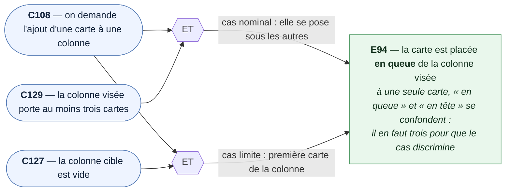

### E95 — Une carte est échangée avec sa voisine du dessus

*Cible : `moveCardUp` · Causes : `C113`, `¬C119`, `C129` · Sert `US8` · `D-C19`*

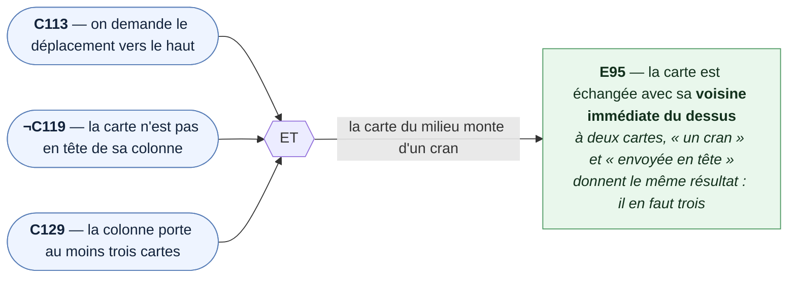

### E96 — Une carte est échangée avec sa voisine du dessous

*Cible : `moveCardDown` · Causes : `C114`, `¬C120`, `C129` · Sert `US8` · `D-C19`*

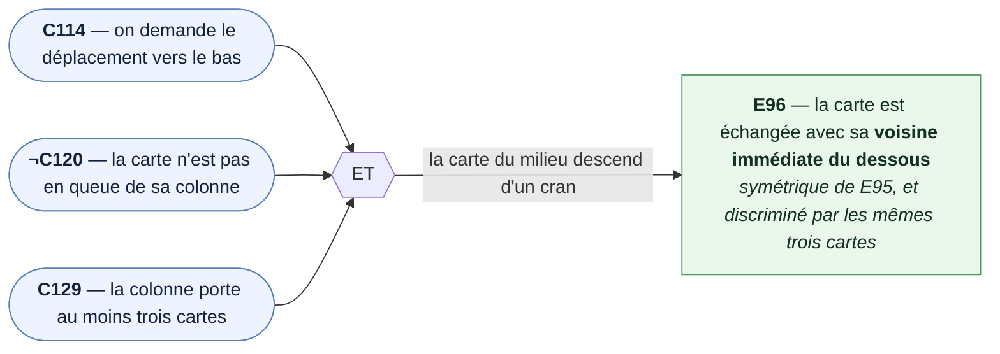

### E97 — Une carte passe dans la colonne de droite, au même rang

*Cible : `moveCardToNextColumn` · Causes : `C116`, `¬C122`, `C126` · Sert `US8` · `H-C4`*

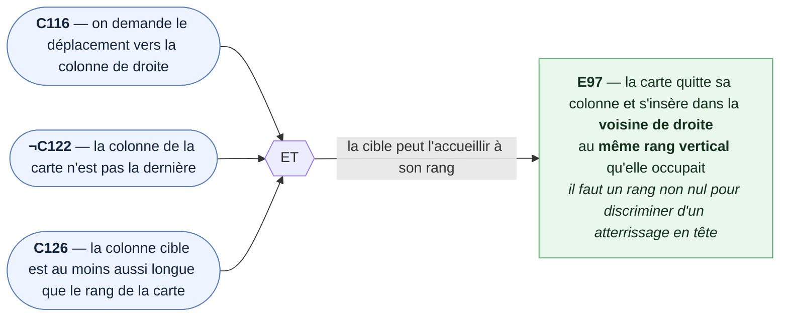

### E98 — Une carte passe dans la colonne de gauche, au même rang

*Cible : `moveCardToPreviousColumn` · Causes : `C115`, `¬C121`, `C126` · Sert `US8` · `H-C4`*

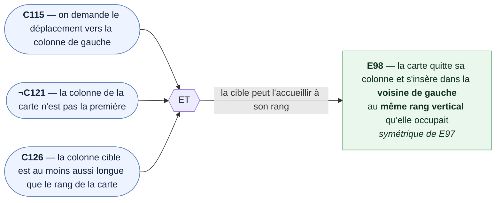

### E99 — Une carte qui change de colonne atterrit en dernier quand la cible est plus courte

*Cible : `moveCardToPreviousColumn`, `moveCardToNextColumn` · Causes : `C115`, `C116`, `C125`, `C127` · Sert `US8` · `H-C4`, `D-C18`*

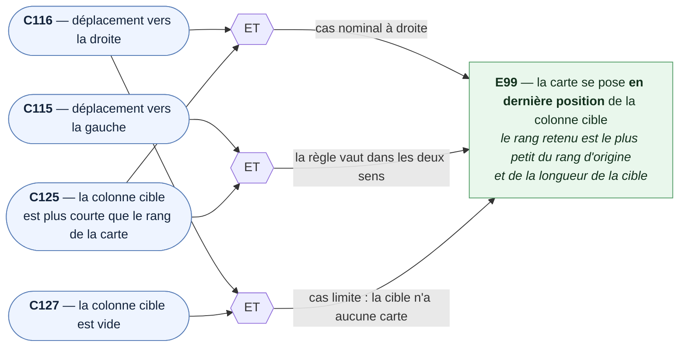

### E100 — Une carte est retirée de sa colonne

*Cible : `removeCard` · Causes : `C112`, `C129` · Sert `US6`*

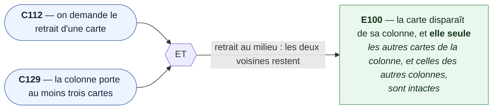

### E101 — Le texte d'une carte est remplacé, et d'elle seule

*Cible : `replaceCardText` · Causes : `C109`, `C131` · Sert `US3` · `D-C30`*

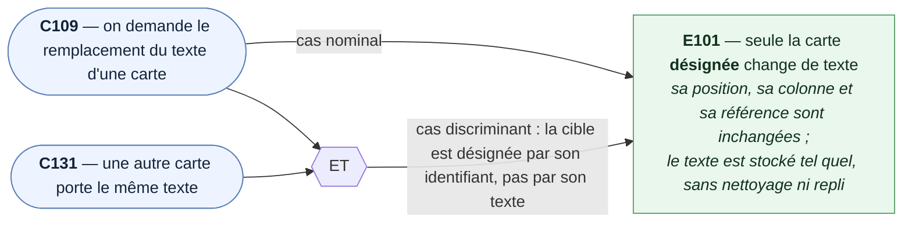

### E102 — Une note est posée sur une carte, et sur elle seule

*Cible : `setCardNote` · Causes : `C110`, `C129` · Sert `US4`*

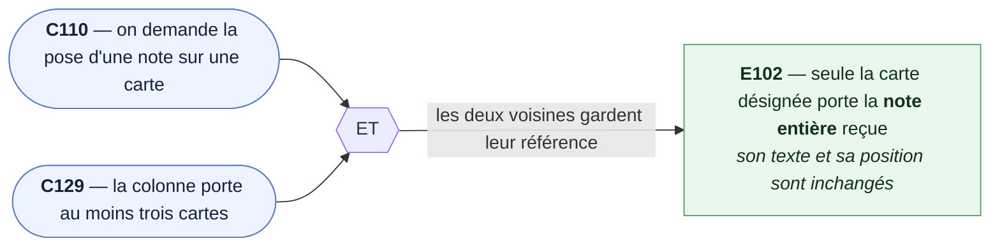

### E103 — La référence d'une carte est vidée

*Cible : `setCardNote` · Causes : `C111`, `C130` · Sert `US4` · `D-C35`*

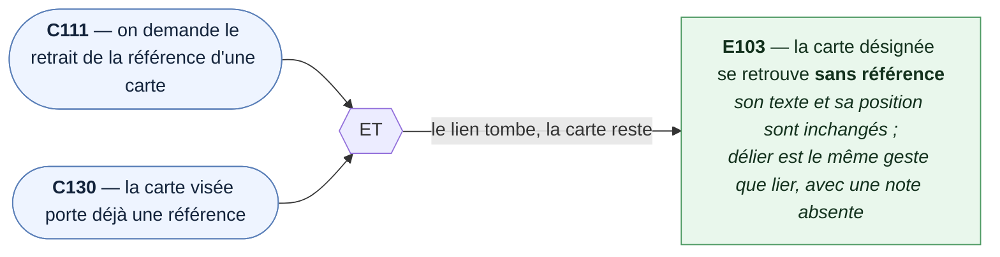

### E104 — Les positions restent contiguës et repartent de 0

*Cible : toutes les fonctions de geste · Causes : `C108`, `C112`, `C113`, `C129` · Sert `US2`, `US6`, `US8` · `D-C19`*

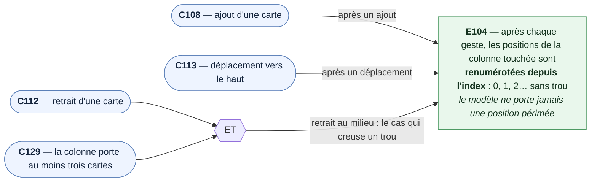

### E105 — Les deux colonnes concernées sont renumérotées

*Cible : `moveCardToNextColumn` · Causes : `C116`, `C126`, `C129` · Sert `US8` · `D-C19`*

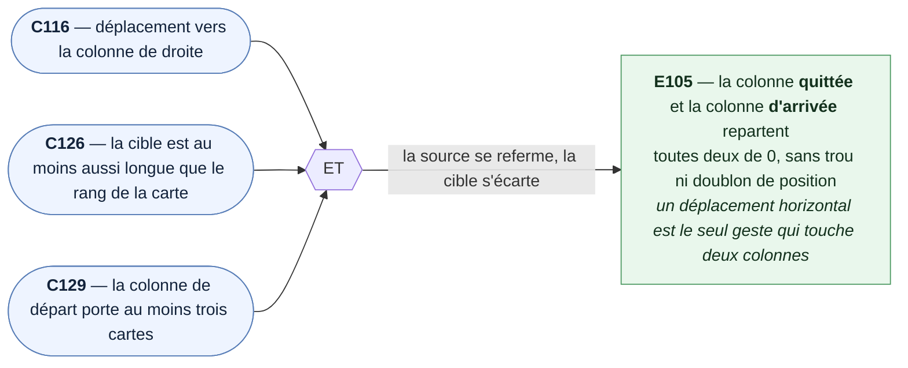

### E106 — La composition est rendue inchangée quand la carte est déjà en tête

*Cible : `moveCardUp` · Causes : `C113`, `C119` · Sert `US8` · `D3`*

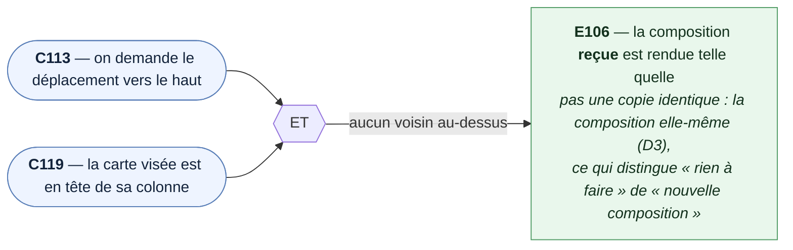

### E107 — La composition est rendue inchangée quand la carte est déjà en queue

*Cible : `moveCardDown` · Causes : `C114`, `C120` · Sert `US8` · `D3`*

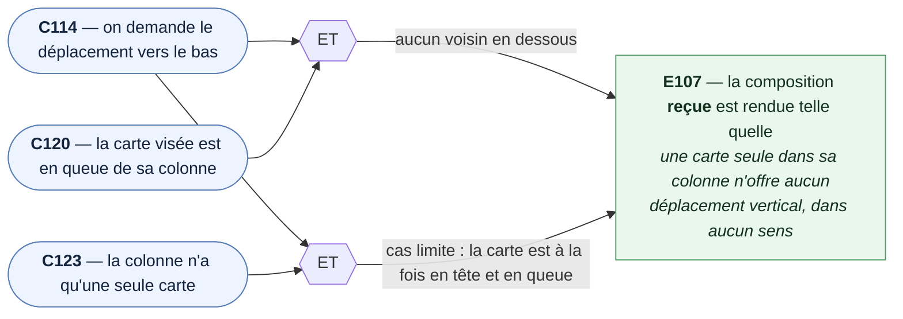

### E108 — La composition est rendue inchangée dans la première colonne

*Cible : `moveCardToPreviousColumn` · Causes : `C115`, `C121` · Sert `US8` · `D3`*

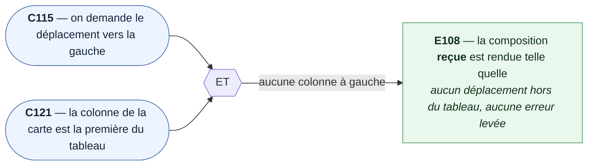

### E109 — La composition est rendue inchangée dans la dernière colonne

*Cible : `moveCardToNextColumn` · Causes : `C116`, `C122` · Sert `US8` · `D3`*

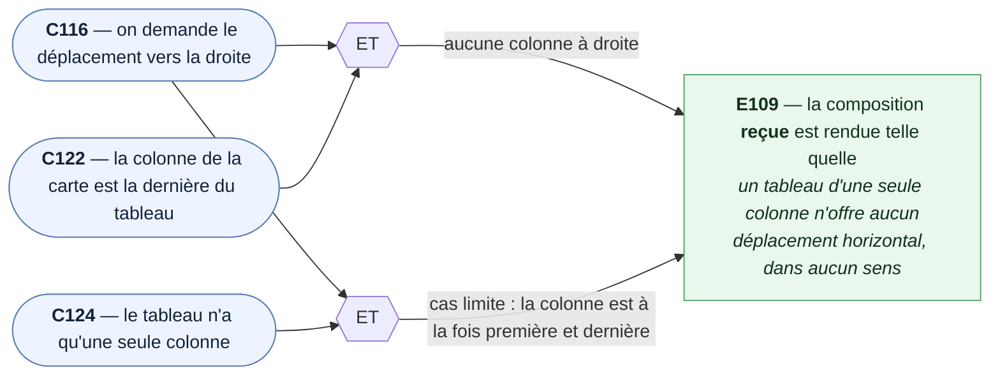

### E110 — La composition est rendue inchangée quand la cible n'existe pas

*Cible : toutes les fonctions de geste · Causes : `C128`, `C132` · Sert `US2` → `US8` · `D3`, `D8`*

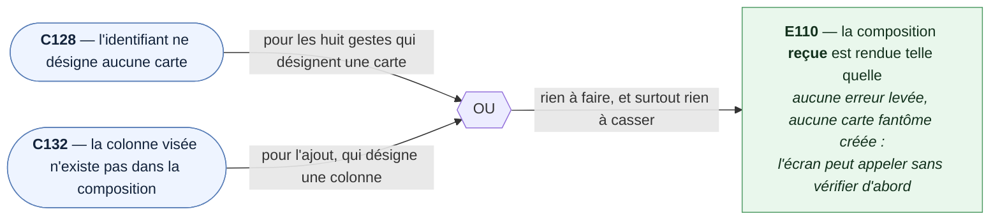

### E111 — La composition reçue n'est jamais modifiée

*Cible : les neuf fonctions de geste · Causes : `C108` → `C116` · Sert `US2` → `US8` · `D2`, `D9`*

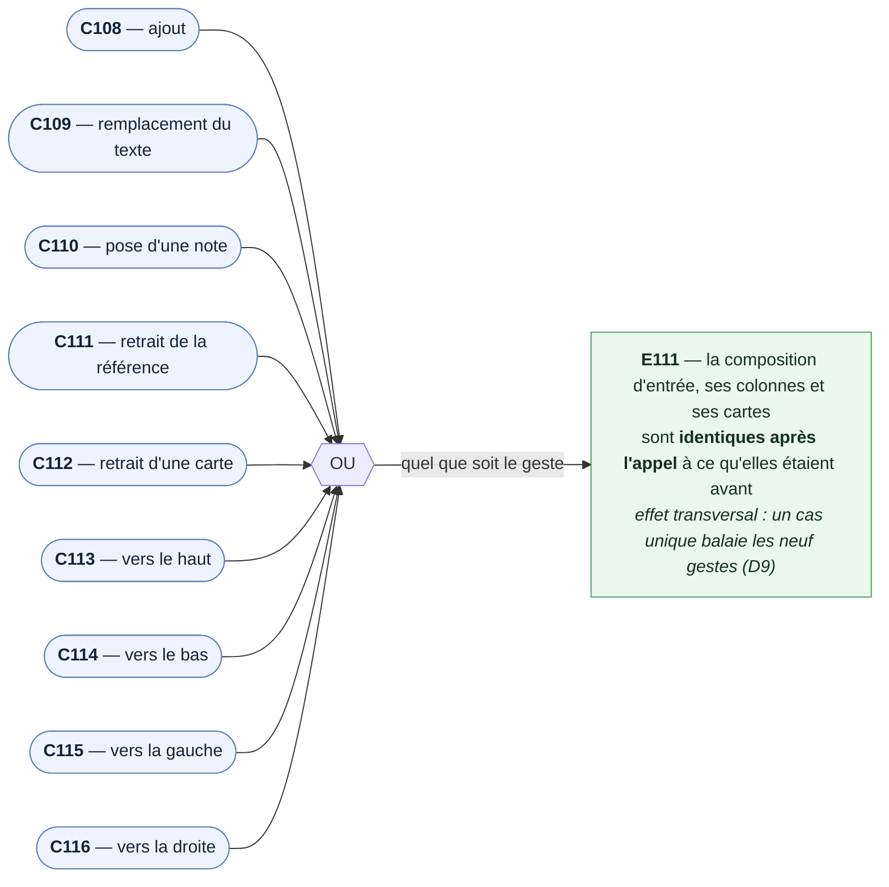

### E112 — Un déplacement ne change ni le texte, ni la référence, ni le nombre de cartes

*Cible : les quatre fonctions de déplacement · Causes : `C113`, `C116`, `C130` · Sert `US8`*

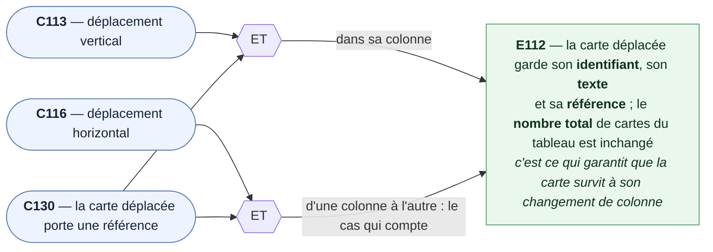

### E113 — La disponibilité d'un déplacement est fausse aux extrémités

*Cible : `canMoveCard` · Causes : `C117`, `C119` → `C124` · Sert `US8` · `D6`*

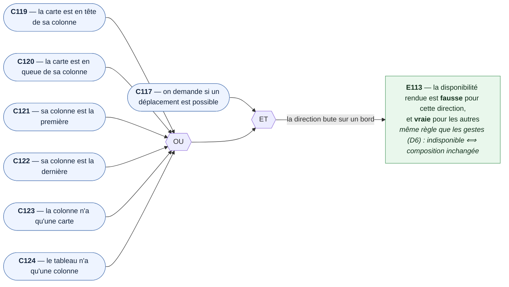

### E114 — La signature de composition bouge après chaque geste

*Cible : `compositionSignature` · Causes : `C118`, `C108`, `C109`, `C112`, `C113` · Sert `US10` · `D7`*

```mermaid
flowchart LR
    C118(["<b>C118</b> — on demande la signature de la composition"])
    C108(["<b>C108</b> — un ajout a eu lieu"])
    C109(["<b>C109</b> — un texte a été remplacé"])
    C112(["<b>C112</b> — une carte a été retirée"])
    C113(["<b>C113</b> — une carte a été déplacée"])

    OU1{{OU}}
    ET1{{ET}}

    C108 --> OU1
    C109 --> OU1
    C112 --> OU1
    C113 --> OU1

    C118 --> ET1
    OU1 --> ET1

    ET1 -- la composition n'est plus celle d'avant --> E114

    E114["<b>E114</b> — la signature <b>diffère</b> de celle d'avant le geste,<br/>et deux compositions de même contenu donnent la <b>même</b> signature<br/><i>elle ne porte que id/nom/position des colonnes et<br/>id/texte/identifiant de note/position des cartes (D7)</i>"]

    class C118,C108,C109,C112,C113 cause
    class E114 effet
    classDef cause fill:#eef4ff,stroke:#5a7fb8,color:#13233b
    classDef effet fill:#e9f7ec,stroke:#4e9a63,color:#13311d
```

---

## 6. Cas de test

> **Déduction :** un cas par **chemin** de diagramme, et **un seul comportement observable par
> cas**. Chaque ligne porte l'effet dont elle sort, les causes à mettre en place, et la user story
> servie.
>
> **Rédaction en boîte noire :** les cas disent ce qui est **vérifié**, jamais comment le code s'y
> prend. `ecrire_tests` les traduira un par un, dans l'ordre des groupes.

**Groupe 1 — Ajouter une carte**

| Cas | Ce qui est vérifié | Effet | Causes | US |
|---|---|---|---|---|
| **T1.1** | La carte ajoutée se retrouve **en queue** d'une colonne qui en portait déjà trois | E94 | C108, C129 | US2 |
| **T1.2** | La carte ajoutée à une colonne **vide** en devient l'unique carte | E94 | C108, C127 | US2 |
| **T1.3** | Les cartes déjà présentes **ne bougent pas** de rang, et les autres colonnes sont intactes | E94 | C108, C129 | US2 |
| **T1.4** | Ajouter à une colonne **inexistante** rend la composition telle quelle | E110 | C108, C132 | US2 |

**Groupe 2 — Modifier le texte d'une carte**

| Cas | Ce qui est vérifié | Effet | Causes | US |
|---|---|---|---|---|
| **T2.1** | Seule la carte désignée porte le nouveau texte | E101 | C109 | US3 |
| **T2.2** | Une **autre carte au même texte** n'est pas touchée : la cible est l'identifiant, pas le texte | E101 | C109, C131 | US3 |
| **T2.3** | Le texte est stocké **tel quel**, espaces compris : ni nettoyage, ni repli | E101 | C109 | US3 |
| **T2.4** | La position, la colonne et la référence de la carte sont **inchangées** | E101 | C109 | US3 |
| **T2.5** | Un identifiant **inconnu** rend la composition telle quelle | E110 | C109, C128 | US3 |

**Groupe 3 — Poser et retirer une référence**

| Cas | Ce qui est vérifié | Effet | Causes | US |
|---|---|---|---|---|
| **T3.1** | Seule la carte désignée porte la **note entière** reçue | E102 | C110, C129 | US4 |
| **T3.2** | Le texte et la position de la carte sont **inchangés** | E102 | C110 | US4 |
| **T3.3** | Une carte qui **portait** une référence se retrouve sans note | E103 | C111, C130 | US4 |
| **T3.4** | Retirer la référence d'une carte qui n'en a pas la laisse telle quelle | E103 | C111 | US4 |
| **T3.5** | Un identifiant **inconnu** rend la composition telle quelle | E110 | C110, C128 | US4 |

**Groupe 4 — Retirer une carte**

| Cas | Ce qui est vérifié | Effet | Causes | US |
|---|---|---|---|---|
| **T4.1** | La carte retirée **au milieu** disparaît, ses deux voisines restent | E100 | C112, C129 | US6 |
| **T4.2** | Les cartes des **autres colonnes** sont intactes | E100 | C112, C129 | US6 |
| **T4.3** | Retirer la **dernière** carte laisse une colonne vide, et non « non chargée » | E100 | C112, C123 | US6 |
| **T4.4** | Un identifiant **inconnu** rend la composition telle quelle | E110 | C112, C128 | US6 |

**Groupe 5 — Déplacer une carte dans sa colonne**

| Cas | Ce qui est vérifié | Effet | Causes | US |
|---|---|---|---|---|
| **T5.1** | La carte **du milieu** monte d'un cran, et d'un seul | E95 | C113, ¬C119, C129 | US8 |
| **T5.2** | La carte **du milieu** descend d'un cran, et d'un seul | E96 | C114, ¬C120, C129 | US8 |
| **T5.3** | Monter la carte **en tête** rend la composition telle quelle | E106 | C113, C119 | US8 |
| **T5.4** | Descendre la carte **en queue** rend la composition telle quelle | E107 | C114, C120 | US8 |
| **T5.5** | Une carte **seule** dans sa colonne ne bouge ni vers le haut ni vers le bas | E107 | C113, C114, C123 | US8 |
| **T5.6** | Le texte et la référence de la carte déplacée sont **inchangés** | E112 | C113, C130 | US8 |

**Groupe 6 — Déplacer une carte d'une colonne à l'autre**

| Cas | Ce qui est vérifié | Effet | Causes | US |
|---|---|---|---|---|
| **T6.1** | La carte passe à **droite** et garde son **rang vertical** | E97 | C116, ¬C122, C126 | US8 |
| **T6.2** | La carte passe à **gauche** et garde son **rang vertical** | E98 | C115, ¬C121, C126 | US8 |
| **T6.3** | Vers une cible **plus courte**, la carte se pose **en dernier** | E99 | C116, C125 | US8 |
| **T6.4** | La règle de l'atterrissage vaut **aussi vers la gauche** | E99 | C115, C125 | US8 |
| **T6.5** | Vers une cible **vide**, la carte en devient l'unique carte | E99 | C116, C127 | US8 |
| **T6.6** | Aller à **gauche** depuis la **première** colonne rend la composition telle quelle | E108 | C115, C121 | US8 |
| **T6.7** | Aller à **droite** depuis la **dernière** colonne rend la composition telle quelle | E109 | C116, C122 | US8 |
| **T6.8** | Dans un tableau d'**une seule colonne**, aucun des deux sens ne déplace | E109 | C115, C116, C124 | US8 |
| **T6.9** | La carte garde son **identifiant**, son texte et sa référence en changeant de colonne | E112 | C116, C130 | US8 |
| **T6.10** | Le **nombre total** de cartes du tableau est inchangé | E112 | C116 | US8 |
| **T6.11** | Les colonnes **ni source ni cible** sont intactes | E97 | C116, C126 | US8 |

**Groupe 7 — Renumérotation**

| Cas | Ce qui est vérifié | Effet | Causes | US |
|---|---|---|---|---|
| **T7.1** | Après un **ajout**, les positions de la colonne vont de 0 à n sans trou | E104 | C108, C129 | US2 |
| **T7.2** | Après un **retrait au milieu**, les positions se referment : pas de trou | E104 | C112, C129 | US6 |
| **T7.3** | Après un **déplacement vertical**, les positions suivent le nouvel ordre affiché | E104 | C113, C129 | US8 |
| **T7.4** | Après un **déplacement horizontal**, la colonne **quittée** repart de 0 sans trou | E105 | C116, C126, C129 | US8 |
| **T7.5** | Après ce même déplacement, la colonne **d'arrivée** repart de 0 sans doublon | E105 | C116, C126, C129 | US8 |

**Groupe 8 — Disponibilité d'un déplacement**

| Cas | Ce qui est vérifié | Effet | Causes | US |
|---|---|---|---|---|
| **T8.1** | « Vers le haut » est **indisponible** pour la carte en tête, disponible pour les autres | E113 | C117, C119 | US8 |
| **T8.2** | « Vers le bas » est **indisponible** pour la carte en queue | E113 | C117, C120 | US8 |
| **T8.3** | « Vers la gauche » est **indisponible** dans la première colonne | E113 | C117, C121 | US8 |
| **T8.4** | « Vers la droite » est **indisponible** dans la dernière colonne | E113 | C117, C122 | US8 |
| **T8.5** | Une carte **seule** dans sa colonne n'offre **aucun** déplacement vertical | E113 | C117, C123 | US8 |
| **T8.6** | Un tableau d'**une seule colonne** n'offre **aucun** déplacement horizontal | E113 | C117, C124 | US8 |
| **T8.7** | Un identifiant **inconnu** rend « indisponible » dans les quatre directions | E113 | C117, C128 | US8 |
| **T8.8** | Pour chaque direction, « indisponible » et « composition inchangée » **coïncident** | E113 | C117, C119, C120, C121, C122 | US8 |

**Groupe 9 — Pureté**

| Cas | Ce qui est vérifié | Effet | Causes | US |
|---|---|---|---|---|
| **T9.1** | Les **neuf gestes**, appliqués à une même composition, la laissent identique à ce qu'elle était | E111 | C108 → C116 | US2 → US8 |
| **T9.2** | Les colonnes **non touchées** par un geste reviennent telles quelles | E111 | C113 | US8 |

**Groupe 10 — Signature de la composition**

| Cas | Ce qui est vérifié | Effet | Causes | US |
|---|---|---|---|---|
| **T10.1** | La signature **change** après un ajout | E114 | C118, C108 | US10 |
| **T10.2** | La signature **change** après un remplacement de texte | E114 | C118, C109 | US10 |
| **T10.3** | La signature **change** après un retrait | E114 | C118, C112 | US10 |
| **T10.4** | La signature **change** après un déplacement, vertical comme horizontal | E114 | C118, C113 | US10 |
| **T10.5** | La signature **change** quand une référence est posée ou retirée | E114 | C118, C110, C111 | US10 |
| **T10.6** | Deux compositions de **même contenu** donnent la **même** signature | E114 | C118 | US10 |
| **T10.7** | La signature ne retient **que** les champs de `D7` : un champ hors signature ne la fait pas bouger | E114 | C118 | US10 |

### Compte et couverture

**49 cas** pour **21 effets** et **25 causes**. Chaque effet est porté par au moins un cas ; chaque
cause apparaît dans au moins un cas. Les effets les plus exposés — `E99` (atterrissage), `E104` et
`E105` (renumérotation), `E113` (extrémités) — portent plusieurs cas, un par chemin de diagramme.

---

## 7. Décisions à figer

Chacune change une assertion. À confirmer avant `ecrire_tests`.

| # | Décision |
|---|---|
| **D1** | Une colonne dont les cartes sont **« non chargées »** est lue comme **vide** par les gestes. Une colonne que le geste **touche** revient avec une liste explicite ; une colonne qu'il ne touche pas revient **telle quelle**. *(à confirmer)* |
| **D2** | Les fonctions rendent une **nouvelle** composition. Ni la composition reçue, ni ses colonnes, ni ses cartes ne sont modifiées. *(à confirmer)* |
| **D3** | Un geste qui **ne s'applique pas** rend la composition **reçue elle-même**, et non une copie identique. C'est ce qui permet de vérifier « rien n'a bougé » sans comparer champ à champ. *(à confirmer)* |
| **D4** | La renumérotation porte sur **toutes** les cartes de la colonne touchée, pas seulement celles qui ont bougé, et repart de **0**. *(à confirmer)* |
| **D5** | Le rang d'atterrissage horizontal est le **plus petit** du rang d'origine et de la longueur de la colonne cible. *(à confirmer)* |
| **D6** | `canMoveCard` et les fonctions de déplacement partagent la **même règle** : « indisponible » ⟺ « composition rendue inchangée ». `T8.8` vérifie cette équivalence. *(à confirmer)* |
| **D7** | La signature ne porte **que** : pour chaque colonne, identifiant, nom et position ; pour chaque carte, identifiant, texte, **identifiant** de note et position. Jamais le contenu de la note. *(à confirmer)* |
| **D8** | Toutes les fonctions passent par une localisation commune, qui ne trouve rien pour un identifiant inconnu — d'où `E110` pour **chacune** d'elles. *(à confirmer)* |
| **D9** | `E111` (pureté) est vérifié par **un cas unique balayant les neuf gestes** (`T9.1`), et non ré-asserté dans chaque cas. *(à confirmer — c'est la question laissée ouverte le 2026-11-11)* |
| **D10** | Le module s'appelle `core/services/kanban-composition.ts` et exporte des **fonctions nommées**, pas une classe : il n'a aucun état. *(à confirmer)* |

---

## 8. Contrat d'API

Ce module n'a pas de DOM : son contrat est sa **surface d'appel**, que les tests figent et que
l'implémentation devra honorer. Équivalent du « contrat DOM » des plans de composants.

| Fonction | Entrée | Sortie |
|---|---|---|
| `locateCard` | la composition, l'identifiant d'une carte | la colonne, son rang, la carte, son rang — ou rien |
| `addCardTo` | la composition, l'identifiant d'une colonne, une carte | une nouvelle composition |
| `replaceCardText` | la composition, l'identifiant d'une carte, un texte | une nouvelle composition |
| `setCardNote` | la composition, l'identifiant d'une carte, une note **ou son absence** | une nouvelle composition |
| `removeCard` | la composition, l'identifiant d'une carte | une nouvelle composition |
| `moveCardUp` · `moveCardDown` | la composition, l'identifiant d'une carte | une nouvelle composition |
| `moveCardToPreviousColumn` · `moveCardToNextColumn` | la composition, l'identifiant d'une carte | une nouvelle composition |
| `canMoveCard` | la composition, l'identifiant d'une carte, une direction | un booléen |
| `compositionSignature` | la composition | une chaîne |

**Directions** : vers le haut, vers le bas, vers la gauche, vers la droite — une valeur fermée,
partagée avec `KanbanColumnPanel` qui l'émet (`E134`).

---

## 9. Points encore ouverts

- **`locateCard` n'a pas d'effet à lui.** Elle est publique dans l'approche (`D-C18`) parce que
  l'écran en a besoin — nommer la carte dans la popup de retrait (`E143`). Mais aucun effet de la
  liste validée ne la couvre directement : elle n'est exercée qu'**à travers** les autres
  fonctions, et son cas limite est `E110`. **À trancher** : soit elle devient interne et l'écran
  obtient la carte autrement, soit elle gagne un effet propre dans le plan de l'écran.
- **`D3` est le pari le plus engageant.** Rendre la composition **reçue** quand rien ne s'applique
  simplifie beaucoup les assertions, mais impose à l'implémentation de ne pas reconstruire
  systématiquement. Si tu préfères qu'elle reconstruise toujours, `T5.3`, `T5.4`, `T6.6`, `T6.7`,
  `T6.8` et `T1.4` comparent alors le **contenu** au lieu de l'identité — même intention, assertions
  plus lourdes.
- **`T10.7` dépend entièrement de `D7`.** Si la signature devait inclure autre chose, ce cas serait
  à réécrire.

---

## 10. Ordre d'implémentation TDD suggéré

Rouge → vert, groupe par groupe. L'ordre suit les dépendances : rien n'y dépend de ce qui vient
après.

| Ordre | Groupe | Pourquoi ici |
|---|---|---|
| 1 | **Groupe 9** — Pureté (`T9.1`, `T9.2`) | Le filet. Posé d'abord, il tient pendant que tout le reste s'écrit. |
| 2 | **Groupe 1** — Ajouter | Le geste le plus simple, et celui qui fabrique les compositions des autres groupes. |
| 3 | **Groupe 2** — Modifier le texte | Aucun déplacement, aucune renumérotation. |
| 4 | **Groupe 3** — Référence | Même forme que le groupe 2. |
| 5 | **Groupe 4** — Retirer | Introduit le trou dans les positions. |
| 6 | **Groupe 7** — Renumérotation | Se referme sur les groupes 1, 4 et 5 : à faire une fois qu'ils existent. |
| 7 | **Groupe 5** — Déplacer dans la colonne | Premier déplacement, une seule colonne touchée. |
| 8 | **Groupe 6** — Déplacer entre colonnes | Le plus délicat : deux colonnes, l'atterrissage, les extrémités. |
| 9 | **Groupe 8** — Disponibilité | Se déduit du groupe 6, et `T8.8` vérifie leur cohérence. |
| 10 | **Groupe 10** — Signature | Indépendant, mais plus parlant une fois que tous les gestes existent. |
