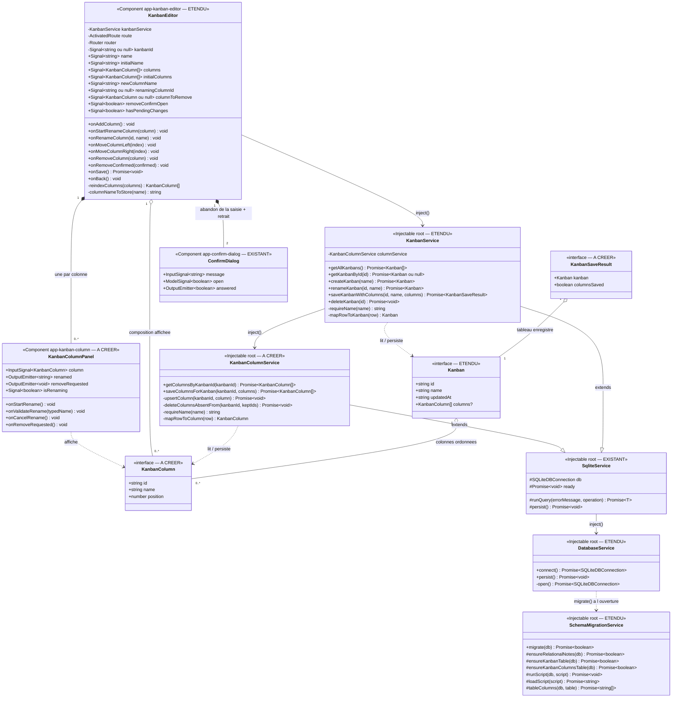

# Approche de développement — Kanban : les listes (colonnes) d'un tableau

> **Date :** 2026-11-05 · **Statut :** brouillon — à valider
> **SPEC :** `.agent/KANBAN/EDITION_LISTES/FEATURE_KANBAN_EDITION_LISTES.md` (US1 → US7)
> **Docs de référence :** `.agent/KANBAN/EDITION/APPROCHE_KANBAN_EDITION.md` (décisions `D-E1` →
> `D-E13`), `.agent/KANBAN/EDITION/REVUE_KANBAN_EDITION.md` (constat `E1`),
> `.agent/KANBAN/CRUD/APPROCHE_KANBAN_CRUD.md` (décisions `D-K1`, `D-K4`, `D-K11`)
> **Code de référence :** `core/models/{kanban.model,index}.ts`,
> `core/services/{sqlite-service,kanban-service,database.service,schema-migration.service}.ts`,
> `kanban-editor/`, `core/components/confirm-dialog/`,
> `public/assets/migrations/schema_kanban.sql`

Ce lot remplit la **zone de contenu** que le lot `EDITION` a livrée volontairement vide (`D-E11`) :
la colonne fantôme annonçant « *les listes et les cartes arriveront dans un prochain lot* » laisse
place aux **colonnes** du tableau. C'est aussi le premier lot depuis `CRUD` qui **change le schéma**
de la base, ce qui l'oblige à rouvrir deux chantiers d'infrastructure laissés ouverts : la migration
de schéma (`E1`) et l'application réelle des clés étrangères.

**Vocabulaire — à lire avant le reste.** L'utilisateur voit le mot « **liste** » ; le code dit
« **column** ». Ce n'est pas une coquetterie : dans ce dépôt, `kanban-list` désigne déjà **la liste
des tableaux** (l'écran `KanbanList`), et un modèle `KanbanList` aurait voulu dire exactement le
contraire de ce qu'il porte. « Column » est par ailleurs le terme kanban standard et déjà le
vocabulaire du gabarit existant (`.board-canvas > .ghost-column`, icône `view_column`). Toute
l'interface reste en « liste » ; seuls les identifiants du code et le nom de la table disent
« column » (`D-L5`).

---

## 0. Décisions de cadrage (hypothèses de la SPEC tranchées)

| # | Sujet | Choix retenu |
|---|-------|--------------|
| D-L1 | H-L2 — moment de la persistance | **Enregistrement groupé** : les quatre gestes ne touchent pas la base, le bouton « Enregistrer » existant écrit le nom **et** les colonnes. Prolonge `US4`/`US5` du lot `EDITION` aux colonnes, et préserve `D-K11` (ouvrir un tableau neuf n'écrit rien). *(Tranché le 2026-11-05.)* |
| D-L2 | H-L3 — geste de déplacement | **Boutons ← / →**, un cran à la fois, indisponibles aux extrémités. Le **glisser-déposer** est hors périmètre : il s'ajoutera par-dessus ce modèle sans le remettre en cause. |
| D-L3 | H-L4 — renommage d'une colonne | **Inclus** (`US3`), pour éviter d'avoir à retirer puis recréer une colonne mal nommée. |
| D-L4 | H-L5 — confirmation au retrait | **Oui**, `ConfirmDialog` — le composant des suppressions de notes et de tableaux (`US4`). |
| D-L5 | Nommage | Modèle **`KanbanColumn`** (`core/models/kanban-column.model.ts`, exporté par `models/index.ts`), service **`KanbanColumnService`** (`core/services/kanban-column-service.ts`, forme à tiret comme `kanban-service.ts`), table **`kanban_columns`**, script **`schema_kanban_columns.sql`**, champ **`Kanban.columns`**. `KanbanList` est pris par l'écran liste des tableaux. |
| D-L6 | Table | `kanban_columns (id, kanban_id, name, position)`. `kanban_id` **non nul**, `REFERENCES kanbans(id) ON DELETE CASCADE`. Index `(kanban_id, position)`. **Pas de dates** : rien ne les affiche, et `kanbans.updated_at` bouge déjà quand les colonnes changent (`D-K1`). **Aucune contrainte d'unicité** — ni sur `name`, ni sur `(kanban_id, name)` (deux colonnes homonymes sont permises dans un même tableau, l'`id` les distingue, comme `D-K4` pour les tableaux), ni sur `(kanban_id, position)` (voir `D-L10`). |
| D-L7 | Modèle | `KanbanColumn { id, name, position }`, mappé 1-pour-1 sur la table sauf `kanban_id` : une colonne est toujours lue et écrite **dans le contexte d'un tableau**, le porter deux fois inviterait la contradiction. `Kanban.columns?: KanbanColumn[]` — **optionnel**, et la distinction est porteuse de sens : `undefined` = *colonnes non chargées*, `[]` = *chargées, le tableau n'en a aucune*. |
| D-L8 | Partage des lectures | **`getAllKanbans` reste une requête sur `kanbans`, et rien d'autre** : il sert le CRUD des tableaux, qui n'affiche aucune colonne, et renvoie donc des `Kanban` sans `columns`. **`getKanbanById` ramène le tableau *et* ses colonnes** (deux requêtes), parce que c'est la méthode qui sert l'éditeur. *(Tranché le 2026-11-05.)* |
| D-L9 | Où vit la logique | **`KanbanColumnService`** porte les requêtes de `kanban_columns` — un service par table, comme `NotesService` / `CategoriesService` / `KanbanService`. L'**enregistrement d'ensemble** (nom + colonnes) est porté par **`KanbanService`**, qui injecte `KanbanColumnService`. L'écran n'injecte donc **que** `KanbanService` et n'orchestre aucune séquence d'écritures. |
| D-L10 | Stratégie d'écriture | **Upsert puis suppression des absentes** : pour chaque colonne affichée, `INSERT … ON CONFLICT(id) DO UPDATE SET name, position`, **puis** suppression des colonnes du tableau dont l'`id` n'est plus affiché, **puis un seul** `persist()`. Ni diff, ni remplacement en bloc : le `DELETE`/réinsertion et `INSERT OR REPLACE` effacent physiquement les lignes et **déclencheraient la cascade des cartes** au lot suivant. L'upsert fait un vrai `UPDATE`, donc les `id` — et les cartes qui s'y accrocheront — survivent. L'upsert **précède** la suppression (rien n'est détruit avant que le nouvel état soit en place), ce qui autorise une **collision temporaire de positions** : d'où l'absence de contrainte d'unicité sur `(kanban_id, position)` (`D-L6`). |
| D-L11 | Origine des identifiants | **Générés par l'écran** à l'ajout (`crypto.randomUUID()`), pas par le service à l'insertion — écart assumé avec `createKanban`. L'écran doit pouvoir désigner la colonne à renommer, retirer ou déplacer **avant** qu'elle existe en base, et `D-L10` exige des `id` stables. |
| D-L12 | Représentation de l'ordre | Lecture **triée par `position`** ; après chaque ajout, retrait ou déplacement, l'écran réordonne son tableau **puis renumérote** `position` depuis l'index (base 0) ; l'écriture envoie `column.position` tel quel. Le modèle n'est donc jamais porteur d'une position fausse, et le service n'a pas à redériver l'ordre. |
| D-L13 | Atomicité | **Pas de transaction** (il n'y en a aucune dans le dépôt) : le tableau d'abord, les colonnes ensuite. Deux obligations qui en découlent — (1) l'écran **bascule en mode édition dès que le tableau est créé**, avant même de tenter les colonnes, sinon un second appui sur « Enregistrer » créerait un **deuxième tableau** ; (2) l'enregistrement est **rejouable**, ce que `D-L10` garantit par construction : rejouer l'état affiché converge vers le bon résultat quel que soit l'état intermédiaire laissé par un échec. *(Tranché le 2026-11-05.)* |
| D-L14 | Intégrité référentielle | **`PRAGMA foreign_keys = ON`** à l'ouverture de la connexion, cascade déclarée sur `kanban_columns.kanban_id`. Sans le pragma, SQLite ignore purement et simplement la cascade et la suppression d'un tableau laisserait ses colonnes orphelines. Effet de bord **voulu** : `notes.category_id ON DELETE SET NULL` devient active elle aussi (voir §4). **Mécanique, vérifiée dans le plugin** *(précisé le 2026-11-07)* : `SQLiteDBConnection.execute(statements, transaction = true)` enrobe par défaut ce qu'il exécute dans une transaction, où SQLite ignore le pragma en silence. Le pragma est donc posé par `db.execute('PRAGMA foreign_keys = ON', false)` — **second argument explicite**. C'est la seule façon qu'il prenne effet. |
| D-L15 | Migration de schéma | **`migrate()` perd son court-circuit** sur la présence de `categories` et devient une suite d'étapes indépendantes, chacune gardée par son `isTable` : notes/catégories relationnelles (**inchangé**), puis `schema_kanban.sql` si `kanbans` manque (**ferme `E1`**), puis `schema_kanban_columns.sql` si `kanban_columns` manque. Le **seed binaire** `family_notesSQLite.db` n'est **pas** modifié : l'étape 3 crée la table partout, installation neuve comprise. |
| D-L16 | H-L6 — sort de l'écran après enregistrement | **Retour à la liste maintenu** (`D-E1` inchangé) : ce lot ne change pas deux choses à la fois. **Question laissée ouverte** dans la SPEC — composer des colonnes puis être éjecté du tableau à chaque enregistrement pourrait justifier de rester sur l'écran, ce qui deviendra franchement pénible au lot « cartes ». |
| D-L17 | H-L7 — nom par défaut d'une colonne | **« Sans titre »**, même repli et même constante d'esprit que pour le nom d'un tableau (`D-E2`) : le repli se fait **à la validation de la saisie**, pas pendant la frappe. Le refus d'un nom vide par le service reste un **filet** (`D-E10`). |
| D-L18 | H-L8 — saisie du nom | **Sur place** : une colonne de saisie à droite des colonnes existantes pour l'ajout, et la saisie **dans l'en-tête** de la colonne pour le renommage. Pas de popup dédiée — `ConfirmDialog` ne sert qu'au retrait (`D-L4`). |
| D-L19 | Portée réelle de la garantie d'`US7` | Le critère de la SPEC « *un échec ne crée, ne modifie, ni ne supprime aucune liste en base* » **n'est pas tenable** avec `D-L13` : un échec survenu après l'écriture du tableau laisse la base dans un état intermédiaire (tableau enregistré, colonnes pas encore, ou à moitié). La garantie réellement tenue est : **l'écran et sa composition restent intacts, et l'enregistrement est rejouable**. → **SPEC retouchée le 2026-11-05** : `US6` et `US7` réécrites, réserve inscrite en clair, hypothèse `H-L12` ajoutée. |
| D-L24 | Échec des colonnes après écriture du tableau — **signature** | **Ce n'est pas une exception, c'est un résultat.** `saveKanbanWithColumns` renvoie un **`KanbanSaveResult`** — le tableau tel qu'il est en base, et un `columnsSaved` qui dit si les colonnes ont suivi. Elle ne **jette** que lorsque l'écriture du **tableau** échoue, cas où rien n'a été écrit. *Pourquoi :* `D-L13` exige que l'écran bascule en mode édition **dès** la création, sinon un ré-essai crée un second tableau ; or une exception **emporte l'identifiant** du tableau fraîchement créé, et l'écran n'a plus aucun moyen de le connaître. Trou découvert en construisant le diagramme Cause-Effet d'`E27` du plan de test, **tranché le 2026-11-06**. L'erreur sous-jacente n'est pas perdue : `runQuery` la journalise déjà avant que `saveKanbanWithColumns` ne la convertisse en `columnsSaved: false`. |
| D-L20 | H-L11 — maquette | **Pas de nouvelle maquette.** `REVUE_KANBAN_EDITION.md` a acté que `MAQUETTE_KANBAN_EDITOR.html` avait fini son office (fixer le contrat DOM avant le plan de test) et que **le code fait foi**. Le contrat DOM des colonnes sera fixé directement par `plan_test`, à partir du gabarit existant. *(À renverser si tu veux voir l'écran avant de le tester.)* |
| D-L21 | Composant dédié pour une colonne | **Oui** : une colonne est un composant à part entière, `app-kanban-column` (dossier `kanban-column/`), au même niveau que les autres composants — le dépôt range ainsi `calendar-day/` et `calendar-event/`, sous-composants de `calendar/`. Il porte le **titre** de la colonne et, sous lui, la **zone qui accueillera les cartes** au lot suivant : il prend le rôle d'ancrage que `D-E11` tenait pour ce lot-ci. |
| D-L22 | Nom de la classe du composant | **`KanbanColumnPanel`**, sélecteur `app-kanban-column`, dossier `kanban-column/`. Le nom `KanbanColumn` est pris par le **modèle** (`D-L5`), et contrairement au précédent `CalendarDay` — composant et modèle homonymes qui coexistent parce que le composant n'importe pas le modèle — **ce composant reçoit une `KanbanColumn` en entrée**. La collision serait donc réelle, et l'alias d'import qui l'éviterait coûterait en lisibilité. |
| D-L23 | Répartition des commandes | **Sur la colonne** : son titre (affichage et saisie de renommage sur place) et sa **corbeille** de suppression. **Sur l'éditeur** : le bouton d'**ajout** d'une colonne et les boutons de **déplacement** ← / → de chaque colonne, rendus autour d'elle. Le composant colonne est **présentationnel** : il n'injecte aucun service, ne décide rien, et se contente d'émettre « on m'a renommée » et « on demande mon retrait ». Le nettoyage du nom, le repli « Sans titre » (`D-L17`), la popup de confirmation, la renumérotation et l'enregistrement restent **dans l'éditeur**, en un seul endroit. |

---

## 1. Diagramme de classes

> **Légende :** « EXISTANT » = réutilisé sans modification ; « ETENDU » = code existant auquel ce
> lot ajoute quelque chose ; « A CREER » = nouveau code. `?` = optionnel.

**À créer :** le modèle `KanbanColumn`, le service `KanbanColumnService`, le composant
`KanbanColumnPanel` (`kanban-column/`), le script `schema_kanban_columns.sql`.
**Étendu :** le modèle `Kanban` (un champ optionnel), `KanbanService` (`getKanbanById` enrichi +
`saveKanbanWithColumns`), `KanbanColumnService` mis à part, `SchemaMigrationService` (étapes
gardées), `DatabaseService` (le pragma), `KanbanEditor` (classe, gabarit, feuille de style) et
`models/index.ts`.
**Existant réutilisé sans modification :** `SqliteService`, `ConfirmDialog`, `KanbanList`,
`createKanban`, `renameKanban`, `deleteKanban`, `getAllKanbans`, `app.routes.ts`.

**Changement de schéma** : après ce lot, `npm run build` puis `npx cap sync` sont **obligatoires**
pour que le nouveau script arrive dans les assets de l'application (cf. `scripts/README.md`).

---

## 2. Lecture des relations

| Relation | Signification |
|---|---|
| `Kanban` agrège `KanbanColumn` | Un tableau porte de 0 à n colonnes **ordonnées**. Agrégation et non composition : le champ est optionnel, et un `Kanban` lu par `getAllKanbans` existe parfaitement sans ses colonnes (`D-L7`, `D-L8`). |
| `KanbanColumnService` hérite de `SqliteService` | Même enrobage que les autres sources : attente de la base prête, journalisation puis relance de l'erreur. Les deux services **partagent la même connexion** (`DatabaseService`), donc aucune question d'accès concurrent entre eux. |
| `KanbanService` injecte `KanbanColumnService` | `getKanbanById` lui demande les colonnes du tableau, `saveKanbanWithColumns` lui délègue leur écriture. `KanbanService` **n'écrit jamais de SQL sur `kanban_columns`** : la table a un seul propriétaire (`D-L9`). |
| `KanbanEditor` utilise `KanbanService` **seulement** | L'écran ne connaît pas `KanbanColumnService`. Il lit un `Kanban` avec ses colonnes, et enregistre par un seul appel : aucune séquence d'écritures dans l'UI. |
| `KanbanEditor` agrège `KanbanColumn` | La **composition affichée**, en mémoire, manipulée par les quatre gestes. Elle n'est pas la base : seul l'enregistrement les réconcilie (`D-L1`). |
| `KanbanEditor` contient **deux** `ConfirmDialog` | Deux questions distinctes, deux instances : l'abandon d'une composition non enregistrée (`US7`, existante) et le retrait d'une colonne (`US4`, nouvelle). Les messages et les suites diffèrent, les mutualiser demanderait un état « quelle question est posée ? » qui ne gagne rien. |
| `DatabaseService` appelle `SchemaMigrationService` | Inchangé dans son principe. Le pragma est posé **entre** l'ouverture de la connexion et la migration (`D-L14`, §4). |
| `KanbanEditor` **compose** `KanbanColumnPanel` | Une instance **par colonne** de la composition affichée, créée et détruite avec elle. L'éditeur entoure chacune de ses deux boutons de déplacement et ferme la zone par le bouton d'ajout (`D-L23`). |
| `KanbanColumnPanel` affiche une `KanbanColumn` | Il **reçoit** la colonne, n'en garde aucune copie et ne la modifie pas : il émet le nom tapé et la demande de retrait, l'éditeur décide. Un composant présentationnel, donc testable seul, sans service ni routeur (`D-L23`). |

---

## 3. Approche de développement

### Règle commune : le nom d'une colonne (US2, US3)

Même traitement que le nom d'un tableau, et pour la même raison — ce que l'utilisateur tape est
affiché tel quel, ce qui est **stocké** est nettoyé :

- **à la validation de la saisie** (ajout ou renommage) — le nom est débarrassé de ses espaces de
  début et de fin, les espaces intérieurs étant partie du nom ; s'il ne reste rien, c'est
  « **Sans titre** » qui est retenu (`D-L17`) ;
- **pour la détection d'une modification en attente** — la comparaison porte sur les noms nettoyés,
  comme `D-E3` le fait pour le tableau.

Le service refuse un nom vide (`requireName`, calqué sur `KanbanService`) : grâce au repli
ci-dessus il n'en reçoit jamais, et ce refus reste un **filet**, pas un chemin normal.

### Lot A — Schéma, migration et clés étrangères (socle de tous les autres)

*Rien de ce lot ne fonctionne sur un appareil déjà installé sans cette brique : la table `kanbans`
elle-même n'existe aujourd'hui que par le **seed**, jamais par une migration (`E1`).*

**Le script `schema_kanban_columns.sql`** (nouveau fichier des assets, sur le modèle de
`schema_kanban.sql`) crée la table `kanban_columns` telle que `D-L6` la décrit et son index
`(kanban_id, position)`. Comme ses voisins, il est **rejouable** (`CREATE TABLE IF NOT EXISTS`) et
exécutable à la main avec `sqlite3`. **Aucun SQL n'est dupliqué en TypeScript.**

**Quand l'application ouvre la base…**
- — j'ouvre la connexion comme aujourd'hui ;
- — **j'active les clés étrangères** sur cette connexion (`PRAGMA foreign_keys = ON`), **avant**
  toute migration : le pragma est propre à la connexion, et il est ignoré à l'intérieur d'une
  transaction — il doit donc être posé tôt et hors transaction (`D-L14`) ;
- — je passe la main à la migration de schéma.

**Quand la migration s'exécute…**
- — je n'ai plus de raccourci « *la table `categories` existe, donc tout est à jour* » : cette
  sortie anticipée est précisément ce qui empêchait `schema_kanban.sql` d'être joué un jour (`E1`) ;
- — **étape 1, notes et catégories** — inchangée dans son contenu : base vide → schéma courant,
  ancien format (`notes.category`) → migration relationnelle, cas limite (notes relationnelles sans
  `categories`) → table des catégories puis ajout de la colonne. Elle est désormais **gardée** par
  la présence de `categories` au lieu de court-circuiter tout le reste ;
- — **étape 2, les tableaux** — si la table `kanbans` manque, je joue `schema_kanban.sql` ;
- — **étape 3, les colonnes** — si la table `kanban_columns` manque, je joue
  `schema_kanban_columns.sql` ;
- — je signale à l'appelant qu'**au moins une étape** a touché la base, pour qu'il flushe le store.

**Cas limites :**
- **installation neuve** : le seed apporte `kanbans` mais pas `kanban_columns` ; les étapes 1 et 2
  ne font rien (gardes), l'étape 3 crée la table ;
- **base déjà installée** (le cas qui échouait) : les trois étapes se présentent chacune à leur
  tour et seules celles qui manquent s'exécutent ;
- **base à l'ancien format** : l'étape 1 fait la migration relationnelle, puis les étapes 2 et 3
  s'exécutent dans la même passe — ce qui n'arrivait jamais auparavant.

### Lot B — `KanbanColumnService` : lecture des colonnes (US1)

**Quand on me demande les colonnes d'un tableau…**
- — je passe par le même enrobage que les autres lectures (base prête, erreur journalisée puis
  relancée) ;
- — je cherche les lignes de `kanban_columns` portant cet identifiant de tableau, **triées par
  `position` croissante** ;
- — je convertis chaque ligne vers `KanbanColumn` (identifiant, nom, position) et je renvoie le
  tableau obtenu ;
- — **si aucune ligne ne correspond**, je renvoie un **tableau vide** : un tableau sans colonne
  n'est pas une anomalie (`US1`) ;
- — si la base échoue, je relance l'erreur ; c'est l'appelant qui décide quoi en montrer.

*Rappel de méthode (mémoire projet) : les tests assertent les **données renvoyées** — les colonnes
dans l'ordre, le tableau vide, l'erreur relancée — **jamais** la requête SQL émise.*

### Lot C — `KanbanColumnService` : écriture des colonnes (US6)

**Quand on me demande d'enregistrer les colonnes d'un tableau…**
- — je vérifie d'abord **tous** les noms (filet `requireName`) : un lot comportant un nom vide est
  refusé **avant** que la base soit touchée ;
- — **pour chaque colonne affichée, dans l'ordre reçu**, j'insère la ligne — et si son identifiant
  existe déjà, je me contente de **mettre à jour** son nom et sa position (`ON CONFLICT(id) DO
  UPDATE`). C'est un vrai `UPDATE` : la ligne n'est jamais détruite, donc rien de ce qui s'y
  rattachera (les cartes) ne tombe (`D-L10`) ;
- — **ensuite seulement**, je supprime les colonnes **de ce tableau** dont l'identifiant n'est plus
  dans la composition reçue ;
- — je **persiste une seule fois**, à la fin, et je renvoie les colonnes enregistrées ;
- — si quoi que ce soit échoue, je relance l'erreur : l'appelant saura que la composition n'est pas
  intégralement en base.

**Cas limites :**
- **plus aucune colonne** (la dernière vient d'être retirée) : la suppression des absentes porte
  alors sur **toutes** les colonnes du tableau — à écrire comme un cas à part, `NOT IN ()` avec une
  liste vide n'étant pas du SQL valide ;
- **collision temporaire de positions** entre une colonne déplacée et une colonne encore présente
  mais promise à la suppression : sans effet, aucune contrainte d'unicité ne porte sur
  `(kanban_id, position)` (`D-L6`) ;
- **aucune modification réelle** : rejouer la même composition réécrit les mêmes valeurs et ne
  supprime rien — l'opération est **idempotente**, c'est ce qui rend `D-L13` tenable ;
- la suppression est **toujours restreinte au tableau concerné** : les colonnes des autres tableaux
  ne sont jamais candidates.

### Lot D — `KanbanService` : lecture unitaire enrichie et enregistrement d'ensemble (US1, US6)

**Quand l'écran demande un tableau par son identifiant…**
- — je lis la ligne de `kanbans` comme aujourd'hui ;
- — **si aucune ligne ne correspond**, je renvoie `null` **sans** demander de colonnes : rien à
  charger pour un tableau qui n'existe pas (`D-E4`) ;
- — sinon je demande ses colonnes au service des colonnes (lot B) et je renvoie le tableau **avec**
  son champ `columns` rempli — éventuellement un tableau vide (`D-L7`, `D-L8`) ;
- — si l'une des deux lectures échoue, je relance l'erreur : l'écran affiche son état d'erreur de
  chargement, comme aujourd'hui.

**Quand l'écran demande d'enregistrer un tableau et ses colonnes…**
- — **si aucun identifiant ne m'est donné** (tableau neuf), je crée le tableau avec le nom reçu,
  puis j'enregistre ses colonnes sous l'identifiant **du tableau fraîchement créé** ;
- — **si un identifiant m'est donné**, je renomme le tableau — ce qui rafraîchit sa date de
  dernière modification, d'où sa remontée en tête de liste — puis j'enregistre ses colonnes ;
- — je renvoie un **résultat d'enregistrement** : le tableau tel qu'il est désormais en base, et
  l'information « **les colonnes ont-elles suivi ?** » (`D-L24`) ;
- — **si l'écriture du tableau échoue**, je **jette** sans avoir touché aux colonnes : rien n'a été
  écrit du tout, il n'y a rien à rapporter à l'appelant qu'une erreur ;
- — **si l'écriture des colonnes échoue** après celle du tableau, je **ne jette pas** : je renvoie
  le tableau — **identifiant compris**, y compris celui d'un tableau qui vient d'être créé — en
  signalant que les colonnes n'ont pas suivi. C'est l'état intermédiaire assumé par `D-L13`, et
  c'est la seule forme qui laisse l'écran basculer en mode édition pour que le ré-essai ne duplique
  rien (lot K). Une exception, elle, emporterait cet identifiant avec elle. L'erreur d'origine
  reste journalisée par `runQuery`.

*`getAllKanbans`, `createKanban`, `renameKanban` et `deleteKanban` ne sont pas touchés (`D-L8`).*

### Lot E — Le composant colonne : `KanbanColumnPanel` (US1, US3, US4)

*Composant **présentationnel** : aucun service injecté, aucun routeur, aucune décision. Il se teste
seul, en lui donnant une colonne et en écoutant ce qu'il émet (`D-L23`).*

**Ce qu'il reçoit et ce qu'il montre…**
- — il reçoit **une colonne** (`KanbanColumn`) et affiche son **nom** dans un en-tête ;
- — l'en-tête porte une **corbeille**, le geste de retrait de cette colonne (`D-L23`) ;
- — sous l'en-tête, il réserve une **zone de contenu vide**, qui accueillera les **cartes** au lot
  suivant. C'est l'ancrage que `D-E11` tenait pour ce lot-ci, descendu d'un cran : la colonne
  fantôme de l'éditeur disparaît, cette zone-ci la remplace (`D-L21`).

**Quand je touche le nom de la colonne…**
- — j'ouvre la **saisie sur place** dans l'en-tête, pré-remplie avec le nom actuel (`D-L18`) ;
- — **si je valide**, j'émets « renommée », avec le texte **tel qu'il a été tapé** — ni nettoyé, ni
  replié sur « Sans titre » : ces règles appartiennent à l'éditeur, qui les applique déjà au nom du
  tableau, et les dupliquer ici les ferait diverger un jour (`D-L23`) ;
- — **si je renonce**, je referme la saisie et je n'émets rien ;
- — dans les deux cas je ne modifie **pas** la colonne reçue : c'est l'éditeur qui la remplacera, et
  le nouveau nom me reviendra par l'entrée.

**Quand je touche la corbeille…**
- — j'émets « retrait demandé » et **rien d'autre** : ni popup, ni suppression. L'éditeur porte la
  confirmation (`D-L4`) et la composition.

### Lot F — L'éditeur affiche la zone de contenu (US1)

**Quand le tableau que j'édite est chargé…**
- — je prends son nom comme aujourd'hui, et je retiens aussi ses **colonnes** comme composition
  affichée **et** comme composition de départ — celle à laquelle je comparerai pour savoir si une
  modification est en attente (lot K) ;
- — j'affiche **une colonne par élément** de la composition, **horizontalement, dans l'ordre**,
  chacune rendue par le composant du lot E ;
- — j'entoure chaque colonne de ses **deux boutons de déplacement** ← / → (`D-L23`) ;
- — je ferme la zone, **à droite de la dernière colonne**, par le bouton d'**ajout** d'une colonne ;
- — **si le tableau n'a aucune colonne**, j'affiche un **état vide** invitant à en ajouter une — le
  bouton d'ajout reste visible. L'ancienne colonne fantôme et son texte « *les listes et les cartes
  arriveront dans un prochain lot* » disparaissent (`D-E11` est retirée) ;
- — la zone reste **défilable horizontalement** quand les colonnes dépassent la largeur de l'écran.

**Quand j'arrive sur un tableau neuf…**
- — je démarre avec **aucune colonne** et une composition de départ **vide** : le premier ajout
  compte donc comme une modification en attente ;
- — je n'appelle **aucune** lecture et je n'écris rien (`D-K11`).

### Lot G — Ajouter une colonne (US2)

**Quand je touche le bouton d'ajout…**
- — j'ouvre la saisie du nom **sur place**, à droite des colonnes existantes (`D-L18`).

**Quand je valide la saisie…**
- — je calcule le **nom à retenir** : la saisie nettoyée, ou « Sans titre » s'il n'en reste rien
  (`D-L17`) ;
- — je crée une colonne portant un **identifiant neuf** (`crypto.randomUUID()`, `D-L11`) et je
  l'ajoute **en dernière position** ;
- — je **renumérote** les positions depuis l'index (`D-L12`) ;
- — une instance du composant colonne apparaît pour elle, avec ses boutons de déplacement ;
- — je vide la saisie et la laisse ouverte : plusieurs colonnes peuvent être ajoutées à la suite ;
- — je **n'écris rien en base** (`D-L1`) : la composition est désormais en attente d'enregistrement.

**Cas limites :** une saisie **vide ou faite d'espaces** donne « Sans titre » ; **renoncer** à la
saisie n'ajoute **aucune** colonne ; deux colonnes **homonymes** sont acceptées, leurs identifiants
les distinguent (`D-L6`).

### Lot H — Renommer une colonne (US3)

**Quand une colonne m'annonce qu'elle a été renommée…**
- — je reçois le **texte tapé** (lot E) et je calcule le nom à retenir : nettoyé, ou « Sans titre »
  s'il n'en reste rien — exactement les règles du nom du tableau (`D-L17`) ;
- — je remplace le nom de **cette** colonne, et d'elle seule, dans la composition affichée ;
- — je ne touche **ni à sa position**, ni à celle des autres ;
- — je **n'écris rien en base**.

**Cas limites :** **renoncer** à la saisie ne me fait rien parvenir, donc rien ne change ; valider
**sans avoir rien changé** laisse la composition identique — et ne doit donc **pas** faire
apparaître une modification en attente, la comparaison portant sur les noms nettoyés (lot K).

### Lot I — Retirer une colonne (US4)

**Quand une colonne m'annonce que son retrait est demandé (sa corbeille)…**
- — je retiens **laquelle** est visée et j'ouvre la popup de confirmation, dont le message **nomme
  la colonne** (`D-L4`).

**Quand je réponds à la popup…**
- — **si j'annule** — y compris par un clic hors de la popup ou par Échap, que `ConfirmDialog`
  rapporte déjà comme un refus — la colonne **reste** et rien ne change ;
- — **si je confirme**, je retire **cette** colonne de la composition, je **renumérote** les
  positions depuis l'index (`D-L12`), et je n'écris **rien en base**.

**Cas limites :** retirer la **dernière** colonne ramène l'écran à son **état vide** (lot F) ; les
colonnes restantes **gardent leur ordre relatif** et leurs positions restent **contiguës**, sans
trou ; quitter l'écran sans enregistrer **laisse la colonne en place** en base.

### Lot J — Déplacer une colonne (US5)

**Quand je touche le bouton « vers la gauche » d'une colonne…**
- — je l'**échange** avec sa voisine immédiate de gauche dans la composition affichée ;
- — je **renumérote** les positions depuis l'index (`D-L12`) ;
- — l'ordre affiché change aussitôt, et je n'écris **rien en base**.

**Quand je touche le bouton « vers la droite »…** — même chose vers la droite.

**Cas limites :** sur la colonne **la plus à gauche**, le bouton « gauche » est **indisponible**
(et réciproquement à droite) : aucun déplacement hors du tableau, aucune erreur à traiter ; un
tableau d'**une seule** colonne n'offre aucun déplacement effectif ; un déplacement ne change **ni
le nom ni le nombre** des colonnes, et le composant colonne n'en sait rien — il est simplement
rendu à une autre place (`D-L23`).

### Lot K — Enregistrement et modifications en attente (US6, US7)

**Détection d'une modification en attente.** Elle s'étend aux colonnes, et reste **dérivée** — rien
à remettre à zéro (`D-E3`). Il y a une modification en attente si le **nom** diffère du nom de
départ (inchangé), **ou** si la composition affichée diffère de la composition de départ : nombre
de colonnes différent, ou, à un même rang, **identifiant** différent (ajout, retrait, déplacement)
ou **nom nettoyé** différent (renommage). La position n'entre pas dans la comparaison : elle est
redondante avec le rang (`D-L12`).

**Quand je touche « Enregistrer »…**
- — j'efface le message d'erreur de la tentative précédente ;
- — je calcule le nom du tableau à enregistrer (`D-E2`, inchangé) ;
- — je demande au service d'enregistrer le tableau **et** la composition affichée en un appel
  (lot D) ;
- — **si tout réussit**, je prends le nom et les colonnes enregistrés comme nouveaux **points de
  départ** — il n'y a donc plus de modification en attente — **puis** je navigue vers `/kanban`
  (`D-E1`, `D-L16`) ;
- — **si quelque chose échoue**, je **reste** sur l'écran : la composition est intacte, le nom est
  intact, un bandeau d'erreur visible l'annonce (`D-E9`), et les points de départ sont inchangés —
  la modification reste donc « en attente ».

**Le piège du tableau neuf (`D-L13`).** Dès que le tableau est créé, l'écran doit **retenir son
identifiant** et passer en mode édition, **même si l'écriture des colonnes échoue ensuite**. Sans
cela, un second appui sur « Enregistrer » repartirait en création et produirait un **deuxième
tableau**. Avec cela, le ré-essai renomme le tableau existant et rejoue l'écriture des colonnes —
qui est idempotente (lot C), donc converge. **Conséquence observable, à ne pas prendre pour un
bug :** après un tel échec, le titre de la barre de navigation passe de « Nouveau tableau » à
« Modifier le tableau », parce que le tableau existe désormais réellement.

**Quand je touche « Retour »…**
- — **sans** modification en attente — ni sur le nom, ni sur les colonnes — je navigue
  **immédiatement** vers la liste, sans rien demander ;
- — **avec** une modification en attente, j'ouvre la popup d'abandon existante (`US7`) ; confirmer
  navigue **sans rien enregistrer**, annuler laisse l'écran et la composition intacts.

---

## 4. Impacts et points d'attention

- **Fichiers créés** : `core/models/kanban-column.model.ts`,
  `core/models/kanban-save-result.model.ts` (`D-L24`),
  `core/services/kanban-column-service.ts` (+ son `.spec.ts`),
  `kanban-column/` — `kanban-column.ts`, `.html`, `.css` (+ son `.spec.ts`),
  `public/assets/migrations/schema_kanban_columns.sql`.
- **Fichiers existants touchés** : `core/models/kanban.model.ts` (+ `models/index.ts`),
  `core/services/kanban-service.ts`, `core/services/database.service.ts`,
  `core/services/schema-migration.service.ts`, `kanban-editor/` (classe, gabarit, style). **Pas
  de changement de routes**, pas de changement de `KanbanList`, pas de changement de
  `ConfirmDialog`.
- **SPEC alignée le 2026-11-05 (`D-L19`)** — fait, et à ne pas défaire : le critère d'`US7`
  « *un échec ne crée, ne modifie, ni ne supprime aucune liste en base* » promettait une atomicité
  que `D-L13` ne donne pas, et `plan_test` en aurait tiré des cas impossibles à rendre verts. `US6`
  et `US7` portent désormais la garantie réellement tenue — *écran et composition intacts,
  enregistrement **rejouable*** —, la réserve d'un état intermédiaire possible en base, et deux
  critères neufs : la **rejouabilité** (`US6`) et « un ré-essai ne crée jamais un second tableau »
  (`US7`, c'est le piège de `D-L13`). L'hypothèse `H-L12` trace la décision.
- **Le pragma et la migration relationnelle se croisent** — *corrigé le 2026-11-07, la version
  précédente de ce point était fausse*. `migration_relational_categories.sql` pose lui-même
  `PRAGMA foreign_keys = OFF` en tête et `= ON` en pied, parce qu'il recrée la table `notes` par
  bascule (`DROP` + `RENAME`). On écrivait ici que « le script reprend la main pendant sa durée » :
  **il ne la reprend pas**. `runScript` passe par `db.execute()`, qui enrobe le script dans une
  transaction (`transaction = true` par défaut), et SQLite ignore en silence un `PRAGMA
  foreign_keys` posé dans une transaction. Les deux pragmas du fichier sont donc **sans effet
  quand l'application joue le script** ; ils ne valent que pour une exécution à la main dans
  `sqlite3`. Conséquence réelle : la migration relationnelle s'exécute **clés étrangères
  actives**. Ce n'est pas bloquant et c'est **vérifié** sur un moteur SQLite réel (voir ci-dessous)
  — rien ne référence `notes`, donc le `DROP` passe, et l'`INSERT INTO notes_migrated` ne pose que
  des `category_id` issus d'un `LEFT JOIN` sur `categories`, donc existants ou `NULL`. À conserver
  tel quel, mais à ne plus décrire comme une reprise de main.
- **Vérification du socle sur un moteur SQLite réel** *(ajouté le 2026-11-07)* : les scripts du lot
  ont été joués sur `sql.js` (le moteur de `jeep-sqlite`, déjà présent dans `node_modules`), ce qui
  couvre sans appareil ce que les tests bouchonnés ne voient pas — création et rejouabilité des
  trois scripts, `CHECK` sur le nom et la position, refus d'un `kanban_id` inconnu ou nul, upsert
  `ON CONFLICT(id)` qui **met à jour** au lieu de recréer (`D-L10`), cascade effective à la
  suppression d'un tableau, `notes.category_id` remis à `NULL` à la suppression d'une catégorie, et
  migration relationnelle complète clés étrangères actives. Reste à voir **sur l'appareil** ce que
  ce moteur ne peut pas dire : que le pragma survit bien à la connexion ouverte par le plugin natif.
- **Un trou existant que `D-L14` ferme au passage** : `categories.service.ts:109` supprime une
  catégorie sans toucher aux notes. Clés étrangères inactives, les notes gardent aujourd'hui un
  `category_id` pointant vers une catégorie disparue. Le pragma activé rend
  `ON DELETE SET NULL` effectif et referme ce trou — c'est un **changement de comportement**
  existant, voulu, mais à annoncer.
- **Le message de fin de migration devient faux** : `database.service.ts` journalise « *Schéma mis
  à jour : table `categories` et `notes.category_id`* » alors que la migration pourra désormais
  avoir créé les tables kanban. À reformuler.
- **`npm run build` + `npx cap sync` obligatoires** après ce lot : un nouveau script de migration
  dans les assets ne parvient à l'application d'aucune autre façon (règle `.agent/AGENT.md` §4 et
  `scripts/README.md`).
- **Commandes réparties entre deux composants (`D-L23`)** : la corbeille est **dans** la colonne,
  les flèches ← / → sont **autour** d'elle, rendues par l'éditeur. C'est ce qui a été demandé, et
  c'est cohérent côté responsabilités — l'éditeur seul connaît les voisines, donc seul lui sait si
  un déplacement est possible. Côté écran, en revanche, l'utilisateur voit trois commandes qui
  concernent la même colonne et dont une seule vit visuellement dedans : **à confirmer à l'œil**, et
  facile à renverser (les flèches descendraient dans l'en-tête de la colonne, qui recevrait deux
  entrées « peut aller à gauche / à droite » et émettrait deux demandes de plus).
- **Le composant colonne se teste seul** : sans service, sans routeur, sans base. Ses cas (affichage
  du nom, ouverture et abandon de la saisie, émission du nom tapé, émission de la demande de
  retrait) ne demandent aucun bouchon et ne doivent **pas** être rejoués au niveau de l'éditeur —
  ce dernier teste ce qu'il **fait** de ces émissions.
- **Deux `ConfirmDialog` dans le même gabarit** : chacune garde son propre état d'ouverture. Le
  contrat DOM du plan de test devra les **distinguer par un sélecteur**, sans quoi les cas de
  retrait et les cas d'abandon se marcheront dessus.
- **`D-E11` est retirée** : la colonne fantôme et son texte « *les listes et les cartes arriveront
  dans un prochain lot* » disparaissent. Les tests du lot `EDITION` qui ciblent `.ghost-column`
  doivent être repris — c'est le seul endroit où ce lot **casse** des tests existants, et c'est
  volontaire.
- **Anti-régression** : les 17 cas de `kanban-service.spec.ts` doivent rester verts —
  `getKanbanById` **change de contrat** (il renvoie désormais `columns`), donc ses cas existants
  seront à compléter, pas à réécrire. Les cas de `schema-migration.service.spec.ts` portent sur le
  court-circuit supprimé : ils sont à **reprendre** en même temps que `migrate()` — *fait le
  2026-11-07* : le cas « ne touche à rien quand la table `categories` existe déjà » devient « ne
  touche à rien quand les **trois étapes** sont déjà en place », les cas existants attendent
  désormais les scripts kanban à la suite du leur, et trois cas neufs couvrent les gardes par
  étape (base installée avant le lot kanban, installation neuve issue du seed, étape déjà en
  place). `database.service.spec.ts` reçoit de même le pragma dans sa doublure de connexion et un
  cas qui vérifie qu'il est posé **hors transaction et avant** `migrate()`. Les cas de
  `kanban-list` et de `notes-service` ne doivent pas bouger.
- **Accessibilité** : chaque colonne porte un nom accessible qui **la désigne** (les boutons
  « ← », « → » et « retirer » se répètent autant de fois qu'il y a de colonnes — sans libellé
  distinct, un lecteur d'écran annonce n fois la même chose) ; le message de la popup de retrait
  nomme la colonne visée ; les boutons de déplacement indisponibles sont **désactivés**, pas
  masqués.
- **Ce que le lot « cartes » attend de celui-ci** : des identifiants de colonne **stables** —
  d'où `D-L10` et `D-L11` —, une cascade **réellement active** — d'où `D-L14` — et une migration
  **qui s'exécute** sur une base déjà installée — d'où `D-L15`. Les trois décisions les plus
  coûteuses de ce lot ne servent pas ce lot mais le suivant ; les renverser plus tard coûtera une
  migration de données.

---

## 5. Découpage suggéré

| Ordre | Lot | Dépend de | US servies | Ce qu'il faudra tester (→ `plan_test`) |
|---|---|---|---|---|
| A | Schéma, migration, pragma | — | US1 → US7 (socle) | migration sur base vide / ancien format / base à jour sans `kanbans` / sans `kanban_columns` ; chaque étape jouée **une seule** fois ; valeur de retour « la base a changé » |
| B | `KanbanColumnService` — lecture | A | US1 | colonnes renvoyées **dans l'ordre**, tableau vide quand il n'y en a aucune, erreur relancée |
| C | `KanbanColumnService` — écriture | B | US6 | ajout, renommage, déplacement, retrait, retrait **de la dernière**, idempotence d'un ré-enregistrement, nom vide refusé, colonnes des **autres** tableaux intactes, un seul `persist()` |
| D | `KanbanService` — `getKanbanById` enrichi + `saveKanbanWithColumns` | C | US1, US6 | tableau **avec** ses colonnes, tableau sans colonne, identifiant inexistant → `null` **sans** lecture de colonnes, création puis colonnes, renommage puis colonnes, échec sur le tableau → colonnes non touchées **et** erreur jetée, échec sur les colonnes → **pas d'exception** mais un résultat portant le tableau (identifiant compris) et `columnsSaved` à faux (`D-L24`) |
| E | `KanbanColumnPanel` — le composant colonne | — | US1, US3, US4 | nom affiché, zone de contenu vide réservée aux cartes, ouverture de la saisie pré-remplie, validation → **nom tapé** émis tel quel, abandon → rien d'émis et colonne inchangée, corbeille → demande de retrait émise sans rien supprimer |
| F | `KanbanEditor` — zone de contenu | D, E | US1 | une colonne rendue par élément, dans l'ordre, boutons de déplacement autour de chacune, bouton d'ajout en fin de zone, état vide, tableau neuf sans colonne, défilement horizontal |
| G | `KanbanEditor` — ajout | F | US2 | nom saisi, position **dernière**, nettoyage des espaces, repli « Sans titre », ajouts successifs, abandon de la saisie, homonymes acceptés, **aucune écriture** |
| H | `KanbanEditor` — renommage | F | US3 | nom tapé reçu de la colonne, nettoyage et repli appliqués **par l'éditeur**, seule la colonne visée change, position inchangée, **aucune écriture** |
| I | `KanbanEditor` — retrait | F | US4 | demande reçue de la corbeille, popup nommant la colonne, annulation / clic hors popup / Échap → colonne conservée, confirmation → retirée, positions contiguës, retrait de la dernière → état vide, **aucune écriture** |
| J | `KanbanEditor` — déplacement | F | US5 | échange avec la voisine, boutons indisponibles aux extrémités, une seule colonne, nom et nombre inchangés, **aucune écriture** |
| K | `KanbanEditor` — enregistrement et modifications en attente | G, H, I, J | US6, US7 | enregistrement du nom **et** des colonnes, retour à la liste, **bascule en mode édition dès la création** (pas de doublon au ré-essai), échec → écran et composition intacts + bandeau, modification en attente pour chacun des quatre gestes, popup d'abandon, plus de modification en attente après un succès |

**Hors périmètre de ce lot** (rappel de la SPEC) : les **cartes** dans les colonnes,
le **glisser-déposer**, le déplacement de plus d'un cran, l'enregistrement automatique, la couleur /
description / limite WIP d'une colonne, l'unicité des noms, annuler / rétablir, l'interception du
bouton « retour » matériel d'Android, le partage et la synchronisation.
