# Plan de test — Kanban : les listes (colonnes) d'un tableau

> **Date :** 2026-11-06 · **Statut :** **arrêté le 2026-11-11** — plan complet
> **Démarche :** TDD **boîte noire**, cas déduits d'un diagramme **Cause-Effet** co-construit.
> **SPEC :** `.agent/KANBAN/EDITION_LISTES/FEATURE_KANBAN_EDITION_LISTES.md` (US1 → US7)
> **Approche :** `.agent/KANBAN/EDITION_LISTES/APPROCHE_KANBAN_EDITION_LISTES.md`
> (décisions `D-L1` → `D-L24`, lots `A` → `K`)
> **Conventions de test :** `kanban-service.spec.ts` et `kanban-editor.spec.ts` du lot précédent
> font foi (doublure de `DatabaseService` par l'injection, jamais du module sqlite ; assertions sur
> les **données renvoyées**, jamais sur le texte SQL émis).

**État d'avancement de ce document :** complet. Les **effets** (§2), les **causes** (§3), leur
**correspondance** (§4), les **49 diagrammes Cause-Effet** — un par effet, décidé le 2026-11-06
(§5) — et les **94 cas de test** qui en sont déduits (§6) sont posés, ainsi que les **décisions
`D#`** (§8), le **contrat DOM** (§9) et les **doublures** (§10), remontés le 2026-11-11 des
en-têtes des `.spec.ts` où ils avaient été pris faute d'être écrits ici (`R8` de
[`REVUE_KANBAN_EDITION_LISTES.md`](REVUE_KANBAN_EDITION_LISTES.md)). Les points du §7 sont tous
tranchés, celui qui restait — l'observabilité de `E15`/`E16`/`E19` — par `D-EL5`.

---

## 1. Objet testé

Quatre cibles, dans l'ordre où elles seront implémentées :

| Cible | Ce qu'elle porte | Lots de l'approche |
|---|---|---|
| `KanbanColumnService` | Lecture et écriture de la table des colonnes | `B`, `C` |
| `KanbanService` | Lecture unitaire enrichie, enregistrement d'ensemble | `D` |
| `KanbanColumnPanel` | Le composant d'une colonne (titre, corbeille, zone des futures cartes) | `E` |
| `KanbanEditor` | L'écran : affichage, les quatre gestes, l'enregistrement | `F` → `K` |

### Hors périmètre de ce plan

- **Le lot `A` — schéma, migration et clés étrangères.** *(Décidé le 2026-11-06.)* Les effets qui
  le couvraient portaient les numéros **`E1` à `E10`** : d'où le fait que cette liste **commence à
  `E11`**, et la numérotation est conservée telle quelle pour ne pas défaire les échanges qui l'ont
  produite. Conséquence à assumer : la correction de `SchemaMigrationService` (`D-L15`, qui ferme
  `E1` de `REVUE_KANBAN_EDITION.md`) et l'activation des clés étrangères (`D-L14`) seront
  **vérifiées à la main sur l'appareil**, pas par des tests.
  **Nuance apportée le 2026-11-07, le lot `A` étant livré :** le socle n'est pas resté sans filet
  pour autant. Les cas de `schema-migration.service.spec.ts` ont dû être **reprises** de toute
  façon (le court-circuit qu'ils testaient a disparu) et couvrent maintenant les gardes par étape,
  `database.service.spec.ts` vérifie que le pragma est posé hors transaction et avant la
  migration, et le SQL lui-même a été joué sur un **moteur SQLite réel** (`sql.js`) : cascade,
  `CHECK`, upsert `ON CONFLICT(id)`, rejouabilité. Ce qui reste **réellement** à l'appareil est le
  seul point que ni les bouchons ni `sql.js` ne peuvent dire : que `PRAGMA foreign_keys = ON`
  prenne bien sur la connexion ouverte par le plugin **natif**.
- Tout ce que la SPEC écarte déjà : les **cartes** dans les colonnes, le **glisser-déposer**, le
  déplacement de plus d'un cran, l'enregistrement automatique, la couleur / description / limite
  WIP d'une colonne, l'unicité des noms, annuler / rétablir, l'interception du bouton « retour »
  matériel d'Android, le partage et la synchronisation.

---

## 2. Effets attendus

> Un **effet** est un résultat **observable** par un test en boîte noire : une donnée renvoyée, un
> élément affiché, une émission, une navigation, une erreur relancée.

### 2.1 `KanbanColumnService`

| # | Effet |
|---|---|
| **E11** | Les colonnes du tableau sont renvoyées **dans l'ordre des positions** |
| **E12** | Une composition **vide** est renvoyée quand le tableau n'a aucune colonne |
| **E13** | L'erreur de lecture est relancée à l'appelant |
| **E14** | La composition enregistrée est renvoyée telle qu'elle a été demandée |
| **E15** | Les colonnes retirées de la composition sont effectivement supprimées ⚠️ |
| **E16** | Les colonnes des **autres** tableaux ne sont pas touchées ⚠️ |
| **E17** | Un nom vide est refusé **avant** la moindre écriture |
| **E18** | L'erreur d'écriture est relancée |
| **E19** | La base est flushée **une seule fois**, après les écritures |
| **E20** | Ré-enregistrer la même composition donne le même résultat (idempotence) |
| **E59** | La lecture ne renvoie **que** les colonnes du tableau demandé *(ajouté le 2026-11-06)* |

### 2.2 `KanbanService`

| # | Effet |
|---|---|
| **E21** | Le tableau est renvoyé **avec** ses colonnes, dans l'ordre |
| **E22** | Un tableau sans colonne est renvoyé avec une composition **vide** (et non « non chargée ») |
| **E23** | Un identifiant inexistant ne renvoie rien, **sans** aller lire de colonnes |
| **E24** | Un tableau neuf est créé **puis** ses colonnes enregistrées, et l'ensemble est renvoyé |
| **E25** | Un tableau existant est renommé et sa date rafraîchie, **puis** ses colonnes enregistrées |
| **E26** | Un échec sur le tableau laisse les colonnes **non touchées**, et l'erreur est relancée |
| **E27** | Un échec sur les colonnes **ne jette pas** : le tableau enregistré est renvoyé, assorti de « les colonnes n'ont pas suivi » *(révisé le 2026-11-06, `D-L24`)* |
| **E28** | `getAllKanbans` renvoie les tableaux **sans** colonnes (non-régression, `D-L8`) |
| **E57** | Une erreur de lecture — du tableau comme de ses colonnes — est relancée à l'appelant *(ajouté et validé le 2026-11-06)* |

### 2.3 `KanbanColumnPanel` — le composant colonne

| # | Effet |
|---|---|
| **E29** | Le nom de la colonne est affiché |
| **E30** | La zone réservée aux cartes est présente et vide |
| **E31** | La saisie de renommage s'ouvre, **pré-remplie** du nom actuel |
| **E32** | Le nom **tapé tel quel** est émis à la validation (ni nettoyé, ni replié) |
| **E33** | L'abandon n'émet rien et ne change pas le nom affiché |
| **E34** | La corbeille émet une **demande** de retrait — sans rien supprimer ni ouvrir de popup |

### 2.4 `KanbanEditor`

| # | Effet |
|---|---|
| **E35** | Une colonne est rendue **par élément**, dans l'ordre |
| **E36** | L'état vide est affiché quand le tableau n'a aucune colonne |
| **E37** | Les boutons de déplacement sont **indisponibles** aux extrémités |
| **E38** | Une colonne apparaît **en dernière position**, avec un identifiant neuf |
| **E39** | Le nom entrant est nettoyé, ou replié sur « Sans titre » — à l'**ajout comme au renommage** *(élargi le 2026-11-06)* |
| **E40** | L'abandon de la saisie d'ajout n'ajoute rien |
| **E41** | Seule la colonne visée change de nom |
| **E42** | La popup de confirmation s'ouvre en **nommant** la colonne |
| **E43** | La colonne est retirée après confirmation |
| **E44** | La colonne est conservée après refus (bouton, clic hors popup, Échap) |
| **E45** | L'ordre affiché change **d'un cran** |
| **E46** | Les positions restent **contiguës** et repartent de 0 après chaque geste |
| **E47** | **Aucune écriture** n'est demandée à la source de données par les quatre gestes |
| **E48** | Le tableau et sa composition sont enregistrés **en un seul appel** |
| **E49** | L'utilisateur est ramené à la liste après un succès |
| **E50** | L'écran est conservé, composition intacte, avec un message d'erreur visible après un échec |
| **E51** | L'écran passe en **mode édition dès la création**, donc un ré-essai ne crée pas un second tableau |
| **E52** | Une modification en attente est signalée après **chacun** des quatre gestes |
| **E53** | Plus aucune modification en attente après un enregistrement réussi |
| **E54** | Le retour est **immédiat et sans question** quand rien n'est en attente |
| **E55** | La popup d'abandon s'ouvre quand quelque chose est en attente |
| **E56** | Confirmer l'abandon ramène à la liste **sans déclencher d'enregistrement** |
| **E58** | Refuser l'abandon laisse l'écran et la composition intacts *(ajouté et validé le 2026-11-06)* |

---

## 3. Causes

> Une **cause** est une condition d'entrée : un geste, un état de départ, ou une réponse d'une
> dépendance. Les causes se combinent pour produire les effets (§4).

### 3.1 `KanbanColumnService`

| # | Cause |
|---|---|
| **C1** | On demande les colonnes d'un tableau |
| **C2** | Ce tableau a au moins une colonne en base |
| **C3** | Les positions stockées ne suivent pas l'ordre naturel des lignes |
| **C4** | La base échoue à la lecture |
| **C5** | On demande d'enregistrer une composition |
| **C6** | La composition contient une colonne **absente** de la base (ajout) |
| **C7** | La composition contient une colonne de la base **sous un autre nom** (renommage) |
| **C8** | La composition contient une colonne de la base **à un autre rang** (déplacement) |
| **C9** | La base contient une colonne **absente** de la composition (retrait) |
| **C10** | La composition reçue est **vide** |
| **C11** | Un nom de la composition est vide une fois nettoyé |
| **C12** | D'**autres** tableaux portent des colonnes |
| **C13** | La base échoue à l'écriture |
| **C14** | La composition reçue est **identique** à celle en base |
| **C55** | Le nom vide n'est **pas en première position** dans la composition *(ajouté le 2026-11-06)* |
| **C56** | L'échec d'écriture survient pendant la **suppression des absentes**, et non pendant les upserts *(ajouté le 2026-11-06)* |
| **C57** | La composition contient **plusieurs** colonnes *(ajouté le 2026-11-06)* |
| **C58** | La base est dans un **état intermédiaire** laissé par un échec précédent : une partie des colonnes écrites, pas les autres *(ajouté le 2026-11-06)* |

### 3.2 `KanbanService`

| # | Cause |
|---|---|
| **C15** | On demande un tableau par son identifiant |
| **C16** | L'identifiant correspond à un tableau existant |
| **C17** | Ce tableau a au moins une colonne |
| **C18** | La lecture du **tableau** échoue |
| **C19** | La lecture des **colonnes** échoue |
| **C20** | On demande d'enregistrer un tableau avec sa composition |
| **C21** | Aucun identifiant n'est fourni (tableau neuf) |
| **C22** | L'écriture du **tableau** échoue |
| **C23** | L'écriture des **colonnes** échoue |
| **C24** | On demande tous les tableaux |

### 3.3 `KanbanColumnPanel` — le composant colonne

| # | Cause |
|---|---|
| **C25** | Une colonne est fournie en entrée |
| **C26** | On touche le nom de la colonne |
| **C27** | On valide la saisie |
| **C28** | La saisie porte des **espaces superflus** en début ou en fin *(reformulée le 2026-11-06 : elle mêlait deux conditions)* |
| **C29** | On abandonne la saisie |
| **C61** | Du texte a été tapé **avant** l'abandon *(ajouté le 2026-11-06)* |
| **C30** | On touche la corbeille |
| **C60** | La saisie est **vide**, ou faite uniquement d'espaces *(ajouté le 2026-11-06)* |
| **C59** | Une **nouvelle** colonne arrive sur l'entrée — l'éditeur a remplacé la précédente *(ajouté le 2026-11-06)* |

### 3.4 `KanbanEditor`

**Ouverture de l'écran**

| # | Cause |
|---|---|
| **C31** | L'écran s'ouvre sans identifiant (tableau neuf) |
| **C32** | L'écran s'ouvre sur un tableau existant **avec** des colonnes |
| **C33** | L'écran s'ouvre sur un tableau existant **sans** colonne |

**Position de la colonne visée**

| # | Cause |
|---|---|
| **C34** | La colonne visée est la **première** |
| **C35** | La colonne visée est la **dernière** |
| **C36** | Le tableau n'a qu'**une seule** colonne |

**Gestes de l'utilisateur**

| # | Cause |
|---|---|
| **C37** | On touche le bouton d'ajout |
| **C38** | On valide la saisie d'ajout |
| **C39** | Le nom entrant — ajout **ou** renommage — est **vide** ou fait uniquement d'espaces *(généralisé le 2026-11-06 : il ne visait que l'ajout)* |
| **C63** | Le nom entrant porte des **espaces superflus** en début ou en fin *(ajouté le 2026-11-06)* |
| **C40** | On abandonne la saisie d'ajout |
| **C62** | Plusieurs ajouts s'enchaînent sans quitter l'écran *(ajouté le 2026-11-06)* |
| **C41** | Une colonne émet un nouveau nom |
| **C42** | Une colonne émet une demande de retrait |
| **C43** | On **confirme** la popup de retrait |
| **C44** | On **refuse** la popup de retrait (bouton, clic hors popup, Échap) |
| **C45** | On touche ← ou → |
| **C46** | On touche « Enregistrer » |
| **C47** | On touche « Retour » |
| **C48** | On **confirme** la popup d'abandon |
| **C49** | On **refuse** la popup d'abandon |

**Réponses des dépendances et état de l'écran**

| # | Cause |
|---|---|
| **C50** | L'enregistrement réussit |
| **C51** | L'enregistrement échoue |
| **C52** | L'échec survient **après** la création du tableau neuf |
| **C53** | Le nom du tableau a été modifié depuis l'ouverture |
| **C54** | La composition a été modifiée depuis l'ouverture |
| **C64** | Deux colonnes du tableau portent le **même nom** *(ajouté le 2026-11-06)* |
| **C65** | Le tableau porte au moins **trois** colonnes *(ajouté le 2026-11-06)* |
| **C66** | Un **second** enregistrement est tenté après l'échec *(ajouté le 2026-11-06)* |
| **C67** | Le renommage reçoit **exactement le nom courant** *(ajouté le 2026-11-06)* |

---

## 4. Correspondance causes → effets

*Table de travail : elle sera reprise telle quelle par le diagramme Cause-Effet, puis par les cas
de test. `¬` note l'absence de la cause.*

### 4.1 `KanbanColumnService`

| Combinaison | Effet |
|---|---|
| C1 + C2 + C3 | E11 |
| C1 + ¬C2 | E12 |
| C1 + C12 | E59 |
| C1 + C4 | E13 |
| C5 + (C6 ∨ C7 ∨ C8) | E14 |
| C5 + C9 | E15 |
| C5 + C10 | E15 *(cas limite : toutes les colonnes retirées)* |
| C5 + C12 | E16 |
| C5 + C11 | E17 |
| C5 + C11 + C55 | E17 *(cas discriminant : la validation précède toute écriture)* |
| C5 + C13 | E18 |
| C5 + C13 + C56 | E18 *(seconde phase de l'écriture)* |
| C5 + ¬C11 + ¬C13 | E19 |
| C5 + ¬C11 + ¬C13 + C57 | E19 *(cas discriminant : un seul flush, pas un par colonne)* |
| C5 + C14 | E20 |
| C5 + C58 | E20 *(convergence depuis un état intermédiaire — c'est ce qui rend `D-L13` tenable)* |

### 4.2 `KanbanService`

| Combinaison | Effet |
|---|---|
| C15 + C16 + C17 | E21 |
| C15 + C16 + C17 + C12 | E21 *(cas discriminant : ce sont **ses** colonnes, pas celles d'un autre tableau)* |
| C15 + C16 + ¬C17 | E22 |
| C15 + ¬C16 | E23 |
| C15 + C18 | E57 *(échec sur le tableau)* |
| C15 + C19 | E57 *(échec sur les colonnes)* |
| C20 + C21 | E24 |
| C20 + C21 + C10 | E24 *(cas limite : tableau neuf sans aucune colonne)* |
| C20 + ¬C21 | E25 |
| C20 + ¬C21 + C14 | E25 *(enregistrer sans avoir touché aux colonnes les laisse telles quelles — `US6`)* |
| C20 + C22 + C21 | E26 *(échec de la création)* |
| C20 + C22 + ¬C21 | E26 *(échec du renommage)* |
| C20 + C23 + ¬C21 | E27 *(renommage : le tableau est renommé, ses colonnes non écrites)* |
| C20 + C23 + C21 | E27 *(création : le tableau existe désormais, et son identifiant revient à l'appelant)* |
| C24 + C12 | E28 |

### 4.3 `KanbanColumnPanel`

| Combinaison | Effet |
|---|---|
| C25 | E29, E30 |
| C25 + C59 | E29 *(cas discriminant : le composant suit son entrée, il ne garde pas de copie)* |
| C25 + C26 | E31 |
| C25 + C59 + C26 | E31 *(cas discriminant : la saisie repart du nom **courant**, pas d'un nom mémorisé à la construction)* |
| C26 + C27 | E32 |
| C26 + C27 + C28 | E32 *(prouve l'absence de nettoyage)* |
| C26 + C27 + C60 | E32 *(prouve l'absence de repli sur « Sans titre »)* |
| C26 + C29 | E33 |
| C26 + C29 + C61 | E33 *(cas discriminant : le nom affiché revient au nom reçu)* |
| C25 + C30 | E34 |

### 4.4 `KanbanEditor`

| Combinaison | Effet |
|---|---|
| C32 | E35 |
| C32 + C57 | E35 *(cas discriminant : le compte et l'ordre ne veulent rien dire à une seule colonne)* |
| C31 ∨ C33 | E36 |
| C34 | E37 *(première : « gauche » indisponible)* |
| C35 | E37 *(dernière : « droite » indisponible)* |
| C36 | E37 *(colonne unique : les deux indisponibles)* |
| ¬C34 + ¬C35 | E37 *(**indispensable** : au milieu, les deux sont disponibles — sinon « tout désactiver » passerait les trois cas ci-dessus)* |
| C37 + C38 | E38 |
| C37 + C38 + C57 | E38 *(cas discriminant : « en dernière position » n'a de sens qu'avec des colonnes devant)* |
| C37 + C38 + C62 | E38 *(ajouts successifs : des identifiants **distincts**)* |
| (C38 ∨ C41) | E39 *(nom déjà propre : conservé tel quel, espaces intérieurs compris)* |
| (C38 ∨ C41) + C63 | E39 *(nettoyage des espaces de bord)* |
| (C38 ∨ C41) + C39 | E39 *(repli sur « Sans titre »)* |
| C37 + C40 | E40 |
| C37 + C40 + C61 | E40 *(cas discriminant : un nom tapé puis abandonné n'ajoute rien non plus)* |
| C41 + C57 | E41 |
| C41 + C64 | E41 *(cas discriminant : la colonne est désignée par son identifiant, pas par son nom)* |
| C42 | E42 |
| C42 + C57 | E42 *(le message nomme **la bonne** colonne)* |
| C42 + C43 | E43 |
| C42 + C43 + C64 | E43 *(la bonne des deux homonymes est retirée)* |
| C42 + C43 + C36 | E43 *(retrait de la dernière → état vide, cf. E36)* |
| C42 + C44 | E44 |
| C45 + C57 | E45 |
| C45 + C65 | E45 *(cas discriminant : un cran, et non un envoi à l'extrémité)* |
| C38 | E46 |
| C43 + C65 | E46 *(retrait au milieu : aucun trou dans la suite des positions)* |
| C45 | E46 |
| C38 ∨ C41 ∨ C43 ∨ C45 | E47 |
| C38 ∨ C41 ∨ C43 ∨ C45 | E52 |
| C41 + C67 | **¬E52** *(contre-épreuve : revalider le même nom n'est pas une modification)* |
| C46 | E48 |
| C46 + C54 | E48 *(un seul appel après plusieurs gestes, et non un par geste)* |
| C46 + C50 | E49 |
| C46 + C50 | E53 |
| C46 + C50 + C39 | E53 *(cas discriminant : un nom replié sur « Sans titre » ne laisse pas de modification fantôme)* |
| C46 + C51 | E50 |
| C46 + C51 + C54 | E50 *(cas discriminant : la composition modifiée est intacte après l'échec)* |
| C46 + C51 + C52 | E51 |
| C46 + C51 + C52 + C66 | E51 *(cas discriminant : le ré-essai ne crée pas un second tableau)* |
| C47 + ¬C53 + ¬C54 | E54 |
| C47 + C53 | E55 *(nom du tableau modifié seul)* |
| C47 + C54 | E55 *(composition modifiée seule — l'apport de ce lot)* |
| C47 + (C53 ∨ C54) + C48 | E56 |
| C47 + (C53 ∨ C54) + C49 | E58 |

---

## 5. Diagrammes Cause-Effet — un par effet

> **Méthode** *(décidée le 2026-11-06)* : un diagramme par effet, et non un diagramme d'ensemble.
> Chaque diagramme montre les causes qui mènent à **cet** effet, leur combinaison, et les
> **chemins distincts** qui l'atteignent — chaque chemin donnera un cas de test.
>
> **Légende :** nœuds bleus = causes (`¬` note l'absence de la cause) · losange `ET` / `OU` =
> combinaison · nœud vert = effet.

### E11 — Les colonnes du tableau sont renvoyées dans l'ordre des positions

*Cible : `KanbanColumnService` · Causes : `C1`, `C2`, `C3` · Sert `US1`*

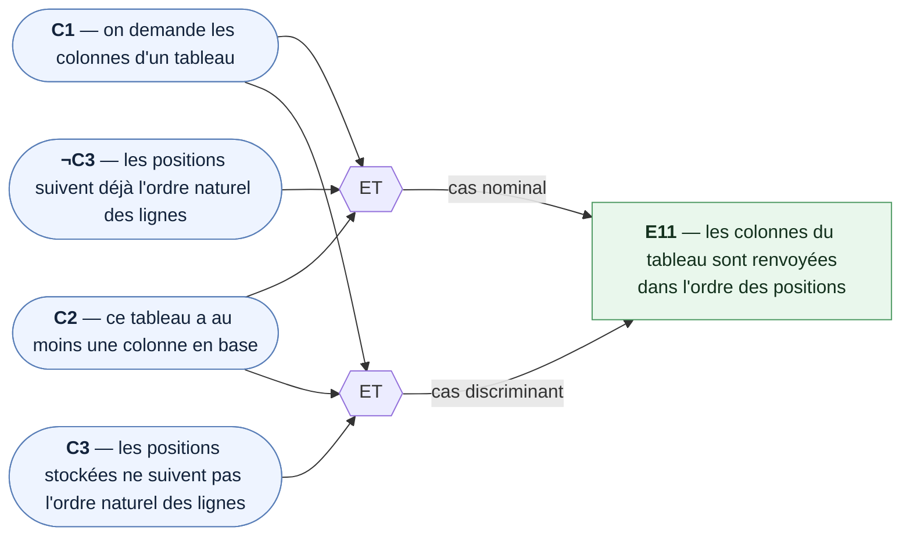

### E12 — Une composition vide est renvoyée quand le tableau n'a aucune colonne

*Cible : `KanbanColumnService` · Causes : `C1`, `¬C2` · Sert `US1`*

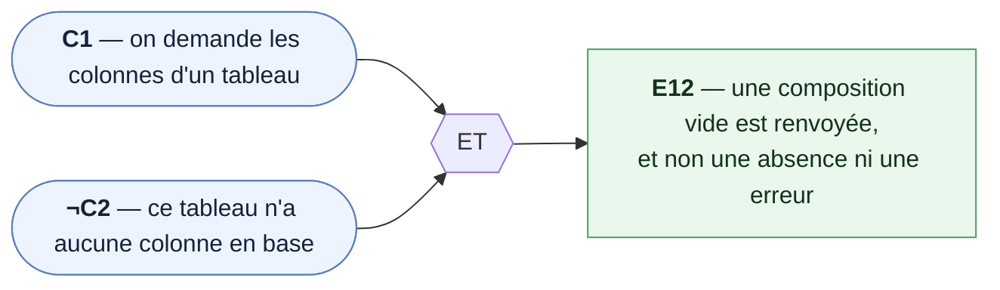

### E13 — L'erreur de lecture est relancée à l'appelant

*Cible : `KanbanColumnService` · Causes : `C1`, `C4` · Sert `US1`*

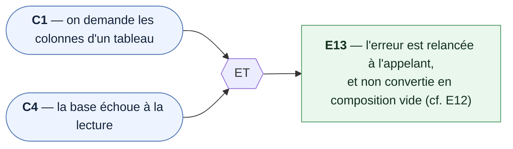

### E14 — La composition enregistrée est renvoyée telle qu'elle a été demandée

*Cible : `KanbanColumnService` · Causes : `C5`, `C6`, `C7`, `C8` · Sert `US6`*

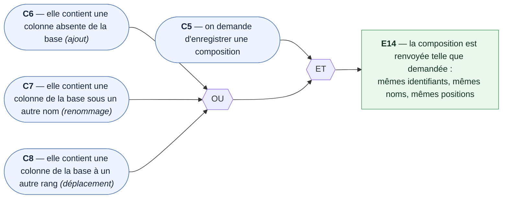

### E15 — Les colonnes retirées de la composition sont effectivement supprimées

*Cible : `KanbanColumnService` · Causes : `C5`, `C9`, `C10` · Sert `US4`, `US6` · ⚠️ observabilité à trancher (§7)*

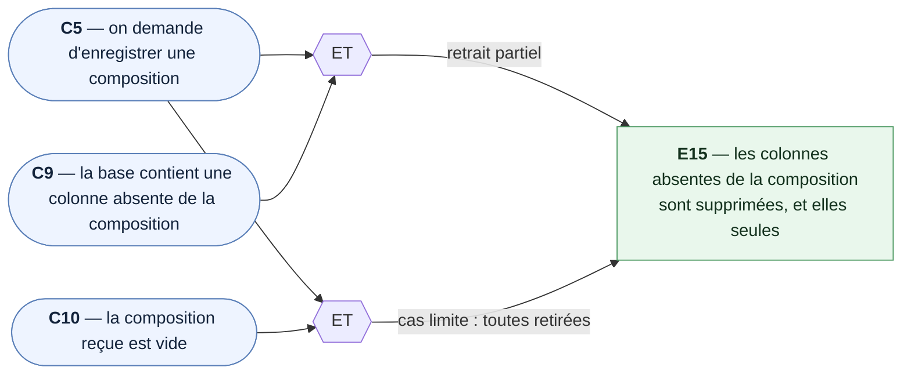

### E16 — Les colonnes des autres tableaux ne sont pas touchées

*Cible : `KanbanColumnService` · Causes : `C5`, `C12`, `C6`/`C7`/`C8`, `C9`/`C10` · Sert `US6` · ⚠️ observabilité à trancher (§7)*

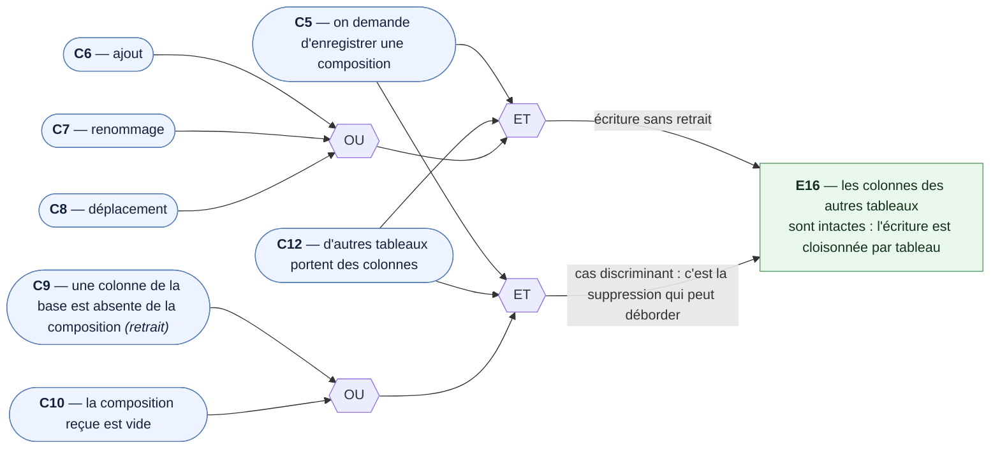

### E17 — Un nom vide est refusé avant la moindre écriture

*Cible : `KanbanColumnService` · Causes : `C5`, `C11`, `C55` · Sert `US2`, `US3`*

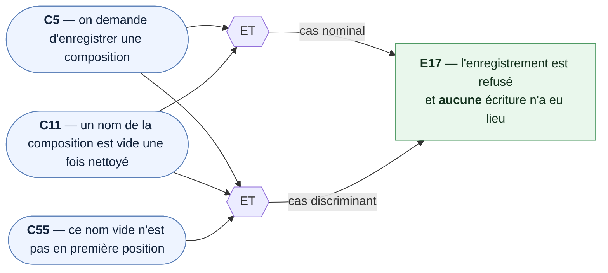

### E18 — L'erreur d'écriture est relancée

*Cible : `KanbanColumnService` · Causes : `C5`, `C13`, `C56` · Sert `US7`*

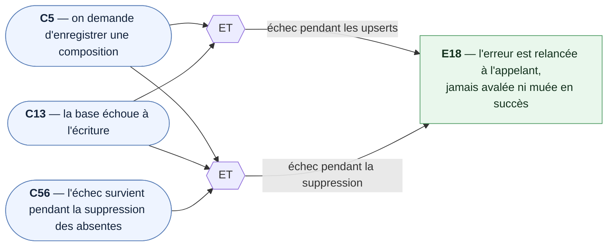

### E19 — La base est flushée une seule fois, après les écritures

*Cible : `KanbanColumnService` · Causes : `C5`, `¬C11`, `¬C13`, `C57` · Sert `US6`*

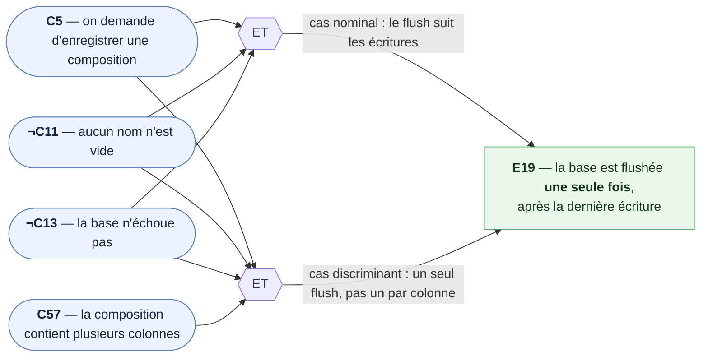

### E20 — Ré-enregistrer la même composition donne le même résultat

*Cible : `KanbanColumnService` · Causes : `C5`, `C14`, `C58` · Sert `US6`, `US7`*

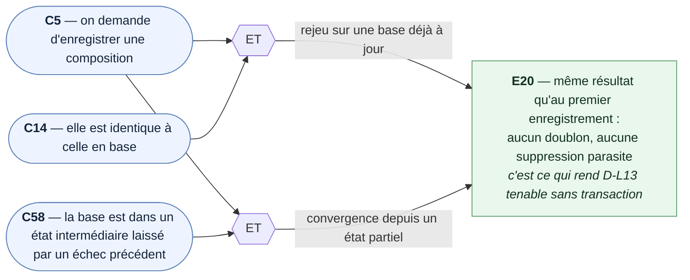

### E21 — Le tableau est renvoyé avec ses colonnes, dans l'ordre

*Cible : `KanbanService` · Causes : `C15`, `C16`, `C17`, `C12` · Sert `US1`*

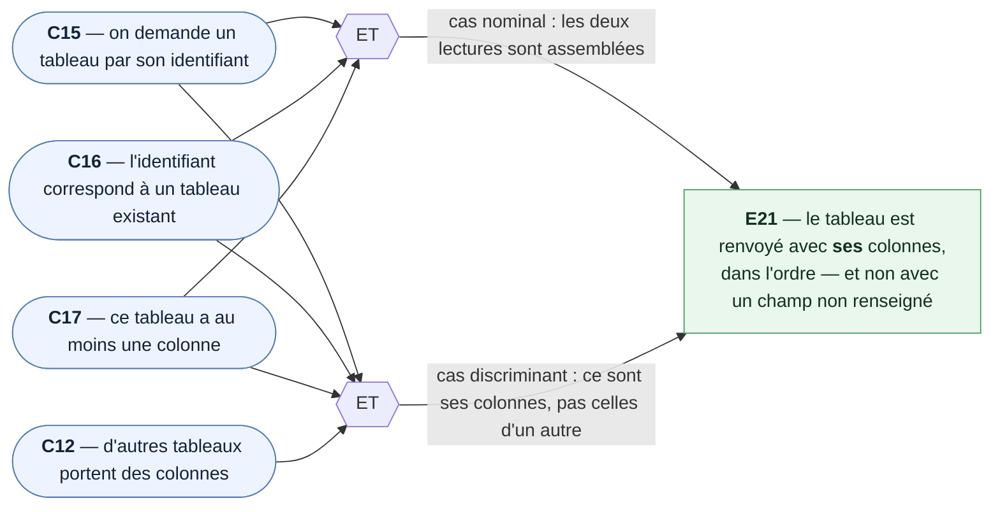

### E22 — Un tableau sans colonne est renvoyé avec une composition vide

*Cible : `KanbanService` · Causes : `C15`, `C16`, `¬C17` · Sert `US1`*

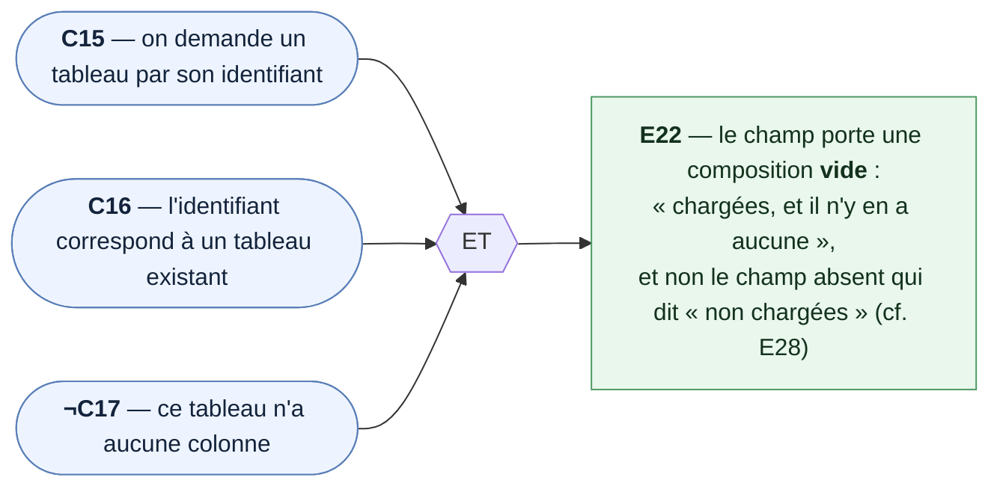

### E23 — Un identifiant inexistant ne renvoie rien, sans aller lire de colonnes

*Cible : `KanbanService` · Causes : `C15`, `¬C16` · Sert `US1`*

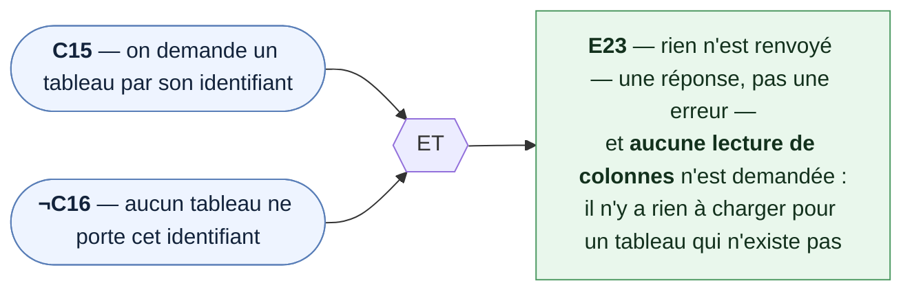

### E24 — Un tableau neuf est créé puis ses colonnes enregistrées, et l'ensemble est renvoyé

*Cible : `KanbanService` · Causes : `C20`, `C21`, `C10` · Sert `US6`*

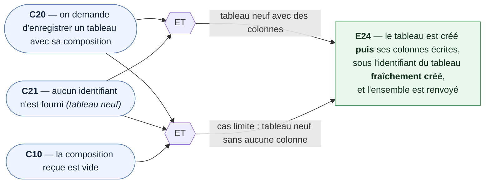

### E25 — Un tableau existant est renommé et sa date rafraîchie, puis ses colonnes enregistrées

*Cible : `KanbanService` · Causes : `C20`, `¬C21`, `C14` · Sert `US6`*

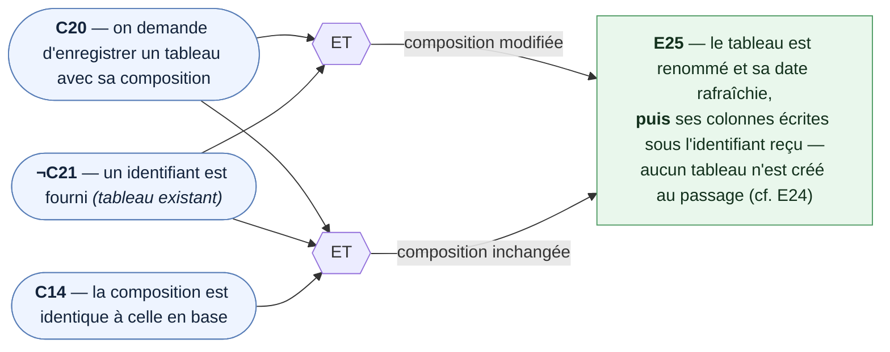

### E26 — Un échec sur le tableau laisse les colonnes non touchées

*Cible : `KanbanService` · Causes : `C20`, `C22`, `C21` · Sert `US6`, `US7`*

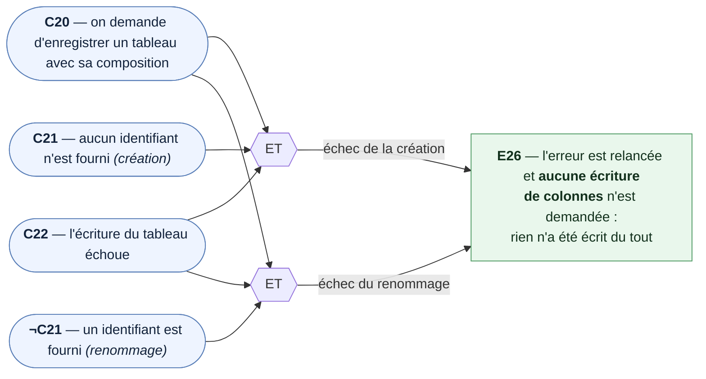

### E27 — Un échec sur les colonnes ne jette pas : le tableau enregistré est renvoyé

*Cible : `KanbanService` · Causes : `C20`, `C23`, `C21` · Sert `US6`, `US7` · `D-L24`*

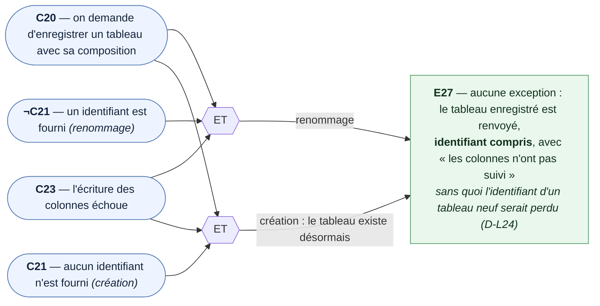

### E28 — `getAllKanbans` renvoie les tableaux sans colonnes

*Cible : `KanbanService` · Causes : `C24`, `C12` · Sert `US1` · `D-L8`*

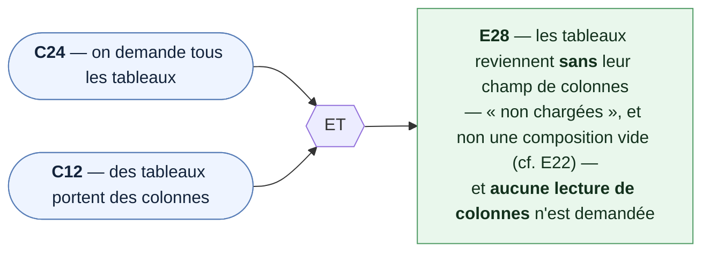

### E29 — Le nom de la colonne est affiché

*Cible : `KanbanColumnPanel` · Causes : `C25`, `C59` · Sert `US1`*

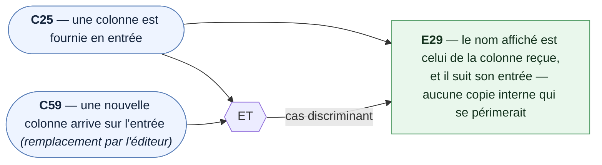

### E30 — La zone réservée aux cartes est présente et vide

*Cible : `KanbanColumnPanel` · Causes : `C25` · Sert `US1` · `D-L21`*

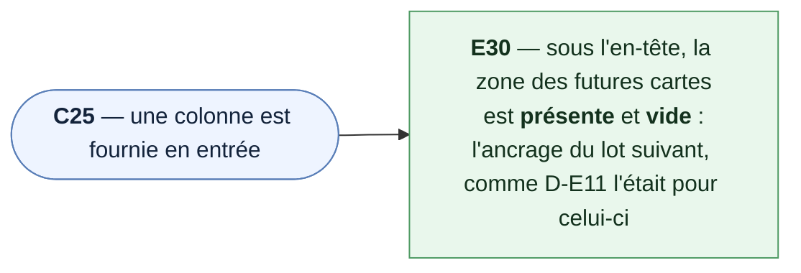

### E31 — La saisie de renommage s'ouvre, pré-remplie du nom actuel

*Cible : `KanbanColumnPanel` · Causes : `C25`, `C26`, `C59` · Sert `US3` · `D-L18`*

```mermaid
flowchart LR
    C25(["<b>C25</b> — une colonne est fournie en entrée"])
    C26(["<b>C26</b> — on touche le nom de la colonne"])
    C59(["<b>C59</b> — une nouvelle colonne est arrivée sur l'entrée entre-temps"])

    ET1{{ET}}
    ET2{{ET}}

    C25 --> ET1
    C26 --> ET1

    C25 --> ET2
    C59 --> ET2
    C26 --> ET2

    ET1 -- cas nominal --> E31
    ET2 -- cas discriminant --> E31

    E31["<b>E31</b> — la saisie s'ouvre sur place dans l'en-tête,<br/><b>pré-remplie du nom courant</b> — ni vide,<br/>ni figée sur un nom mémorisé à la construction"]

    class C25,C26,C59 cause
    class E31 effet
    classDef cause fill:#eef4ff,stroke:#5a7fb8,color:#13233b
    classDef effet fill:#e9f7ec,stroke:#4e9a63,color:#13311d
```

### E32 — Le nom tapé tel quel est émis à la validation

*Cible : `KanbanColumnPanel` · Causes : `C26`, `C27`, `C28`, `C60` · Sert `US3` · `D-L23`*

```mermaid
flowchart LR
    C26(["<b>C26</b> — on touche le nom de la colonne"])
    C27(["<b>C27</b> — on valide la saisie"])
    C28(["<b>C28</b> — la saisie porte des espaces superflus"])
    C60(["<b>C60</b> — la saisie est vide ou faite d'espaces"])

    ET1{{ET}}
    ET2{{ET}}
    ET3{{ET}}

    C26 --> ET1
    C27 --> ET1

    C26 --> ET2
    C27 --> ET2
    C28 --> ET2

    C26 --> ET3
    C27 --> ET3
    C60 --> ET3

    ET1 -- cas nominal --> E32
    ET2 -- prouve l'absence de nettoyage --> E32
    ET3 -- prouve l'absence de repli --> E32

    E32["<b>E32</b> — le texte est émis <b>tel qu'il a été tapé</b> :<br/>ni espaces retirés, ni repli sur « Sans titre »<br/><i>ces règles vivent dans l'éditeur, pas ici (D-L23)</i>"]

    class C26,C27,C28,C60 cause
    class E32 effet
    classDef cause fill:#eef4ff,stroke:#5a7fb8,color:#13233b
    classDef effet fill:#e9f7ec,stroke:#4e9a63,color:#13311d
```

### E33 — L'abandon n'émet rien et ne change pas le nom affiché

*Cible : `KanbanColumnPanel` · Causes : `C26`, `C29`, `C61` · Sert `US3`*

```mermaid
flowchart LR
    C26(["<b>C26</b> — on touche le nom de la colonne"])
    C29(["<b>C29</b> — on abandonne la saisie"])
    C61(["<b>C61</b> — du texte a été tapé avant l'abandon"])

    ET1{{ET}}
    ET2{{ET}}

    C26 --> ET1
    C29 --> ET1

    C26 --> ET2
    C61 --> ET2
    C29 --> ET2

    ET1 -- cas nominal --> E33
    ET2 -- cas discriminant --> E33

    E33["<b>E33</b> — <b>rien n'est émis</b>, la saisie se referme,<br/>et le nom affiché redevient celui de la colonne reçue —<br/>pas le texte abandonné"]

    class C26,C29,C61 cause
    class E33 effet
    classDef cause fill:#eef4ff,stroke:#5a7fb8,color:#13233b
    classDef effet fill:#e9f7ec,stroke:#4e9a63,color:#13311d
```

### E34 — La corbeille émet une demande de retrait, sans rien supprimer

*Cible : `KanbanColumnPanel` · Causes : `C25`, `C30` · Sert `US4` · `D-L23`*

```mermaid
flowchart LR
    C25(["<b>C25</b> — une colonne est fournie en entrée"])
    C30(["<b>C30</b> — on touche la corbeille"])

    ET1{{ET}}

    C25 --> ET1
    C30 --> ET1

    ET1 --> E34

    E34["<b>E34</b> — une <b>demande</b> de retrait est émise, et rien d'autre :<br/>aucune popup ouverte ici, aucune suppression,<br/>la colonne reste affichée — l'éditeur décide (D-L23)"]

    class C25,C30 cause
    class E34 effet
    classDef cause fill:#eef4ff,stroke:#5a7fb8,color:#13233b
    classDef effet fill:#e9f7ec,stroke:#4e9a63,color:#13311d
```

### E35 — Une colonne est rendue par élément, dans l'ordre

*Cible : `KanbanEditor` · Causes : `C32`, `C57` · Sert `US1`*

```mermaid
flowchart LR
    C32(["<b>C32</b> — l'écran s'ouvre sur un tableau existant avec des colonnes"])
    C57(["<b>C57</b> — la composition contient plusieurs colonnes"])

    ET1{{ET}}

    C32 --> E35
    C32 --> ET1
    C57 --> ET1

    ET1 -- cas discriminant --> E35

    E35["<b>E35</b> — <b>une</b> instance du composant colonne par élément,<br/>rendues horizontalement dans l'<b>ordre</b> de la composition"]

    class C32,C57 cause
    class E35 effet
    classDef cause fill:#eef4ff,stroke:#5a7fb8,color:#13233b
    classDef effet fill:#e9f7ec,stroke:#4e9a63,color:#13311d
```

### E36 — L'état vide est affiché quand le tableau n'a aucune colonne

*Cible : `KanbanEditor` · Causes : `C31`, `C33` · Sert `US1` · retire `D-E11`*

```mermaid
flowchart LR
    C31(["<b>C31</b> — l'écran s'ouvre sans identifiant <i>(tableau neuf)</i>"])
    C33(["<b>C33</b> — l'écran s'ouvre sur un tableau existant sans colonne"])

    OU1{{OU}}

    C31 --> OU1
    C33 --> OU1

    OU1 --> E36

    E36["<b>E36</b> — un état vide invite à ajouter une colonne,<br/>le bouton d'ajout reste visible, et la colonne fantôme<br/>« les listes arriveront dans un prochain lot » a disparu"]

    class C31,C33 cause
    class E36 effet
    classDef cause fill:#eef4ff,stroke:#5a7fb8,color:#13233b
    classDef effet fill:#e9f7ec,stroke:#4e9a63,color:#13311d
```

### E37 — Les boutons de déplacement sont indisponibles aux extrémités

*Cible : `KanbanEditor` · Causes : `C34`, `C35`, `C36` · Sert `US5` · `D-L23`*

```mermaid
flowchart LR
    C34(["<b>C34</b> — la colonne visée est la première"])
    C35(["<b>C35</b> — la colonne visée est la dernière"])
    C36(["<b>C36</b> — le tableau n'a qu'une seule colonne"])
    MIL(["<b>¬C34 ∧ ¬C35</b> — la colonne visée est au milieu"])

    ET1{{ET}}

    C34 -- « gauche » indisponible --> E37
    C35 -- « droite » indisponible --> E37
    C36 -- les deux indisponibles --> E37

    MIL --> ET1
    ET1 -- contre-épreuve : les deux disponibles --> E37

    E37["<b>E37</b> — aux extrémités, le bouton est <b>désactivé</b><br/>et non masqué ; au milieu, les deux restent actifs<br/><i>sans la contre-épreuve, « tout désactiver » passerait</i>"]

    class C34,C35,C36,MIL cause
    class E37 effet
    classDef cause fill:#eef4ff,stroke:#5a7fb8,color:#13233b
    classDef effet fill:#e9f7ec,stroke:#4e9a63,color:#13311d
```

### E38 — Une colonne apparaît en dernière position, avec un identifiant neuf

*Cible : `KanbanEditor` · Causes : `C37`, `C38`, `C57`, `C62` · Sert `US2` · `D-L11`*

```mermaid
flowchart LR
    C37(["<b>C37</b> — on touche le bouton d'ajout"])
    C38(["<b>C38</b> — on valide la saisie d'ajout"])
    C57(["<b>C57</b> — le tableau porte déjà plusieurs colonnes"])
    C62(["<b>C62</b> — plusieurs ajouts s'enchaînent sans quitter l'écran"])

    ET1{{ET}}
    ET2{{ET}}
    ET3{{ET}}

    C37 --> ET1
    C38 --> ET1

    C37 --> ET2
    C38 --> ET2
    C57 --> ET2

    C37 --> ET3
    C38 --> ET3
    C62 --> ET3

    ET1 -- premier ajout --> E38
    ET2 -- cas discriminant : la place --> E38
    ET3 -- cas discriminant : l'identifiant --> E38

    E38["<b>E38</b> — la colonne apparaît <b>en dernière position</b>,<br/>portant un identifiant <b>neuf et distinct</b> des autres,<br/>généré par l'écran avant toute écriture (D-L11)"]

    class C37,C38,C57,C62 cause
    class E38 effet
    classDef cause fill:#eef4ff,stroke:#5a7fb8,color:#13233b
    classDef effet fill:#e9f7ec,stroke:#4e9a63,color:#13311d
```

### E39 — Le nom entrant est nettoyé, ou replié sur « Sans titre »

*Cible : `KanbanEditor` · Causes : `C38`, `C41`, `C63`, `C39` · Sert `US2`, `US3` · `D-L17`, `D-L23`*

```mermaid
flowchart LR
    C38(["<b>C38</b> — on valide la saisie d'ajout"])
    C41(["<b>C41</b> — une colonne émet un nouveau nom <i>(renommage)</i>"])
    C63(["<b>C63</b> — le nom entrant porte des espaces superflus"])
    C39(["<b>C39</b> — le nom entrant est vide ou fait d'espaces"])

    OU1{{OU}}
    ET1{{ET}}
    ET2{{ET}}

    C38 --> OU1
    C41 --> OU1

    OU1 -- nom déjà propre --> E39

    OU1 --> ET1
    C63 --> ET1

    OU1 --> ET2
    C39 --> ET2

    ET1 -- espaces de bord retirés, intérieurs gardés --> E39
    ET2 -- repli sur « Sans titre » --> E39

    E39["<b>E39</b> — la règle de nom s'applique <b>dans l'éditeur</b>,<br/>identiquement aux deux portes d'entrée —<br/>c'est la contrepartie d'E32, où la colonne n'y touche pas"]

    class C38,C41,C63,C39 cause
    class E39 effet
    classDef cause fill:#eef4ff,stroke:#5a7fb8,color:#13233b
    classDef effet fill:#e9f7ec,stroke:#4e9a63,color:#13311d
```

### E40 — L'abandon de la saisie d'ajout n'ajoute rien

*Cible : `KanbanEditor` · Causes : `C37`, `C40`, `C61` · Sert `US2`*

```mermaid
flowchart LR
    C37(["<b>C37</b> — on touche le bouton d'ajout"])
    C40(["<b>C40</b> — on abandonne la saisie d'ajout"])
    C61(["<b>C61</b> — du texte a été tapé avant l'abandon"])

    ET1{{ET}}
    ET2{{ET}}

    C37 --> ET1
    C40 --> ET1

    C37 --> ET2
    C61 --> ET2
    C40 --> ET2

    ET1 -- cas nominal --> E40
    ET2 -- cas discriminant --> E40

    E40["<b>E40</b> — <b>aucune</b> colonne ajoutée, composition inchangée,<br/>et donc <b>aucune modification en attente</b> ne naît d'un abandon"]

    class C37,C40,C61 cause
    class E40 effet
    classDef cause fill:#eef4ff,stroke:#5a7fb8,color:#13233b
    classDef effet fill:#e9f7ec,stroke:#4e9a63,color:#13311d
```

### E41 — Seule la colonne visée change de nom

*Cible : `KanbanEditor` · Causes : `C41`, `C57`, `C64` · Sert `US3`*

```mermaid
flowchart LR
    C41(["<b>C41</b> — une colonne émet un nouveau nom"])
    C57(["<b>C57</b> — le tableau porte plusieurs colonnes"])
    C64(["<b>C64</b> — deux colonnes portent le même nom"])

    ET1{{ET}}
    ET2{{ET}}

    C41 --> ET1
    C57 --> ET1

    C41 --> ET2
    C64 --> ET2

    ET1 -- cas nominal --> E41
    ET2 -- cas discriminant --> E41

    E41["<b>E41</b> — seule la colonne visée change de nom,<br/>sa position ne bouge pas, les autres sont intactes —<br/>la désignation se fait par <b>identifiant</b>, jamais par nom"]

    class C41,C57,C64 cause
    class E41 effet
    classDef cause fill:#eef4ff,stroke:#5a7fb8,color:#13233b
    classDef effet fill:#e9f7ec,stroke:#4e9a63,color:#13311d
```

### E42 — La popup de confirmation s'ouvre en nommant la colonne

*Cible : `KanbanEditor` · Causes : `C42`, `C57` · Sert `US4` · `D-L4`*

```mermaid
flowchart LR
    C42(["<b>C42</b> — une colonne émet une demande de retrait"])
    C57(["<b>C57</b> — le tableau porte plusieurs colonnes"])

    ET1{{ET}}

    C42 --> E42
    C42 --> ET1
    C57 --> ET1

    ET1 -- cas discriminant : le message nomme la bonne --> E42

    E42["<b>E42</b> — la popup de confirmation s'ouvre, son message<br/><b>nomme la colonne visée</b>, et rien n'est retiré à ce stade"]

    class C42,C57 cause
    class E42 effet
    classDef cause fill:#eef4ff,stroke:#5a7fb8,color:#13233b
    classDef effet fill:#e9f7ec,stroke:#4e9a63,color:#13311d
```

### E43 — La colonne est retirée après confirmation

*Cible : `KanbanEditor` · Causes : `C42`, `C43`, `C64`, `C36` · Sert `US4`*

```mermaid
flowchart LR
    C42(["<b>C42</b> — une colonne émet une demande de retrait"])
    C43(["<b>C43</b> — on confirme la popup"])
    C64(["<b>C64</b> — deux colonnes portent le même nom"])
    C36(["<b>C36</b> — le tableau n'a qu'une seule colonne"])

    ET1{{ET}}
    ET2{{ET}}
    ET3{{ET}}

    C42 --> ET1
    C43 --> ET1

    C42 --> ET2
    C43 --> ET2
    C64 --> ET2

    C42 --> ET3
    C43 --> ET3
    C36 --> ET3

    ET1 -- cas nominal --> E43
    ET2 -- la bonne des deux homonymes --> E43
    ET3 -- cas limite : la dernière --> E43

    E43["<b>E43</b> — cette colonne, et elle seule, quitte la composition ;<br/>les autres gardent leur ordre relatif —<br/>et retirer la dernière ramène à l'état vide (E36)"]

    class C42,C43,C64,C36 cause
    class E43 effet
    classDef cause fill:#eef4ff,stroke:#5a7fb8,color:#13233b
    classDef effet fill:#e9f7ec,stroke:#4e9a63,color:#13311d
```

### E44 — La colonne est conservée après refus

*Cible : `KanbanEditor` · Causes : `C42`, `C44` · Sert `US4`*

```mermaid
flowchart LR
    C42(["<b>C42</b> — une colonne émet une demande de retrait"])
    C44(["<b>C44</b> — la popup répond non"])

    ET1{{ET}}

    C42 --> ET1
    C44 --> ET1

    ET1 --> E44

    E44["<b>E44</b> — la colonne reste, la composition est inchangée<br/><i>les trois façons de refuser — bouton, clic hors popup, Échap —<br/>appartiennent à ConfirmDialog, déjà couvert au lot EDITION</i>"]

    class C42,C44 cause
    class E44 effet
    classDef cause fill:#eef4ff,stroke:#5a7fb8,color:#13233b
    classDef effet fill:#e9f7ec,stroke:#4e9a63,color:#13311d
```

### E45 — L'ordre affiché change d'un cran

*Cible : `KanbanEditor` · Causes : `C45`, `C57`, `C65` · Sert `US5` · `D-L2`*

```mermaid
flowchart LR
    C45(["<b>C45</b> — on touche ← ou →"])
    C57(["<b>C57</b> — le tableau porte plusieurs colonnes"])
    C65(["<b>C65</b> — le tableau porte au moins trois colonnes"])

    ET1{{ET}}
    ET2{{ET}}

    C45 --> ET1
    C57 --> ET1

    C45 --> ET2
    C65 --> ET2

    ET1 -- cas nominal --> E45
    ET2 -- cas discriminant --> E45

    E45["<b>E45</b> — la colonne est échangée avec sa <b>voisine immédiate</b><br/><i>à deux colonnes, « un cran » et « envoyée à l'extrémité »<br/>donnent le même résultat : il en faut trois</i>"]

    class C45,C57,C65 cause
    class E45 effet
    classDef cause fill:#eef4ff,stroke:#5a7fb8,color:#13233b
    classDef effet fill:#e9f7ec,stroke:#4e9a63,color:#13311d
```

### E46 — Les positions restent contiguës et repartent de 0

*Cible : `KanbanEditor` · Causes : `C38`, `C43`, `C45`, `C65` · Sert `US2`, `US4`, `US5` · `D-L12`*

```mermaid
flowchart LR
    C38(["<b>C38</b> — on valide la saisie d'ajout"])
    C43(["<b>C43</b> — on confirme un retrait"])
    C45(["<b>C45</b> — on touche ← ou →"])
    C65(["<b>C65</b> — le tableau porte au moins trois colonnes"])

    ET1{{ET}}

    C38 -- après un ajout --> E46
    C45 -- après un déplacement --> E46

    C43 --> ET1
    C65 --> ET1
    ET1 -- retrait au milieu : le cas qui creuse un trou --> E46

    E46["<b>E46</b> — après chaque geste, les positions sont<br/><b>renumérotées depuis l'index</b> : 0, 1, 2… sans trou"]

    class C38,C43,C45,C65 cause
    class E46 effet
    classDef cause fill:#eef4ff,stroke:#5a7fb8,color:#13233b
    classDef effet fill:#e9f7ec,stroke:#4e9a63,color:#13311d
```

### E47 — Aucune écriture n'est demandée par les quatre gestes

*Cible : `KanbanEditor` · Causes : `C38`, `C41`, `C43`, `C45` · Sert `US2` → `US5` · `D-L1`*

```mermaid
flowchart LR
    C38(["<b>C38</b> — ajout validé"])
    C41(["<b>C41</b> — renommage reçu"])
    C43(["<b>C43</b> — retrait confirmé"])
    C45(["<b>C45</b> — déplacement ← ou →"])

    OU1{{OU}}

    C38 --> OU1
    C41 --> OU1
    C43 --> OU1
    C45 --> OU1

    OU1 --> E47

    E47["<b>E47</b> — la source de données n'est <b>jamais</b> sollicitée :<br/>les quatre gestes ne touchent que la composition affichée,<br/>et quitter sans enregistrer ne laisse aucune trace"]

    class C38,C41,C43,C45 cause
    class E47 effet
    classDef cause fill:#eef4ff,stroke:#5a7fb8,color:#13233b
    classDef effet fill:#e9f7ec,stroke:#4e9a63,color:#13311d
```

### E48 — Le tableau et sa composition sont enregistrés en un seul appel

*Cible : `KanbanEditor` · Causes : `C46`, `C54` · Sert `US6` · `D-L9`*

```mermaid
flowchart LR
    C46(["<b>C46</b> — on touche « Enregistrer »"])
    C54(["<b>C54</b> — la composition a été modifiée depuis l'ouverture"])

    ET1{{ET}}

    C46 --> E48
    C46 --> ET1
    C54 --> ET1

    ET1 -- cas discriminant : plusieurs gestes, un seul appel --> E48

    E48["<b>E48</b> — <b>un seul</b> appel au service, portant le nom<br/>du tableau <b>et</b> la composition entière —<br/>pas un appel par geste, pas deux appels séparés"]

    class C46,C54 cause
    class E48 effet
    classDef cause fill:#eef4ff,stroke:#5a7fb8,color:#13233b
    classDef effet fill:#e9f7ec,stroke:#4e9a63,color:#13311d
```

### E49 — L'utilisateur est ramené à la liste après un succès

*Cible : `KanbanEditor` · Causes : `C46`, `C50` · Sert `US6` · `D-E1`, `D-L16`*

```mermaid
flowchart LR
    C46(["<b>C46</b> — on touche « Enregistrer »"])
    C50(["<b>C50</b> — l'enregistrement réussit"])

    ET1{{ET}}

    C46 --> ET1
    C50 --> ET1

    ET1 --> E49

    E49["<b>E49</b> — navigation vers la liste des tableaux,<br/>où le tableau apparaît ou remonte en tête"]

    class C46,C50 cause
    class E49 effet
    classDef cause fill:#eef4ff,stroke:#5a7fb8,color:#13233b
    classDef effet fill:#e9f7ec,stroke:#4e9a63,color:#13311d
```

### E50 — L'écran est conservé, composition intacte, avec un message d'erreur

*Cible : `KanbanEditor` · Causes : `C46`, `C51`, `C54` · Sert `US7` · `D-E9`*

```mermaid
flowchart LR
    C46(["<b>C46</b> — on touche « Enregistrer »"])
    C51(["<b>C51</b> — l'enregistrement échoue"])
    C54(["<b>C54</b> — la composition a été modifiée depuis l'ouverture"])

    ET1{{ET}}
    ET2{{ET}}

    C46 --> ET1
    C51 --> ET1

    C46 --> ET2
    C51 --> ET2
    C54 --> ET2

    ET1 -- cas nominal --> E50
    ET2 -- cas discriminant --> E50

    E50["<b>E50</b> — aucune navigation : l'écran reste, le nom et la<br/>composition sont <b>intacts</b>, et un bandeau visible annonce<br/>l'échec — jamais la seule console"]

    class C46,C51,C54 cause
    class E50 effet
    classDef cause fill:#eef4ff,stroke:#5a7fb8,color:#13233b
    classDef effet fill:#e9f7ec,stroke:#4e9a63,color:#13311d
```

### E51 — L'écran passe en mode édition dès la création

*Cible : `KanbanEditor` · Causes : `C46`, `C51`, `C52`, `C66` · Sert `US6`, `US7` · `D-L13`, `D-L24`*

```mermaid
flowchart LR
    C46(["<b>C46</b> — on touche « Enregistrer »"])
    C51(["<b>C51</b> — l'enregistrement échoue"])
    C52(["<b>C52</b> — l'échec survient après la création du tableau"])
    C66(["<b>C66</b> — un second enregistrement est tenté"])

    ET1{{ET}}
    ET2{{ET}}

    C46 --> ET1
    C51 --> ET1
    C52 --> ET1

    ET1 --> ET2
    C66 --> ET2

    ET1 -- l'écran retient l'identifiant reçu --> E51
    ET2 -- cas discriminant : le ré-essai --> E51

    E51["<b>E51</b> — l'identifiant du tableau créé est retenu et l'écran<br/>bascule en mode édition : le ré-essai <b>renomme</b> ce tableau<br/>au lieu d'en créer un second"]

    class C46,C51,C52,C66 cause
    class E51 effet
    classDef cause fill:#eef4ff,stroke:#5a7fb8,color:#13233b
    classDef effet fill:#e9f7ec,stroke:#4e9a63,color:#13311d
```

### E52 — Une modification en attente est signalée après chacun des quatre gestes

*Cible : `KanbanEditor` · Causes : `C38`, `C41`, `C43`, `C45`, `C67` · Sert `US7` · `D-E3`*

```mermaid
flowchart LR
    C38(["<b>C38</b> — ajout validé"])
    C41(["<b>C41</b> — renommage reçu"])
    C43(["<b>C43</b> — retrait confirmé"])
    C45(["<b>C45</b> — déplacement ← ou →"])
    C67(["<b>C67</b> — le renommage reçoit exactement le nom courant"])

    OU1{{OU}}
    ET1{{ET}}

    C38 --> OU1
    C41 --> OU1
    C43 --> OU1
    C45 --> OU1

    OU1 --> E52

    C41 --> ET1
    C67 --> ET1
    ET1 -- contre-épreuve --> NE52

    E52["<b>E52</b> — chacun des quatre gestes rend une modification<br/>« en attente », au même titre que la saisie du nom du tableau"]
    NE52["<b>¬E52</b> — revalider le <b>même</b> nom ne compte pas :<br/>la comparaison porte sur les noms nettoyés"]

    class C38,C41,C43,C45,C67 cause
    class E52,NE52 effet
    classDef cause fill:#eef4ff,stroke:#5a7fb8,color:#13233b
    classDef effet fill:#e9f7ec,stroke:#4e9a63,color:#13311d
```

### E53 — Plus aucune modification en attente après un enregistrement réussi

*Cible : `KanbanEditor` · Causes : `C46`, `C50`, `C39` · Sert `US7` · `D5`*

```mermaid
flowchart LR
    C46(["<b>C46</b> — on touche « Enregistrer »"])
    C50(["<b>C50</b> — l'enregistrement réussit"])
    C39(["<b>C39</b> — un nom entrant était vide, donc replié sur « Sans titre »"])

    ET1{{ET}}
    ET2{{ET}}

    C46 --> ET1
    C50 --> ET1

    C46 --> ET2
    C50 --> ET2
    C39 --> ET2

    ET1 -- cas nominal --> E53
    ET2 -- cas discriminant --> E53

    E53["<b>E53</b> — les points de départ sont repris sur ce qui a été<br/><b>enregistré</b> : un nom replié ne laisse pas de<br/>« modification fantôme » derrière lui"]

    class C46,C50,C39 cause
    class E53 effet
    classDef cause fill:#eef4ff,stroke:#5a7fb8,color:#13233b
    classDef effet fill:#e9f7ec,stroke:#4e9a63,color:#13311d
```

### E54 — Le retour est immédiat et sans question quand rien n'est en attente

*Cible : `KanbanEditor` · Causes : `C47`, `¬C53`, `¬C54` · Sert `US7`*

```mermaid
flowchart LR
    C47(["<b>C47</b> — on touche « Retour »"])
    NC53(["<b>¬C53</b> — le nom du tableau n'a pas été modifié"])
    NC54(["<b>¬C54</b> — la composition n'a pas été modifiée"])

    ET1{{ET}}

    C47 --> ET1
    NC53 --> ET1
    NC54 --> ET1

    ET1 --> E54

    E54["<b>E54</b> — navigation <b>immédiate</b> vers la liste :<br/>aucune popup, rien à perdre"]

    class C47,NC53,NC54 cause
    class E54 effet
    classDef cause fill:#eef4ff,stroke:#5a7fb8,color:#13233b
    classDef effet fill:#e9f7ec,stroke:#4e9a63,color:#13311d
```

### E55 — La popup d'abandon s'ouvre quand quelque chose est en attente

*Cible : `KanbanEditor` · Causes : `C47`, `C53`, `C54` · Sert `US7`*

```mermaid
flowchart LR
    C47(["<b>C47</b> — on touche « Retour »"])
    C53(["<b>C53</b> — le nom du tableau a été modifié"])
    C54(["<b>C54</b> — la composition a été modifiée"])

    ET1{{ET}}
    ET2{{ET}}

    C47 --> ET1
    C53 --> ET1

    C47 --> ET2
    C54 --> ET2

    ET1 -- nom modifié seul : l'acquis du lot EDITION --> E55
    ET2 -- composition modifiée seule : l'apport de ce lot --> E55

    E55["<b>E55</b> — la popup d'abandon s'ouvre et prévient<br/>que les modifications seront perdues"]

    class C47,C53,C54 cause
    class E55 effet
    classDef cause fill:#eef4ff,stroke:#5a7fb8,color:#13233b
    classDef effet fill:#e9f7ec,stroke:#4e9a63,color:#13311d
```

### E56 — Confirmer l'abandon ramène à la liste sans déclencher d'enregistrement

*Cible : `KanbanEditor` · Causes : `C47`, `C53`/`C54`, `C48` · Sert `US7`*

```mermaid
flowchart LR
    C47(["<b>C47</b> — on touche « Retour »"])
    C53(["<b>C53</b> — le nom a été modifié"])
    C54(["<b>C54</b> — la composition a été modifiée"])
    C48(["<b>C48</b> — on confirme la popup d'abandon"])

    OU1{{OU}}
    ET1{{ET}}

    C53 --> OU1
    C54 --> OU1

    C47 --> ET1
    OU1 --> ET1
    C48 --> ET1

    ET1 --> E56

    E56["<b>E56</b> — navigation vers la liste, et <b>aucun appel</b><br/>au service au passage : rien n'est créé, retiré,<br/>renommé ni déplacé en base"]

    class C47,C53,C54,C48 cause
    class E56 effet
    classDef cause fill:#eef4ff,stroke:#5a7fb8,color:#13233b
    classDef effet fill:#e9f7ec,stroke:#4e9a63,color:#13311d
```

### E57 — Une erreur de lecture est relancée à l'appelant

*Cible : `KanbanService` · Causes : `C15`, `C18`, `C19` · Sert `US1`*

```mermaid
flowchart LR
    C15(["<b>C15</b> — on demande un tableau par son identifiant"])
    C18(["<b>C18</b> — la lecture du tableau échoue"])
    C19(["<b>C19</b> — la lecture des colonnes échoue"])

    ET1{{ET}}
    ET2{{ET}}

    C15 --> ET1
    C18 --> ET1

    C15 --> ET2
    C19 --> ET2

    ET1 -- échec sur le tableau --> E57
    ET2 -- échec sur les colonnes --> E57

    E57["<b>E57</b> — l'erreur est relancée, d'où qu'elle vienne :<br/>c'est elle qui fait basculer l'écran dans son état<br/>d'erreur de chargement, livré au lot EDITION"]

    class C15,C18,C19 cause
    class E57 effet
    classDef cause fill:#eef4ff,stroke:#5a7fb8,color:#13233b
    classDef effet fill:#e9f7ec,stroke:#4e9a63,color:#13311d
```

### E58 — Refuser l'abandon laisse l'écran et la composition intacts

*Cible : `KanbanEditor` · Causes : `C47`, `C53`/`C54`, `C49` · Sert `US7`*

```mermaid
flowchart LR
    C47(["<b>C47</b> — on touche « Retour »"])
    C53(["<b>C53</b> — le nom a été modifié"])
    C54(["<b>C54</b> — la composition a été modifiée"])
    C49(["<b>C49</b> — on refuse la popup d'abandon"])

    OU1{{OU}}
    ET1{{ET}}

    C53 --> OU1
    C54 --> OU1

    C47 --> ET1
    OU1 --> ET1
    C49 --> ET1

    ET1 --> E58

    E58["<b>E58</b> — aucune navigation : l'écran reste, le nom et la<br/>composition sont intacts, et la modification<br/>reste « en attente »"]

    class C47,C53,C54,C49 cause
    class E58 effet
    classDef cause fill:#eef4ff,stroke:#5a7fb8,color:#13233b
    classDef effet fill:#e9f7ec,stroke:#4e9a63,color:#13311d
```

### E59 — La lecture ne renvoie que les colonnes du tableau demandé

*Cible : `KanbanColumnService` · Causes : `C1`, `C12` · Sert `US1`*

```mermaid
flowchart LR
    C1(["<b>C1</b> — on demande les colonnes d'un tableau"])
    C12(["<b>C12</b> — d'autres tableaux portent des colonnes"])

    ET1{{ET}}

    C1 --> ET1
    C12 --> ET1

    ET1 --> E59

    E59["<b>E59</b> — seules les colonnes du tableau demandé reviennent :<br/>la lecture est cloisonnée par tableau,<br/>comme l'écriture l'est par E16"]

    class C1,C12 cause
    class E59 effet
    classDef cause fill:#eef4ff,stroke:#5a7fb8,color:#13233b
    classDef effet fill:#e9f7ec,stroke:#4e9a63,color:#13311d
```

---

## 6. Cas de test

> **Déduction :** un cas par **chemin** de diagramme, et **un seul comportement observable par
> cas**. Chaque ligne porte l'effet dont elle sort, les causes à mettre en place, et la user story
> servie. Les cas marqués ⚠️ dépendent de la question d'observabilité encore ouverte (§7).
>
> **Rédaction en boîte noire :** les cas disent ce qui est **vérifié**, jamais comment le code s'y
> prend. `ecrire_tests` les traduira un par un, dans l'ordre des groupes.

### `KanbanColumnService`

**Groupe 1 — Lire les colonnes d'un tableau**

| Cas | Ce qui est vérifié | Effet | Causes | US |
|---|---|---|---|---|
| **T1.1** | Les colonnes reviennent **dans l'ordre de leurs positions**, alors que la base les sort dans un autre ordre | E11 | C1, C2, C3 | US1 |
| **T1.2** | Un tableau sans colonne renvoie une **composition vide**, pas une erreur | E12 | C1, ¬C2 | US1 |
| **T1.3** | Seules les colonnes **du tableau demandé** reviennent, alors que d'autres tableaux en portent | E59 | C1, C12 | US1 |
| **T1.4** | Une erreur de lecture est **relancée**, et non convertie en composition vide | E13 | C1, C4 | US1 |

**Groupe 2 — Enregistrer la composition d'un tableau**

| Cas | Ce qui est vérifié | Effet | Causes | US |
|---|---|---|---|---|
| **T2.1** | Une colonne **ajoutée** est renvoyée dans la composition enregistrée | E14 | C5, C6 | US6 |
| **T2.2** | Une colonne **renommée** revient sous son nouveau nom, avec le même identifiant | E14 | C5, C7 | US6 |
| **T2.3** | Une colonne **déplacée** revient à son nouveau rang | E14 | C5, C8 | US6 |
| **T2.4** | Une colonne absente de la composition est **supprimée** ⚠️ | E15 | C5, C9 | US4, US6 |
| **T2.5** | Une composition **vide** supprime **toutes** les colonnes du tableau ⚠️ | E15 | C5, C10 | US4, US6 |
| **T2.6** | Un retrait ne touche **pas** les colonnes des autres tableaux ⚠️ | E16 | C5, C12, C9 | US6 |
| **T2.7** | Un nom vide fait **refuser** l'enregistrement, sans aucune écriture | E17 | C5, C11 | US2, US3 |
| **T2.8** | Le refus vaut même quand le nom vide n'est **pas le premier** : la validation précède toute écriture | E17 | C5, C11, C55 | US2, US3 |
| **T2.9** | Un échec pendant les **upserts** relance l'erreur | E18 | C5, C13 | US7 |
| **T2.10** | Un échec pendant la **suppression des absentes** relance l'erreur aussi | E18 | C5, C13, C56 | US7 |
| **T2.11** | La base est flushée **une seule fois**, après la dernière écriture, même à plusieurs colonnes ⚠️ | E19 | C5, ¬C11, ¬C13, C57 | US6 |
| **T2.12** | Ré-enregistrer une composition **identique** donne le même résultat, sans doublon | E20 | C5, C14 | US6, US7 |
| **T2.13** | Rejouer depuis un **état intermédiaire** laissé par un échec converge vers la composition attendue | E20 | C5, C58 | US6, US7 |

### `KanbanService`

**Groupe 3 — Lire un tableau et ses colonnes**

| Cas | Ce qui est vérifié | Effet | Causes | US |
|---|---|---|---|---|
| **T3.1** | Le tableau revient **avec** ses colonnes, dans l'ordre | E21 | C15, C16, C17 | US1 |
| **T3.2** | Ce sont **ses** colonnes : un autre tableau en porte d'autres, qui ne remontent pas | E21 | C15, C16, C17, C12 | US1 |
| **T3.3** | Un tableau sans colonne revient avec une composition **vide**, et non un champ absent | E22 | C15, C16, ¬C17 | US1 |
| **T3.4** | Un identifiant inexistant ne renvoie rien **et** ne déclenche aucune lecture de colonnes | E23 | C15, ¬C16 | US1 |
| **T3.5** | Un échec de lecture **du tableau** est relancé | E57 | C15, C18 | US1 |
| **T3.6** | Un échec de lecture **des colonnes** est relancé | E57 | C15, C19 | US1 |

**Groupe 4 — Enregistrer un tableau et sa composition**

| Cas | Ce qui est vérifié | Effet | Causes | US |
|---|---|---|---|---|
| **T4.1** | Un tableau neuf est **créé**, puis ses colonnes écrites **sous l'identifiant créé** | E24 | C20, C21 | US6 |
| **T4.2** | Un tableau neuf **sans colonne** est créé sans que rien d'autre soit écrit | E24 | C20, C21, C10 | US6 |
| **T4.3** | Un tableau existant est **renommé et redaté**, puis ses colonnes écrites | E25 | C20, ¬C21 | US6 |
| **T4.4** | Une composition inchangée laisse les colonnes telles quelles, le tableau étant quand même redaté | E25 | C20, ¬C21, C14 | US6 |
| **T4.5** | Un échec de **création** jette, et aucune écriture de colonnes n'est tentée | E26 | C20, C22, C21 | US6, US7 |
| **T4.6** | Un échec de **renommage** jette, et aucune écriture de colonnes n'est tentée | E26 | C20, C22, ¬C21 | US6, US7 |
| **T4.7** | Un échec **des colonnes** après un renommage **ne jette pas** : le résultat porte le tableau et « colonnes non enregistrées » | E27 | C20, C23, ¬C21 | US6, US7 |
| **T4.8** | Un échec des colonnes après une **création** renvoie le tableau **avec son identifiant** — sans quoi le ré-essai dupliquerait | E27 | C20, C23, C21 | US6, US7 |
| **T4.9** | `getAllKanbans` renvoie les tableaux **sans** colonnes et ne lit pas la table des colonnes | E28 | C24, C12 | US1 |

### `KanbanColumnPanel` — le composant colonne

**Groupe 5 — Afficher, renommer, demander le retrait**

| Cas | Ce qui est vérifié | Effet | Causes | US |
|---|---|---|---|---|
| **T5.1** | Le nom de la colonne reçue est affiché | E29 | C25 | US1 |
| **T5.2** | Une **nouvelle** colonne en entrée change le nom affiché : aucune copie interne | E29 | C25, C59 | US1 |
| **T5.3** | La zone réservée aux futures cartes est **présente et vide** | E30 | C25 | US1 |
| **T5.4** | Toucher le nom ouvre la saisie **pré-remplie** du nom courant | E31 | C25, C26 | US3 |
| **T5.5** | Après un remplacement de la colonne, la saisie repart du **nouveau** nom | E31 | C25, C59, C26 | US3 |
| **T5.6** | Valider émet le texte tapé | E32 | C26, C27 | US3 |
| **T5.7** | Des espaces superflus sont émis **sans nettoyage** | E32 | C26, C27, C28 | US3 |
| **T5.8** | Une saisie vide est émise **vide**, sans repli sur « Sans titre » | E32 | C26, C27, C60 | US3 |
| **T5.9** | Abandonner n'émet rien | E33 | C26, C29 | US3 |
| **T5.10** | Abandonner **après avoir tapé** laisse le nom affiché inchangé | E33 | C26, C29, C61 | US3 |
| **T5.11** | La corbeille émet une **demande** : aucune popup ici, aucune suppression, la colonne reste | E34 | C25, C30 | US4 |

### `KanbanEditor`

**Groupe 6 — Afficher la zone de contenu**

| Cas | Ce qui est vérifié | Effet | Causes | US |
|---|---|---|---|---|
| **T6.1** | Une colonne est rendue **par élément**, dans l'ordre de la composition | E35 | C32, C57 | US1 |
| **T6.2** | Un tableau **neuf** affiche l'état vide, bouton d'ajout visible | E36 | C31 | US1 |
| **T6.3** | Un tableau existant **sans colonne** affiche l'état vide — la colonne fantôme a disparu | E36 | C33 | US1 |
| **T6.4** | Sur la **première** colonne, « gauche » est désactivé | E37 | C34 | US5 |
| **T6.5** | Sur la **dernière**, « droite » est désactivé | E37 | C35 | US5 |
| **T6.6** | Avec une **seule** colonne, les deux sont désactivés | E37 | C36 | US5 |
| **T6.7** | Sur une colonne **du milieu**, les deux sont actifs *(contre-épreuve indispensable)* | E37 | ¬C34, ¬C35 | US5 |

**Groupe 7 — Ajouter une colonne**

| Cas | Ce qui est vérifié | Effet | Causes | US |
|---|---|---|---|---|
| **T7.1** | La colonne ajoutée apparaît **en dernière position** | E38 | C37, C38, C57 | US2 |
| **T7.2** | Deux ajouts successifs produisent deux **identifiants distincts** | E38 | C37, C38, C62 | US2 |
| **T7.3** | Un nom déjà propre est conservé tel quel, **espaces intérieurs compris** | E39 | C38 | US2 |
| **T7.4** | Les espaces de **début et de fin** sont retirés | E39 | C38, C63 | US2 |
| **T7.5** | Une saisie vide donne **« Sans titre »** | E39 | C38, C39 | US2 |
| **T7.6** | Abandonner la saisie n'ajoute **aucune** colonne | E40 | C37, C40 | US2 |
| **T7.7** | Abandonner **après avoir tapé** n'ajoute rien et ne crée aucune modification en attente | E40 | C37, C40, C61 | US2 |

**Groupe 8 — Renommer une colonne**

| Cas | Ce qui est vérifié | Effet | Causes | US |
|---|---|---|---|---|
| **T8.1** | Seule la colonne visée change de nom ; sa position et les autres sont intactes | E41 | C41, C57 | US3 |
| **T8.2** | Entre deux colonnes **homonymes**, c'est la bonne qui est renommée | E41 | C41, C64 | US3 |
| **T8.3** | Le nom reçu de la colonne est **nettoyé par l'éditeur** | E39 | C41, C63 | US3 |
| **T8.4** | Un nom reçu vide donne **« Sans titre »** | E39 | C41, C39 | US3 |
| **T8.5** | Revalider **exactement le même nom** ne crée **aucune** modification en attente | ¬E52 | C41, C67 | US3, US7 |

**Groupe 9 — Retirer une colonne**

| Cas | Ce qui est vérifié | Effet | Causes | US |
|---|---|---|---|---|
| **T9.1** | La demande ouvre la popup, dont le message **nomme la colonne visée** | E42 | C42, C57 | US4 |
| **T9.2** | Confirmer retire **cette** colonne de la composition | E43 | C42, C43 | US4 |
| **T9.3** | Entre deux **homonymes**, c'est la bonne qui est retirée | E43 | C42, C43, C64 | US4 |
| **T9.4** | Retirer la **dernière** colonne ramène à l'état vide | E43 | C42, C43, C36 | US4 |
| **T9.5** | Refuser la popup **conserve** la colonne | E44 | C42, C44 | US4 |
| **T9.6** | Retirer une colonne **du milieu** laisse les positions contiguës, sans trou | E46 | C43, C65 | US4 |

**Groupe 10 — Déplacer une colonne**

| Cas | Ce qui est vérifié | Effet | Causes | US |
|---|---|---|---|---|
| **T10.1** | La colonne est échangée avec sa **voisine immédiate**, et non envoyée à l'extrémité | E45 | C45, C65 | US5 |
| **T10.2** | Les positions sont **renumérotées** après le déplacement | E46 | C45 | US5 |
| **T10.3** | Un ajout renumérote aussi les positions depuis l'index | E46 | C38 | US2 |
| **T10.4** | Une composition **lue avec un trou** dans les positions est enregistrée **contiguë** *(ajouté le 2026-11-11, `R2`)* | E46 | C32, C38 | US2, US6 |

**Groupe 11 — Enregistrer**

| Cas | Ce qui est vérifié | Effet | Causes | US |
|---|---|---|---|---|
| **T11.1** | L'enregistrement fait **un seul** appel, portant le nom **et** la composition | E48 | C46 | US6 |
| **T11.2** | Après **plusieurs** gestes, c'est toujours un seul appel — pas un par geste | E48 | C46, C54 | US6 |
| **T11.3** | Un succès ramène à la **liste des tableaux** | E49 | C46, C50 | US6 |
| **T11.4** | Un échec **garde l'écran** et affiche un bandeau visible | E50 | C46, C51 | US7 |
| **T11.5** | Après un échec, la composition modifiée est **intacte** | E50 | C46, C51, C54 | US7 |
| **T11.6** | Un échec **après la création** fait passer l'écran en mode édition, identifiant retenu | E51 | C46, C51, C52 | US6, US7 |
| **T11.7** | Le **ré-essai** renomme ce tableau au lieu d'en créer un second | E51 | C46, C51, C52, C66 | US6, US7 |
| **T11.8** | Après un succès, il n'y a **plus** de modification en attente | E53 | C46, C50 | US7 |
| **T11.9** | Un nom replié sur « Sans titre » ne laisse **pas** de modification fantôme après le succès | E53 | C46, C50, C39 | US7 |

**Groupe 12 — Ne rien écrire, et le retour**

| Cas | Ce qui est vérifié | Effet | Causes | US |
|---|---|---|---|---|
| **T12.1** | Un **ajout** ne demande aucune écriture à la source de données | E47 | C38 | US2 |
| **T12.2** | Un **renommage** n'en demande aucune | E47 | C41 | US3 |
| **T12.3** | Un **retrait** n'en demande aucune | E47 | C43 | US4 |
| **T12.4** | Un **déplacement** n'en demande aucune | E47 | C45 | US5 |
| **T12.5** | Un **ajout** rend une modification « en attente » | E52 | C38 | US7 |
| **T12.6** | Un **renommage** rend une modification « en attente » | E52 | C41 | US7 |
| **T12.7** | Un **retrait** rend une modification « en attente » | E52 | C43 | US7 |
| **T12.8** | Un **déplacement** rend une modification « en attente » | E52 | C45 | US7 |
| **T12.9** | Sans rien en attente, le retour est **immédiat**, sans popup | E54 | C47, ¬C53, ¬C54 | US7 |
| **T12.10** | Le **nom du tableau** modifié ouvre la popup d'abandon | E55 | C47, C53 | US7 |
| **T12.11** | La **composition** modifiée ouvre la popup d'abandon *(l'apport de ce lot)* | E55 | C47, C54 | US7 |
| **T12.12** | Confirmer l'abandon ramène à la liste **sans aucun appel** au service | E56 | C47, C54, C48 | US7 |
| **T12.13** | Refuser l'abandon laisse l'écran et la composition **intacts** | E58 | C47, C54, C49 | US7 |

### Compte et couverture

**94 cas** : 17 pour `KanbanColumnService`, 15 pour `KanbanService`, 11 pour `KanbanColumnPanel`,
51 pour `KanbanEditor`. Chaque effet `E11` → `E59` est porté par au moins un cas, et chaque chemin
de diagramme par exactement un.

*Le compte était de **93** jusqu'au 2026-11-11 : `T10.4` a été ajouté par `R2` de la revue, un
chemin que les diagrammes n'avaient pas vu — une composition **lue** peut porter des positions non
contiguës, puisque `D-L13` autorise la base à rester dans un état intermédiaire.*

**Ordre d'implémentation TDD suggéré** — il suit les dépendances des lots de l'approche :
groupes **1 → 2** (`KanbanColumnService`), puis **3 → 4** (`KanbanService`), puis **5**
(le composant colonne, qui ne dépend de rien et peut se faire en parallèle), puis **6** à **12**
(`KanbanEditor`), dans cet ordre : affichage, ajout, renommage, retrait, déplacement,
enregistrement, et enfin le groupe 12 qui ne se tient qu'une fois les quatre gestes en place.

---

## 7. Points encore ouverts

- ~~**`E57` et `E58`**~~ — **validés le 2026-11-06.** Nés du passage par les causes : sans eux,
  `C18`, `C19` et `C49` restaient des causes orphelines.
- ~~**Cloisonnement par tableau en *lecture***~~ — **tranché le 2026-11-06** : `E59` ajouté.
  `E16` ne couvrait que l'écriture ; le diagramme d'`E11` a rendu visible que `C12` n'alimentait
  rien côté lecture.
- ~~**Observabilité de `E15`, `E16` et `E19` (⚠️)**~~ — **tranchée le 2026-11-11** (`D-EL5`) : on
  asserte les **paramètres** passés à l'écriture, jamais son texte SQL — ce que
  `kanban-service.spec.ts` faisait déjà pour le nombre d'appels et l'ordre écriture → `persist`.
  La **fausse base qui stocke réellement les lignes**, plus proche de la règle « asserter les
  données renvoyées », a été écartée : c'est un outillage neuf, et les écritures de ce lot sont
  déjà jouées sur un **vrai moteur** (`sql.js`) là où elles comptent — cascade, `CHECK`, upsert.
- ~~**Trou dans l'approche découvert en construisant `E27`**~~ — **tranché le 2026-11-06** :
  `saveKanbanWithColumns` **ne jette pas** quand les colonnes échouent après le tableau ; elle
  renvoie un `KanbanSaveResult` — le tableau enregistré, identifiant compris, et un `columnsSaved`
  à faux. Elle ne jette que si l'écriture du **tableau** échoue (`E26`). Une exception aurait
  emporté l'identifiant du tableau fraîchement créé, et `D-L13` / `E51` seraient devenus
  intenables. Répercuté dans l'approche : décision **`D-L24`**, diagramme de classes, lot `D`,
  fichiers créés et découpage.
- ~~**Découpage du plan**~~ — **tranché par l'usage** : le plan est resté **un seul document**, un
  diagramme par effet et les cas groupés à la suite. Volumineux, mais une seule adresse à citer.
- **`C3`** mérite d'exister seule : c'est le seul moyen de prouver que le tri se fait sur
  `position` et non sur l'ordre d'insertion des lignes.
- **`C52`** est la cause la plus intéressante du lot : elle seule révèle le doublon de tableau si
  l'écran ne bascule pas en mode édition dès la création (`D-L13`).
- **`C60` et `C39` se répondent** : la même saisie vide donne un nom émis **tel quel** côté colonne
  (`E32`) et un repli sur « Sans titre » côté éditeur (`E39`). C'est voulu — la règle vit à un seul
  endroit (`D-L23`) — et ce couple de cas le verrouille.

---

## 8. Décisions `D#`

> **Arrêtées le 2026-11-11** (`R8` de [`REVUE_KANBAN_EDITION_LISTES.md`](REVUE_KANBAN_EDITION_LISTES.md)).
> Ces décisions ont toutes été **prises pendant l'écriture des tests**, faute d'avoir été posées
> ici en temps voulu : elles vivaient dans les en-têtes JSDoc de `kanban-editor.spec.ts` (`D-EL1`
> → `D-EL8`) et de `kanban-column.spec.ts` (`D-P1` → `D-P4`), au statut « proposé, à confirmer ».
> Elles sont remontées ici, qui est leur place : le plan fait foi, le spec le traduit.

### 8.1 L'écran (`KanbanEditor`)

| # | Sujet | Décision |
|---|-------|----------|
| **D-EL1** | Boutons de déplacement | **Désactivés et non masqués** aux extrémités, comme `E37` le formule, et **une paire par colonne** quel que soit son rang : un cas lit la paire de rang `i` comme celle de la colonne de rang `i`. |
| **D-EL2** | Validation de la saisie d'ajout | **Deux boutons** `✓` / `✗`, comme le renommage du panneau (`D-P1`) : le clavier est hors de portée sur un téléphone. |
| **D-EL3** | Sort du champ d'ajout après validation | Les cas **ne le figent pas** : le lot `G` veut qu'il reste ouvert (plusieurs colonnes à la suite), et la doublure de test rouvre le champ si elle retrouve le bouton d'ajout — les deux gabarits passent. |
| **D-EL4** | Message de la popup de retrait | La popup est seulement tenue de **nommer** la colonne, entre les guillemets des autres suppressions du dépôt (`Supprimer le tableau « … » ?`) ; la phrase elle-même est laissée au gabarit. |
| **D-EL5** | Observabilité des identifiants et des positions | Ni l'un ni l'autre n'est **affiché** : les cas qui portent sur eux (identifiant neuf, positions contiguës) lisent la composition **portée par l'enregistrement groupé**, c'est-à-dire l'API publique de la seule dépendance de l'écran. **C'est la réponse au ⚠️ du §7** : on asserte les paramètres d'un appel, pas un texte SQL, et sans fausse base qui stockerait les lignes. |
| **D-EL6** | Doublure d'enregistrement | Elle **fait écho** à ce qu'on lui donne : le tableau renvoyé porte le nom et la composition reçus, ce que `D-L24` promet en cas de succès. Un cas qui a besoin d'un échec, d'un demi-succès ou d'un identifiant créé la surcharge. |
| **D-EL7** | Lecture d'un nom dans le DOM | **Trimé mais non normalisé** : les espaces intérieurs font partie d'un nom (`US2`), les écraser cacherait ce que `T7.3` vérifie. |
| **D-EL8** | Les **deux** `ConfirmDialog` | Distinguées par une **classe propre** — `app-confirm-dialog.confirm-remove-column` et `app-confirm-dialog.confirm-leave` — et **chaque cas dit quelle popup il pilote**. *(Ajoutée le 2026-11-11, `R5` : c'est ce que le §4 de l'approche demandait. S'en remettre à « la popup ouverte » ne marchait que parce que l'écran n'en ouvre jamais deux à la fois — ce que rien ne garantit — et envoyait en silence deux cas du groupe 12 sur le sélecteur de l'abandon.)* |

### 8.2 Le composant colonne (`KanbanColumnPanel`)

| # | Sujet | Décision |
|---|-------|----------|
| **D-P1** | Validation du renommage | **Deux boutons** `✓` / `✗` dans l'en-tête tant que le champ est ouvert, pas le clavier : `Échap` est hors de portée d'un clavier logiciel Android, là où `ConfirmDialog` peut se le permettre sur un navigateur de bureau. |
| **D-P2** | Nom affiché et champ de saisie | Ils se **relaient** : ouvrir le champ masque `.column-name`, ce que `T5.10` relit une fois le renommage abandonné. |
| **D-P3** | Sorties du composant | `renamed` (le texte tapé) et `removeRequested` (rien), comme le diagramme de classes de l'approche les nomme : l'API publique d'un composant présentationnel, donc ce que ces tests écoutent. |
| **D-P4** | « La zone des cartes est vide » | Lu comme **aucun élément enfant et aucun texte** : c'est l'ancrage du lot suivant, pas une légende à réécrire dès la première carte. |

---

## 9. Contrat DOM

> **Arrêté le 2026-11-11** (`R8`). Le gabarit **doit** honorer ces sélecteurs ; un cas qui en
> change un change le contrat, et se signale comme tel.

### 9.1 `kanban-editor.html`

| Sélecteur | Rôle | Cas |
|---|---|---|
| `.board-canvas` | Zone de contenu du tableau, défilable horizontalement | `T6.x` |
| `app-kanban-column` | Un panneau par colonne, dans l'ordre d'affichage (`D-L21`) | `T6.1`, `T7.x` → `T12.x` |
| `.board-canvas .no-columns` | État vide d'un tableau sans aucune colonne (bloc `.empty`, comme les autres états vides de l'écran) | `T6.2`, `T6.3`, `T9.4` |
| `.btn-move-left` / `.btn-move-right` | Boutons de déplacement rendus par l'éditeur autour de chaque colonne (`D-L23`), une paire par colonne, dans le même ordre | `T6.4` → `T6.7`, `T10.x` |
| `.btn-add-column` | Le geste d'ajout, visible y compris sur un tableau vide | `T6.2`, `T6.3`, `T7.x` |
| `.new-column-name` | Champ de saisie sur place de la colonne en cours d'ajout (`input[type="text"]`, `D-L18`) | `T7.x` |
| `.btn-add-confirm` / `.btn-add-cancel` | Valide / abandonne la saisie d'ajout (`D-EL2`) | `T7.x` |
| `app-confirm-dialog.confirm-remove-column` | La popup de retrait (`D-L4`, `D-EL8`), qui nomme la colonne visée | `T9.x`, `T12.3`, `T12.7` |
| `app-confirm-dialog.confirm-leave` | La popup d'abandon d'un nom ou d'une composition non enregistrés (`US7`, `D-EL8`) | `T12.5` → `T12.13`, et les `T9.x` du plan `EDITION` |
| `.action-error[role="alert"]` | Bandeau d'échec d'enregistrement (`D-E9`) — **deux messages distincts** : rien d'écrit, ou tableau écrit sans ses listes (`R4`) | `T11.4`, `T11.6` |

### 9.2 `kanban-column.html`

| Sélecteur | Rôle | Cas |
|---|---|---|
| `.kanban-column` | Racine du panneau | `T5.11` |
| `.column-header` | En-tête : le nom et la corbeille | — |
| `.column-name` | Le nom affiché ; le toucher ouvre le champ de renommage | `T5.1`, `T5.2`, `T5.4`, `T5.10`, `T5.11` |
| `.column-name-input` | Champ de renommage sur place (`input[type="text"]`), pré-rempli | `T5.4` → `T5.10` |
| `.btn-rename-confirm` / `.btn-rename-cancel` | Valide / abandonne le renommage (`D-P1`) | `T5.6` → `T5.10` |
| `.btn-remove-column` | La corbeille de cette colonne (`D-L23`) | `T5.11` |
| `.column-cards` | Zone réservée aux cartes du lot suivant (`D-L21`, `D-P4`) | `T5.3` |

---

## 10. Doublures

| Cible | Doublure | Pourquoi |
|---|---|---|
| `KanbanColumnService`, `KanbanService` | **`DatabaseService` par l'injection** (`{ provide: DatabaseService, useValue: { connect, persist } }`) | Jamais de `vi.mock` du module `@capacitor-community/sqlite` : il ne s'applique pas de façon fiable d'un fichier de spec à l'autre dans ce runner (mémoire projet `run-frontend-tests`). |
| `KanbanService` | **`KanbanColumnService` par l'injection** | `getKanbanById` et `saveKanbanWithColumns` lui délèguent ; c'est la frontière à observer. ⚠️ Tout `TestBed` reconstruit en cours de spec doit **redonner les deux** doublures, sans quoi le vrai service s'instancie, sa connexion rejette, et la suite sort des `Unhandled Rejection` sous des totaux verts. |
| `KanbanEditor` | **`KanbanService` doublé**, `Router.navigate` espionné, `ActivatedRoute` bouchonné (snapshot lu une fois, `D8`) | L'écran se teste seul. `ConfirmDialog` et `KanbanColumnPanel` restent **réels**, pilotés par le DOM : c'est ce qui garde ces cas en boîte noire. |
| `KanbanColumnPanel` | **aucune** | Composant présentationnel : une colonne en entrée, ses émissions en sortie. |
| Le SQL lui-même | **`sql.js`** (moteur de `jeep-sqlite`, déjà dans `node_modules`) | Ce que les bouchons ne voient pas : cascade, `CHECK`, upsert `ON CONFLICT(id)`, rejouabilité des scripts. Cf. §1, « hors périmètre », lot `A`. |

---

## 11. Suite

Plan **complet** : effets, causes, correspondance, diagrammes, cas, décisions `D#`, contrat DOM et
doublures. Les 93 cas du §6 — **94** depuis l'ajout de `T10.4` par `R2` de la revue — sont
implémentés et verts.

**Pour le lot « cartes »**, ce plan est la référence : le contrat DOM du §9 et les décisions du §8
sont ce sur quoi il peut s'appuyer sans aller les chercher dans un fichier de test.
