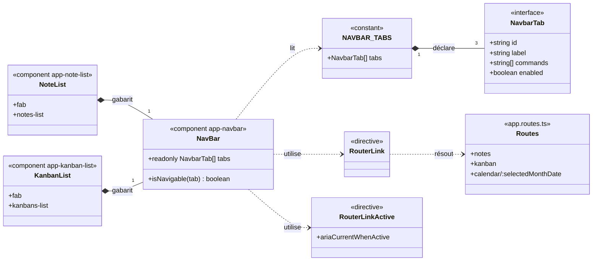

# Approche de développement — NAVBAR : barre de navigation partagée

> **Date :** 2026-11-14 · **status: validé le 2026-11-14** (hors rendu Mermaid, cf. §1)
> **SPEC :** `.agent/NAVBAR/FEATURE_NAVBAR.md` (US1 → US5, hypothèses `H1` → `H8` tranchées le 2026-11-14)
> **Docs de référence :** `.agent/KANBAN/CRUD/FEATURE_KANBAN_CRUD.md` (menu de navigation global renvoyé à ce lot),
> `.agent/KANBAN/EDITION_CARTES/APPROCHE_KANBAN_EDITION_CARTES.md` (précédent de format et de composant partagé : `D-C31`, `NotePicker`)
> **Code de référence :** `frontend/src/app/{app.config.ts,app.routes.ts,app.html,app.css}`,
> `note-list/{note-list.ts,.html,.css}`, `kanban-list/{kanban-list.ts,.html,.css}`,
> `core/components/{confirm-dialog,note-picker}/`, `frontend/src/styles.css`, `frontend/src/index.html`

**Légende des décisions.** Les décisions de ce document sont numérotées `D-N#`. Toutes ont été tranchées par l'utilisateur le 2026-11-14, conformément aux recommandations de l'approche.

Ce lot est **purement présentationnel** : aucune table, aucun service, aucun modèle de domaine, aucune
migration. Il ajoute **un composant**, une **donnée statique** qui décrit ses trois onglets, et
retouche **les gabarits et feuilles de style de deux écrans existants**.

---

## 0. Décisions de cadrage

| # | Sujet | Choix retenu |
|---|-------|--------------|
| D-N1 | Composant | `NavBar`, sélecteur `app-navbar`, dossier `core/components/navbar/` (`navbar.ts`, `navbar.html`, `navbar.css`, `navbar.spec.ts`), `standalone: true`, `templateUrl` + `styleUrl` — exactement la forme de `ConfirmDialog` et `NotePicker` (`H5`). |
| D-N2 | Pas d'entrée, pas de sortie, pas d'injection | `NavBar` n'a **aucun `input()`**, **aucun `output()`** et n'injecte **rien** : il ne contient ni logique métier ni état. Les directives `RouterLink` / `RouterLinkActive` portent la navigation et la mise en évidence (cf. D-N5). Contrairement à `ConfirmDialog` (`model` + `output`) et `NotePicker` (`model` + `output` + `NotesService`), il n'y a donc **rien à calquer côté API** : on ne calque que la **forme de fichiers**, le sélecteur `app-…` et l'en-tête JSDoc. |
| D-N3 | Données des onglets | Une **constante** `NAVBAR_TABS: readonly NavbarTab[]` rangée dans `navbar.ts` (ordre, libellé, destination, état). C'est la **source de vérité unique** : le gabarit ne contient aucun libellé en dur (US3, US4 : « ni libellé à changer, ni onglet à insérer »). |
| D-N4 | Intégration | `<app-navbar />` posée **en dernier enfant** du conteneur de `note-list.html` et de `kanban-list.html`, après `app-confirm-dialog` (l ordre DOM est indifférent : la popup est à `z-index: 1000`, la barre plus bas). `NavBar` ajouté aux `imports` des deux composants. `app.html` est **inchangé** (`H6`). |
| D-N5 | Détermination de l'onglet actif (tranché le 2026-11-14) | **Lecture du routeur** par `routerLinkActive` + `ariaCurrentWhenActive="page"`, pas d'`input()` donné par les écrans. Détail et alternatives en §3, point 4. |
| D-N6 | Tokens CSS (tranché le 2026-11-14) | `NavBar` **n'embarque pas sa palette** : il **hérite** de celle que déclare l'écran hôte sur son `:host` (les custom properties se propagent aux composants enfants). Il ne réclame que `--surface`, `--separator`, `--text`, `--text-2`, `--accent`. Détail et alternatives en §3, point 1. |
| D-N7 | Dimensions partagées (tranché le 2026-11-14) | **Deux custom properties globales** déclarées une fois sur `:root` dans `frontend/src/styles.css` (aujourd'hui vide, déjà référencé par `angular.json`) : `--navbar-height: 56px` et `--navbar-fab-gap: 16px`. Les trois feuilles de style (`navbar.css`, `note-list.css`, `kanban-list.css`) les **lisent**, aucune ne les redéfinit. Valeurs et justification en §3, point 2. |
| D-N8 | Onglet désactivé (tranché le 2026-11-14) | Rendu par un **`<button type="button" disabled>`** natif, et non par un lien : non focalisable, non cliquable, annoncé « indisponible » par TalkBack, sans aucun `ariaDisabled` à entretenir. Détail en §3, point 5. |
| D-N9 | Sémantique | La barre est un **`<nav aria-label="Navigation principale">`** contenant les trois onglets. |
| D-N10 | Limite de cette approche | **Ne touche pas** au thème des deux écrans : ce lot ne corrige pas l'absence de bloc sombre dans `note-list.css` (cf. §4, E1 : hors lot, tranché le 2026-11-14). |

---

## 1. Diagramme de classes

> **Mermaid non rendu (2026-11-14).** Le diagramme ci-dessous **n'a pas été rendu** par
> `mermaid.render()` : l'exécution de JavaScript dans le Browser pane (chargement de mermaid depuis
> jsdelivr) a été refusée par le classifieur de permissions, à la rédaction comme chez le
> superviseur, et aucun contournement n'a été tenté. **L'utilisateur a accepté le 2026-11-14 de
> valider l'approche sans ce rendu** ; sa syntaxe reste donc non vérifiée (stéréotype le plus
> risqué : `<<component app-navbar>>`, à ramener à `<<component>>` en cas d'échec de rendu).



**Existant / à créer.**

| Élément | État |
|---|---|
| `NavBar`, `NavbarTab`, `NAVBAR_TABS` (`core/components/navbar/navbar.ts`) | **À créer** |
| `core/components/navbar/navbar.{html,css,spec.ts}` | **À créer** |
| `--navbar-height`, `--navbar-fab-gap` dans `src/styles.css` | **À créer** (le fichier existe, vide) |
| `NoteList`, `KanbanList` (`.ts`, `.html`, `.css`) | **Existants, modifiés** (import, balise, `.fab`, réserve de place) |
| `provideRouter(routes)` (`app.config.ts`), routes `notes` / `kanban` / `calendar/:selectedMonthDate` (`app.routes.ts`) | **Existants, inchangés** |
| `RouterLink`, `RouterLinkActive` | **Angular, existants** ; `NoteList` les importe déjà (`note-list.ts:9`) |

Aucun service, aucun modèle de `core/models`, aucune table : le diagramme domaine de
`DIAGRAMME_CLASSES_NOTES.md` n'évolue pas.

---

## 2. Approche de développement

### Lot A — Le composant `NavBar` (US1, US2, US3, US4)

**Modèle.**

```
interface NavbarTab { id: string; label: string; commands: string[]; enabled: boolean }

NAVBAR_TABS = [
  { id: 'notes',    label: 'Notes',      commands: ['/notes'],  enabled: true  },
  { id: 'kanbans',  label: 'Kanbans',    commands: ['/kanban'], enabled: true  },
  { id: 'calendar', label: 'Calendrier', commands: [],          enabled: false },
]
```

L'ordre du tableau **est** l'ordre d'affichage (US4). `commands` du calendrier est vide tant que
l'onglet est désactivé : la route réelle exige un paramètre (`calendar/:selectedMonthDate`) que
personne ne décide encore (cf. §3 point 5).

**Rendu (`navbar.html`).**

- Quand le composant s'affiche :
  -- Je pose un `<nav aria-label="Navigation principale" class="navbar">` et je boucle sur `tabs` avec
     `@for (tab of tabs; track tab.id)`.
  -- Pour chaque onglet **navigable** (`tab.enabled`), je rends un
     `<a class="navbar-tab" [routerLink]="tab.commands" routerLinkActive="navbar-tab-active"
     ariaCurrentWhenActive="page" [routerLinkActiveOptions]="{ exact: true }">{{ tab.label }}</a>`.
  -- Pour chaque onglet **désactivé**, je rends un
     `<button type="button" class="navbar-tab navbar-tab-disabled" disabled>{{ tab.label }}</button>`.
     Il ne porte **aucun** `routerLink`, **aucun** `(click)`, **aucun** `ariaCurrentWhenActive` : il ne
     peut donc pas être mis en évidence (US3, « jamais actif »).

**Interaction : toucher un onglet navigable.**

- Quand je touche **Kanbans** depuis la liste des notes :
  -- `RouterLink` demande au routeur d'aller sur `/kanban` ; `NoteList` est détruit, `KanbanList` est créé,
     charge sa liste de lui-même (`ngOnInit`), son « + » et ses actions répondent comme à l'ouverture
     directe (US1).
- Quand je touche **l'onglet de l'écran déjà affiché** :
  -- Le routeur voit une URL identique et, avec sa configuration par défaut
     (`onSameUrlNavigation: 'ignore'`, non surchargée dans `provideRouter(routes)`), **ne fait rien** :
     pas de rechargement, la recherche en cours de `NoteList` est conservée (US1). *Point à vérifier
     par un test qui compte les navigations, cf. Lot D.*
- Quand j'appuie sur **retour matériel** :
  -- L'URL change, `routerLinkActive` se recalcule : l'onglet mis en évidence suit l'écran réellement
     affiché (US2, dernier critère) sans qu'aucun écran n'ait à le déclarer.

**Interaction : toucher l'onglet Calendrier.**

- Quand je touche **Calendrier** :
  -- Rien : le `<button disabled>` n'émet aucun clic, n'est pas focalisable (ni clavier ni balayage
     TalkBack n'y atterrissent comme cible active), est annoncé « désactivé », et la feuille de style
     ne lui donne **aucun état `:active`** ni surbrillance de toucher (H3). Le grisé est le seul
     signal.

**Mise en évidence (US2) — tranché le 2026-11-14 (point 3 du §3).**

- Onglet actif : couleur `--accent` **+ graisse 700 + trait de 3 px en haut de l'onglet** ; attribut
  `aria-current="page"` posé par `ariaCurrentWhenActive`.
- Onglet inactif navigable : `--text`, graisse 500.
- Onglet désactivé : `--text-2` à `opacity: .5`, graisse 500, `cursor: default`.

Les trois états diffèrent donc par au moins deux canaux (couleur + graisse ou trait) : la
mise en évidence ne repose pas sur la couleur seule.

**Mise en page (`navbar.css`) (US4).**

- `.navbar` : `position: fixed; left: 0; right: 0; bottom: 0; max-width: 720px; margin: 0 auto;`
  (même largeur utile que `.note-list-container` / `.kanban-list-container`, centrée) ;
  `display: flex; z-index: 25;` ; `height: calc(var(--navbar-height) + env(safe-area-inset-bottom, 0px))` ;
  `padding-bottom: env(safe-area-inset-bottom, 0px)` ; fond `--surface`, `border-top: 0.5px solid var(--separator)`.
- `.navbar-tab` : `flex: 1 1 0; display: flex; align-items: center; justify-content: center;
  height: var(--navbar-height)` → trois onglets de **largeur égale**, quel que soit le libellé.
- Étagement : `topbar` 20, **barre 25**, `.fab` 30, `ConfirmDialog` et `NotePicker` 1000
  (`note-list.css:39,202`, `kanban-list.css:54,216`, `confirm-dialog.css:34`). La barre passe donc
  **sous** le « + » et **sous** la popup de confirmation, qui la recouvre sans la rendre
  inopérante une fois refermée (US4).

**Pourquoi `env(safe-area-inset-bottom)` directement et non `var(--safe-bottom)`.** La barre doit
fonctionner même si un hôte ne déclare pas `--safe-bottom` ; `env()` est la source dont `--safe-bottom`
n'est que l'alias dans chaque écran. Cela retire un contrat de plus entre la barre et son hôte.

### Lot B — Intégration dans `note-list` et `kanban-list` (US1, US4, US5)

- **`note-list.ts` / `kanban-list.ts`** : ajouter `NavBar` à `imports`. Aucune autre ligne de TypeScript
  (la barre ne demande ni état ni méthode à son hôte).
- **`note-list.html` / `kanban-list.html`** : ajouter `<app-navbar />` dans le conteneur racine.
- **`.fab` des deux feuilles** (`note-list.css:190`, `kanban-list.css:204`) :
  `bottom: calc(var(--navbar-height) + var(--navbar-fab-gap) + var(--safe-bottom))`.
  La forme (60 × 60, ronde), le `right` et le `z-index: 30` ne changent pas (US5).
- **Réserve de place** : `.notes-list` (`note-list.css:81`) et `.kanbans-list` (`kanban-list.css:88`)
  prennent le **même** padding bas :
  `calc(var(--navbar-height) + var(--navbar-fab-gap) + 60px + var(--navbar-fab-gap) + var(--safe-bottom))`.
  Aujourd'hui `110px + safe-bottom` côté notes, `24px + safe-bottom` côté kanbans : le second est le
  défaut déjà observé (le « + » masque la dernière carte), corrigé ici au passage.
- **Cohabitation** : le champ de recherche (`.topbar` sticky, haut), le compteur de tableaux, l'état
  de chargement, l'état vide, l'état d'erreur et le bandeau `.action-error` sont tous **dans le flux
  en haut ou au milieu** : seule la réserve basse change. Rien d'autre n'est à toucher.

### Lot C — Variables partagées (US4, US5)

- Ajouter dans `frontend/src/styles.css` un seul bloc `:root { --navbar-height: 56px; --navbar-fab-gap: 16px; }`.
  Ce bloc est **le seul changement global** du lot ; la palette n'y entre pas (D-N6).

### Lot D — Tests (à cadrer par `plan_test`, pas par cette approche)

Pas de test écrit ici. Éléments de cadrage pour `plan_test`, qui découlent des décisions :

- Le spec monte `NavBar` seul avec `provideRouter([{ path: 'notes', … }, { path: 'kanban', … }])` et des
  composants vides en cible : **routeur réel, pas de mock de module**, comme `note-list.spec.ts` et
  `kanban-list.spec.ts` (qui injectent déjà `provideRouter([])`). L'onglet actif s'asserte par
  `aria-current="page"` après `router.navigateByUrl(...)` ; l'onglet Calendrier par `disabled`, absence
  de `href`, absence de `aria-current`.
- Les valeurs chiffrées (§3 point 2) s'assertent **sur le texte des feuilles de style ou sur les
  custom properties**, jamais sur une mesure de rendu : jsdom ne calcule pas de mise en page. Le plan
  de test devra le dire (D-NN à créer) ou renvoyer ces critères à la vérification sur appareil.
- `kanban-list.spec.ts` et `note-list.spec.ts` ne devraient **pas** casser : la barre n'est pas
  cliquée, et leurs doublures de navigation (`navigate`, `navigateByUrl`) n'interceptent que des
  clics. À reconfirmer en lançant les deux specs une fois le gabarit modifié.

---

## 3. Points que la SPEC laisse à l'approche

### 1. Tokens CSS — D-N6, tranché le 2026-11-14

**Constat.** `note-list.css:7-20` et `kanban-list.css:11-24` redéclarent chacun la palette sur `:host`
(« redéclarés car non globaux ») ; `app.css` et `styles.css` sont vides. Un composant partagé sous son
propre `:host` n'hérite de **rien** qu'un `:root` n'ait déclaré — mais il hérite de tout ce que son
**parent** a déclaré sur son `:host`, parce que les custom properties sont héritées par le DOM, et que
l'encapsulation d'Angular n'isole que les **sélecteurs**, pas l'héritage.

**Options.**

| Option | Principe | Conséquences |
|---|---|---|
| **A. La barre porte sa propre palette** | `:host` de `navbar.css` redéclare `--surface`, `--text`, `--text-2`, `--accent`, `--separator` **et** son bloc `prefers-color-scheme: dark`, comme `confirm-dialog.css:14-25` et `note-picker.css:12-25` le font déjà | Pas de contrat avec l'hôte, précédent existant. **Mais** une **troisième copie** de la palette ; **et** la barre devient sombre quand le système l'est, alors que `note-list` ne l'est **jamais** (cf. écart E1) : barre sombre sous une liste claire. |
| **B. Palette globale sur `:root`** | Déplacer la palette dans `styles.css`, retirer les redéclarations des écrans | Bonne solution à terme, sans doublon. **Hors du « ne refactore pas au-delà de ce que ton choix exige »** : touche au moins 6 feuilles (`note-list`, `kanban-list`, `kanban-editor`, `kanban-column`, `kanban-card`, `confirm-dialog`, `note-picker`), à faire dans un lot dédié. |
| **C. La barre hérite de l'hôte** *(retenue)* | `navbar.css` n'écrit que `var(--surface)`, `var(--separator)`, `var(--text)`, `var(--text-2)`, `var(--accent)` ; aucune déclaration. Elle reçoit la palette — claire ou sombre, selon ce que l'écran fait — de `NoteList` ou `KanbanList` | Zéro duplication, **suit automatiquement le thème de l'écran**, y compris l'absence de thème sombre de `note-list`. **Contrat implicite** : tout futur hôte doit déclarer ces cinq variables ; il est écrit dans l'en-tête JSDoc de `NavBar`. Contrepartie : le composant ne se rend correctement qu'**à l'intérieur** d'un hôte qui les déclare — un test qui le monte seul n'a pas de couleurs (sans importance : jsdom n'affirme pas de couleur). |
| **D. C avec valeurs de repli** | `var(--accent, #007aff)`… | Rend la barre autonome, mais **re-duplique** la palette claire dans le composant. À écarter, sauf si l'on veut un composant qui survive hors des deux écrans (hors périmètre). |

**Décision (tranchée le 2026-11-14) : C.** C'est la plus petite et la seule qui reste **cohérente avec l'écran qui
l'héberge** ; A fabrique un défaut visuel réel dès le premier lancement (E1), B est un lot à part.
**Les dimensions**, elles, ne sont pas des tokens de thème et vont sur `:root` (D-N7), ce qui ne
contredit pas C. **Choix suivant : B**, à planifier hors de ce lot.

### 2. Valeurs chiffrées — D-N7, tranché le 2026-11-14

| Grandeur | Valeur | Justification |
|---|---|---|
| Hauteur de la barre (hors zone système) | **56 px** (`--navbar-height`) | Hauteur de la barre de navigation inférieure Material ; cible tactile ≥ 48 px, confortable au pouce. Largeur d'onglet = ⅓ de la barre, donc ≥ 48 px de large aussi. |
| Hauteur totale de la barre | **56 px + `env(safe-area-inset-bottom)`** | La zone système est **ajoutée** en bas, pas retranchée : aucun onglet n'est masqué sur un appareil avec barre système (US4). |
| Jeu entre la barre et le « + » (`--navbar-fab-gap`) | **16 px** | Ni chevauchement ni contact (US5), sans éloigner le « + » du pouce. |
| Taille du « + » | **60 px** (inchangée) | Existante dans les deux feuilles ; **non** promue en variable : elle ne varie pas dans ce lot. |
| `bottom` du « + » | **`56px + 16px + safe-bottom` = 72 px + `--safe-bottom`** (au lieu de `24px + safe-bottom`) | Le « + » **remonte de 48 px** (72 − 24). Son bord bas est à 16 px au-dessus de la barre. |
| Réserve de place en bas des listes | **56 + 16 + 60 + 16 = 148 px + `--safe-bottom`** | Barre + jeu + « + » + 16 px de respiration sous le dernier élément. Remplace `110px + safe-bottom` (`note-list.css:81`, **+38 px**) et `24px + safe-bottom` (`kanban-list.css:88`, **+124 px**). |

**Vérification arithmétique.** Le « + » occupe, depuis le bas de l'écran,
`[72 + safe, 132 + safe]` ; la barre occupe `[0, 56 + safe]` ; le dernier élément de la liste s'arrête
à `148 + safe` du bas. Les trois zones sont disjointes (jeu de 16 px entre barre et « + »,
16 px entre « + » et dernier élément). Les 110 px d'aujourd'hui laissaient 26 px de respiration
(`110 − 24 − 60`) : la nouvelle réserve en laisse 16, c'est un **choix**, pas une conséquence — à
confirmer par l'utilisateur si 26 lui paraît préférable (réserve = 158 px).

**Portage.** `--navbar-height` et `--navbar-fab-gap` sont déclarées **une fois** sur `:root` dans
`styles.css`, lues par trois feuilles ; la réserve est un `calc()` de ces variables, jamais un nombre
recopié (sauf le `60px` du « + », déjà présent en dur dans les deux feuilles).
*Écartée :* une constante TypeScript exportée, qui ne parle pas au CSS ; et un `input()` de hauteur
sur la barre, qui n'a pas de sens pour une dimension fixe.

*Réserve sur `--safe-bottom`.* `index.html:7` déclare `viewport` **sans** `viewport-fit=cover` : sans
lui, `env(safe-area-inset-bottom)` vaut `0` dans une WebView classique. La valeur est donc
**non vérifiable** dans le navigateur et à contrôler **sur appareil** (cf. §4). Ce lot ne modifie pas
`index.html`.

### 3. Apparence de l'onglet actif — tranché le 2026-11-14

| Option | Principe | Conséquences |
|---|---|---|
| **A. Graisse seule** | 700 vs 500 | Perceptible sans couleur, mais discret ; sur trois libellés courts, l'écart de graisse est faible. |
| **B. Trait sous l'onglet seul** | Filet de 3 px | Très lisible, mais un filet isolé se lit mal sur fond sombre fin. |
| **C. Graisse + trait + couleur `--accent`** *(retenue)* | Les trois à la fois, avec `aria-current="page"` | Trois canaux redondants : lisible sans distinction de couleur (US2), robuste en thème sombre. Coût : 3 propriétés CSS. |
| **D. Pastille de fond** | Fond arrondi derrière le libellé | Évoque une icône ; plus lourd, et suppose de choisir une teinte de fond par thème. |

**Décision (tranchée le 2026-11-14) : C.** Le trait se place en `::before` de `.navbar-tab-active` (largeur 24 px, 3 px de
haut, en haut de l'onglet) et la graisse change **sans changer la largeur utile de l'onglet** (onglets
de largeur égale, `flex: 1 1 0`), donc sans décalage visuel des voisins. Attribut d'accessibilité :
`aria-current="page"`, posé par `ariaCurrentWhenActive="page"` de `RouterLinkActive`, et **absent**
sur les deux autres.

**Contraste (point d'attention).** `--text-2` (`#8e8e93` sur `#ffffff`, `note-list.css:11`) donne un
contraste d'environ 3,2:1, sous le seuil de 4,5:1 des textes courants. D'où le choix de **ne pas**
prendre `--text-2` pour l'onglet inactif navigable (`--text`, graisse 500) et de le **réserver** à
l'onglet désactivé, où l'atténuation est l'information.

### 4. Détermination de l'onglet actif — D-N5, tranché le 2026-11-14

| Option | Principe | Conséquences |
|---|---|---|
| **A. `input()` donné par l'écran** | `<app-navbar active="notes" />` | Simple, pure, testable sans routeur pour la mise en évidence. **Mais** : chaque écran doit penser à la donner (une faute de frappe affiche un mauvais onglet sans erreur) ; elle dit « cet écran » et non « l'URL » ; les liens de navigation ont **quand même** besoin du routeur. |
| **B. `routerLink` + `routerLinkActive`** *(retenue)* | Les liens sont de vrais `<a>` ; l'état actif se déduit de l'URL | Zéro entrée à fournir, l'état **suit l'URL réelle** — accès direct, retour matériel — par construction (US2, dernier critère). Les `<a>` portent un vrai `href` (TalkBack annonce « lien »). `aria-current` fourni par Angular. `NoteList` utilise déjà ces deux directives (`note-list.ts:9`) : aucune nouveauté pour le dépôt. |
| **C. `Router.url` + `computed`** | Le composant injecte `Router`, calcule l'onglet depuis `router.url` | Plus de code (un signal d'URL à rafraîchir sur `NavigationEnd`), même résultat que B, **plus de surface à tester**. |

**Décision (tranchée le 2026-11-14) : B.** Il faut de toute façon `RouterLink` pour naviguer ; autant lui laisser aussi le
« qui est actif ».

**Conséquence sur la testabilité, honnêtement.** Il faut un **vrai routeur** dans le spec :
`provideRouter([{ path: 'notes', component: Vide }, { path: 'kanban', component: Vide }])`, puis
`await router.navigateByUrl('/kanban')` et `fixture.detectChanges()` avant de lire
`aria-current`. Ce n'est **pas** un mock de module : c'est exactement ce que les deux specs de liste
font déjà avec `provideRouter([])` (`note-list.spec.ts:49`, `kanban-list.spec.ts:64`). Deux
particularités à connaître : (a) les specs de liste **espionnent** `navigateByUrl` avec
`mockResolvedValue(true)` (`kanban-list.spec.ts:68-69`) — un clic sur un onglet dans ces specs
n'irait donc **pas** jusqu'à l'URL, et c'est le spec de `NavBar` qui porte les critères de
navigation ; (b) `routerLinkActive` se recalcule sur `NavigationEnd`, donc il faut **attendre** la
navigation avant d'asserter.

### 5. Onglet Calendrier désactivé — D-N8, tranché le 2026-11-14

**Contraintes.** La route `calendar/:selectedMonthDate` exige un paramètre (`app.routes.ts:8`) ; le
module est inachevé (`calendar.ts:42-93` commenté) ; l'activation future ne doit modifier ni libellé,
ni ordre, ni mise en page (US3).

| Option | Principe | Conséquences |
|---|---|---|
| **A. `<button disabled>` natif, piloté par `enabled: false` dans `NAVBAR_TABS`** *(retenue)* | Tableau de données + `@if (tab.enabled)` dans le gabarit | Non focalisable, jamais cliquable, annoncé « désactivé » par le navigateur et TalkBack **sans** attribut ARIA à maintenir. L'activation = mettre `enabled: true` **et** renseigner `commands` dans l'entrée du tableau, **aucun** autre fichier. Écart honnête avec « un seul changement d'état » : il y a **deux champs** (état + destination), la destination n'existant pas aujourd'hui (le mois ouvert par défaut est à décider par le lot calendrier). Pas d'autre fichier touché. |
| **B. `<a>` + `aria-disabled="true"` + `tabindex="-1"` + `(click)` bloqué** | Lien neutralisé à la main | Trois attributs à tenir en cohérence ; un lecteur d'écran peut encore atteindre l'élément par balayage ; le blocage du clic se fait par code. Plus fragile. |
| **C. `routerLink` direct vers `/calendar/<mois courant>` mais neutralisé** | Destination figée en dur dès maintenant | **Écartée** : choisit à la place du lot calendrier le mois par défaut (hors périmètre), et ouvrirait un écran inachevé si la neutralisation sautait. |
| **D. Même gabarit pour les trois, `[class.disabled]`** | Un seul élément, classe CSS | Un lien visuellement grisé reste **focalisable** : viole le critère « non atteignable au clavier ». |

**Décision : A, tranchée le 2026-11-14, y compris son coût.** *À lire sans adoucissement :* l'activation
future de l'onglet **ne se réduit pas à un seul changement d'état**. Elle demande **deux champs** de
l'entrée `NAVBAR_TABS` : `enabled: true` **et** `commands`, parce que la destination **n'existe pas
aujourd'hui** — la route `calendar/:selectedMonthDate` exige un mois, et la décision du mois ouvert
par défaut est **hors lot**, c'est celle du lot calendrier. Le critère d'US3 (« ni libellé à changer,
ni onglet à insérer, ni mise en page à revoir ») est tenu ; celui d'un unique changement d'état ne
l'est pas à la lettre. Le gabarit boucle sur `tabs` ; la branche `@else` rend le `<button disabled>` ;
`.navbar-tab-disabled` ne définit **pas** d'`:active` et fixe `-webkit-tap-highlight-color: transparent`,
pour qu'aucun retour visuel d'appui ne se produise (H3). Un onglet qui devient `enabled: true` change
simplement de branche du `@if` : même classe `.navbar-tab`, même taille, même place.

### 6. Réutilisation de l'existant

**`ConfirmDialog` / `NotePicker` examinés.** Fichiers : `<nom>.ts`, `<nom>.html`, `<nom>.css`
(+ `<nom>.spec.ts` pour `NotePicker`) ; `standalone: true` ; sélecteur `app-<nom-en-kebab>` ;
`templateUrl` + `styleUrl` (singulier) ; en-tête JSDoc de classe décrivant le composant et son usage ;
tests **par injection** (`NotePicker` : `NotesService` doublé par injection, jamais par mock du module
sqlite, cf. `note-picker.spec.ts`, D-NP5). `NavBar` reprend **tout cela**, hors l'API (`model`/`output`/`inject`),
inutile ici (D-N2).

**État réel d'Angular Router.** `app.config.ts` appelle `provideRouter(routes)` **sans** option : pas de
`withComponentInputBinding`, ni `onSameUrlNavigation` surchargé — le comportement par défaut (`ignore`)
s'applique. `routerLink` est déjà utilisé par `note-list.html:23` (`[routerLink]="['/notes/edit', note.id]"`
avec `routerLinkActive`), donc le routeur est **opérationnel et éprouvé** ; `routerLink` est utilisable
tel quel.

---

## 4. Impacts & points d'attention

| # | Constat | Conséquence |
|---|---------|-------------|
| E1 | **`note-list.css` n'a aucun bloc `@media (prefers-color-scheme: dark)`** (contrairement à `kanban-list.css:32`) ; la SPEC (US4, dernier critère) suppose pourtant que les deux listes « suivent déjà le thème du système ». | **Thème sombre des notes : HORS LOT** (tranché le 2026-11-14), `note-list.css` n'est pas touché. Par D-N6, la barre **hérite du thème de chaque écran** : sombre sous les kanbans quand le système l'est, **toujours claire sous les notes**. Le critère « thème sombre » d'US4 n'est donc **vérifiable que sur la liste des kanbans** (à vérifier sur appareil). |
| E2 | `kanban-list.css:243` lit `var(--surface-2)` que ce fichier **ne déclare pas** (il le fait dans `note-list.css:10`) : le fond de `.btn-icon` y est invalide. | Défaut **préexistant, hors lot**, **non corrigé ici**. N'affecte pas la barre (elle n'utilise pas `--surface-2`). |
| E3 | `index.html:7` : `viewport` sans `viewport-fit=cover`. | `env(safe-area-inset-bottom)` peut valoir `0` dans la WebView ; la zone système basse (US4) est à vérifier **sur appareil**, pas dans le navigateur. Ce lot ne modifie pas `index.html`. |
| E4 | Clavier virtuel : le champ de recherche de `NoteList` ouvre le clavier sur un `position: fixed; bottom: 0`. Selon le mode de redimensionnement de la WebView, la barre peut **remonter au-dessus du clavier** et manger de l'espace. | US5 demande que cela « ne casse pas la mise en page de la barre » ; la SPEC ne dit pas qu'elle doive se masquer. Le « + » a déjà ce comportement. **À vérifier sur appareil** ; la masquer au focus serait une décision hors SPEC. |
| E5 | `ConfirmDialog` (`z-index: 1000`) recouvre la barre (`z-index: 25`), comme voulu (US4). | **À vérifier sur appareil** : le fond de la popup couvre la zone de la barre, qui ne la rend pas inopérante une fois refermée. |
| E6 | `kanban-list.spec.ts` et `note-list.spec.ts` montent leur écran entier : l'ajout de `<app-navbar />` les fait **rendre** la barre. | Probablement sans effet (aucun clic dessus), mais les **deux specs sont à relancer** après la modification des gabarits (§2 Lot D). |
| E7 | `frontend/src/styles.css` et `app.css` sont vides ; `styles.css` ne figurait pas dans les fichiers cités par la SPEC. | `styles.css` reçoit le seul bloc `:root` des deux variables de dimension (D-N7) ; la palette n'y entre pas. |
| E8 | `.note-list-container` et `.kanban-list-container` (`min-height: 100vh`) : la barre étant `fixed`, elle ne change pas la hauteur du contenu ; seule la réserve de place compte. | Aucun risque de double défilement. |

---

## 5. Découpage suggéré

1. **Lot C** — variables globales `--navbar-height`, `--navbar-fab-gap` dans `styles.css` (5 lignes, aucun risque).
2. **Lot A** — `NavBar` (`navbar.ts`, `.html`, `.css`) **et son spec** : c'est le cœur des critères US2, US3, US4, testable en isolation avec un routeur réel.
3. **Lot B** — intégration dans `note-list` puis `kanban-list`, avec la remontée du « + » et le recalcul de la réserve (US1, US4, US5). On relance les deux specs existants.
4. **Vérification sur appareil** (APK) : zone système basse (E3), clavier (E4), popup (E5), dernier élément des deux listes entièrement consultable, thème sombre sur kanbans (E1).

**Hors périmètre de ce lot** (reprise de la SPEC) : activation du calendrier et choix du mois par
défaut, barre dans les éditeurs et le calendrier, quatrième onglet, icônes, message au toucher du
calendrier, mémorisation du dernier onglet, animation, balayage, menu latéral. **Hors périmètre de
cette approche, en plus** : palette globale (option B du point 1), bloc sombre de `note-list.css` (E1),
`--surface-2` manquant (E2), `viewport-fit=cover` (E3).

**Suite après validation.** `plan_test` sur le Lot A (puis B), puis `ecrire_tests` / `dev_par_cas`.
