# Plan de test — NAVBAR : la barre de navigation partagée

> **Date :** 2026-11-14 · **Statut :** validé le 2026-11-14 *(plan complet ; couples `P1` à `P24` et décisions `D1` à `D6` tranchés par l'utilisateur le 2026-11-14)*
> **Approche :** TDD **boîte noire** — les cas disent ce qui est **vérifié**, jamais comment le code s'y prend.
> **SPEC :** `.agent/NAVBAR/FEATURE_NAVBAR.md` (`US1` → `US5`, hypothèses `H1` → `H8`)
> **Approche de dev :** `.agent/NAVBAR/APPROCHE_NAVBAR.md` (décisions `D-N1` → `D-N10`, lots **A** → **D**)
> **Conventions de test :** `frontend/src/app/core/components/note-picker/note-picker.spec.ts` (TestBed, doublures par DI, en-tête JSDoc avec table de contrat DOM), `note-list.spec.ts`, `kanban-list.spec.ts`. `ConfirmDialog` n'a **pas** de spec : `note-picker.spec.ts` est le **seul** modèle de spec d'un composant partagé.

> **Mermaid non rendu (2026-11-14).** Le diagramme du §3 **n'a pas été rendu** par `mermaid.render()` :
> le chargement de mermaid depuis un CDN est refusé par le classifieur de permissions dans cet
> environnement, et aucun contournement n'a été tenté. La source est volontairement simple
> (`graph TD`, nœuds rectangulaires, aucun stéréotype) ; sa syntaxe reste **non vérifiée**.

---

## 1. Objet testé

La barre de navigation `NavBar` (`app-navbar`, `core/components/navbar/`) : trois onglets **Notes**,
**Kanbans**, **Calendrier** (ce dernier affiché mais désactivé), posée en bas des deux listes. Elle
n'a ni entrée, ni sortie, ni service (`D-N2`) : tout son comportement observable passe par le
**routeur réel** (`routerLink`, `routerLinkActive`, `D-N5`).

Trois cibles de test, un seul fichier neuf :

| Cible | Fichier | Nature | User stories |
|---|---|---|---|
| `NavBar` | `navbar.spec.ts` **(à créer)** | composant, routeur réel (`provideRouter` + routes factices) | US1, US2, US3, US4 (part DOM) |
| `NoteList` — intégration | `note-list.spec.ts` **(cas ajoutés)** | composant hôte, `NotesService` doublé par DI | US1, US2, US4, US5 (part DOM) |
| `KanbanList` — intégration | `kanban-list.spec.ts` **(cas ajoutés)** | composant hôte, `KanbanService` doublé par DI | US1, US2, US4, US5 (part DOM) |
| Appareil (APK) | **checklist §8**, pas de code | vérification manuelle | US2, US3, US4, US5 (part mise en page) |

Les critères de **navigation** relèvent de `navbar.spec.ts` seul : `note-list.spec.ts` et
`kanban-list.spec.ts` espionnent `navigateByUrl` avec `mockResolvedValue(true)`
(`kanban-list.spec.ts:69`, `note-list.spec.ts:56`), si bien qu'un toucher d'onglet n'y va jamais
jusqu'à l'URL. Un test de navigation écrit dans ces specs passerait à vide.

### Hors périmètre de ce plan

Reporté ou écarté par la SPEC : activation du Calendrier, barre dans les éditeurs et le calendrier,
icônes, message au toucher du Calendrier (`H3`), mémorisation du dernier onglet, animation, balayage,
thème sombre de `note-list` (`E1` de l'approche), `--surface-2` manquant (`E2`), `viewport-fit=cover`
(`E3`).

Hors test automatisé **pour une raison technique** (jsdom ne calcule aucune mise en page) : la
hauteur de 56 px, le jeu de 16 px, le `bottom` de 72 px du « + », la réserve de 148 px, l'ancrage
`fixed`, l'étagement des `z-index`, le contraste, la mise en évidence « pas seulement par la couleur »,
le thème, la zone système basse, le clavier virtuel. Tous renvoyés à la **checklist §8** (décision `D1`).

Hors plan : tests des feuilles de style, test de la constante `NAVBAR_TABS` (décision `D6`).

---

## 2. Couples [Cause → Effet] (phase 2.1, à valider)

Numérotés `P#`. « Cible » dit où le couple est vérifié ; « US » d'où il vient.

### 2.1 Structure et libellés (`navbar.spec.ts`)

| # | Cause | Effet | US |
|---|---|---|---|
| P1 | La barre s'affiche | Un repère de navigation `nav` nommé « Navigation principale » | US4 (D-N9) |
| P2 | La barre s'affiche | Exactement trois onglets, dans l'ordre Notes, Kanbans, Calendrier, aux libellés exacts | US3, US4 |
| P3 | La barre s'affiche | Notes et Kanbans sont de vrais liens, vers `/notes` et `/kanban` | US1 |
| P4 | La barre s'affiche | Calendrier est un bouton **désactivé**, sans lien (`href`) | US3 |

### 2.2 Onglet actif (`navbar.spec.ts`)

| # | Cause | Effet | US |
|---|---|---|---|
| P5 | L'URL est `/notes` | Notes porte `aria-current="page"` ; Kanbans et Calendrier n'en portent pas | US2 |
| P6 | L'URL est `/kanban` | Kanbans porte `aria-current="page"` ; les deux autres non | US2 |
| P7 | La route est ouverte **avant** le premier rendu de la barre (accès direct) | L'onglet de cette route est actif dès le premier rendu | US2 |
| P8 | L'URL passe de `/notes` à `/kanban` puis revient, sans toucher la barre (retour matériel, cf. `D3`) | L'onglet actif suit l'URL ; **un seul** onglet actif à chaque instant | US2 |
| P9 | L'URL est hors des deux listes (`/notes/edit/n-1`, cf. `D4`) | Aucun onglet n'est actif | US2 |
| P10 | L'URL est `/calendar/2026-11` | Aucun des trois onglets n'est actif : Calendrier n'est **jamais** actif | US3 |

### 2.3 Navigation (`navbar.spec.ts`)

| # | Cause | Effet | US |
|---|---|---|---|
| P11 | Toucher Kanbans depuis `/notes` | L'URL devient `/kanban` ; Kanbans devient l'onglet actif | US1, US2 |
| P12 | Toucher Notes depuis `/kanban` | L'URL devient `/notes` ; Notes devient l'onglet actif | US1, US2 |
| P13 | Toucher l'onglet de l'écran **déjà affiché** | **Aucune navigation** : aucun `NavigationStart` supplémentaire, URL inchangée (`onSameUrlNavigation: 'ignore'`) | US1 |

### 2.4 Calendrier désactivé (`navbar.spec.ts`)

| # | Cause | Effet | US |
|---|---|---|---|
| P14 | Toucher Calendrier | Aucune navigation : aucun `NavigationStart`, URL inchangée | US3 |
| P15 | Toucher Calendrier | Rien n'apparaît : le DOM de la barre est identique avant et après (ni message, ni erreur, `H3`) | US3 |
| P16 | Donner le focus à Calendrier | Le focus n'arrive pas dessus (élément actif inchangé) ; il est exposé comme `disabled` | US3 |

### 2.5 Intégration dans les listes (`note-list.spec.ts`, `kanban-list.spec.ts`)

| # | Cause | Effet | US |
|---|---|---|---|
| P17 | La liste est affichée | Une seule barre, avec ses trois onglets | US1, US4 |
| P18 | La liste est affichée | Le « + » est **hors** de la barre, et la barre ne contient aucune action de création : le « + » reste porté par la liste | US5 |
| P19 | La liste est ouverte sur sa **vraie** route (routeur non espionné) | L'onglet de cette liste est actif (Notes sur les notes, Kanbans sur les kanbans) | US2 |
| P20 | La liste est en chargement | La barre est présente | US4 |
| P21 | La liste est vide | La barre est présente | US4 |
| P22 | Le chargement a échoué | La barre est présente | US4 |
| P23 | *(kanbans seulement)* Une suppression a été refusée | Le bandeau d'erreur **et** la barre sont présents | US4 |
| P24 | Les cas **existants** de la liste sont rejoués avec la barre dans le gabarit | Tous restent verts (recherche, compteur, corbeille, popup, « + ») | US5 (E6) |

### 2.6 Critères qui n'ont **pas** de couple automatisé (checklist §8)

Mise en page chiffrée (US4, US5), zone système, clavier virtuel, popup au-dessus de la barre, thème
sombre des kanbans, mise en évidence sans la couleur, absence de retour d'appui sur Calendrier,
retour matériel réel, annonce TalkBack, dernier élément entièrement visible. **P1 à P24 ne les
couvrent pas, et le plan le dit.**

### 2.7 Ce que le plan ne teste volontairement pas

- **« Toucher l'onglet courant ne fait pas perdre la recherche » (US1).** Dans les listes, le routeur
  est espionné : le test passerait à vide. C'est la **conséquence** de P13 (aucune navigation, donc
  aucun écran recréé) ; elle est reprise en V15 de la checklist.
- **« L'écran d'arrivée est pleinement fonctionnel » (US1).** Aucun routage réel n'est monté dans les
  specs de liste ; chaque liste est déjà couverte par ses propres cas (`T1.x`…, `T6.x`…).
- **Largeur égale des onglets, cible tactile ≥ 48 px** : mise en page, checklist V2.

---

## 3. Diagramme Cause-Effet

```mermaid
graph TD
    subgraph Causes
        C1[La barre s affiche]
        C2[URL notes]
        C3[URL kanban]
        C4[URL hors listes]
        C5[URL calendar]
        C6[Toucher Kanbans ou Notes]
        C7[Toucher l onglet deja affiche]
        C8[Toucher ou focaliser Calendrier]
        C9[Liste affichee: chargement vide erreur]
        C10[Suppression refusee kanbans]
    end

    subgraph Effets
        E1[nav nomme avec 3 onglets dans l ordre]
        E2[Notes et Kanbans sont des liens]
        E3[Calendrier est un bouton disabled]
        E4[Notes aria-current page]
        E5[Kanbans aria-current page]
        E6[Aucun onglet actif]
        E7[URL change et onglet actif suit]
        E8[Aucune navigation]
        E9[DOM inchange et focus refuse]
        E10[Barre presente avec le plus hors de la barre]
    end

    C1 --> E1
    C1 --> E2
    C1 --> E3
    C2 --> E4
    C3 --> E5
    C4 --> E6
    C5 --> E6
    C6 --> E7
    C7 --> E8
    C8 --> E8
    C8 --> E9
    C9 --> E10
    C10 --> E10
```

Lecture : `C1→E1,E2,E3` = P1 à P4 ; `C2→E4` = P5 ; `C3→E5` = P6 ; `C4,C5→E6` = P9, P10 ;
`C6→E7` = P11, P12 ; `C7→E8` = P13 ; `C8→E8,E9` = P14 à P16 ; `C9,C10→E10` = P17 à P23.
P7, P8 (accès direct, suivi de l'URL) sont des variantes de `C2`/`C3` ; P19 est `C2`/`C3` vu depuis
la liste ; P24 est la non-régression transversale.

---

## 4. Décisions de conception à figer

> Les six décisions ont été **tranchées par l'utilisateur le 2026-11-14**, conformément aux recommandations.

- **D1 — Les valeurs chiffrées de US4 / US5 ne sont pas assertées automatiquement** — *tranchée le 2026-11-14*.
  56 px, 16 px, 72 px, 148 px, `fixed`, `z-index`, zone système : renvoyés à la checklist §8.
  Raisons : jsdom ne calcule ni `calc()`, ni `var()`, ni mise en page ; `tsconfig.spec.json` ne
  charge que `vitest/globals` (pas `@types/node`, donc pas de lecture de fichier CSS depuis un spec) ;
  asserter le texte d'une feuille de style teste l'implémentation et casserait à la moindre
  réécriture équivalente. **Coût assumé, noir sur blanc : une régression sur ces nombres (56, 16, 72, 148 px, `fixed`, `z-index`, zone système) ne fait rougir aucun test.** Seule la checklist §8 la détecte.
- **D2 — Profondeur de l'intégration dans les listes** — *tranchée le 2026-11-14*. Un petit groupe par liste
  (P17 à P23), sans test de navigation, plus la relance de la suite existante (P24). P19 exige de
  rendre au test son vrai routeur (`navigateByUrlSpy.mockRestore()` dans le cas, puis
  `await router.navigateByUrl('/notes')`).
- **D3 — « Retour matériel »** — *tranchée le 2026-11-14*. Simulé par un `navigateByUrl` vers l'URL précédente
  (l'effet sur la barre est le même : l'URL change sans toucher d'onglet). Le vrai bouton Android
  est en checklist V11. Pas de `provideLocationMocks()` / `Location.back()`.
- **D4 — Hors des listes, aucun onglet n'est actif** — *tranchée le 2026-11-14*. À `/notes/edit/n-1`, ni Notes
  ni Kanbans n'est actif (`routerLinkActiveOptions: { exact: true }`, `D-N5`). Cela fige un
  comportement que la SPEC n'exige pas (la barre n'est jamais montrée sur ces écrans) : c'est le
  seul cas (P9) dont la valeur est la documentation de `exact: true`.
- **D5 — « Non atteignable au clavier » pour Calendrier** — *tranchée le 2026-11-14*. Assertion : la propriété
  `disabled` est vraie **et** un appel à `focus()` ne change pas l'élément actif (P16). jsdom suit
  la règle des éléments désactivés pour le focus (non vérifié à ce jour). **Ordre de repli, à
  appliquer par `ecrire_tests` sans re-décision :** si, au premier passage, `focus()` donne le focus
  à un `<button disabled>` dans jsdom, le cas T4.3 retombe sur « `disabled` seul » (option B) et le
  repli est noté dans l'en-tête du spec ; ce n'est pas un blocage.
- **D6 — La constante `NAVBAR_TABS` n'est pas lue par les tests** — *tranchée le 2026-11-14*. Les libellés,
  l'ordre et les destinations sont écrits **en dur** dans le spec (`H7`) : le test reste boîte noire
  et ne duplique pas la source de vérité. Conséquence : la promesse « activer le Calendrier ne demande
  que deux champs » (US3, `D-N8`) n'est **pas** testée ; elle reste affaire de revue.

---

## 5. Cas de test

**Numérotation.** Groupes 1 à 4 dans `navbar.spec.ts`, **12** dans `note-list.spec.ts`, **13** dans
`kanban-list.spec.ts`. Les groupes **5 à 11 sont volontairement absents** : `T5.x` à `T9.x` existent
déjà dans `note-list.spec.ts` et `T6.x` à `T11.x` dans `kanban-list.spec.ts`, et une numérotation
continue aurait créé des doublons de titre. Ces trous sont assumés (décision du 2026-11-14).

### `navbar.spec.ts` — montage seul, `provideRouter` avec routes factices `notes`, `kanban`, `calendar/:selectedMonthDate`, `notes/edit/:id`

**Groupe 1 — Structure et libellés**
- **T1.1** La barre est un repère `nav` nommé « Navigation principale » *(P1 · US4)*
- **T1.2** Elle porte trois onglets, dans l'ordre Notes, Kanbans, Calendrier *(P2 · US3, US4)*
- **T1.3** Notes et Kanbans sont des liens vers `/notes` et `/kanban` *(P3 · US1)*
- **T1.4** Calendrier est un bouton désactivé, sans `href` *(P4 · US3)*

**Groupe 2 — Onglet actif**
- **T2.1** À `/notes`, seul Notes porte `aria-current="page"` *(P5 · US2)*
- **T2.2** À `/kanban`, seul Kanbans le porte *(P6 · US2)*
- **T2.3** Route ouverte avant le premier rendu : l'onglet est actif dès ce rendu *(P7 · US2)*
- **T2.4** L'onglet actif suit l'URL quand elle change sans toucher la barre ; un seul actif *(P8 · US2, `D3`)*
- **T2.5** Hors des listes, aucun onglet actif *(P9 · US2, `D4`)*
- **T2.6** À `/calendar/2026-11`, aucun des trois onglets n'est actif *(P10 · US3)*

**Groupe 3 — Navigation**
- **T3.1** Toucher Kanbans depuis `/notes` mène à `/kanban` et déplace l'onglet actif *(P11 · US1, US2)*
- **T3.2** Toucher Notes depuis `/kanban` mène à `/notes` et déplace l'onglet actif *(P12 · US1, US2)*
- **T3.3** Toucher l'onglet de l'écran affiché ne déclenche aucune navigation *(P13 · US1)*

**Groupe 4 — Calendrier désactivé**
- **T4.1** Toucher Calendrier ne déclenche aucune navigation et laisse l'URL inchangée *(P14 · US3)*
- **T4.2** Toucher Calendrier ne change rien dans le DOM : aucun message *(P15 · US3, `H3`)*
- **T4.3** Calendrier est désactivé et ne reçoit pas le focus *(P16 · US3, `D5`)*

### `note-list.spec.ts` — cas ajoutés (**Groupe 12**, numéro choisi pour ne pas entrer en collision avec les `T1`→`T9` du fichier)

- **T12.1** La liste affiche une seule barre, aux trois onglets *(P17 · US1, US4)*
- **T12.2** Le « + » est hors de la barre ; la barre n'a aucun contrôle de création *(P18 · US5)*
- **T12.3** Sur la vraie route `/notes`, Notes est l'onglet actif *(P19 · US2, `D2`)*
- **T12.4** La barre est présente pendant le chargement *(P20 · US4)*
- **T12.5** …quand la liste est vide *(P21 · US4)*
- **T12.6** …quand le chargement a échoué *(P22 · US4)*

### `kanban-list.spec.ts` — cas ajoutés (**Groupe 13**, pour la même raison : le fichier va jusqu'à `T11`)

- **T13.1** à **T13.6** : mêmes six cas, Kanbans comme onglet actif sur la vraie route `/kanban` *(P17 à P22)*
- **T13.7** La barre reste présente avec le bandeau d'erreur après une suppression refusée *(P23 · US4)*

### Non-régression *(P24 · US5)*

Rejouer en entier `note-list.spec.ts` (`T1`→`T9`), `kanban-list.spec.ts` (`T6`→`T11`) et la suite
complète. **État de référence de la suite : 2 rouges pré-existants** (`calendar.spec.ts > should
create`, `category-selector.spec.ts > placeholder`) — les confondre avec une régression serait une
erreur ; la suite saine est à 2 failed, pas à 0.

---

## 6. Dépendances (abstraites) & doublures

- **Routeur : réel**, jamais mock de module. `navbar.spec.ts` : `provideRouter` avec des composants
  vides en cible des quatre routes. Les navigations sont `await`-ées, puis `detectChanges()`.
- **Comptage des navigations** (T3.3, T4.1) : abonnement aux événements du routeur (`NavigationStart`)
  pour compter, sans espionner `navigateByUrl`.
- **Listes :** `NotesService` / `KanbanService` doublés **par DI**, jamais par mock du module sqlite
  (mémoire `run-frontend-tests`). Dans les cas P19 (T12.3, T13.3), l'espion `navigateByUrl` du
  `beforeEach` est **levé** pour le cas ; les autres cas gardent l'espion.
- Aucun `DatabaseService` : la barre n'injecte rien (`D-N2`).

## 7. Contrat DOM

| Sélecteur | Rôle | Cas |
|---|---|---|
| `nav[aria-label="Navigation principale"]` | La barre | T1.1, T12.1, T13.1 |
| `nav .navbar-tab` | Un onglet, dans l'ordre d'affichage | T1.2, T3.x, T4.x |
| `a.navbar-tab` | Onglet navigable (`href` = `/notes` ou `/kanban`) | T1.3, T3.x |
| `button.navbar-tab[disabled]` | Onglet Calendrier désactivé | T1.4, T4.x |
| `[aria-current="page"]` (dans la barre) | Onglet actif — **seul** marqueur asserté ; la classe `navbar-tab-active` est un détail de feuille de style, non assertée | T2.x, T3.x, T12.3, T13.3 |
| `.fab` | Le « + » de la liste, **hors** de `nav` | T12.2, T13.2 |

## 8. Checklist de vérification sur appareil (APK)

À jouer sur un téléphone **avec** barre de navigation système puis **sans**, thème clair puis
sombre. Chaque ligne dit ce qu'il faut observer, avec la valeur attendue.

| # | Critère | US | À observer |
|---|---|---|---|
| V1 | Hauteur de la barre | US4 | 56 px hors zone système ; zone système **ajoutée** en bas (aucun onglet masqué) |
| V2 | Onglets | US4 | trois largeurs égales ; cible tactile ≥ 48 px |
| V3 | Barre fixe | US4 | ne défile pas, listes longues comprises ; même hauteur et même place sur les deux écrans |
| V4 | Position du « + » | US5 | `bottom` de 72 px + zone système ; rond 60 × 60, ancré à droite ; 16 px de jeu avec la barre, aucun chevauchement |
| V5 | Réserve basse, **notes** | US5 | 148 px + zone système ; dernier élément entièrement visible et touchable |
| V6 | Réserve basse, **kanbans** | US5 | idem — le « + » ne masque plus la dernière carte (défaut préexistant corrigé) |
| V7 | Zone système basse (`E3`) | US4 | `viewport-fit=cover` absent : contrôler que `env(safe-area-inset-bottom)` donne bien la marge attendue |
| V8 | Clavier virtuel (`E4`) | US5 | recherche des notes : la mise en page de la barre n'est pas cassée |
| V9 | Popup de suppression (`E5`) | US4 | recouvre la barre ; une fois fermée, la barre répond |
| V10 | Thème | US4 | sombre **sur les kanbans seulement** (`E1`) ; clair sur les notes ; lisible |
| V11 | Retour matériel | US1, US2 | ramène à l'écran précédent ; l'onglet actif suit |
| V12 | Mise en évidence | US2 | onglet actif repérable **sans la couleur** (trait + graisse), p. ex. capture en niveaux de gris |
| V13 | Calendrier | US3 | grisé ; **aucun** retour visuel d'appui, aucun message |
| V14 | Lecteur d'écran | US2, US3 | TalkBack annonce l'onglet actif, annonce Calendrier « désactivé », ne le propose pas comme cible |
| V15 | Toucher l'onglet courant | US1 | aucun rechargement, **la recherche en cours est conservée** (notes) |
| V16 | Corbeille | US5 | l'icône de chaque carte reste touchable, la barre n'intercepte rien |
| V17 | États | US4 | chargement, vide, erreur, bandeau d'erreur : barre intacte |

## 9. Ordre d'implémentation TDD suggéré

1. Groupe 1 (structure) → 2. Groupe 2 (actif) → 3. Groupe 3 (navigation) → 4. Groupe 4 (Calendrier)
— tous dans `navbar.spec.ts`, **lot A** de l'approche. 5. Groupe 12 puis Groupe 13 — **lot B**, avec
relance des specs existants (P24). 6. Checklist §8 sur APK. Les variables `--navbar-*` (lot C) n'ont
pas de cas propre : leur effet est la checklist.

**Granularité.** `ecrire_tests` aplatit cet ordre au grain du cas : T1.1 → T1.4, T2.1 → T2.6, T3.1 →
T3.3, T4.1 → T4.3, puis T12.1 → T12.6, T13.1 → T13.7. T3.1 et T3.2 sont les premiers cas à exiger
un vrai clic suivi d'un `await` de navigation ; T12.3 et T13.3 sont les seuls à lever l'espion de
navigation du `beforeEach`.

## 10. Traçabilité des user stories

| US | Critères automatisés (cas) | Critères renvoyés (checklist ou raison) |
|---|---|---|
| **US1** | barre visible sur les deux listes (T12.1, T13.1) ; Notes → Kanbans et retour (T3.1, T3.2) ; onglet courant sans navigation (T3.3) | retour matériel réel : V11 ; **recherche conservée en touchant l'onglet courant** : non testable en liste (routeur espionné), conséquence de T3.3, vérifiée en V15 ; **écran d'arrivée pleinement fonctionnel** : couvert par les cas propres de chaque liste (P24), aucun routage réel monté |
| **US2** | onglet actif par écran, un seul, `aria-current`, accès direct, suivi de l'URL (T2.1 à T2.4, T2.5, T12.3, T13.3) | mise en évidence sans la couleur : V12 ; annonce TalkBack : V14 ; retour matériel : V11 |
| **US3** | Calendrier affiché en 3e position, bouton désactivé, jamais actif, sans effet, sans message, non focalisable (T1.2, T1.4, T2.6, T4.1 à T4.3) | aspect grisé et absence de retour d'appui : V13 ; annonce « désactivé » : V14 ; « activation = levée de l'état » : revue, décision `D6` |
| **US4** | mêmes libellés et ordre (T1.1, T1.2, T12.1, T13.1) ; barre présente en chargement, vide, erreur, bandeau (T12.4 à T12.6, T13.4 à T13.7) | hauteur, `fixed`, non-défilement, zone système, thème, popup au-dessus : V1, V2, V3, V7, V9, V10, V17 ; valeurs chiffrées : `D1` |
| **US5** | « + » hors de la barre, aucun contrôle de création dans la barre (T12.2, T13.2) ; non-régression recherche, compteur, corbeille, popup (P24) | `bottom` 72 px, jeu 16 px, réserve 148 px, dernier élément visible, clavier, corbeille touchable : V4, V5, V6, V8, V16 ; valeurs chiffrées : `D1` |

Aucun critère d'acceptation n'est laissé sans cas, sans entrée de checklist, ni raison écrite.
